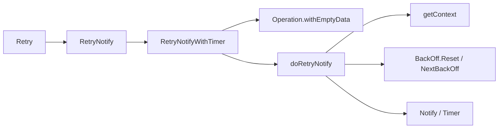

# Retry boundaries, context and stop values

Research candidate; not owner-approved, training gold or published.

Revisions: `6b0e4ad0cd65431b217393bff47d1dff727b264b` → `720b78985a65c0452fd37bb155c7cac4157a7c45`.

## Purpose

The pinned `backoff` package composes retry operations with delay policies, context wrappers and optional notification. The policy interface supplies `NextBackOff` and `Reset`; the retry loop, timer and context have different responsibilities. A policy value alone does not establish an application retry, deadline or cancellation guarantee. [source:v4.3.0:BackOff] [source:v4.3.0:Retry] [source:v4.3.0:RetryNotifyWithTimer] [source:v4.3.0:Timer] [source:v4.3.0:BackOffContext]

## Architecture

In the current cut, `Retry` delegates through `RetryNotify` and `RetryNotifyWithTimer` into generic `doRetryNotify`; `Operation.withEmptyData` adapts the no-data callback. The earlier `RetryNotifyWithTimer` contains the loop directly. The refactor changes where complete behavior evidence must be selected, even though the shared bounded observations agree. [source:v4.3.0:Retry] [source:v4.3.0:RetryNotify] [source:v4.3.0:RetryNotifyWithTimer] [source:v4.3.0:Operation.withEmptyData] [source:v4.3.0:doRetryNotify] [source:v4.1.3:RetryNotifyWithTimer]

## Dependencies and configuration

Both selected root packages use only Go standard-library imports. Their module directives change from `go 1.13` to `go 1.18` for `github.com/cenkalti/backoff/v4`. The executed context is existing Go1.27.4 Linux/ARM64 with CGO and package downloads disabled; no minimum-version or installed-distribution compatibility claim follows from those directives. [source:v4.3.0:doRetryNotify] [source:v4.3.0:WithContext] [source:v4.3.0:ExponentialBackOff.NextBackOff]

## Attempts and notification

`WithMaxRetries` counts allowed calls through its wrapper, not total operation attempts. In the frozen failing-operation observations, a limit of 0 still allowed the initial operation once, while a limit of 2 produced three attempts, two notifications and two owned timer starts. These counts apply to the shown composition and do not establish a network retry policy. [source:v4.3.0:WithMaxRetries] [source:v4.3.0:backOffTries.NextBackOff] [source:v4.3.0:doRetryNotify] [runtime:max-retries-zero,max-retries-two]

Notification occurs only after a failed non-permanent operation obtains a delay other than `Stop`, and before the timer starts. The owned order trace is reset, first operation, next delay, notification, timer start, second operation and timer stop. A final stop or permanent error produced no notification. [source:v4.3.0:doRetryNotify] [source:v4.3.0:Timer] [runtime:notify-order,stop-error,permanent-direct]

## Context boundaries

With the valid owned policy, a context canceled before retry did not prevent the first operation. An immediate successful operation returned success. A failing operation returned `context.Canceled` when the context-backed policy stopped; a permanent failure instead returned its wrapped operation error because that check precedes the backoff/context stop path. [source:v4.3.0:doRetryNotify] [source:v4.3.0:WithContext] [source:v4.3.0:backOffContext.NextBackOff] [runtime:canceled-success,canceled-error,canceled-permanent]

`getContext` recognizes a context-backed policy and recursively unwraps `backOffTries`. Both wrapper orders returned the canceled context error in the selected observations. Separately, wrapping an existing direct context wrapper with `WithContext` replaces its context rather than preserving both cancellation conditions; the observed new live context allowed the underlying zero delay despite the old canceled context. [source:v4.3.0:getContext] [source:v4.3.0:WithContext] [source:v4.3.0:backOffContext.NextBackOff] [source:v4.3.0:backOffTries.NextBackOff] [runtime:tries-outside-context,context-outside-tries,context-rewrap]

## Errors and identity

The retry loop uses `errors.As` to find `*PermanentError` even through an owned outer wrapper, then returns its inner error. `Permanent(nil)` returns `nil`. Separately, `PermanentError.Is` recognizes the wrapper type regardless of the compared inner errors, while `Unwrap` exposes the inner error. These are distinct class-match and error-identity relationships. [source:v4.3.0:doRetryNotify] [source:v4.3.0:Permanent] [source:v4.3.0:PermanentError.Is] [source:v4.3.0:PermanentError.Unwrap] [runtime:permanent-direct,permanent-wrapped,permanent-nil,permanent-is-class,permanent-unwrap]

The loop defers `Timer.Stop`. Owned panics from the operation, notification and timer-start callbacks propagated to the driver recovery while the owned timer stop count was one. This is bounded cleanup evidence, not a claim that the library catches callback panics, restores application state or provides crash recovery. [source:v4.3.0:doRetryNotify] [source:v4.3.0:Timer] [runtime:operation-panic,notify-panic,timer-start-panic]

## Stop sentinel and elapsed budget

`WithRetryStopDuration` assigns `ExponentialBackOff.Stop`; it does not set `MaxElapsedTime`. The policy can return that configured value after its elapsed-plus-next-delay check, while the retry loop compares against package `Stop`, whose value is -1. With a configured positive 5 ms stop value and an owned expired clock, the observed loop scheduled that value and made a second successful attempt. The same effect existed through the earlier public field; the new option is not a newly introduced runtime effect. [source:v4.3.0:WithRetryStopDuration] [source:v4.3.0:ExponentialBackOff.NextBackOff] [source:v4.3.0:doRetryNotify] [source:v4.1.3:ExponentialBackOff.NextBackOff] [source:v4.1.3:RetryNotifyWithTimer] [runtime:exp-custom-stop,custom-positive-stop-retry,positive-stop-option-retry]

The next-delay check includes both elapsed time and the proposed wait, so the owned policy could return `Stop` at elapsed time zero when its first delay exceeded the budget. A separately configured initial interval above the maximum interval produced 100 ms and then 50 ms with jitter output disabled. The selected code does not validate those caller settings or guarantee every proposed delay is within the configured maximum. [source:v4.3.0:ExponentialBackOff.NextBackOff] [source:v4.3.0:ExponentialBackOff.incrementCurrentInterval] [source:v4.3.0:ExponentialBackOff.Reset] [source:v4.3.0:getRandomValueFromInterval] [runtime:exp-predicted-wait-cutoff,exp-initial-over-cap,exp-growth]

## Inputs and outputs

The current generic loop returns the latest operation data even on its final error paths. Owned observations returned data 73 with the operation error, 91 with the inner permanent error and 17 with cancellation; success returned 42. Do not describe every error result as zero data, and do not infer useful application data from these synthetic values. [source:v4.3.0:OperationWithData] [source:v4.3.0:RetryNotifyWithTimerAndData] [source:v4.3.0:doRetryNotify] [runtime:generic-final-error,generic-permanent,generic-cancel,generic-success]

## Source compatibility

Adding variadic constructor options preserved the compiled zero-argument call, but changed function type assignability: an owned `func() *backoff.ExponentialBackOff` factory assignment compiled before and failed in the new cut. The variadic factory type, option call and generic data function compiled only in the current cut; the existing retry-with-timer function type compiled in both. This is six consumer shapes, not full API compatibility. [source:v4.3.0:NewExponentialBackOff] [source:v4.3.0:ExponentialBackOffOpts] [source:v4.1.3:NewExponentialBackOff] [source:v4.3.0:RetryNotifyWithTimer] [compiler:zero-argument-call,zero-argument-factory-type,variadic-factory-type,option-call,generic-data-function,stable-retry-timer-type]

Constructor options run in order before `Reset`; the last observed initial-interval option won, and the owned clock was read once during construction. Supplying a nil clock option panicked in the bounded observation. The setter names do not imply configuration validation or a guaranteed valid clock. [source:v4.3.0:NewExponentialBackOff] [source:v4.3.0:WithInitialInterval] [source:v4.3.0:WithClockProvider] [source:v4.3.0:ExponentialBackOff.Reset] [runtime:constructor-options,constructor-option-order,nil-clock-option-panic]

## Limitations

Thirty shared frozen scenarios matched once per source cut, and eight current-only API scenarios matched in the current cut. Six compile-only consumer shapes were checked per cut. The retry observations used owned synchronous timer channels and clocks: no real sleeping, retry timer, ticker, network request or upstream test was used. No other operating system, race safety, arbitrary callback behavior or installed dependency identity was certified. [source:v4.3.0:doRetryNotify] [source:v4.3.0:Timer] [source:v4.3.0:getContext]

## Illustrative example and command

Illustrative and unexecuted; no output or installation success is claimed.

```go
package example

import (
    "errors"
    backoff "github.com/cenkalti/backoff/v4"
)

func Once() error {
    return backoff.Retry(func() error {
        return backoff.Permanent(errors.New("illustrative failure"))
    }, &backoff.StopBackOff{})
}
```

```sh
go doc github.com/cenkalti/backoff/v4.RetryNotifyWithTimer
```

[source:v4.3.0:Retry] [source:v4.3.0:Permanent] [source:v4.3.0:StopBackOff.NextBackOff]

## Source map

| File | Responsibility |
|---|---|
| `retry.go` | Operation, permanent-error checks, generic loop |
| `context.go` | Context replacement and extraction |
| `tries.go` | Retry-count wrapper |
| `exponential.go` | Intervals, clock and configured stop value |
| `timer.go` | Timer interface and default implementation |

## Written relationships



[source:v4.3.0:Retry] [source:v4.3.0:RetryNotify] [source:v4.3.0:RetryNotifyWithTimer] [source:v4.3.0:doRetryNotify]

## FAQ

### Does a retry limit of zero prevent the initial operation?

`WithMaxRetries` counts allowed calls through its wrapper, not total operation attempts. In the frozen failing-operation observations, a limit of 0 still allowed the initial operation once, while a limit of 2 produced three attempts, two notifications and two owned timer starts. These counts apply to the shown composition and do not establish a network retry policy. [source:v4.3.0:WithMaxRetries] [source:v4.3.0:backOffTries.NextBackOff] [source:v4.3.0:doRetryNotify]

### Does prior cancellation always prevent the operation or override a permanent error?

With the valid owned policy, a context canceled before retry did not prevent the first operation. An immediate successful operation returned success. A failing operation returned `context.Canceled` when the context-backed policy stopped; a permanent failure instead returned its wrapped operation error because that check precedes the backoff/context stop path. [source:v4.3.0:doRetryNotify] [source:v4.3.0:WithContext] [source:v4.3.0:backOffContext.NextBackOff]

### Does the stop-duration option set an elapsed-time deadline?

`WithRetryStopDuration` assigns `ExponentialBackOff.Stop`; it does not set `MaxElapsedTime`. The policy can return that configured value after its elapsed-plus-next-delay check, while the retry loop compares against package `Stop`, whose value is -1. With a configured positive 5 ms stop value and an owned expired clock, the observed loop scheduled that value and made a second successful attempt. The same effect existed through the earlier public field; the new option is not a newly introduced runtime effect. [source:v4.3.0:WithRetryStopDuration] [source:v4.3.0:ExponentialBackOff.NextBackOff] [source:v4.3.0:doRetryNotify] [source:v4.1.3:ExponentialBackOff.NextBackOff] [source:v4.1.3:RetryNotifyWithTimer]

### Must final error data be zero in the generic API?

The current generic loop returns the latest operation data even on its final error paths. Owned observations returned data 73 with the operation error, 91 with the inner permanent error and 17 with cancellation; success returned 42. Do not describe every error result as zero data, and do not infer useful application data from these synthetic values. [source:v4.3.0:OperationWithData] [source:v4.3.0:RetryNotifyWithTimerAndData] [source:v4.3.0:doRetryNotify]

### Are zero-argument calls and zero-argument factory types equally compatible?

Adding variadic constructor options preserved the compiled zero-argument call, but changed function type assignability: an owned `func() *backoff.ExponentialBackOff` factory assignment compiled before and failed in the new cut. The variadic factory type, option call and generic data function compiled only in the current cut; the existing retry-with-timer function type compiled in both. This is six consumer shapes, not full API compatibility. [source:v4.3.0:NewExponentialBackOff] [source:v4.3.0:ExponentialBackOffOpts] [source:v4.1.3:NewExponentialBackOff] [source:v4.3.0:RetryNotifyWithTimer]

### Is every failed attempt notified?

Notification occurs only after a failed non-permanent operation obtains a delay other than `Stop`, and before the timer starts. The owned order trace is reset, first operation, next delay, notification, timer start, second operation and timer stop. A final stop or permanent error produced no notification. [source:v4.3.0:doRetryNotify] [source:v4.3.0:Timer]

### Does matching a permanent wrapper prove equal inner errors?

The retry loop uses `errors.As` to find `*PermanentError` even through an owned outer wrapper, then returns its inner error. `Permanent(nil)` returns `nil`. Separately, `PermanentError.Is` recognizes the wrapper type regardless of the compared inner errors, while `Unwrap` exposes the inner error. These are distinct class-match and error-identity relationships. [source:v4.3.0:doRetryNotify] [source:v4.3.0:Permanent] [source:v4.3.0:PermanentError.Is] [source:v4.3.0:PermanentError.Unwrap]

## Evidence and license

[Runtime receipt](../backoff-confined-runtime-results-v1.json); [consumer compilation receipt](../backoff-source-compatibility-results-v1.json).

- [source:v4.1.3:ExponentialBackOff.NextBackOff] [exponential.go:116–125](https://github.com/cenkalti/backoff/blob/6b0e4ad0cd65431b217393bff47d1dff727b264b/exponential.go#L116-L125); SHA-256 `73492c2d55e59b5c1132a786f565bcfe64213951ffd740d944001b701bb7c41d`.
- [source:v4.1.3:NewExponentialBackOff] [exponential.go:84–96](https://github.com/cenkalti/backoff/blob/6b0e4ad0cd65431b217393bff47d1dff727b264b/exponential.go#L84-L96); SHA-256 `73492c2d55e59b5c1132a786f565bcfe64213951ffd740d944001b701bb7c41d`.
- [source:v4.1.3:RetryNotifyWithTimer] [retry.go:40–84](https://github.com/cenkalti/backoff/blob/6b0e4ad0cd65431b217393bff47d1dff727b264b/retry.go#L40-L84); SHA-256 `a684fbb371daca15fcf4100d67e88430aec6117d4353736ff9ae87cad70bf59b`.
- [source:v4.3.0:BackOff] [backoff.go:16–33](https://github.com/cenkalti/backoff/blob/720b78985a65c0452fd37bb155c7cac4157a7c45/backoff.go#L16-L33); SHA-256 `29ac6bfd43e1a21d838f1ccf459cdeb46b93c9246bf7666d5216b3426ecaed35`.
- [source:v4.3.0:BackOffContext] [context.go:10–13](https://github.com/cenkalti/backoff/blob/720b78985a65c0452fd37bb155c7cac4157a7c45/context.go#L10-L13); SHA-256 `b7884b0062bafb41eb9f7032f64704a55280fd6fc6a42d260c50637582982514`.
- [source:v4.3.0:ExponentialBackOff.NextBackOff] [exponential.go:171–180](https://github.com/cenkalti/backoff/blob/720b78985a65c0452fd37bb155c7cac4157a7c45/exponential.go#L171-L180); SHA-256 `cd5e77b2c07db015cae3d8ad5224600f73db66b8d5f8bf1f75b73051689ddcfc`.
- [source:v4.3.0:ExponentialBackOff.Reset] [exponential.go:164–167](https://github.com/cenkalti/backoff/blob/720b78985a65c0452fd37bb155c7cac4157a7c45/exponential.go#L164-L167); SHA-256 `cd5e77b2c07db015cae3d8ad5224600f73db66b8d5f8bf1f75b73051689ddcfc`.
- [source:v4.3.0:ExponentialBackOff.incrementCurrentInterval] [exponential.go:193–200](https://github.com/cenkalti/backoff/blob/720b78985a65c0452fd37bb155c7cac4157a7c45/exponential.go#L193-L200); SHA-256 `cd5e77b2c07db015cae3d8ad5224600f73db66b8d5f8bf1f75b73051689ddcfc`.
- [source:v4.3.0:ExponentialBackOffOpts] [exponential.go:75–75](https://github.com/cenkalti/backoff/blob/720b78985a65c0452fd37bb155c7cac4157a7c45/exponential.go#L75-L75); SHA-256 `cd5e77b2c07db015cae3d8ad5224600f73db66b8d5f8bf1f75b73051689ddcfc`.
- [source:v4.3.0:NewExponentialBackOff] [exponential.go:87–102](https://github.com/cenkalti/backoff/blob/720b78985a65c0452fd37bb155c7cac4157a7c45/exponential.go#L87-L102); SHA-256 `cd5e77b2c07db015cae3d8ad5224600f73db66b8d5f8bf1f75b73051689ddcfc`.
- [source:v4.3.0:Operation.withEmptyData] [retry.go:16–20](https://github.com/cenkalti/backoff/blob/720b78985a65c0452fd37bb155c7cac4157a7c45/retry.go#L16-L20); SHA-256 `b21e168bb7e9cef042818138ed24658db1ad314ef740218dc3b61725e2cd3212`.
- [source:v4.3.0:OperationWithData] [retry.go:10–10](https://github.com/cenkalti/backoff/blob/720b78985a65c0452fd37bb155c7cac4157a7c45/retry.go#L10-L10); SHA-256 `b21e168bb7e9cef042818138ed24658db1ad314ef740218dc3b61725e2cd3212`.
- [source:v4.3.0:Permanent] [retry.go:139–146](https://github.com/cenkalti/backoff/blob/720b78985a65c0452fd37bb155c7cac4157a7c45/retry.go#L139-L146); SHA-256 `b21e168bb7e9cef042818138ed24658db1ad314ef740218dc3b61725e2cd3212`.
- [source:v4.3.0:PermanentError.Is] [retry.go:133–136](https://github.com/cenkalti/backoff/blob/720b78985a65c0452fd37bb155c7cac4157a7c45/retry.go#L133-L136); SHA-256 `b21e168bb7e9cef042818138ed24658db1ad314ef740218dc3b61725e2cd3212`.
- [source:v4.3.0:PermanentError.Unwrap] [retry.go:129–131](https://github.com/cenkalti/backoff/blob/720b78985a65c0452fd37bb155c7cac4157a7c45/retry.go#L129-L131); SHA-256 `b21e168bb7e9cef042818138ed24658db1ad314ef740218dc3b61725e2cd3212`.
- [source:v4.3.0:Retry] [retry.go:37–39](https://github.com/cenkalti/backoff/blob/720b78985a65c0452fd37bb155c7cac4157a7c45/retry.go#L37-L39); SHA-256 `b21e168bb7e9cef042818138ed24658db1ad314ef740218dc3b61725e2cd3212`.
- [source:v4.3.0:RetryNotify] [retry.go:48–50](https://github.com/cenkalti/backoff/blob/720b78985a65c0452fd37bb155c7cac4157a7c45/retry.go#L48-L50); SHA-256 `b21e168bb7e9cef042818138ed24658db1ad314ef740218dc3b61725e2cd3212`.
- [source:v4.3.0:RetryNotifyWithTimer] [retry.go:60–63](https://github.com/cenkalti/backoff/blob/720b78985a65c0452fd37bb155c7cac4157a7c45/retry.go#L60-L63); SHA-256 `b21e168bb7e9cef042818138ed24658db1ad314ef740218dc3b61725e2cd3212`.
- [source:v4.3.0:RetryNotifyWithTimerAndData] [retry.go:66–68](https://github.com/cenkalti/backoff/blob/720b78985a65c0452fd37bb155c7cac4157a7c45/retry.go#L66-L68); SHA-256 `b21e168bb7e9cef042818138ed24658db1ad314ef740218dc3b61725e2cd3212`.
- [source:v4.3.0:StopBackOff.NextBackOff] [backoff.go:52–52](https://github.com/cenkalti/backoff/blob/720b78985a65c0452fd37bb155c7cac4157a7c45/backoff.go#L52-L52); SHA-256 `29ac6bfd43e1a21d838f1ccf459cdeb46b93c9246bf7666d5216b3426ecaed35`.
- [source:v4.3.0:Timer] [timer.go:5–9](https://github.com/cenkalti/backoff/blob/720b78985a65c0452fd37bb155c7cac4157a7c45/timer.go#L5-L9); SHA-256 `573cf5acb47aed687ec55dededb00a18ad82429ee9ad0e9ca60c4872197a2c89`.
- [source:v4.3.0:WithClockProvider] [exponential.go:147–151](https://github.com/cenkalti/backoff/blob/720b78985a65c0452fd37bb155c7cac4157a7c45/exponential.go#L147-L151); SHA-256 `cd5e77b2c07db015cae3d8ad5224600f73db66b8d5f8bf1f75b73051689ddcfc`.
- [source:v4.3.0:WithContext] [context.go:23–39](https://github.com/cenkalti/backoff/blob/720b78985a65c0452fd37bb155c7cac4157a7c45/context.go#L23-L39); SHA-256 `b7884b0062bafb41eb9f7032f64704a55280fd6fc6a42d260c50637582982514`.
- [source:v4.3.0:WithInitialInterval] [exponential.go:105–109](https://github.com/cenkalti/backoff/blob/720b78985a65c0452fd37bb155c7cac4157a7c45/exponential.go#L105-L109); SHA-256 `cd5e77b2c07db015cae3d8ad5224600f73db66b8d5f8bf1f75b73051689ddcfc`.
- [source:v4.3.0:WithMaxRetries] [tries.go:12–14](https://github.com/cenkalti/backoff/blob/720b78985a65c0452fd37bb155c7cac4157a7c45/tries.go#L12-L14); SHA-256 `4dfae8898960edaf75a4d0c75deb7fd49b04b7ea06d7d665fc9043a411040ed8`.
- [source:v4.3.0:WithRetryStopDuration] [exponential.go:140–144](https://github.com/cenkalti/backoff/blob/720b78985a65c0452fd37bb155c7cac4157a7c45/exponential.go#L140-L144); SHA-256 `cd5e77b2c07db015cae3d8ad5224600f73db66b8d5f8bf1f75b73051689ddcfc`.
- [source:v4.3.0:backOffContext.NextBackOff] [context.go:55–62](https://github.com/cenkalti/backoff/blob/720b78985a65c0452fd37bb155c7cac4157a7c45/context.go#L55-L62); SHA-256 `b7884b0062bafb41eb9f7032f64704a55280fd6fc6a42d260c50637582982514`.
- [source:v4.3.0:backOffTries.NextBackOff] [tries.go:22–33](https://github.com/cenkalti/backoff/blob/720b78985a65c0452fd37bb155c7cac4157a7c45/tries.go#L22-L33); SHA-256 `4dfae8898960edaf75a4d0c75deb7fd49b04b7ea06d7d665fc9043a411040ed8`.
- [source:v4.3.0:doRetryNotify] [retry.go:70–118](https://github.com/cenkalti/backoff/blob/720b78985a65c0452fd37bb155c7cac4157a7c45/retry.go#L70-L118); SHA-256 `b21e168bb7e9cef042818138ed24658db1ad314ef740218dc3b61725e2cd3212`.
- [source:v4.3.0:getContext] [context.go:41–49](https://github.com/cenkalti/backoff/blob/720b78985a65c0452fd37bb155c7cac4157a7c45/context.go#L41-L49); SHA-256 `b7884b0062bafb41eb9f7032f64704a55280fd6fc6a42d260c50637582982514`.
- [source:v4.3.0:getRandomValueFromInterval] [exponential.go:204–216](https://github.com/cenkalti/backoff/blob/720b78985a65c0452fd37bb155c7cac4157a7c45/exponential.go#L204-L216); SHA-256 `cd5e77b2c07db015cae3d8ad5224600f73db66b8d5f8bf1f75b73051689ddcfc`.
- v4.1.3 [LICENSE](../new-public-sources-v1/cenkalti--backoff/6b0e4ad0cd65431b217393bff47d1dff727b264b/LICENSE); SHA-256 `5c0476add4c38b55d0ed5ac11b85e00c38f26e1caee20dfe3ab58190103d1fbc`.
- v4.1.3 [go.mod](../new-public-sources-v1/cenkalti--backoff/6b0e4ad0cd65431b217393bff47d1dff727b264b/go.mod); SHA-256 `f54b1c855a5145feee56fd87359baf2487fe886b10b1925e376da14640958e97`.
- v4.3.0 [LICENSE](../new-public-sources-v1/cenkalti--backoff/720b78985a65c0452fd37bb155c7cac4157a7c45/LICENSE); SHA-256 `5c0476add4c38b55d0ed5ac11b85e00c38f26e1caee20dfe3ab58190103d1fbc`.
- v4.3.0 [go.mod](../new-public-sources-v1/cenkalti--backoff/720b78985a65c0452fd37bb155c7cac4157a7c45/go.mod); SHA-256 `83d4122d49127f13cda95fb79397cfe516c23cdd7fc07a2886ad764dd1422be3`.
