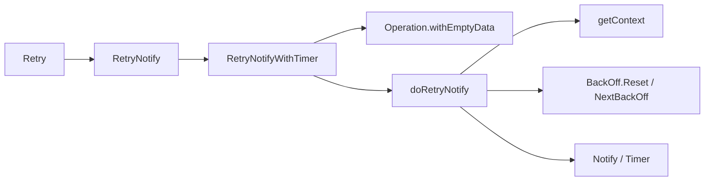

# Limites da repetição, contexto e valores de parada

Candidato de pesquisa; sem aprovação do proprietário, gold de treinamento ou publicação.

Revisions: `6b0e4ad0cd65431b217393bff47d1dff727b264b` → `720b78985a65c0452fd37bb155c7cac4157a7c45`.

## Propósito

O pacote `backoff` fixado compõe operações de repetição com políticas de atraso, wrappers de contexto e notificação opcional. A interface da política fornece `NextBackOff` e `Reset`; o laço de repetição, o timer e o contexto possuem responsabilidades distintas. Um valor de política sozinho não estabelece garantia de repetição, prazo ou cancelamento de uma aplicação. [source:v4.3.0:BackOff] [source:v4.3.0:Retry] [source:v4.3.0:RetryNotifyWithTimer] [source:v4.3.0:Timer] [source:v4.3.0:BackOffContext]

## Arquitetura

No recorte atual, `Retry` delega por `RetryNotify` e `RetryNotifyWithTimer` até o auxiliar genérico `doRetryNotify`; `Operation.withEmptyData` adapta o callback sem dados. O `RetryNotifyWithTimer` anterior contém o laço diretamente. A refatoração muda onde a evidência completa de comportamento precisa ser selecionada, embora as observações limitadas compartilhadas coincidam. [source:v4.3.0:Retry] [source:v4.3.0:RetryNotify] [source:v4.3.0:RetryNotifyWithTimer] [source:v4.3.0:Operation.withEmptyData] [source:v4.3.0:doRetryNotify] [source:v4.1.3:RetryNotifyWithTimer]

## Dependências e configuração

Os dois pacotes raiz selecionados usam apenas imports da biblioteca padrão Go. Suas diretivas de módulo mudam de `go 1.13` para `go 1.18` em `github.com/cenkalti/backoff/v4`. O contexto executado é o Go1.27.4 existente em Linux/ARM64, com CGO e downloads de pacotes desativados; dessas diretivas não decorre alegação de compatibilidade com versão mínima ou distribuição instalada. [source:v4.3.0:doRetryNotify] [source:v4.3.0:WithContext] [source:v4.3.0:ExponentialBackOff.NextBackOff]

## Tentativas e notificação

`WithMaxRetries` conta chamadas permitidas por seu wrapper, não o total de tentativas da operação. Nas observações congeladas com operação que falha, um limite de 0 ainda permitiu a operação inicial uma vez, enquanto um limite de 2 produziu três tentativas, duas notificações e duas partidas do timer próprio. Essas contagens valem para a composição mostrada e não estabelecem uma política de repetição de rede. [source:v4.3.0:WithMaxRetries] [source:v4.3.0:backOffTries.NextBackOff] [source:v4.3.0:doRetryNotify] [runtime:max-retries-zero,max-retries-two]

A notificação ocorre apenas depois que uma operação não permanente que falhou obtém um atraso diferente de `Stop`, e antes da partida do timer. O rastreamento próprio de ordem é reset, primeira operação, próximo atraso, notificação, partida do timer, segunda operação e parada do timer. Uma parada final ou um erro permanente não produziu notificação. [source:v4.3.0:doRetryNotify] [source:v4.3.0:Timer] [runtime:notify-order,stop-error,permanent-direct]

## Limites de contexto

Com a política própria válida, um contexto cancelado antes da repetição não impediu a primeira operação. Uma operação imediatamente bem-sucedida retornou sucesso. Uma operação que falhou retornou `context.Canceled` quando a política apoiada no contexto parou; uma falha permanente retornou seu erro de operação encapsulado, pois essa verificação precede o caminho de parada da política e do contexto. [source:v4.3.0:doRetryNotify] [source:v4.3.0:WithContext] [source:v4.3.0:backOffContext.NextBackOff] [runtime:canceled-success,canceled-error,canceled-permanent]

`getContext` reconhece uma política apoiada no contexto e desembrulha recursivamente `backOffTries`. As duas ordens de wrappers retornaram o erro de contexto cancelado nas observações selecionadas. Separadamente, envolver um wrapper direto de contexto existente com `WithContext` substitui seu contexto, em vez de preservar as duas condições de cancelamento; o novo contexto ativo observado permitiu o atraso zero subjacente apesar do contexto antigo cancelado. [source:v4.3.0:getContext] [source:v4.3.0:WithContext] [source:v4.3.0:backOffContext.NextBackOff] [source:v4.3.0:backOffTries.NextBackOff] [runtime:tries-outside-context,context-outside-tries,context-rewrap]

## Erros e identidade

O laço de repetição usa `errors.As` para encontrar `*PermanentError` mesmo através de um wrapper externo próprio, e então retorna seu erro interno. `Permanent(nil)` retorna `nil`. Separadamente, `PermanentError.Is` reconhece o tipo do wrapper independentemente dos erros internos comparados, enquanto `Unwrap` expõe o erro interno. São relações distintas de correspondência de classe e identidade de erro. [source:v4.3.0:doRetryNotify] [source:v4.3.0:Permanent] [source:v4.3.0:PermanentError.Is] [source:v4.3.0:PermanentError.Unwrap] [runtime:permanent-direct,permanent-wrapped,permanent-nil,permanent-is-class,permanent-unwrap]

O laço adia `Timer.Stop`. Panics próprios dos callbacks de operação, notificação e partida do timer propagaram até a recuperação do driver, enquanto a contagem de parada do timer próprio foi um. Isso é evidência limitada de limpeza, não alegação de que a biblioteca captura panics de callbacks, restaura estado da aplicação ou fornece recuperação de falhas. [source:v4.3.0:doRetryNotify] [source:v4.3.0:Timer] [runtime:operation-panic,notify-panic,timer-start-panic]

## Sentinela de parada e limite decorrido

`WithRetryStopDuration` atribui `ExponentialBackOff.Stop`; não define `MaxElapsedTime`. A política pode retornar esse valor configurado após verificar tempo decorrido mais próximo atraso, enquanto o laço de repetição compara com `Stop` do pacote, cujo valor é -1. Com valor de parada positivo de 5 ms e relógio próprio expirado, o laço observado agendou esse valor e realizou uma segunda tentativa bem-sucedida. O mesmo efeito existia pelo campo público anterior; a nova opção não é um efeito de execução recém-introduzido. [source:v4.3.0:WithRetryStopDuration] [source:v4.3.0:ExponentialBackOff.NextBackOff] [source:v4.3.0:doRetryNotify] [source:v4.1.3:ExponentialBackOff.NextBackOff] [source:v4.1.3:RetryNotifyWithTimer] [runtime:exp-custom-stop,custom-positive-stop-retry,positive-stop-option-retry]

A verificação do próximo atraso inclui tanto o tempo decorrido quanto a espera proposta, de modo que a política própria pôde retornar `Stop` com tempo decorrido zero quando seu primeiro atraso excedia o limite. Um intervalo inicial configurado separadamente acima do intervalo máximo produziu 100 ms e depois 50 ms com a saída de jitter desativada. O código selecionado não valida essas configurações do chamador nem garante que todo atraso proposto esteja dentro do máximo configurado. [source:v4.3.0:ExponentialBackOff.NextBackOff] [source:v4.3.0:ExponentialBackOff.incrementCurrentInterval] [source:v4.3.0:ExponentialBackOff.Reset] [source:v4.3.0:getRandomValueFromInterval] [runtime:exp-predicted-wait-cutoff,exp-initial-over-cap,exp-growth]

## Entradas e saídas

O laço genérico atual retorna os dados mais recentes da operação mesmo em seus caminhos finais de erro. As observações próprias retornaram dados 73 com o erro da operação, 91 com o erro permanente interno e 17 com cancelamento; o sucesso retornou 42. Não descreva todo resultado de erro como dados zerados, nem deduza dados úteis de aplicação desses valores sintéticos. [source:v4.3.0:OperationWithData] [source:v4.3.0:RetryNotifyWithTimerAndData] [source:v4.3.0:doRetryNotify] [runtime:generic-final-error,generic-permanent,generic-cancel,generic-success]

## Compatibilidade de código

Adicionar opções variádicas ao construtor preservou a chamada compilada sem argumentos, mas mudou a atribuição entre tipos de função: uma atribuição própria de fábrica `func() *backoff.ExponentialBackOff` compilou antes e falhou no novo recorte. O tipo de fábrica variádica, a chamada com opção e a função genérica de dados compilaram apenas no recorte atual; o tipo existente da função de repetição com timer compilou nos dois. São seis formas de consumo, não compatibilidade completa da API. [source:v4.3.0:NewExponentialBackOff] [source:v4.3.0:ExponentialBackOffOpts] [source:v4.1.3:NewExponentialBackOff] [source:v4.3.0:RetryNotifyWithTimer] [compiler:zero-argument-call,zero-argument-factory-type,variadic-factory-type,option-call,generic-data-function,stable-retry-timer-type]

As opções do construtor são executadas em ordem antes de `Reset`; a última opção observada de intervalo inicial prevaleceu, e o relógio próprio foi lido uma vez durante a construção. Fornecer uma opção de relógio nulo produziu panic na observação limitada. Os nomes dos setters não implicam validação de configuração nem garantia de relógio válido. [source:v4.3.0:NewExponentialBackOff] [source:v4.3.0:WithInitialInterval] [source:v4.3.0:WithClockProvider] [source:v4.3.0:ExponentialBackOff.Reset] [runtime:constructor-options,constructor-option-order,nil-clock-option-panic]

## Limitações

Trinta cenários congelados compartilhados coincidiram uma vez por recorte de código, e oito cenários de APIs apenas atuais coincidiram no recorte atual. Seis formas de consumo apenas compiladas foram verificadas por recorte. As observações de repetição usaram canais síncronos de timer e relógios próprios: nenhuma espera real, timer de repetição, ticker, requisição de rede ou teste externo foi usado. Nenhum outro sistema operacional, segurança contra condições de corrida, comportamento de callback arbitrário ou identidade de dependência instalada foi certificado. [source:v4.3.0:doRetryNotify] [source:v4.3.0:Timer] [source:v4.3.0:getContext]

## Exemplo e comando ilustrativos

Ilustrativos e não executados; nenhuma saída ou instalação bem-sucedida é afirmada.

```go
package example

import (
    "errors"
    backoff "github.com/cenkalti/backoff/v4"
)

func Once() error {
    return backoff.Retry(func() error {
        return backoff.Permanent(errors.New("illustrative failure"))
    }, &backoff.StopBackOff{})
}
```

```sh
go doc github.com/cenkalti/backoff/v4.RetryNotifyWithTimer
```

[source:v4.3.0:Retry] [source:v4.3.0:Permanent] [source:v4.3.0:StopBackOff.NextBackOff]

## Mapa do código

| File | Responsabilidade |
|---|---|
| `retry.go` | Operação, verificações de erro permanente, laço genérico |
| `context.go` | Substituição e extração de contexto |
| `tries.go` | Wrapper de contagem de repetição |
| `exponential.go` | Intervalos, relógio e valor de parada configurado |
| `timer.go` | Interface do timer e implementação padrão |

## Relações escritas



[source:v4.3.0:Retry] [source:v4.3.0:RetryNotify] [source:v4.3.0:RetryNotifyWithTimer] [source:v4.3.0:doRetryNotify]

## FAQ

### Um limite de repetição zero impede a operação inicial?

`WithMaxRetries` conta chamadas permitidas por seu wrapper, não o total de tentativas da operação. Nas observações congeladas com operação que falha, um limite de 0 ainda permitiu a operação inicial uma vez, enquanto um limite de 2 produziu três tentativas, duas notificações e duas partidas do timer próprio. Essas contagens valem para a composição mostrada e não estabelecem uma política de repetição de rede. [source:v4.3.0:WithMaxRetries] [source:v4.3.0:backOffTries.NextBackOff] [source:v4.3.0:doRetryNotify]

### O cancelamento anterior sempre impede a operação ou substitui um erro permanente?

Com a política própria válida, um contexto cancelado antes da repetição não impediu a primeira operação. Uma operação imediatamente bem-sucedida retornou sucesso. Uma operação que falhou retornou `context.Canceled` quando a política apoiada no contexto parou; uma falha permanente retornou seu erro de operação encapsulado, pois essa verificação precede o caminho de parada da política e do contexto. [source:v4.3.0:doRetryNotify] [source:v4.3.0:WithContext] [source:v4.3.0:backOffContext.NextBackOff]

### A opção de duração de parada define um prazo de tempo decorrido?

`WithRetryStopDuration` atribui `ExponentialBackOff.Stop`; não define `MaxElapsedTime`. A política pode retornar esse valor configurado após verificar tempo decorrido mais próximo atraso, enquanto o laço de repetição compara com `Stop` do pacote, cujo valor é -1. Com valor de parada positivo de 5 ms e relógio próprio expirado, o laço observado agendou esse valor e realizou uma segunda tentativa bem-sucedida. O mesmo efeito existia pelo campo público anterior; a nova opção não é um efeito de execução recém-introduzido. [source:v4.3.0:WithRetryStopDuration] [source:v4.3.0:ExponentialBackOff.NextBackOff] [source:v4.3.0:doRetryNotify] [source:v4.1.3:ExponentialBackOff.NextBackOff] [source:v4.1.3:RetryNotifyWithTimer]

### Os dados finais de erro precisam ser zero na API genérica?

O laço genérico atual retorna os dados mais recentes da operação mesmo em seus caminhos finais de erro. As observações próprias retornaram dados 73 com o erro da operação, 91 com o erro permanente interno e 17 com cancelamento; o sucesso retornou 42. Não descreva todo resultado de erro como dados zerados, nem deduza dados úteis de aplicação desses valores sintéticos. [source:v4.3.0:OperationWithData] [source:v4.3.0:RetryNotifyWithTimerAndData] [source:v4.3.0:doRetryNotify]

### Chamadas sem argumentos e tipos de fábrica sem argumentos são igualmente compatíveis?

Adicionar opções variádicas ao construtor preservou a chamada compilada sem argumentos, mas mudou a atribuição entre tipos de função: uma atribuição própria de fábrica `func() *backoff.ExponentialBackOff` compilou antes e falhou no novo recorte. O tipo de fábrica variádica, a chamada com opção e a função genérica de dados compilaram apenas no recorte atual; o tipo existente da função de repetição com timer compilou nos dois. São seis formas de consumo, não compatibilidade completa da API. [source:v4.3.0:NewExponentialBackOff] [source:v4.3.0:ExponentialBackOffOpts] [source:v4.1.3:NewExponentialBackOff] [source:v4.3.0:RetryNotifyWithTimer]

### Toda tentativa que falha é notificada?

A notificação ocorre apenas depois que uma operação não permanente que falhou obtém um atraso diferente de `Stop`, e antes da partida do timer. O rastreamento próprio de ordem é reset, primeira operação, próximo atraso, notificação, partida do timer, segunda operação e parada do timer. Uma parada final ou um erro permanente não produziu notificação. [source:v4.3.0:doRetryNotify] [source:v4.3.0:Timer]

### Corresponder a um wrapper permanente comprova erros internos iguais?

O laço de repetição usa `errors.As` para encontrar `*PermanentError` mesmo através de um wrapper externo próprio, e então retorna seu erro interno. `Permanent(nil)` retorna `nil`. Separadamente, `PermanentError.Is` reconhece o tipo do wrapper independentemente dos erros internos comparados, enquanto `Unwrap` expõe o erro interno. São relações distintas de correspondência de classe e identidade de erro. [source:v4.3.0:doRetryNotify] [source:v4.3.0:Permanent] [source:v4.3.0:PermanentError.Is] [source:v4.3.0:PermanentError.Unwrap]

## Evidência e licença

[Runtime receipt](../backoff-confined-runtime-results-v1.json); [consumer compilation receipt](../backoff-source-compatibility-results-v1.json).

- [source:v4.1.3:ExponentialBackOff.NextBackOff] [exponential.go:116–125](https://github.com/cenkalti/backoff/blob/6b0e4ad0cd65431b217393bff47d1dff727b264b/exponential.go#L116-L125); SHA-256 `73492c2d55e59b5c1132a786f565bcfe64213951ffd740d944001b701bb7c41d`.
- [source:v4.1.3:NewExponentialBackOff] [exponential.go:84–96](https://github.com/cenkalti/backoff/blob/6b0e4ad0cd65431b217393bff47d1dff727b264b/exponential.go#L84-L96); SHA-256 `73492c2d55e59b5c1132a786f565bcfe64213951ffd740d944001b701bb7c41d`.
- [source:v4.1.3:RetryNotifyWithTimer] [retry.go:40–84](https://github.com/cenkalti/backoff/blob/6b0e4ad0cd65431b217393bff47d1dff727b264b/retry.go#L40-L84); SHA-256 `a684fbb371daca15fcf4100d67e88430aec6117d4353736ff9ae87cad70bf59b`.
- [source:v4.3.0:BackOff] [backoff.go:16–33](https://github.com/cenkalti/backoff/blob/720b78985a65c0452fd37bb155c7cac4157a7c45/backoff.go#L16-L33); SHA-256 `29ac6bfd43e1a21d838f1ccf459cdeb46b93c9246bf7666d5216b3426ecaed35`.
- [source:v4.3.0:BackOffContext] [context.go:10–13](https://github.com/cenkalti/backoff/blob/720b78985a65c0452fd37bb155c7cac4157a7c45/context.go#L10-L13); SHA-256 `b7884b0062bafb41eb9f7032f64704a55280fd6fc6a42d260c50637582982514`.
- [source:v4.3.0:ExponentialBackOff.NextBackOff] [exponential.go:171–180](https://github.com/cenkalti/backoff/blob/720b78985a65c0452fd37bb155c7cac4157a7c45/exponential.go#L171-L180); SHA-256 `cd5e77b2c07db015cae3d8ad5224600f73db66b8d5f8bf1f75b73051689ddcfc`.
- [source:v4.3.0:ExponentialBackOff.Reset] [exponential.go:164–167](https://github.com/cenkalti/backoff/blob/720b78985a65c0452fd37bb155c7cac4157a7c45/exponential.go#L164-L167); SHA-256 `cd5e77b2c07db015cae3d8ad5224600f73db66b8d5f8bf1f75b73051689ddcfc`.
- [source:v4.3.0:ExponentialBackOff.incrementCurrentInterval] [exponential.go:193–200](https://github.com/cenkalti/backoff/blob/720b78985a65c0452fd37bb155c7cac4157a7c45/exponential.go#L193-L200); SHA-256 `cd5e77b2c07db015cae3d8ad5224600f73db66b8d5f8bf1f75b73051689ddcfc`.
- [source:v4.3.0:ExponentialBackOffOpts] [exponential.go:75–75](https://github.com/cenkalti/backoff/blob/720b78985a65c0452fd37bb155c7cac4157a7c45/exponential.go#L75-L75); SHA-256 `cd5e77b2c07db015cae3d8ad5224600f73db66b8d5f8bf1f75b73051689ddcfc`.
- [source:v4.3.0:NewExponentialBackOff] [exponential.go:87–102](https://github.com/cenkalti/backoff/blob/720b78985a65c0452fd37bb155c7cac4157a7c45/exponential.go#L87-L102); SHA-256 `cd5e77b2c07db015cae3d8ad5224600f73db66b8d5f8bf1f75b73051689ddcfc`.
- [source:v4.3.0:Operation.withEmptyData] [retry.go:16–20](https://github.com/cenkalti/backoff/blob/720b78985a65c0452fd37bb155c7cac4157a7c45/retry.go#L16-L20); SHA-256 `b21e168bb7e9cef042818138ed24658db1ad314ef740218dc3b61725e2cd3212`.
- [source:v4.3.0:OperationWithData] [retry.go:10–10](https://github.com/cenkalti/backoff/blob/720b78985a65c0452fd37bb155c7cac4157a7c45/retry.go#L10-L10); SHA-256 `b21e168bb7e9cef042818138ed24658db1ad314ef740218dc3b61725e2cd3212`.
- [source:v4.3.0:Permanent] [retry.go:139–146](https://github.com/cenkalti/backoff/blob/720b78985a65c0452fd37bb155c7cac4157a7c45/retry.go#L139-L146); SHA-256 `b21e168bb7e9cef042818138ed24658db1ad314ef740218dc3b61725e2cd3212`.
- [source:v4.3.0:PermanentError.Is] [retry.go:133–136](https://github.com/cenkalti/backoff/blob/720b78985a65c0452fd37bb155c7cac4157a7c45/retry.go#L133-L136); SHA-256 `b21e168bb7e9cef042818138ed24658db1ad314ef740218dc3b61725e2cd3212`.
- [source:v4.3.0:PermanentError.Unwrap] [retry.go:129–131](https://github.com/cenkalti/backoff/blob/720b78985a65c0452fd37bb155c7cac4157a7c45/retry.go#L129-L131); SHA-256 `b21e168bb7e9cef042818138ed24658db1ad314ef740218dc3b61725e2cd3212`.
- [source:v4.3.0:Retry] [retry.go:37–39](https://github.com/cenkalti/backoff/blob/720b78985a65c0452fd37bb155c7cac4157a7c45/retry.go#L37-L39); SHA-256 `b21e168bb7e9cef042818138ed24658db1ad314ef740218dc3b61725e2cd3212`.
- [source:v4.3.0:RetryNotify] [retry.go:48–50](https://github.com/cenkalti/backoff/blob/720b78985a65c0452fd37bb155c7cac4157a7c45/retry.go#L48-L50); SHA-256 `b21e168bb7e9cef042818138ed24658db1ad314ef740218dc3b61725e2cd3212`.
- [source:v4.3.0:RetryNotifyWithTimer] [retry.go:60–63](https://github.com/cenkalti/backoff/blob/720b78985a65c0452fd37bb155c7cac4157a7c45/retry.go#L60-L63); SHA-256 `b21e168bb7e9cef042818138ed24658db1ad314ef740218dc3b61725e2cd3212`.
- [source:v4.3.0:RetryNotifyWithTimerAndData] [retry.go:66–68](https://github.com/cenkalti/backoff/blob/720b78985a65c0452fd37bb155c7cac4157a7c45/retry.go#L66-L68); SHA-256 `b21e168bb7e9cef042818138ed24658db1ad314ef740218dc3b61725e2cd3212`.
- [source:v4.3.0:StopBackOff.NextBackOff] [backoff.go:52–52](https://github.com/cenkalti/backoff/blob/720b78985a65c0452fd37bb155c7cac4157a7c45/backoff.go#L52-L52); SHA-256 `29ac6bfd43e1a21d838f1ccf459cdeb46b93c9246bf7666d5216b3426ecaed35`.
- [source:v4.3.0:Timer] [timer.go:5–9](https://github.com/cenkalti/backoff/blob/720b78985a65c0452fd37bb155c7cac4157a7c45/timer.go#L5-L9); SHA-256 `573cf5acb47aed687ec55dededb00a18ad82429ee9ad0e9ca60c4872197a2c89`.
- [source:v4.3.0:WithClockProvider] [exponential.go:147–151](https://github.com/cenkalti/backoff/blob/720b78985a65c0452fd37bb155c7cac4157a7c45/exponential.go#L147-L151); SHA-256 `cd5e77b2c07db015cae3d8ad5224600f73db66b8d5f8bf1f75b73051689ddcfc`.
- [source:v4.3.0:WithContext] [context.go:23–39](https://github.com/cenkalti/backoff/blob/720b78985a65c0452fd37bb155c7cac4157a7c45/context.go#L23-L39); SHA-256 `b7884b0062bafb41eb9f7032f64704a55280fd6fc6a42d260c50637582982514`.
- [source:v4.3.0:WithInitialInterval] [exponential.go:105–109](https://github.com/cenkalti/backoff/blob/720b78985a65c0452fd37bb155c7cac4157a7c45/exponential.go#L105-L109); SHA-256 `cd5e77b2c07db015cae3d8ad5224600f73db66b8d5f8bf1f75b73051689ddcfc`.
- [source:v4.3.0:WithMaxRetries] [tries.go:12–14](https://github.com/cenkalti/backoff/blob/720b78985a65c0452fd37bb155c7cac4157a7c45/tries.go#L12-L14); SHA-256 `4dfae8898960edaf75a4d0c75deb7fd49b04b7ea06d7d665fc9043a411040ed8`.
- [source:v4.3.0:WithRetryStopDuration] [exponential.go:140–144](https://github.com/cenkalti/backoff/blob/720b78985a65c0452fd37bb155c7cac4157a7c45/exponential.go#L140-L144); SHA-256 `cd5e77b2c07db015cae3d8ad5224600f73db66b8d5f8bf1f75b73051689ddcfc`.
- [source:v4.3.0:backOffContext.NextBackOff] [context.go:55–62](https://github.com/cenkalti/backoff/blob/720b78985a65c0452fd37bb155c7cac4157a7c45/context.go#L55-L62); SHA-256 `b7884b0062bafb41eb9f7032f64704a55280fd6fc6a42d260c50637582982514`.
- [source:v4.3.0:backOffTries.NextBackOff] [tries.go:22–33](https://github.com/cenkalti/backoff/blob/720b78985a65c0452fd37bb155c7cac4157a7c45/tries.go#L22-L33); SHA-256 `4dfae8898960edaf75a4d0c75deb7fd49b04b7ea06d7d665fc9043a411040ed8`.
- [source:v4.3.0:doRetryNotify] [retry.go:70–118](https://github.com/cenkalti/backoff/blob/720b78985a65c0452fd37bb155c7cac4157a7c45/retry.go#L70-L118); SHA-256 `b21e168bb7e9cef042818138ed24658db1ad314ef740218dc3b61725e2cd3212`.
- [source:v4.3.0:getContext] [context.go:41–49](https://github.com/cenkalti/backoff/blob/720b78985a65c0452fd37bb155c7cac4157a7c45/context.go#L41-L49); SHA-256 `b7884b0062bafb41eb9f7032f64704a55280fd6fc6a42d260c50637582982514`.
- [source:v4.3.0:getRandomValueFromInterval] [exponential.go:204–216](https://github.com/cenkalti/backoff/blob/720b78985a65c0452fd37bb155c7cac4157a7c45/exponential.go#L204-L216); SHA-256 `cd5e77b2c07db015cae3d8ad5224600f73db66b8d5f8bf1f75b73051689ddcfc`.
- v4.1.3 [LICENSE](../new-public-sources-v1/cenkalti--backoff/6b0e4ad0cd65431b217393bff47d1dff727b264b/LICENSE); SHA-256 `5c0476add4c38b55d0ed5ac11b85e00c38f26e1caee20dfe3ab58190103d1fbc`.
- v4.1.3 [go.mod](../new-public-sources-v1/cenkalti--backoff/6b0e4ad0cd65431b217393bff47d1dff727b264b/go.mod); SHA-256 `f54b1c855a5145feee56fd87359baf2487fe886b10b1925e376da14640958e97`.
- v4.3.0 [LICENSE](../new-public-sources-v1/cenkalti--backoff/720b78985a65c0452fd37bb155c7cac4157a7c45/LICENSE); SHA-256 `5c0476add4c38b55d0ed5ac11b85e00c38f26e1caee20dfe3ab58190103d1fbc`.
- v4.3.0 [go.mod](../new-public-sources-v1/cenkalti--backoff/720b78985a65c0452fd37bb155c7cac4157a7c45/go.mod); SHA-256 `83d4122d49127f13cda95fb79397cfe516c23cdd7fc07a2886ad764dd1422be3`.
