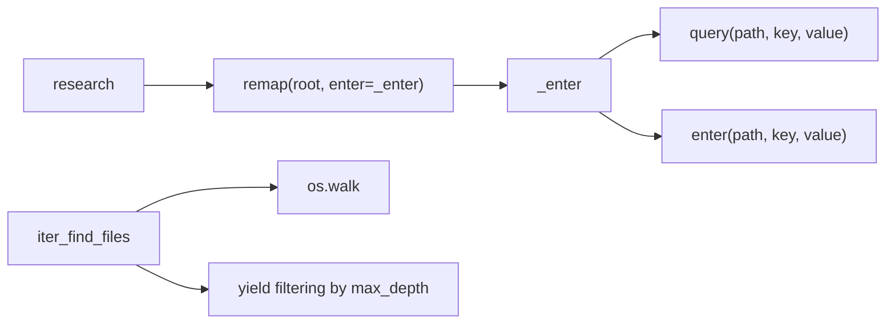

# Utilitários selecionados do Boltons: mudanças no código e observações confinadas

Capítulo isolado de pesquisa; sem publicação, aprovação do proprietário ou gold de treinamento. Revisões de código: `992a58c1036fcf4d52cbf3313b6217b7c07b11d9` → `c23dbdadb6fecdf505eb4231559561913b84c13f`.

## Propósito e escopo

Este capítulo compara contratos selecionados de `fileutils`, `iterutils` e `typeutils` em `24.0.0` e `25.0.0`. Ele cobre as revisões preservadas, em vez da versão mais recente do Boltons ou do pacote inteiro. [source:25.0.0:rotate_file] [source:25.0.0:research] [source:25.0.0:make_sentinel] 

## Arquitetura e direção dos auxiliares

`research` declara `enter=default_enter` fornecido pelo chamador, define `_enter`, passa esse wrapper como `remap(root, enter=_enter)` e escreve `return enter(path, key, value)` dentro dele. Descrever isso como uma chamada sempre feita a um auxiliar fixo perde o parâmetro fornecido pelo chamador. A vinculação do callback em execução e o percurso completo não foram executados aqui. [source:24.0.0:research] [source:25.0.0:research] 

O corpo selecionado de `make_sentinel` escreve `return Sentinel()`. Sua classe local atual define diretamente `__copy__` e `__deepcopy__`, ambos com `return self`; a classe local selecionada anterior não possui essas duas definições diretas. Isso descreve a classe local escrita e a expressão de construção, sem garantir universalmente alocação ou herança em execução. [source:24.0.0:make_sentinel] [source:25.0.0:make_sentinel] 

## Responsabilidades no sistema de arquivos

`rotate_file` verifica `keep < 1`, retorna se o caminho de origem estiver ausente e rejeita uma origem que não seja arquivo. Ele separa o nome do arquivo, monta nomes numerados, renomeia a cadeia em ordem inversa e depois remove o último destino numerado se ele existir. O corpo selecionado não contém ramo de rollback. [source:25.0.0:rotate_file] 

## Configuração e entradas declaradas

As declarações atuais incluem `rotate_file(filename, *, keep: int = 5)`, `max_depth=None` em `iter_find_files` e `enter=default_enter` em `research`. Expressões padrão e anotações são código escrito; sua avaliação durante importação não é testada por este capítulo. [source:25.0.0:rotate_file] [source:25.0.0:iter_find_files] [source:25.0.0:research] 

O prefixo anterior de `remap` extrai `reraise_visit` antes da verificação de opções restantes. O prefixo atual também extrai `trace` com padrão `()`, normaliza `True` e strings, verifica `tuple`, `list` ou `set` e deriva indicadores de eventos antes da verificação de opções restantes. Portanto, ele escreve tratamento explícito para `trace`; reconhecer a opção não garante que todo valor seja válido nem que o percurso posterior tenha sucesso. [source:24.0.0:remap:complete_statement_prefix] [source:25.0.0:remap:complete_statement_prefix] [source:25.0.0:remap:header] 

## Expressões de retorno escritas

`strip_iter` escreve `rstrip_iter(lstrip_iter(iterable, strip_value), strip_value)` como expressão de retorno. `rstrip` escreve `list(rstrip_iter(iterable, strip_value))`. `default_visit` escreve `return key, value`. Essas expressões selecionadas permanecem iguais entre os recortes comparados; nenhuma equivalência geral de auxiliares nem vinculação em execução é inferida. [source:24.0.0:strip_iter] [source:25.0.0:strip_iter] [source:24.0.0:rstrip] [source:25.0.0:rstrip] [source:24.0.0:default_visit] [source:25.0.0:default_visit] 

## Limites de erros

O wrapper interno `_enter` captura `Exception` em torno da chamada a `query` e da adição do resultado; quando `reraise` é verdadeiro, ele relança a exceção. Seu `return enter(path, key, value)` final fica depois desse handler local. Esse limite no código não estabelece como todo erro posterior do percurso é tratado. [source:25.0.0:research] 

No prefixo atual selecionado, `trace is True` é normalizado, mas o literal `False` não tem ramo correspondente de normalização nem pertence a `tuple`, `list` ou `set`. O ramo escrito de verificação de tipo lança `TypeError` para esse valor se for alcançado. Esta é uma observação do caminho no código, em vez de uma chamada completa de `remap` executada. [source:25.0.0:remap:complete_statement_prefix] 

## Observações nativas confinadas

Nas estruturas sintéticas congeladas de macOS/Linux, `keep=1` moveu o original para o primeiro destino numerado e depois o removeu; nenhuma cópia rotacionada permaneceu. Cadeias existentes preparadas com `keep=2` e `keep=5` conservaram um e quatro arquivos numerados, respectivamente. Isso não estabelece atomicidade contra falhas, segurança contra disputas, comportamento de sobrescrita no Windows nem intenção do mantenedor. [source:25.0.0:rotate_file] [observation:rotate-confined-macos-v1.json] [observation:rotate-confined-linux-v1.json]

O ramo de `max_depth` pula o processamento de uma raiz fornecida quando sua profundidade calculada é grande demais; ele não altera a lista de diretórios do percurso. Nas estruturas de três diretórios com o gerador totalmente consumido, `max_depth=0` forneceu apenas o arquivo de texto da raiz, enquanto o percurso nativo ainda visitou os três diretórios. Isso é filtragem dos resultados, sem garantia observada de poda do percurso. [source:25.0.0:iter_find_files] [observation:find-depth-confined-macos-v1.json] [observation:find-depth-confined-linux-v1.json]

Com `include_dirs=True` e `max_depth=0`, a estrutura também forneceu `tree/deep`, um diretório filho encontrado na raiz. Com `ignored='deep'`, esse nome de diretório não foi fornecido, mas seus descendentes ainda foram visitados e arquivos elegíveis foram fornecidos. Nenhuma dessas opções podou a lista nativa de diretórios observada. [source:25.0.0:iter_find_files] [observation:find-depth-confined-macos-v1.json] [observation:find-depth-confined-linux-v1.json]

## Mapa de dependências

| Responsável selecionado | Dependência escrita | Escopo |
|---|---|---|
| `rotate_file` | `os.path`, `os.rename`, `os.remove` | [source:25.0.0:rotate_file] |
| `iter_find_files` | `os.walk`, `fnmatch.translate`, `re.compile` | [source:25.0.0:iter_find_files] |
| `research` | `query`, caller `enter`, `remap` | [source:25.0.0:research] |
| `make_sentinel` | local `Sentinel` | [source:25.0.0:make_sentinel] |

## Relações de chamadas escritas



O diagrama resume relações escritas selecionadas, sem constituir um grafo completo de chamadas em execução.

## Exemplo ilustrativo e comando de sintaxe

O exemplo tem apenas a sintaxe verificada. As importações, as chamadas exibidas e o comando abaixo não foram executados; nenhuma lista de saída é afirmada.

```python
from boltons.iterutils import default_visit
from boltons.fileutils import iter_find_files

key_value = default_visit((), 'item', 7)
paths = iter_find_files('owned-example', '*.txt', max_depth=0)
```

```sh
python -m py_compile boltons-example.py
```

## Perguntas frequentes

### keep=1 garante uma cópia rotacionada preservada neste recorte?

Nas estruturas sintéticas congeladas de macOS/Linux, `keep=1` moveu o original para o primeiro destino numerado e depois o removeu; nenhuma cópia rotacionada permaneceu. Cadeias existentes preparadas com `keep=2` e `keep=5` conservaram um e quatro arquivos numerados, respectivamente. Isso não estabelece atomicidade contra falhas, segurança contra disputas, comportamento de sobrescrita no Windows nem intenção do mantenedor. [source:25.0.0:rotate_file] [observation:rotate-confined-macos-v1.json] [observation:rotate-confined-linux-v1.json]

### max_depth=0 impede o percurso de visitar diretórios filhos aqui?

O ramo de `max_depth` pula o processamento de uma raiz fornecida quando sua profundidade calculada é grande demais; ele não altera a lista de diretórios do percurso. Nas estruturas de três diretórios com o gerador totalmente consumido, `max_depth=0` forneceu apenas o arquivo de texto da raiz, enquanto o percurso nativo ainda visitou os três diretórios. Isso é filtragem dos resultados, sem garantia observada de poda do percurso. [source:25.0.0:iter_find_files] [observation:find-depth-confined-macos-v1.json] [observation:find-depth-confined-linux-v1.json]

### Um nome de diretório ignorado exclui automaticamente sua subárvore?

Com `include_dirs=True` e `max_depth=0`, a estrutura também forneceu `tree/deep`, um diretório filho encontrado na raiz. Com `ignored='deep'`, esse nome de diretório não foi fornecido, mas seus descendentes ainda foram visitados e arquivos elegíveis foram fornecidos. Nenhuma dessas opções podou a lista nativa de diretórios observada. [source:25.0.0:iter_find_files] [observation:find-depth-confined-macos-v1.json] [observation:find-depth-confined-linux-v1.json]

### research sempre delega a um auxiliar default_enter fixo?

`research` declara `enter=default_enter` fornecido pelo chamador, define `_enter`, passa esse wrapper como `remap(root, enter=_enter)` e escreve `return enter(path, key, value)` dentro dele. Descrever isso como uma chamada sempre feita a um auxiliar fixo perde o parâmetro fornecido pelo chamador. A vinculação do callback em execução e o percurso completo não foram executados aqui. [source:24.0.0:research] [source:25.0.0:research] 

### Reconhecer a opção torna trace=False um valor validado?

No prefixo atual selecionado, `trace is True` é normalizado, mas o literal `False` não tem ramo correspondente de normalização nem pertence a `tuple`, `list` ou `set`. O ramo escrito de verificação de tipo lança `TypeError` para esse valor se for alcançado. Esta é uma observação do caminho no código, em vez de uma chamada completa de `remap` executada. [source:25.0.0:remap:complete_statement_prefix] 

### Quais métodos de cópia estão escritos diretamente na classe sentinela local atual?

O corpo selecionado de `make_sentinel` escreve `return Sentinel()`. Sua classe local atual define diretamente `__copy__` e `__deepcopy__`, ambos com `return self`; a classe local selecionada anterior não possui essas duas definições diretas. Isso descreve a classe local escrita e a expressão de construção, sem garantir universalmente alocação ou herança em execução. [source:24.0.0:make_sentinel] [source:25.0.0:make_sentinel] 

### O handler de query abrange diretamente a chamada final a enter?

O wrapper interno `_enter` captura `Exception` em torno da chamada a `query` e da adição do resultado; quando `reraise` é verdadeiro, ele relança a exceção. Seu `return enter(path, key, value)` final fica depois desse handler local. Esse limite no código não estabelece como todo erro posterior do percurso é tratado. [source:25.0.0:research] 

## Licença e limites da verificação

O aviso original de estilo BSD com três cláusulas está preservado e vinculado abaixo; isso não aprova treinamento. Apenas rotate_file e iter_find_files foram executados, cada um como função exata revisada sob uma fachada restrita em dados temporários sintéticos. Todas as outras afirmações são inspeção de código. Nenhum módulo Boltons inteiro, percurso completo de remap/research, fábrica de sentinelas, auxiliar de cópia, comando gerado por modelo ou exemplo ilustrativo foi executado. Os casos de macOS/Linux são repetições correlacionadas; Windows, concorrência, durabilidade contra falhas e semântica completa do pacote continuam não verificados.

## Referências físicas de código e observação

[source:25.0.0:rotate_file]: ../../documentation-intelligence-20261120/public-sources/25.0.0/boltons/fileutils.py#L694 "3cf65e04eaedb63d71e5a4bfe6974194802ae203439cfd8f3f87f2807fc731fc"

[source:24.0.0:iter_find_files]: ../../documentation-intelligence-20261120/public-sources/24.0.0/boltons/fileutils.py#L489 "6fc6db8a372b2548c0203cf505fe1fb098f15e600f4361ccbcdc8be8b6263887"

[source:25.0.0:iter_find_files]: ../../documentation-intelligence-20261120/public-sources/25.0.0/boltons/fileutils.py#L492 "3cf65e04eaedb63d71e5a4bfe6974194802ae203439cfd8f3f87f2807fc731fc"

[source:24.0.0:research]: ../../documentation-intelligence-20261120/public-sources/24.0.0/boltons/iterutils.py#L1299 "9fe8a7c9f2ae4f089a3daec37d5e869f876691bb794b843907785855b5fbc235"

[source:25.0.0:research]: ../../documentation-intelligence-20261120/public-sources/25.0.0/boltons/iterutils.py#L1335 "229f0f767aa3ca9fbc0b057dd7191170815bffb43599d3a293a246bd5a75afb6"

[source:24.0.0:make_sentinel]: ../../documentation-intelligence-20261120/public-sources/24.0.0/boltons/typeutils.py#L42 "cda9a4da1b3eeff88c728d7f41ed447a3b25c9cf33d7ce0e860e5b78caefd99e"

[source:25.0.0:make_sentinel]: ../../documentation-intelligence-20261120/public-sources/25.0.0/boltons/typeutils.py#L42 "4da2b26d71386ee9010dfb52104e461ecba486ba5544a8cf50d9e26cd34e9c09"

[source:24.0.0:strip_iter]: ../../documentation-intelligence-20261120/public-sources/24.0.0/boltons/iterutils.py#L274 "9fe8a7c9f2ae4f089a3daec37d5e869f876691bb794b843907785855b5fbc235"

[source:25.0.0:strip_iter]: ../../documentation-intelligence-20261120/public-sources/25.0.0/boltons/iterutils.py#L274 "229f0f767aa3ca9fbc0b057dd7191170815bffb43599d3a293a246bd5a75afb6"

[source:24.0.0:rstrip]: ../../documentation-intelligence-20261120/public-sources/24.0.0/boltons/iterutils.py#L223 "9fe8a7c9f2ae4f089a3daec37d5e869f876691bb794b843907785855b5fbc235"

[source:25.0.0:rstrip]: ../../documentation-intelligence-20261120/public-sources/25.0.0/boltons/iterutils.py#L223 "229f0f767aa3ca9fbc0b057dd7191170815bffb43599d3a293a246bd5a75afb6"

[source:24.0.0:default_visit]: ../../documentation-intelligence-20261120/public-sources/24.0.0/boltons/iterutils.py#L1005 "9fe8a7c9f2ae4f089a3daec37d5e869f876691bb794b843907785855b5fbc235"

[source:25.0.0:default_visit]: ../../documentation-intelligence-20261120/public-sources/25.0.0/boltons/iterutils.py#L1010 "229f0f767aa3ca9fbc0b057dd7191170815bffb43599d3a293a246bd5a75afb6"

[source:24.0.0:remap:header]: ../../documentation-intelligence-20261120/public-sources/24.0.0/boltons/iterutils.py#L1052 "9fe8a7c9f2ae4f089a3daec37d5e869f876691bb794b843907785855b5fbc235"

[source:24.0.0:remap:complete_statement_prefix]: ../../documentation-intelligence-20261120/public-sources/24.0.0/boltons/iterutils.py#L1152 "9fe8a7c9f2ae4f089a3daec37d5e869f876691bb794b843907785855b5fbc235"

[source:25.0.0:remap:header]: ../../documentation-intelligence-20261120/public-sources/25.0.0/boltons/iterutils.py#L1058 "229f0f767aa3ca9fbc0b057dd7191170815bffb43599d3a293a246bd5a75afb6"

[source:25.0.0:remap:complete_statement_prefix]: ../../documentation-intelligence-20261120/public-sources/25.0.0/boltons/iterutils.py#L1161 "229f0f767aa3ca9fbc0b057dd7191170815bffb43599d3a293a246bd5a75afb6"

[observation:rotate-confined-macos-v1.json]: ../rotate-confined-macos-v1.json "c0969a3e865406516c96affdf74bc1573c775c086c9bc5328c76f5d7c213d75c"

[observation:rotate-confined-linux-v1.json]: ../rotate-confined-linux-v1.json "a8931e7bb656c2303ea4013d3835a290a43b438ebf92fd88a7698c56dff62c9b"

[observation:find-depth-confined-macos-v1.json]: ../find-depth-confined-macos-v1.json "a81f04fa8070a4e80dc4f294a14920d151bf1058ce6e299e64be0817b779daf7"

[observation:find-depth-confined-linux-v1.json]: ../find-depth-confined-linux-v1.json "6922ce2ed3ece49bfd6354e60d2f019fd55077a0adf8fa331c008a0a6bafb6f4"

[source-license]: ../../documentation-intelligence-20261120/public-sources/25.0.0/LICENSE "c301912653a8d8c99eab6212aa3aea8d164ea249d8ad53c941e0558a0a5ac1e3"
