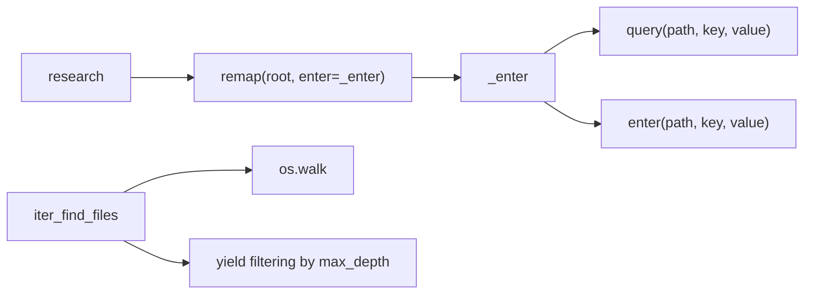

# Boltons selected utilities: source changes and confined observations

Isolated research chapter; not published, owner-approved or training gold. Source revisions: `992a58c1036fcf4d52cbf3313b6217b7c07b11d9` → `c23dbdadb6fecdf505eb4231559561913b84c13f`.

## Purpose and scope

This chapter compares selected `fileutils`, `iterutils` and `typeutils` contracts at `24.0.0` and `25.0.0`. It covers the preserved revisions, not the latest Boltons release or the entire package. [source:25.0.0:rotate_file] [source:25.0.0:research] [source:25.0.0:make_sentinel] 

## Architecture and helper direction

`research` declares caller-supplied `enter=default_enter`, defines `_enter`, passes it as `remap(root, enter=_enter)`, and writes `return enter(path, key, value)` inside that wrapper. Describing this as always calling a fixed helper loses the caller-supplied parameter. Runtime callback binding and full traversal behavior were not executed here. [source:24.0.0:research] [source:25.0.0:research] 

The selected `make_sentinel` body writes `return Sentinel()`. Its current local class directly defines `__copy__` and `__deepcopy__`, both with `return self`; the earlier selected local class lacks those two direct definitions. This describes the written local class and constructor expression, not a universal runtime allocation or inheritance guarantee. [source:24.0.0:make_sentinel] [source:25.0.0:make_sentinel] 

## Filesystem responsibilities

`rotate_file` checks `keep < 1`, returns if the source path is absent, and rejects a non-file source. It splits the filename, builds numbered names, renames the chain in reverse order and then removes the final numbered destination when it exists. The selected body contains no rollback branch. [source:25.0.0:rotate_file] 

## Configuration and declared inputs

The current declarations include `rotate_file(filename, *, keep: int = 5)`, `max_depth=None` on `iter_find_files`, and `enter=default_enter` on `research`. Default expressions and annotations are written source; their import-time evaluation is not tested by this chapter. [source:25.0.0:rotate_file] [source:25.0.0:iter_find_files] [source:25.0.0:research] 

The earlier `remap` prefix pops `reraise_visit` before its remaining-keyword guard. The current prefix also pops `trace` with default `()`, normalizes `True` and strings, checks for `tuple`, `list` or `set`, and derives event flags before the remaining-keyword guard. It therefore writes explicit handling for `trace`; recognition does not guarantee that every value is valid or that later traversal succeeds. [source:24.0.0:remap:complete_statement_prefix] [source:25.0.0:remap:complete_statement_prefix] [source:25.0.0:remap:header] 

## Written return expressions

`strip_iter` writes `rstrip_iter(lstrip_iter(iterable, strip_value), strip_value)` as its return expression. `rstrip` writes `list(rstrip_iter(iterable, strip_value))`. `default_visit` writes `return key, value`. These selected expressions remain the same across the compared cuts; no general helper equivalence or runtime binding is inferred. [source:24.0.0:strip_iter] [source:25.0.0:strip_iter] [source:24.0.0:rstrip] [source:25.0.0:rstrip] [source:24.0.0:default_visit] [source:25.0.0:default_visit] 

## Error boundaries

The nested `_enter` wrapper catches `Exception` around the `query` call and result append; when `reraise` is true, it re-raises. Its final `return enter(path, key, value)` lies after that local handler. This source boundary does not establish how every downstream traversal error is handled. [source:25.0.0:research] 

In the selected current prefix, `trace is True` is normalized, but literal `False` has no corresponding normalization branch and does not belong to `tuple`, `list` or `set`. The written type-check branch raises `TypeError` for that value if reached. This is a source-path observation, not an executed full `remap` call. [source:25.0.0:remap:complete_statement_prefix] 

## Confined native observations

On the frozen owned macOS/Linux fixtures, `keep=1` moved the original to its first numbered destination and then removed it; no rotated copy remained. Prepared existing chains with `keep=2` and `keep=5` retained one and four numbered files, respectively. This does not establish crash atomicity, race safety, Windows overwrite behavior or maintainer intent. [source:25.0.0:rotate_file] [observation:rotate-confined-macos-v1.json] [observation:rotate-confined-linux-v1.json]

The `max_depth` branch skips processing a yielded root when its computed depth is too large; it does not edit the walker directory list. In the fully consumed three-directory fixtures, `max_depth=0` yielded only the root text file while native walking still visited all three directories. This is yield filtering, not an observed traversal-pruning guarantee. [source:25.0.0:iter_find_files] [observation:find-depth-confined-macos-v1.json] [observation:find-depth-confined-linux-v1.json]

With `include_dirs=True` and `max_depth=0`, the fixture also yielded `tree/deep`, a child directory encountered at the root. With `ignored='deep'`, that directory name was not yielded, but its descendants were still visited and eligible files were yielded. Neither setting pruned the observed native directory list. [source:25.0.0:iter_find_files] [observation:find-depth-confined-macos-v1.json] [observation:find-depth-confined-linux-v1.json]

## Dependency map

| Selected owner | Written dependency | Scope |
|---|---|---|
| `rotate_file` | `os.path`, `os.rename`, `os.remove` | [source:25.0.0:rotate_file] |
| `iter_find_files` | `os.walk`, `fnmatch.translate`, `re.compile` | [source:25.0.0:iter_find_files] |
| `research` | `query`, caller `enter`, `remap` | [source:25.0.0:research] |
| `make_sentinel` | local `Sentinel` | [source:25.0.0:make_sentinel] |

## Written call relationships



The diagram summarizes selected written relationships, not a complete runtime call graph.

## Illustrative example and syntax command

The example is syntax checked only. Imports, the displayed calls and the command below were not executed; no output list is asserted.

```python
from boltons.iterutils import default_visit
from boltons.fileutils import iter_find_files

key_value = default_visit((), 'item', 7)
paths = iter_find_files('owned-example', '*.txt', max_depth=0)
```

```sh
python -m py_compile boltons-example.py
```

## FAQs

### Does keep=1 guarantee one preserved rotated copy in this cut?

On the frozen owned macOS/Linux fixtures, `keep=1` moved the original to its first numbered destination and then removed it; no rotated copy remained. Prepared existing chains with `keep=2` and `keep=5` retained one and four numbered files, respectively. This does not establish crash atomicity, race safety, Windows overwrite behavior or maintainer intent. [source:25.0.0:rotate_file] [observation:rotate-confined-macos-v1.json] [observation:rotate-confined-linux-v1.json]

### Does max_depth=0 stop the walker from visiting child directories here?

The `max_depth` branch skips processing a yielded root when its computed depth is too large; it does not edit the walker directory list. In the fully consumed three-directory fixtures, `max_depth=0` yielded only the root text file while native walking still visited all three directories. This is yield filtering, not an observed traversal-pruning guarantee. [source:25.0.0:iter_find_files] [observation:find-depth-confined-macos-v1.json] [observation:find-depth-confined-linux-v1.json]

### Does an ignored directory name automatically exclude its subtree?

With `include_dirs=True` and `max_depth=0`, the fixture also yielded `tree/deep`, a child directory encountered at the root. With `ignored='deep'`, that directory name was not yielded, but its descendants were still visited and eligible files were yielded. Neither setting pruned the observed native directory list. [source:25.0.0:iter_find_files] [observation:find-depth-confined-macos-v1.json] [observation:find-depth-confined-linux-v1.json]

### Does research always delegate to a fixed default_enter helper?

`research` declares caller-supplied `enter=default_enter`, defines `_enter`, passes it as `remap(root, enter=_enter)`, and writes `return enter(path, key, value)` inside that wrapper. Describing this as always calling a fixed helper loses the caller-supplied parameter. Runtime callback binding and full traversal behavior were not executed here. [source:24.0.0:research] [source:25.0.0:research] 

### Does keyword recognition make trace=False a validated value?

In the selected current prefix, `trace is True` is normalized, but literal `False` has no corresponding normalization branch and does not belong to `tuple`, `list` or `set`. The written type-check branch raises `TypeError` for that value if reached. This is a source-path observation, not an executed full `remap` call. [source:25.0.0:remap:complete_statement_prefix] 

### Which copy hooks are directly written on the current local sentinel class?

The selected `make_sentinel` body writes `return Sentinel()`. Its current local class directly defines `__copy__` and `__deepcopy__`, both with `return self`; the earlier selected local class lacks those two direct definitions. This describes the written local class and constructor expression, not a universal runtime allocation or inheritance guarantee. [source:24.0.0:make_sentinel] [source:25.0.0:make_sentinel] 

### Does the query handler directly enclose the final enter call?

The nested `_enter` wrapper catches `Exception` around the `query` call and result append; when `reraise` is true, it re-raises. Its final `return enter(path, key, value)` lies after that local handler. This source boundary does not establish how every downstream traversal error is handled. [source:25.0.0:research] 

## License and verification limits

The original BSD-style three-clause notice is preserved and linked below; this is not approval for training. Only rotate_file and iter_find_files were executed, each as an exact reviewed function under a restricted facade on owned temporary data. All other claims are source inspection. No whole Boltons module, full remap/research traversal, sentinel factory, copied helper, model-generated command or illustrative example was executed. The macOS/Linux cases are correlated repetitions; Windows, concurrency, crash durability and complete package semantics remain unverified.

## Physical source and observation references

[source:25.0.0:rotate_file]: ../../documentation-intelligence-20261120/public-sources/25.0.0/boltons/fileutils.py#L694 "3cf65e04eaedb63d71e5a4bfe6974194802ae203439cfd8f3f87f2807fc731fc"

[source:24.0.0:iter_find_files]: ../../documentation-intelligence-20261120/public-sources/24.0.0/boltons/fileutils.py#L489 "6fc6db8a372b2548c0203cf505fe1fb098f15e600f4361ccbcdc8be8b6263887"

[source:25.0.0:iter_find_files]: ../../documentation-intelligence-20261120/public-sources/25.0.0/boltons/fileutils.py#L492 "3cf65e04eaedb63d71e5a4bfe6974194802ae203439cfd8f3f87f2807fc731fc"

[source:24.0.0:research]: ../../documentation-intelligence-20261120/public-sources/24.0.0/boltons/iterutils.py#L1299 "9fe8a7c9f2ae4f089a3daec37d5e869f876691bb794b843907785855b5fbc235"

[source:25.0.0:research]: ../../documentation-intelligence-20261120/public-sources/25.0.0/boltons/iterutils.py#L1335 "229f0f767aa3ca9fbc0b057dd7191170815bffb43599d3a293a246bd5a75afb6"

[source:24.0.0:make_sentinel]: ../../documentation-intelligence-20261120/public-sources/24.0.0/boltons/typeutils.py#L42 "cda9a4da1b3eeff88c728d7f41ed447a3b25c9cf33d7ce0e860e5b78caefd99e"

[source:25.0.0:make_sentinel]: ../../documentation-intelligence-20261120/public-sources/25.0.0/boltons/typeutils.py#L42 "4da2b26d71386ee9010dfb52104e461ecba486ba5544a8cf50d9e26cd34e9c09"

[source:24.0.0:strip_iter]: ../../documentation-intelligence-20261120/public-sources/24.0.0/boltons/iterutils.py#L274 "9fe8a7c9f2ae4f089a3daec37d5e869f876691bb794b843907785855b5fbc235"

[source:25.0.0:strip_iter]: ../../documentation-intelligence-20261120/public-sources/25.0.0/boltons/iterutils.py#L274 "229f0f767aa3ca9fbc0b057dd7191170815bffb43599d3a293a246bd5a75afb6"

[source:24.0.0:rstrip]: ../../documentation-intelligence-20261120/public-sources/24.0.0/boltons/iterutils.py#L223 "9fe8a7c9f2ae4f089a3daec37d5e869f876691bb794b843907785855b5fbc235"

[source:25.0.0:rstrip]: ../../documentation-intelligence-20261120/public-sources/25.0.0/boltons/iterutils.py#L223 "229f0f767aa3ca9fbc0b057dd7191170815bffb43599d3a293a246bd5a75afb6"

[source:24.0.0:default_visit]: ../../documentation-intelligence-20261120/public-sources/24.0.0/boltons/iterutils.py#L1005 "9fe8a7c9f2ae4f089a3daec37d5e869f876691bb794b843907785855b5fbc235"

[source:25.0.0:default_visit]: ../../documentation-intelligence-20261120/public-sources/25.0.0/boltons/iterutils.py#L1010 "229f0f767aa3ca9fbc0b057dd7191170815bffb43599d3a293a246bd5a75afb6"

[source:24.0.0:remap:header]: ../../documentation-intelligence-20261120/public-sources/24.0.0/boltons/iterutils.py#L1052 "9fe8a7c9f2ae4f089a3daec37d5e869f876691bb794b843907785855b5fbc235"

[source:24.0.0:remap:complete_statement_prefix]: ../../documentation-intelligence-20261120/public-sources/24.0.0/boltons/iterutils.py#L1152 "9fe8a7c9f2ae4f089a3daec37d5e869f876691bb794b843907785855b5fbc235"

[source:25.0.0:remap:header]: ../../documentation-intelligence-20261120/public-sources/25.0.0/boltons/iterutils.py#L1058 "229f0f767aa3ca9fbc0b057dd7191170815bffb43599d3a293a246bd5a75afb6"

[source:25.0.0:remap:complete_statement_prefix]: ../../documentation-intelligence-20261120/public-sources/25.0.0/boltons/iterutils.py#L1161 "229f0f767aa3ca9fbc0b057dd7191170815bffb43599d3a293a246bd5a75afb6"

[observation:rotate-confined-macos-v1.json]: ../rotate-confined-macos-v1.json "c0969a3e865406516c96affdf74bc1573c775c086c9bc5328c76f5d7c213d75c"

[observation:rotate-confined-linux-v1.json]: ../rotate-confined-linux-v1.json "a8931e7bb656c2303ea4013d3835a290a43b438ebf92fd88a7698c56dff62c9b"

[observation:find-depth-confined-macos-v1.json]: ../find-depth-confined-macos-v1.json "a81f04fa8070a4e80dc4f294a14920d151bf1058ce6e299e64be0817b779daf7"

[observation:find-depth-confined-linux-v1.json]: ../find-depth-confined-linux-v1.json "6922ce2ed3ece49bfd6354e60d2f019fd55077a0adf8fa331c008a0a6bafb6f4"

[source-license]

[source-license]: ../../documentation-intelligence-20261120/public-sources/25.0.0/LICENSE "c301912653a8d8c99eab6212aa3aea8d164ea249d8ad53c941e0558a0a5ac1e3"
