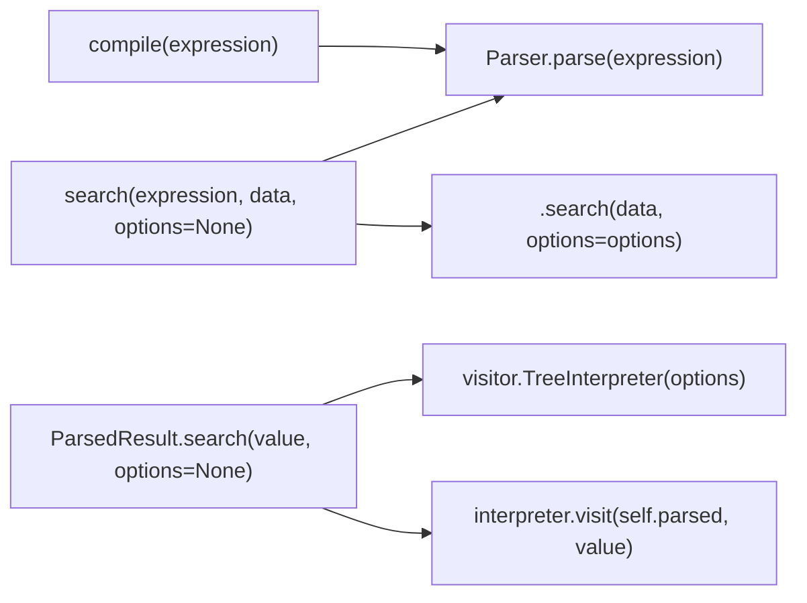

# Pinned parser and cache source walkthrough

Research candidate. Not published, owner-approved or training gold.

Revision: `6ff419a8b171d055a9bfc6904605bceb8b7a80ef`.

## Purpose

This chapter follows the written path from `compile` and `search` into `Parser.parse`; it documents the pinned source revision rather than a measured execution. [source:compile] [source:search] [source:Parser.parse]

## Architecture

`compile(expression)` returns the expression `parser.Parser().parse(expression)`. `search(expression, data, options=None)` appends `.search(data, options=options)` to that chain. [source:compile] [source:search]

## Responsibilities

`Parser.parse` first attempts `self._CACHE[expression]`. After a `KeyError`, it calls `self._do_parse(expression)` and contains the capacity check before its final cache assignment. [source:Parser.parse]

## Dependencies

The facade writes `from jmespath import parser`. The parser writes `from jmespath import visitor`. These imports identify source relationships; the runtime import loader was not checked. [source:jmespath/__init__.py:import:1] [source:jmespath/parser.py:import:32]

## Configuration

`Parser._MAX_SIZE` is written as the integer 512. This is a class-level source value, not proof of a live cache occupancy limit under every execution. [source:Parser._MAX_SIZE] [source:Parser.parse]

## Inputs and outputs

`search` forwards `data` and `options` to the written chained call. `ParsedResult.search` constructs `visitor.TreeInterpreter(options)`, calls `interpreter.visit(self.parsed, value)` and returns the local `result`. The returned runtime type is not established by these statements alone. [source:search] [source:ParsedResult.search]

## Error handling

`Parser._do_parse` catches `exceptions.LexerError` and `exceptions.ParseError`, assigns `e.expression = expression` and re-raises. For `exceptions.IncompleteExpressionError`, it calls `e.set_expression(expression)` and re-raises. The exception class implementations are outside this evidence pack. [source:Parser._do_parse] [source:jmespath/parser.py:import:31]

The eviction block in `Parser.parse` catches `KeyError`, `StopIteration` and `RuntimeError`, then returns `parsed_result` before the final `self._CACHE[expression] = parsed_result` statement. This is written control flow, not a concurrency guarantee. [source:Parser.parse]

## Example

Illustrative and unexecuted. No output or successful installation is claimed.

```python
jmespath.search("name", {"name": "Ada"})
```

[source:search]

## Command

Illustrative and unexecuted. No output or successful installation is claimed.

```sh
python -c 'import jmespath; print(jmespath.search("name", {"name": "Ada"}))'
```

[source:search]

## Source map

| Unit | File |
|---|---|
| `compile` | `jmespath/__init__.py` |
| `search` | `jmespath/__init__.py` |
| `Parser.parse` | `jmespath/parser.py` |
| `Parser._MAX_SIZE` | `jmespath/parser.py` |
| `Parser._do_parse` | `jmespath/parser.py` |
| `ParsedResult.search` | `jmespath/parser.py` |

## Written call relationships

Edges show written call expressions; they do not certify runtime target identity or a complete execution trace.



[source:compile] [source:search] [source:ParsedResult.search]

## FAQ

### Which cache-size value is written in the selected Parser class?

`Parser._MAX_SIZE` is written as the integer 512. This is a class-level source value, not proof of a live cache occupancy limit under every execution. [source:Parser._MAX_SIZE] [source:Parser.parse]

### Does this source path prove one fixed return type?

`search` forwards `data` and `options` to the written chained call. `ParsedResult.search` constructs `visitor.TreeInterpreter(options)`, calls `interpreter.visit(self.parsed, value)` and returns the local `result`. The returned runtime type is not established by these statements alone. [source:search] [source:ParsedResult.search]

### How are the facade entry points and arguments written?

`compile(expression)` returns the expression `parser.Parser().parse(expression)`. `search(expression, data, options=None)` appends `.search(data, options=options)` to that chain. [source:compile] [source:search]

### Which local method enriches parser errors here?

`Parser._do_parse` catches `exceptions.LexerError` and `exceptions.ParseError`, assigns `e.expression = expression` and re-raises. For `exceptions.IncompleteExpressionError`, it calls `e.set_expression(expression)` and re-raises. The exception class implementations are outside this evidence pack. [source:Parser._do_parse] [source:jmespath/parser.py:import:31]

### Does catching eviction errors prove thread safety?

The eviction block in `Parser.parse` catches `KeyError`, `StopIteration` and `RuntimeError`, then returns `parsed_result` before the final `self._CACHE[expression] = parsed_result` statement. This is written control flow, not a concurrency guarantee. [source:Parser.parse]

### Which operational guarantees remain unknown?

The source pack does not establish LRU behavior, thread safety, timeout units, retries, authentication or external API responses. Runtime helper resolution, package installation and example execution were not verified. [source:Parser.parse] [source:search] [source:ParsedResult.search]

## Limitations

The source pack does not establish LRU behavior, thread safety, timeout units, retries, authentication or external API responses. Runtime helper resolution, package installation and example execution were not verified. [source:Parser.parse] [source:search] [source:ParsedResult.search]

## Physical source citations

- [source:Parser._MAX_SIZE] [jmespath/parser.py:74–74](https://github.com/jmespath/jmespath.py/blob/6ff419a8b171d055a9bfc6904605bceb8b7a80ef/jmespath/parser.py#L74-L74); SHA-256 `5630d0379ca349ee467f973d227700e84e18c55473621254697059ada0ec5137`.

- [source:Parser.parse] [jmespath/parser.py:82–103](https://github.com/jmespath/jmespath.py/blob/6ff419a8b171d055a9bfc6904605bceb8b7a80ef/jmespath/parser.py#L82-L103); SHA-256 `5630d0379ca349ee467f973d227700e84e18c55473621254697059ada0ec5137`.

- [source:Parser._do_parse] [jmespath/parser.py:105–116](https://github.com/jmespath/jmespath.py/blob/6ff419a8b171d055a9bfc6904605bceb8b7a80ef/jmespath/parser.py#L105-L116); SHA-256 `5630d0379ca349ee467f973d227700e84e18c55473621254697059ada0ec5137`.

- [source:ParsedResult.search] [jmespath/parser.py:514–517](https://github.com/jmespath/jmespath.py/blob/6ff419a8b171d055a9bfc6904605bceb8b7a80ef/jmespath/parser.py#L514-L517); SHA-256 `5630d0379ca349ee467f973d227700e84e18c55473621254697059ada0ec5137`.

- [source:compile] [jmespath/__init__.py:7–8](https://github.com/jmespath/jmespath.py/blob/6ff419a8b171d055a9bfc6904605bceb8b7a80ef/jmespath/__init__.py#L7-L8); SHA-256 `1bdefe3427441afe5dd173812b95de18db16731294a4c114e392e1ef949cd8a3`.

- [source:search] [jmespath/__init__.py:11–12](https://github.com/jmespath/jmespath.py/blob/6ff419a8b171d055a9bfc6904605bceb8b7a80ef/jmespath/__init__.py#L11-L12); SHA-256 `1bdefe3427441afe5dd173812b95de18db16731294a4c114e392e1ef949cd8a3`.

- [source:jmespath/__init__.py:import:1] [jmespath/__init__.py:1–1](https://github.com/jmespath/jmespath.py/blob/6ff419a8b171d055a9bfc6904605bceb8b7a80ef/jmespath/__init__.py#L1-L1); SHA-256 `1bdefe3427441afe5dd173812b95de18db16731294a4c114e392e1ef949cd8a3`.

- [source:jmespath/__init__.py:import:2] [jmespath/__init__.py:2–2](https://github.com/jmespath/jmespath.py/blob/6ff419a8b171d055a9bfc6904605bceb8b7a80ef/jmespath/__init__.py#L2-L2); SHA-256 `1bdefe3427441afe5dd173812b95de18db16731294a4c114e392e1ef949cd8a3`.

- [source:jmespath/parser.py:import:28] [jmespath/parser.py:28–28](https://github.com/jmespath/jmespath.py/blob/6ff419a8b171d055a9bfc6904605bceb8b7a80ef/jmespath/parser.py#L28-L28); SHA-256 `5630d0379ca349ee467f973d227700e84e18c55473621254697059ada0ec5137`.

- [source:jmespath/parser.py:import:29] [jmespath/parser.py:29–29](https://github.com/jmespath/jmespath.py/blob/6ff419a8b171d055a9bfc6904605bceb8b7a80ef/jmespath/parser.py#L29-L29); SHA-256 `5630d0379ca349ee467f973d227700e84e18c55473621254697059ada0ec5137`.

- [source:jmespath/parser.py:import:30] [jmespath/parser.py:30–30](https://github.com/jmespath/jmespath.py/blob/6ff419a8b171d055a9bfc6904605bceb8b7a80ef/jmespath/parser.py#L30-L30); SHA-256 `5630d0379ca349ee467f973d227700e84e18c55473621254697059ada0ec5137`.

- [source:jmespath/parser.py:import:31] [jmespath/parser.py:31–31](https://github.com/jmespath/jmespath.py/blob/6ff419a8b171d055a9bfc6904605bceb8b7a80ef/jmespath/parser.py#L31-L31); SHA-256 `5630d0379ca349ee467f973d227700e84e18c55473621254697059ada0ec5137`.

- [source:jmespath/parser.py:import:32] [jmespath/parser.py:32–32](https://github.com/jmespath/jmespath.py/blob/6ff419a8b171d055a9bfc6904605bceb8b7a80ef/jmespath/parser.py#L32-L32); SHA-256 `5630d0379ca349ee467f973d227700e84e18c55473621254697059ada0ec5137`.
