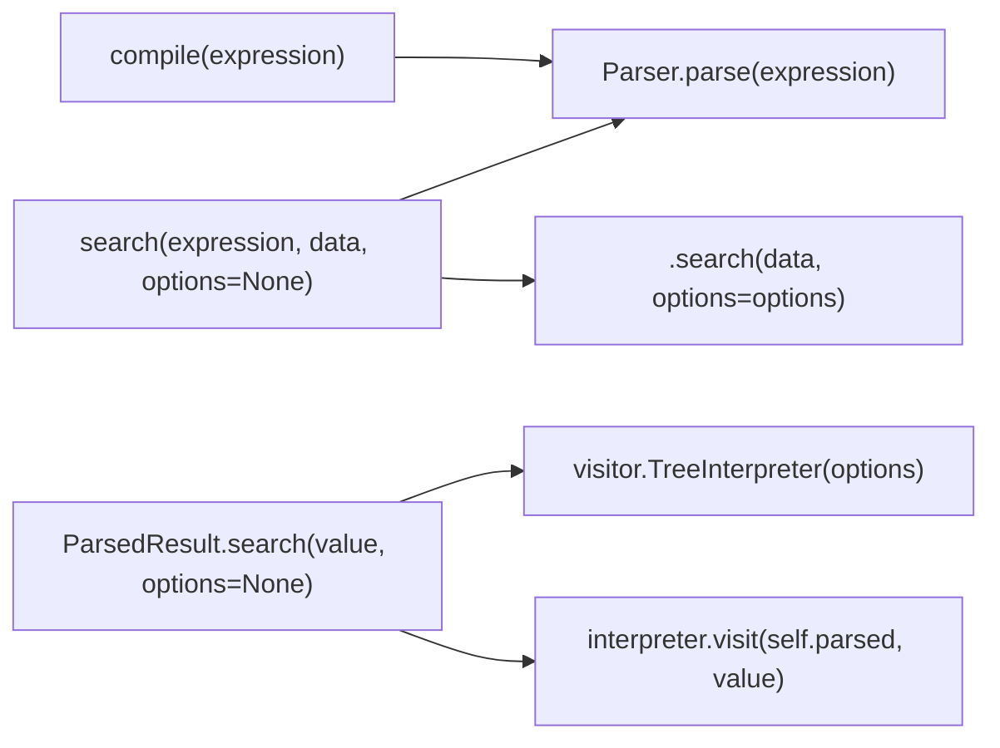

# Leitura do código fixado do parser e do cache

Candidato de pesquisa. Não publicado, aprovado pelo proprietário ou classificado como gold de treinamento.

Revision: `6ff419a8b171d055a9bfc6904605bceb8b7a80ef`.

## Propósito

Este capítulo acompanha o caminho escrito de `compile` e `search` até `Parser.parse`; documenta a revisão fixada do código, sem representar uma execução medida. [source:compile] [source:search] [source:Parser.parse]

## Arquitetura

`compile(expression)` retorna a expressão `parser.Parser().parse(expression)`. `search(expression, data, options=None)` acrescenta `.search(data, options=options)` a essa cadeia. [source:compile] [source:search]

## Responsabilidades

`Parser.parse` primeiro tenta `self._CACHE[expression]`. Após um `KeyError`, chama `self._do_parse(expression)` e contém a verificação de capacidade antes da atribuição final ao cache. [source:Parser.parse]

## Dependências

A fachada declara `from jmespath import parser`. O parser declara `from jmespath import visitor`. Essas importações identificam relações no código; o carregador de importações em execução não foi verificado. [source:jmespath/__init__.py:import:1] [source:jmespath/parser.py:import:32]

## Configuração

`Parser._MAX_SIZE` está escrito como o inteiro 512. Esse é um valor no código da classe, sem constituir prova de um limite de ocupação do cache em toda execução. [source:Parser._MAX_SIZE] [source:Parser.parse]

## Entradas e saídas

`search` encaminha `data` e `options` para a chamada encadeada escrita. `ParsedResult.search` constrói `visitor.TreeInterpreter(options)`, chama `interpreter.visit(self.parsed, value)` e retorna a variável local `result`. Essas instruções, isoladamente, não estabelecem o tipo retornado em execução. [source:search] [source:ParsedResult.search]

## Tratamento de erros

`Parser._do_parse` captura `exceptions.LexerError` e `exceptions.ParseError`, atribui `e.expression = expression` e relança a exceção. Para `exceptions.IncompleteExpressionError`, chama `e.set_expression(expression)` e relança a exceção. As implementações dessas classes de exceção estão fora deste conjunto de evidências. [source:Parser._do_parse] [source:jmespath/parser.py:import:31]

O bloco de remoção em `Parser.parse` captura `KeyError`, `StopIteration` e `RuntimeError`, e então retorna `parsed_result` antes da instrução final `self._CACHE[expression] = parsed_result`. Isso descreve o fluxo escrito, sem garantir comportamento concorrente. [source:Parser.parse]

## Exemplo

Ilustrativo e não executado. Nenhuma saída ou instalação bem-sucedida é afirmada.

```python
jmespath.search("name", {"name": "Ada"})
```

[source:search]

## Comando

Ilustrativo e não executado. Nenhuma saída ou instalação bem-sucedida é afirmada.

```sh
python -c 'import jmespath; print(jmespath.search("name", {"name": "Ada"}))'
```

[source:search]

## Mapa do código

| Unit | File |
|---|---|
| `compile` | `jmespath/__init__.py` |
| `search` | `jmespath/__init__.py` |
| `Parser.parse` | `jmespath/parser.py` |
| `Parser._MAX_SIZE` | `jmespath/parser.py` |
| `Parser._do_parse` | `jmespath/parser.py` |
| `ParsedResult.search` | `jmespath/parser.py` |

## Relações de chamadas escritas

As setas mostram expressões de chamada escritas; não certificam a identidade dos destinos em execução nem um rastreamento completo.



[source:compile] [source:search] [source:ParsedResult.search]

## Perguntas frequentes

### Qual valor de tamanho do cache está escrito na classe Parser selecionada?

`Parser._MAX_SIZE` está escrito como o inteiro 512. Esse é um valor no código da classe, sem constituir prova de um limite de ocupação do cache em toda execução. [source:Parser._MAX_SIZE] [source:Parser.parse]

### Esse caminho no código prova um único tipo de retorno?

`search` encaminha `data` e `options` para a chamada encadeada escrita. `ParsedResult.search` constrói `visitor.TreeInterpreter(options)`, chama `interpreter.visit(self.parsed, value)` e retorna a variável local `result`. Essas instruções, isoladamente, não estabelecem o tipo retornado em execução. [source:search] [source:ParsedResult.search]

### Como estão escritos os pontos de entrada da fachada e seus argumentos?

`compile(expression)` retorna a expressão `parser.Parser().parse(expression)`. `search(expression, data, options=None)` acrescenta `.search(data, options=options)` a essa cadeia. [source:compile] [source:search]

### Qual método local acrescenta contexto aos erros do parser neste trecho?

`Parser._do_parse` captura `exceptions.LexerError` e `exceptions.ParseError`, atribui `e.expression = expression` e relança a exceção. Para `exceptions.IncompleteExpressionError`, chama `e.set_expression(expression)` e relança a exceção. As implementações dessas classes de exceção estão fora deste conjunto de evidências. [source:Parser._do_parse] [source:jmespath/parser.py:import:31]

### Capturar erros na remoção prova segurança entre threads?

O bloco de remoção em `Parser.parse` captura `KeyError`, `StopIteration` e `RuntimeError`, e então retorna `parsed_result` antes da instrução final `self._CACHE[expression] = parsed_result`. Isso descreve o fluxo escrito, sem garantir comportamento concorrente. [source:Parser.parse]

### Quais garantias operacionais permanecem desconhecidas?

O conjunto de código não estabelece comportamento LRU, segurança entre threads, unidades de timeout, retentativas, autenticação ou respostas de APIs externas. A resolução de auxiliares em execução, a instalação do pacote e a execução do exemplo não foram verificadas. [source:Parser.parse] [source:search] [source:ParsedResult.search]

## Limitações

O conjunto de código não estabelece comportamento LRU, segurança entre threads, unidades de timeout, retentativas, autenticação ou respostas de APIs externas. A resolução de auxiliares em execução, a instalação do pacote e a execução do exemplo não foram verificadas. [source:Parser.parse] [source:search] [source:ParsedResult.search]

## Citações físicas do código

- [source:Parser._MAX_SIZE] [jmespath/parser.py:74–74](https://github.com/jmespath/jmespath.py/blob/6ff419a8b171d055a9bfc6904605bceb8b7a80ef/jmespath/parser.py#L74-L74); SHA-256 `5630d0379ca349ee467f973d227700e84e18c55473621254697059ada0ec5137`.

- [source:Parser.parse] [jmespath/parser.py:82–103](https://github.com/jmespath/jmespath.py/blob/6ff419a8b171d055a9bfc6904605bceb8b7a80ef/jmespath/parser.py#L82-L103); SHA-256 `5630d0379ca349ee467f973d227700e84e18c55473621254697059ada0ec5137`.

- [source:Parser._do_parse] [jmespath/parser.py:105–116](https://github.com/jmespath/jmespath.py/blob/6ff419a8b171d055a9bfc6904605bceb8b7a80ef/jmespath/parser.py#L105-L116); SHA-256 `5630d0379ca349ee467f973d227700e84e18c55473621254697059ada0ec5137`.

- [source:ParsedResult.search] [jmespath/parser.py:514–517](https://github.com/jmespath/jmespath.py/blob/6ff419a8b171d055a9bfc6904605bceb8b7a80ef/jmespath/parser.py#L514-L517); SHA-256 `5630d0379ca349ee467f973d227700e84e18c55473621254697059ada0ec5137`.

- [source:compile] [jmespath/__init__.py:7–8](https://github.com/jmespath/jmespath.py/blob/6ff419a8b171d055a9bfc6904605bceb8b7a80ef/jmespath/__init__.py#L7-L8); SHA-256 `1bdefe3427441afe5dd173812b95de18db16731294a4c114e392e1ef949cd8a3`.

- [source:search] [jmespath/__init__.py:11–12](https://github.com/jmespath/jmespath.py/blob/6ff419a8b171d055a9bfc6904605bceb8b7a80ef/jmespath/__init__.py#L11-L12); SHA-256 `1bdefe3427441afe5dd173812b95de18db16731294a4c114e392e1ef949cd8a3`.

- [source:jmespath/__init__.py:import:1] [jmespath/__init__.py:1–1](https://github.com/jmespath/jmespath.py/blob/6ff419a8b171d055a9bfc6904605bceb8b7a80ef/jmespath/__init__.py#L1-L1); SHA-256 `1bdefe3427441afe5dd173812b95de18db16731294a4c114e392e1ef949cd8a3`.

- [source:jmespath/__init__.py:import:2] [jmespath/__init__.py:2–2](https://github.com/jmespath/jmespath.py/blob/6ff419a8b171d055a9bfc6904605bceb8b7a80ef/jmespath/__init__.py#L2-L2); SHA-256 `1bdefe3427441afe5dd173812b95de18db16731294a4c114e392e1ef949cd8a3`.

- [source:jmespath/parser.py:import:28] [jmespath/parser.py:28–28](https://github.com/jmespath/jmespath.py/blob/6ff419a8b171d055a9bfc6904605bceb8b7a80ef/jmespath/parser.py#L28-L28); SHA-256 `5630d0379ca349ee467f973d227700e84e18c55473621254697059ada0ec5137`.

- [source:jmespath/parser.py:import:29] [jmespath/parser.py:29–29](https://github.com/jmespath/jmespath.py/blob/6ff419a8b171d055a9bfc6904605bceb8b7a80ef/jmespath/parser.py#L29-L29); SHA-256 `5630d0379ca349ee467f973d227700e84e18c55473621254697059ada0ec5137`.

- [source:jmespath/parser.py:import:30] [jmespath/parser.py:30–30](https://github.com/jmespath/jmespath.py/blob/6ff419a8b171d055a9bfc6904605bceb8b7a80ef/jmespath/parser.py#L30-L30); SHA-256 `5630d0379ca349ee467f973d227700e84e18c55473621254697059ada0ec5137`.

- [source:jmespath/parser.py:import:31] [jmespath/parser.py:31–31](https://github.com/jmespath/jmespath.py/blob/6ff419a8b171d055a9bfc6904605bceb8b7a80ef/jmespath/parser.py#L31-L31); SHA-256 `5630d0379ca349ee467f973d227700e84e18c55473621254697059ada0ec5137`.

- [source:jmespath/parser.py:import:32] [jmespath/parser.py:32–32](https://github.com/jmespath/jmespath.py/blob/6ff419a8b171d055a9bfc6904605bceb8b7a80ef/jmespath/parser.py#L32-L32); SHA-256 `5630d0379ca349ee467f973d227700e84e18c55473621254697059ada0ec5137`.
