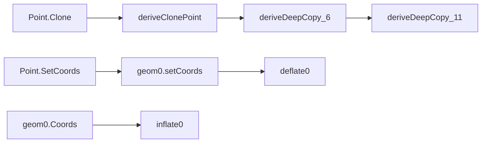

# Construtores de Point, estado das coordenadas e cópia gerada

Candidato de pesquisa;não publicado,aprovado pelo proprietário ou gold de treinamento.

Revision: `ccb5701a505df08114edca6b19efaf9d3f01fc8d`.

## Propósito

Este capítulo acompanha a implementação fixada de `Point` pelo estado incorporado, pelos auxiliares de coordenadas e pelo caminho de clonagem gerado. Distingue cópia escrita, atribuição direta de fatia e propagação de erros, sem tratar todo acessor ou construtor como equivalente. [source:Point] [source:NewPointFlat] [source:geom0.Coords] [source:Point.Clone]

## Arquitetura

`Point` incorpora `geom0`. Essa estrutura declara `layout`, `stride`, `flatCoords` e `srid`. Os construtores e métodos selecionados leem ou escrevem essa representação compartilhada; não foi realizada uma verificação completa de pacote e tipos. [source:Point] [source:geom0] [source:NewPointFlat] [source:Point.SetSRID]

## Responsabilidades

`NewPointFlat(l, flatCoords)` escreve `g.layout = l`, `g.stride = l.Stride()` e `g.flatCoords = flatCoords`, e então retorna `g`. O corpo selecionado contém atribuição direta da fatia recebida, sem chamada de cópia. Isso difere do caminho separado dos auxiliares de clonagem. [source:NewPointFlat] [source:Point.Clone] [source:deriveClonePoint]

`NewPoint` passa `make([]float64, l.Stride())` para `NewPointFlat`. `NewPointEmpty` passa `nil` para esse construtor. São entradas distintas nos construtores escritos; nenhuma alocação de exemplo ou operação com ponto vazio foi executada aqui. [source:NewPoint] [source:NewPointEmpty] [source:NewPointFlat]

`Point.SetSRID` escreve `g.srid = srid` e retorna `g`. O setter selecionado não contém ramificação de validação; ele não estabelece a validade de um SRID ou de um sistema de referência de coordenadas. [source:Point.SetSRID]

## Dependências e auxiliares gerados

`Point.Clone` retorna `deriveClonePoint(g)`. O código gerado contém então uma verificação de `nil`, `new(Point)` e `deriveDeepCopy_6(dst, src)`. Esse auxiliar chama `deriveDeepCopy_11` para a estrutura incorporada `geom0`. A diretiva do gerador nomeia `derived.gen.go`; o gerador não foi executado e seu executável e sua versão não foram verificados. [source:Point.Clone] [source:deriveClonePoint] [source:deriveDeepCopy_6] [source:package-and-generation]

`deriveDeepCopy_11` atribui `layout`, `stride` e `srid`, distingue fatias de coordenadas `nil` e contém ramificações de redimensionamento e alocação seguidas de `copy(dst.flatCoords, src.flatCoords)`. Isso fornece evidência concreta do auxiliar além de um comentário de clonagem; não é uma garantia medida de segurança concorrente ou de vínculo completo do pacote. [source:deriveDeepCopy_11] [source:deriveDeepCopy_6]

## Configuração

A declaração do módulo é `github.com/twpayne/go-geom` e a diretiva Go registrada é `go 1.26.3`. `Layout.Stride` escreve retornos 0, 2, 3, 3 e 4 para `NoLayout`, `XY`, `XYZ`, `XYM` e `XYZM`, respectivamente; o caso padrão retorna `int(l)`. Esses valores no código não validam layouts arbitrários recebidos do chamador. [source:module-toolchain] [source:Layout.Stride] [source:layout-constants]

## Entradas e saídas

`geom0.FlatCoords` retorna diretamente `g.flatCoords`. Já `geom0.Coords` chama `inflate0(g.flatCoords, 0, len(g.flatCoords), g.stride)`; esse auxiliar verifica a relação entre deslocamento, passo e limite, e então contém `make`, `copy` e o retorno da nova fatia local. Os dois caminhos escritos não devem ser documentados como o mesmo contrato de cópia. [source:geom0.FlatCoords] [source:geom0.Coords] [source:inflate0]

## Erros e mudanças de estado

`Point.SetCoords` chama `g.setCoords(coords)` e retorna `nil, err` no erro ou `g, nil` no outro caso. O método delegado `geom0.setCoords` primeiro atribui tanto `g.flatCoords` quanto `err` a partir de `deflate0(nil, coords0, g.stride)`. Na ramificação escrita de incompatibilidade de comprimento, `deflate0` retorna `nil` com `ErrStrideMismatch`. Assim, o caminho de erro mostrado inclui a atribuição desse valor retornado ao campo; o código selecionado não codifica rollback para a fatia anterior. [source:Point.SetCoords] [source:geom0.setCoords] [source:deflate0] [source:ErrStrideMismatch]

`Point.MustSetCoords` passa o resultado de `SetCoords` para `Must`; esse auxiliar contém `panic(err)` quando seu argumento de erro não é `nil`. Separadamente, `inflate0` contém `panic("geom: stride mismatch")` quando falha a relação entre deslocamento, passo e limite. São caminhos locais distintos de panic, sem constituir prova de que todo erro de geometria vira a mesma exceção ou valor retornado. [source:Point.MustSetCoords] [source:Must] [source:inflate0]

## Exemplo ilustrativo

Apenas ilustrativo;não compilado nem executado,sem saída afirmada.

```go
package main

import "github.com/twpayne/go-geom"

func main() {
    p := geom.NewPointFlat(geom.XY, []float64{1, 2})
    q := p.Clone()
    if _, err := q.SetCoords([]float64{3, 4}); err != nil {
        panic(err)
    }
}
```

[source:module-toolchain] [source:layout-constants] [source:NewPointFlat] [source:Point.Clone] [source:Point.SetCoords]

## Comando ilustrativo

Apenas ilustrativo;não compilado nem executado,sem saída afirmada.

```sh
go doc github.com/twpayne/go-geom.Point
```

[source:module-toolchain] [source:layout-constants] [source:NewPointFlat] [source:Point.Clone] [source:Point.SetCoords]

## Mapa do código

| Unit | File |
|---|---|
| `Point` | `point.go` |
| `geom0` | `flat.go` |
| `Layout.Stride` | `geom.go` |
| `Point.SetCoords` | `point.go` |
| `deflate0` | `flat.go` |
| `Point.Clone` | `point.go` |
| `deriveClonePoint` | `derived.gen.go` |
| `deriveDeepCopy_6` | `derived.gen.go` |
| `deriveDeepCopy_11` | `derived.gen.go` |

## Relações escritas entre auxiliares

Relações de chamadas escritas;sem representar rastreamento de execução medido.



[source:Point.Clone] [source:deriveClonePoint] [source:deriveDeepCopy_6] [source:Point.SetCoords] [source:geom0.setCoords] [source:geom0.Coords]

## Perguntas frequentes

### O construtor selecionado de coordenadas planas copia sua entrada?

`NewPointFlat(l, flatCoords)` escreve `g.layout = l`, `g.stride = l.Stride()` e `g.flatCoords = flatCoords`, e então retorna `g`. O corpo selecionado contém atribuição direta da fatia recebida, sem chamada de cópia. Isso difere do caminho separado dos auxiliares de clonagem. [source:NewPointFlat] [source:Point.Clone] [source:deriveClonePoint]

### Os dois acessores de coordenadas mostram o mesmo caminho de cópia?

`geom0.FlatCoords` retorna diretamente `g.flatCoords`. Já `geom0.Coords` chama `inflate0(g.flatCoords, 0, len(g.flatCoords), g.stride)`; esse auxiliar verifica a relação entre deslocamento, passo e limite, e então contém `make`, `copy` e o retorno da nova fatia local. Os dois caminhos escritos não devem ser documentados como o mesmo contrato de cópia. [source:geom0.FlatCoords] [source:geom0.Coords] [source:inflate0]

### O caminho de erro de coordenadas mostrado preserva a fatia anterior por rollback?

`Point.SetCoords` chama `g.setCoords(coords)` e retorna `nil, err` no erro ou `g, nil` no outro caso. O método delegado `geom0.setCoords` primeiro atribui tanto `g.flatCoords` quanto `err` a partir de `deflate0(nil, coords0, g.stride)`. Na ramificação escrita de incompatibilidade de comprimento, `deflate0` retorna `nil` com `ErrStrideMismatch`. Assim, o caminho de erro mostrado inclui a atribuição desse valor retornado ao campo; o código selecionado não codifica rollback para a fatia anterior. [source:Point.SetCoords] [source:geom0.setCoords] [source:deflate0] [source:ErrStrideMismatch]

### Que evidência sustenta o caminho de clonagem além de seu comentário?

`deriveDeepCopy_11` atribui `layout`, `stride` e `srid`, distingue fatias de coordenadas `nil` e contém ramificações de redimensionamento e alocação seguidas de `copy(dst.flatCoords, src.flatCoords)`. Isso fornece evidência concreta do auxiliar além de um comentário de clonagem; não é uma garantia medida de segurança concorrente ou de vínculo completo do pacote. [source:deriveDeepCopy_11] [source:deriveDeepCopy_6]

### Onde aparecem os caminhos de panic selecionados?

`Point.MustSetCoords` passa o resultado de `SetCoords` para `Must`; esse auxiliar contém `panic(err)` quando seu argumento de erro não é `nil`. Separadamente, `inflate0` contém `panic("geom: stride mismatch")` quando falha a relação entre deslocamento, passo e limite. São caminhos locais distintos de panic, sem constituir prova de que todo erro de geometria vira a mesma exceção ou valor retornado. [source:Point.MustSetCoords] [source:Must] [source:inflate0]

### O que o construtor vazio passa para o construtor de coordenadas planas?

`NewPoint` passa `make([]float64, l.Stride())` para `NewPointFlat`. `NewPointEmpty` passa `nil` para esse construtor. São entradas distintas nos construtores escritos; nenhuma alocação de exemplo ou operação com ponto vazio foi executada aqui. [source:NewPoint] [source:NewPointEmpty] [source:NewPointFlat]

### O setter de SRID selecionado valida o identificador?

`Point.SetSRID` escreve `g.srid = srid` e retorna `g`. O setter selecionado não contém ramificação de validação; ele não estabelece a validade de um SRID ou de um sistema de referência de coordenadas. [source:Point.SetSRID]

## Limitações

O conjunto de código inclui declarações selecionadas completas e intervalos explícitos separados de metadados. Não estabelece seleção completa de build, resolução de dependências, identidade em execução, ausência de condições de corrida, segurança entre threads, reprodutibilidade do gerador ou execução no Windows. Os exemplos e comandos ilustrativos abaixo não foram compilados nem executados; nenhuma saída ou instalação bem-sucedida do módulo é afirmada. [source:package-and-generation] [source:module-toolchain] [source:deriveClonePoint] [source:deriveDeepCopy_11]

## Citações físicas do código

- [source:Point] [point.go:15–17](https://github.com/twpayne/go-geom/blob/ccb5701a505df08114edca6b19efaf9d3f01fc8d/point.go#L15-L17); SHA-256 `0501ecd459f7f84d75c83ecc4f702497babc902df679a66cc8a0fa6b14e3243c`.

- [source:NewPoint] [point.go:20–22](https://github.com/twpayne/go-geom/blob/ccb5701a505df08114edca6b19efaf9d3f01fc8d/point.go#L20-L22); SHA-256 `0501ecd459f7f84d75c83ecc4f702497babc902df679a66cc8a0fa6b14e3243c`.

- [source:NewPointEmpty] [point.go:25–27](https://github.com/twpayne/go-geom/blob/ccb5701a505df08114edca6b19efaf9d3f01fc8d/point.go#L25-L27); SHA-256 `0501ecd459f7f84d75c83ecc4f702497babc902df679a66cc8a0fa6b14e3243c`.

- [source:NewPointFlat] [point.go:30–36](https://github.com/twpayne/go-geom/blob/ccb5701a505df08114edca6b19efaf9d3f01fc8d/point.go#L30-L36); SHA-256 `0501ecd459f7f84d75c83ecc4f702497babc902df679a66cc8a0fa6b14e3243c`.

- [source:Point.SetCoords] [point.go:76–81](https://github.com/twpayne/go-geom/blob/ccb5701a505df08114edca6b19efaf9d3f01fc8d/point.go#L76-L81); SHA-256 `0501ecd459f7f84d75c83ecc4f702497babc902df679a66cc8a0fa6b14e3243c`.

- [source:Point.MustSetCoords] [point.go:70–73](https://github.com/twpayne/go-geom/blob/ccb5701a505df08114edca6b19efaf9d3f01fc8d/point.go#L70-L73); SHA-256 `0501ecd459f7f84d75c83ecc4f702497babc902df679a66cc8a0fa6b14e3243c`.

- [source:Point.Clone] [point.go:60–62](https://github.com/twpayne/go-geom/blob/ccb5701a505df08114edca6b19efaf9d3f01fc8d/point.go#L60-L62); SHA-256 `0501ecd459f7f84d75c83ecc4f702497babc902df679a66cc8a0fa6b14e3243c`.

- [source:Point.SetSRID] [point.go:84–87](https://github.com/twpayne/go-geom/blob/ccb5701a505df08114edca6b19efaf9d3f01fc8d/point.go#L84-L87); SHA-256 `0501ecd459f7f84d75c83ecc4f702497babc902df679a66cc8a0fa6b14e3243c`.

- [source:geom0] [flat.go:5–10](https://github.com/twpayne/go-geom/blob/ccb5701a505df08114edca6b19efaf9d3f01fc8d/flat.go#L5-L10); SHA-256 `605e0fd2ddc0da880eee9a383e245d31f9a0db870ce0a3681c654ff5909524ab`.

- [source:geom0.FlatCoords] [flat.go:53–55](https://github.com/twpayne/go-geom/blob/ccb5701a505df08114edca6b19efaf9d3f01fc8d/flat.go#L53-L55); SHA-256 `605e0fd2ddc0da880eee9a383e245d31f9a0db870ce0a3681c654ff5909524ab`.

- [source:geom0.Coords] [flat.go:32–34](https://github.com/twpayne/go-geom/blob/ccb5701a505df08114edca6b19efaf9d3f01fc8d/flat.go#L32-L34); SHA-256 `605e0fd2ddc0da880eee9a383e245d31f9a0db870ce0a3681c654ff5909524ab`.

- [source:geom0.setCoords] [flat.go:81–85](https://github.com/twpayne/go-geom/blob/ccb5701a505df08114edca6b19efaf9d3f01fc8d/flat.go#L81-L85); SHA-256 `605e0fd2ddc0da880eee9a383e245d31f9a0db870ce0a3681c654ff5909524ab`.

- [source:deflate0] [flat.go:284–290](https://github.com/twpayne/go-geom/blob/ccb5701a505df08114edca6b19efaf9d3f01fc8d/flat.go#L284-L290); SHA-256 `605e0fd2ddc0da880eee9a383e245d31f9a0db870ce0a3681c654ff5909524ab`.

- [source:inflate0] [flat.go:332–339](https://github.com/twpayne/go-geom/blob/ccb5701a505df08114edca6b19efaf9d3f01fc8d/flat.go#L332-L339); SHA-256 `605e0fd2ddc0da880eee9a383e245d31f9a0db870ce0a3681c654ff5909524ab`.

- [source:Layout] [geom.go:19–19](https://github.com/twpayne/go-geom/blob/ccb5701a505df08114edca6b19efaf9d3f01fc8d/geom.go#L19-L19); SHA-256 `15ee065994b2c90f5a493b0ce6694dfc06178ec443f10561aaa452ab64e4f172`.

- [source:Layout.Stride] [geom.go:147–162](https://github.com/twpayne/go-geom/blob/ccb5701a505df08114edca6b19efaf9d3f01fc8d/geom.go#L147-L162); SHA-256 `15ee065994b2c90f5a493b0ce6694dfc06178ec443f10561aaa452ab64e4f172`.

- [source:Must] [geom.go:232–237](https://github.com/twpayne/go-geom/blob/ccb5701a505df08114edca6b19efaf9d3f01fc8d/geom.go#L232-L237); SHA-256 `15ee065994b2c90f5a493b0ce6694dfc06178ec443f10561aaa452ab64e4f172`.

- [source:ErrStrideMismatch] [geom.go:47–50](https://github.com/twpayne/go-geom/blob/ccb5701a505df08114edca6b19efaf9d3f01fc8d/geom.go#L47-L50); SHA-256 `15ee065994b2c90f5a493b0ce6694dfc06178ec443f10561aaa452ab64e4f172`.

- [source:deriveClonePoint] [derived.gen.go:76–83](https://github.com/twpayne/go-geom/blob/ccb5701a505df08114edca6b19efaf9d3f01fc8d/derived.gen.go#L76-L83); SHA-256 `7bec045db89fc50174d1a99b941f13e79bdc049160cda71ac9b46c84933f13eb`.

- [source:deriveDeepCopy_6] [derived.gen.go:187–193](https://github.com/twpayne/go-geom/blob/ccb5701a505df08114edca6b19efaf9d3f01fc8d/derived.gen.go#L187-L193); SHA-256 `7bec045db89fc50174d1a99b941f13e79bdc049160cda71ac9b46c84933f13eb`.

- [source:deriveDeepCopy_11] [derived.gen.go:268–290](https://github.com/twpayne/go-geom/blob/ccb5701a505df08114edca6b19efaf9d3f01fc8d/derived.gen.go#L268-L290); SHA-256 `7bec045db89fc50174d1a99b941f13e79bdc049160cda71ac9b46c84933f13eb`.

- [source:package-and-generation] [geom.go:1–6](https://github.com/twpayne/go-geom/blob/ccb5701a505df08114edca6b19efaf9d3f01fc8d/geom.go#L1-L6); SHA-256 `15ee065994b2c90f5a493b0ce6694dfc06178ec443f10561aaa452ab64e4f172`.

- [source:layout-constants] [geom.go:21–32](https://github.com/twpayne/go-geom/blob/ccb5701a505df08114edca6b19efaf9d3f01fc8d/geom.go#L21-L32); SHA-256 `15ee065994b2c90f5a493b0ce6694dfc06178ec443f10561aaa452ab64e4f172`.

- [source:module-toolchain] [go.mod:1–3](https://github.com/twpayne/go-geom/blob/ccb5701a505df08114edca6b19efaf9d3f01fc8d/go.mod#L1-L3); SHA-256 `60b5865afe951339ceb60b79abe8a764710c2d61b1b034f20df3c8b998b94c7f`.
