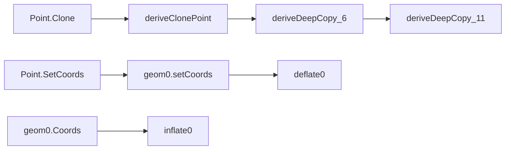

# Point constructors, coordinate state and generated copying

Research candidate;not published,owner-approved or training gold.

Revision: `ccb5701a505df08114edca6b19efaf9d3f01fc8d`.

## Purpose

This chapter follows the pinned `Point` implementation through its embedded state, coordinate helpers and generated clone path. It separates written copying, direct slice assignment and error propagation instead of treating every accessor or constructor as equivalent. [source:Point] [source:NewPointFlat] [source:geom0.Coords] [source:Point.Clone]

## Architecture

`Point` embeds `geom0`. The latter declares `layout`, `stride`, `flatCoords` and `srid`. The selected constructors and methods read or write that shared representation; the tracked root library was compiled with Go1.27.4 for Linux/ARM64, and its static method-set data was checked. Runtime behavior was not measured. [source:Point] [source:geom0] [source:NewPointFlat] [source:Point.SetSRID] [artifact:static-method-set-v2]

In the checked root package, the `Point` method set resolves `setCoords` to the declared receiver `*geom.geom0`, while `SetCoords` is declared on `*geom.Point`. This closes the selected static promotion question; it is not an execution trace. Private names missing from export metadata remain source-present and cannot be treated as removed. [source:Point] [source:Point.SetCoords] [source:geom0.setCoords] [artifact:static-method-set-v2]

## Responsibilities

`NewPointFlat(l, flatCoords)` writes `g.layout = l`, `g.stride = l.Stride()` and `g.flatCoords = flatCoords`, then returns `g`. Its selected body contains direct assignment of the supplied slice and no copying call. This differs from the separate clone-helper path. [source:NewPointFlat] [source:Point.Clone] [source:deriveClonePoint]

`NewPoint` passes `make([]float64, l.Stride())` to `NewPointFlat`. `NewPointEmpty` passes `nil` to that constructor. These are different written constructor inputs; no sample allocation or empty-point operation was executed here. [source:NewPoint] [source:NewPointEmpty] [source:NewPointFlat]

`Point.SetSRID` writes `g.srid = srid` and returns `g`. The selected setter contains no validation branch; it does not establish the validity of an SRID or a coordinate reference system. [source:Point.SetSRID]

## Dependencies and generated helpers

`Point.Clone` returns `deriveClonePoint(g)`. The generated source then contains a `nil` check, `new(Point)` and `deriveDeepCopy_6(dst, src)`. That helper calls `deriveDeepCopy_11` for the embedded `geom0`. The generator directive names `derived.gen.go`; the generator was not run and its executable/version was not verified. [source:Point.Clone] [source:deriveClonePoint] [source:deriveDeepCopy_6] [source:package-and-generation]

`deriveDeepCopy_11` assigns `layout`, `stride` and `srid`, distinguishes `nil` coordinate slices, and contains resizing/allocation branches followed by `copy(dst.flatCoords, src.flatCoords)`. This is concrete helper evidence beyond a clone comment; it is not a measured concurrent-safety or full-package binding guarantee. [source:deriveDeepCopy_11] [source:deriveDeepCopy_6]

## Configuration

The module declaration is `github.com/twpayne/go-geom` and the recorded Go directive is `go 1.26.3`. `Layout.Stride` writes returns 0, 2, 3, 3 and 4 for `NoLayout`, `XY`, `XYZ`, `XYM` and `XYZM`, respectively; the default returns `int(l)`. These source values do not validate arbitrary caller-provided layouts. [source:module-toolchain] [source:Layout.Stride] [source:layout-constants]

## Inputs and outputs

`geom0.FlatCoords` directly returns `g.flatCoords`. `geom0.Coords` instead calls `inflate0(g.flatCoords, 0, len(g.flatCoords), g.stride)`; that helper checks its offset/stride/end relation and then contains `make`, `copy` and a return of the new local slice. The two written paths should not be documented as the same copying contract. [source:geom0.FlatCoords] [source:geom0.Coords] [source:inflate0]

## Errors and state changes

`Point.SetCoords` calls `g.setCoords(coords)` and returns `nil, err` on error or `g, nil` otherwise. The delegated `geom0.setCoords` first assigns both `g.flatCoords` and `err` from `deflate0(nil, coords0, g.stride)`. On its written length-mismatch branch, `deflate0` returns `nil` with `ErrStrideMismatch`. Thus the shown error route includes assignment of that returned value to the field; the selected code does not encode rollback to the previous slice. [source:Point.SetCoords] [source:geom0.setCoords] [source:deflate0] [source:ErrStrideMismatch]

`Point.MustSetCoords` passes the `SetCoords` result to `Must`; that helper contains `panic(err)` when its error argument is not `nil`. Separately, `inflate0` contains `panic("geom: stride mismatch")` when its offset/stride/end relation fails. These are different local panic routes, not proof that every geometry error becomes the same exception or return value. [source:Point.MustSetCoords] [source:Must] [source:inflate0]

## Illustrative example

Statically compiled to an object against the verified library archive;not linked or executed,no output claimed.

```go
package main

import "github.com/twpayne/go-geom"

func main() {
    p := geom.NewPointFlat(geom.XY, []float64{1, 2})
    q := p.Clone()
    if _, err := q.SetCoords([]float64{3, 4}); err != nil {
        panic(err)
    }
}
```

[source:module-toolchain] [source:layout-constants] [source:NewPointFlat] [source:Point.Clone] [source:Point.SetCoords] [artifact:example-typecheck-v1]

## Illustrative command

Illustrative command;not executed,no output claimed.

```sh
go doc github.com/twpayne/go-geom.Point
```

[source:module-toolchain] [source:layout-constants] [source:NewPointFlat] [source:Point.Clone] [source:Point.SetCoords]

## Source map

| Unit | File |
|---|---|
| `Point` | `point.go` |
| `geom0` | `flat.go` |
| `Layout.Stride` | `geom.go` |
| `Point.SetCoords` | `point.go` |
| `deflate0` | `flat.go` |
| `Point.Clone` | `point.go` |
| `deriveClonePoint` | `derived.gen.go` |
| `deriveDeepCopy_6` | `derived.gen.go` |
| `deriveDeepCopy_11` | `derived.gen.go` |

## Written helper relationships

Written call relationships;not a measured execution trace.



[source:Point.Clone] [source:deriveClonePoint] [source:deriveDeepCopy_6] [source:Point.SetCoords] [source:geom0.setCoords] [source:geom0.Coords]

## FAQ

### Does the selected flat constructor copy its input?

`NewPointFlat(l, flatCoords)` writes `g.layout = l`, `g.stride = l.Stride()` and `g.flatCoords = flatCoords`, then returns `g`. Its selected body contains direct assignment of the supplied slice and no copying call. This differs from the separate clone-helper path. [source:NewPointFlat] [source:Point.Clone] [source:deriveClonePoint]

### Do both coordinate accessors show the same copying path?

`geom0.FlatCoords` directly returns `g.flatCoords`. `geom0.Coords` instead calls `inflate0(g.flatCoords, 0, len(g.flatCoords), g.stride)`; that helper checks its offset/stride/end relation and then contains `make`, `copy` and a return of the new local slice. The two written paths should not be documented as the same copying contract. [source:geom0.FlatCoords] [source:geom0.Coords] [source:inflate0]

### Does the shown coordinate error route preserve the previous slice by rollback?

`Point.SetCoords` calls `g.setCoords(coords)` and returns `nil, err` on error or `g, nil` otherwise. The delegated `geom0.setCoords` first assigns both `g.flatCoords` and `err` from `deflate0(nil, coords0, g.stride)`. On its written length-mismatch branch, `deflate0` returns `nil` with `ErrStrideMismatch`. Thus the shown error route includes assignment of that returned value to the field; the selected code does not encode rollback to the previous slice. [source:Point.SetCoords] [source:geom0.setCoords] [source:deflate0] [source:ErrStrideMismatch]

### What evidence supports the clone path beyond its comment?

`deriveDeepCopy_11` assigns `layout`, `stride` and `srid`, distinguishes `nil` coordinate slices, and contains resizing/allocation branches followed by `copy(dst.flatCoords, src.flatCoords)`. This is concrete helper evidence beyond a clone comment; it is not a measured concurrent-safety or full-package binding guarantee. [source:deriveDeepCopy_11] [source:deriveDeepCopy_6]

### Where do the selected panic routes appear?

`Point.MustSetCoords` passes the `SetCoords` result to `Must`; that helper contains `panic(err)` when its error argument is not `nil`. Separately, `inflate0` contains `panic("geom: stride mismatch")` when its offset/stride/end relation fails. These are different local panic routes, not proof that every geometry error becomes the same exception or return value. [source:Point.MustSetCoords] [source:Must] [source:inflate0]

### What does the empty constructor pass to the flat constructor?

`NewPoint` passes `make([]float64, l.Stride())` to `NewPointFlat`. `NewPointEmpty` passes `nil` to that constructor. These are different written constructor inputs; no sample allocation or empty-point operation was executed here. [source:NewPoint] [source:NewPointEmpty] [source:NewPointFlat]

### Does the selected SRID setter validate the identifier?

`Point.SetSRID` writes `g.srid = srid` and returns `g`. The selected setter contains no validation branch; it does not establish the validity of an SRID or a coordinate reference system. [source:Point.SetSRID]

## Limitations

The source pack includes complete selected declarations and separate explicit metadata ranges. The library build and method-set checks apply to this frozen tracked root package on Go1.27.4 Linux/ARM64. They do not establish another deployment, runtime identity, race freedom, thread safety, generator reproducibility or Windows execution. The exact example below was statically compiled to an object against the verified library archive, but was not linked or executed. The command remains unexecuted; no output or successful module installation is claimed. [source:package-and-generation] [source:module-toolchain] [source:deriveClonePoint] [source:deriveDeepCopy_11]

## Physical source citations

- [artifact:example-typecheck-v1] [Exact example static compiler receipt](../go-geom-example-typecheck-v1/receipt.json); SHA-256 `3c6465f17d0e8742d9a4225cbb927104c801a336d61cf4b96fd8239db57dd7e7`.

- [artifact:static-method-set-v2] [Static package and method-set receipt](../go-geom-static-method-set-v2/receipt.json); SHA-256 `b1accb9f929df7ed0a7b5bf4fd5beec45d1cda828b7274c80a949eeb7f34273e`.

- [source:Point] [point.go:15–17](https://github.com/twpayne/go-geom/blob/ccb5701a505df08114edca6b19efaf9d3f01fc8d/point.go#L15-L17); SHA-256 `0501ecd459f7f84d75c83ecc4f702497babc902df679a66cc8a0fa6b14e3243c`.

- [source:NewPoint] [point.go:20–22](https://github.com/twpayne/go-geom/blob/ccb5701a505df08114edca6b19efaf9d3f01fc8d/point.go#L20-L22); SHA-256 `0501ecd459f7f84d75c83ecc4f702497babc902df679a66cc8a0fa6b14e3243c`.

- [source:NewPointEmpty] [point.go:25–27](https://github.com/twpayne/go-geom/blob/ccb5701a505df08114edca6b19efaf9d3f01fc8d/point.go#L25-L27); SHA-256 `0501ecd459f7f84d75c83ecc4f702497babc902df679a66cc8a0fa6b14e3243c`.

- [source:NewPointFlat] [point.go:30–36](https://github.com/twpayne/go-geom/blob/ccb5701a505df08114edca6b19efaf9d3f01fc8d/point.go#L30-L36); SHA-256 `0501ecd459f7f84d75c83ecc4f702497babc902df679a66cc8a0fa6b14e3243c`.

- [source:Point.SetCoords] [point.go:76–81](https://github.com/twpayne/go-geom/blob/ccb5701a505df08114edca6b19efaf9d3f01fc8d/point.go#L76-L81); SHA-256 `0501ecd459f7f84d75c83ecc4f702497babc902df679a66cc8a0fa6b14e3243c`.

- [source:Point.MustSetCoords] [point.go:70–73](https://github.com/twpayne/go-geom/blob/ccb5701a505df08114edca6b19efaf9d3f01fc8d/point.go#L70-L73); SHA-256 `0501ecd459f7f84d75c83ecc4f702497babc902df679a66cc8a0fa6b14e3243c`.

- [source:Point.Clone] [point.go:60–62](https://github.com/twpayne/go-geom/blob/ccb5701a505df08114edca6b19efaf9d3f01fc8d/point.go#L60-L62); SHA-256 `0501ecd459f7f84d75c83ecc4f702497babc902df679a66cc8a0fa6b14e3243c`.

- [source:Point.SetSRID] [point.go:84–87](https://github.com/twpayne/go-geom/blob/ccb5701a505df08114edca6b19efaf9d3f01fc8d/point.go#L84-L87); SHA-256 `0501ecd459f7f84d75c83ecc4f702497babc902df679a66cc8a0fa6b14e3243c`.

- [source:geom0] [flat.go:5–10](https://github.com/twpayne/go-geom/blob/ccb5701a505df08114edca6b19efaf9d3f01fc8d/flat.go#L5-L10); SHA-256 `605e0fd2ddc0da880eee9a383e245d31f9a0db870ce0a3681c654ff5909524ab`.

- [source:geom0.FlatCoords] [flat.go:53–55](https://github.com/twpayne/go-geom/blob/ccb5701a505df08114edca6b19efaf9d3f01fc8d/flat.go#L53-L55); SHA-256 `605e0fd2ddc0da880eee9a383e245d31f9a0db870ce0a3681c654ff5909524ab`.

- [source:geom0.Coords] [flat.go:32–34](https://github.com/twpayne/go-geom/blob/ccb5701a505df08114edca6b19efaf9d3f01fc8d/flat.go#L32-L34); SHA-256 `605e0fd2ddc0da880eee9a383e245d31f9a0db870ce0a3681c654ff5909524ab`.

- [source:geom0.setCoords] [flat.go:81–85](https://github.com/twpayne/go-geom/blob/ccb5701a505df08114edca6b19efaf9d3f01fc8d/flat.go#L81-L85); SHA-256 `605e0fd2ddc0da880eee9a383e245d31f9a0db870ce0a3681c654ff5909524ab`.

- [source:deflate0] [flat.go:284–290](https://github.com/twpayne/go-geom/blob/ccb5701a505df08114edca6b19efaf9d3f01fc8d/flat.go#L284-L290); SHA-256 `605e0fd2ddc0da880eee9a383e245d31f9a0db870ce0a3681c654ff5909524ab`.

- [source:inflate0] [flat.go:332–339](https://github.com/twpayne/go-geom/blob/ccb5701a505df08114edca6b19efaf9d3f01fc8d/flat.go#L332-L339); SHA-256 `605e0fd2ddc0da880eee9a383e245d31f9a0db870ce0a3681c654ff5909524ab`.

- [source:Layout] [geom.go:19–19](https://github.com/twpayne/go-geom/blob/ccb5701a505df08114edca6b19efaf9d3f01fc8d/geom.go#L19-L19); SHA-256 `15ee065994b2c90f5a493b0ce6694dfc06178ec443f10561aaa452ab64e4f172`.

- [source:Layout.Stride] [geom.go:147–162](https://github.com/twpayne/go-geom/blob/ccb5701a505df08114edca6b19efaf9d3f01fc8d/geom.go#L147-L162); SHA-256 `15ee065994b2c90f5a493b0ce6694dfc06178ec443f10561aaa452ab64e4f172`.

- [source:Must] [geom.go:232–237](https://github.com/twpayne/go-geom/blob/ccb5701a505df08114edca6b19efaf9d3f01fc8d/geom.go#L232-L237); SHA-256 `15ee065994b2c90f5a493b0ce6694dfc06178ec443f10561aaa452ab64e4f172`.

- [source:ErrStrideMismatch] [geom.go:47–50](https://github.com/twpayne/go-geom/blob/ccb5701a505df08114edca6b19efaf9d3f01fc8d/geom.go#L47-L50); SHA-256 `15ee065994b2c90f5a493b0ce6694dfc06178ec443f10561aaa452ab64e4f172`.

- [source:deriveClonePoint] [derived.gen.go:76–83](https://github.com/twpayne/go-geom/blob/ccb5701a505df08114edca6b19efaf9d3f01fc8d/derived.gen.go#L76-L83); SHA-256 `7bec045db89fc50174d1a99b941f13e79bdc049160cda71ac9b46c84933f13eb`.

- [source:deriveDeepCopy_6] [derived.gen.go:187–193](https://github.com/twpayne/go-geom/blob/ccb5701a505df08114edca6b19efaf9d3f01fc8d/derived.gen.go#L187-L193); SHA-256 `7bec045db89fc50174d1a99b941f13e79bdc049160cda71ac9b46c84933f13eb`.

- [source:deriveDeepCopy_11] [derived.gen.go:268–290](https://github.com/twpayne/go-geom/blob/ccb5701a505df08114edca6b19efaf9d3f01fc8d/derived.gen.go#L268-L290); SHA-256 `7bec045db89fc50174d1a99b941f13e79bdc049160cda71ac9b46c84933f13eb`.

- [source:package-and-generation] [geom.go:1–6](https://github.com/twpayne/go-geom/blob/ccb5701a505df08114edca6b19efaf9d3f01fc8d/geom.go#L1-L6); SHA-256 `15ee065994b2c90f5a493b0ce6694dfc06178ec443f10561aaa452ab64e4f172`.

- [source:layout-constants] [geom.go:21–32](https://github.com/twpayne/go-geom/blob/ccb5701a505df08114edca6b19efaf9d3f01fc8d/geom.go#L21-L32); SHA-256 `15ee065994b2c90f5a493b0ce6694dfc06178ec443f10561aaa452ab64e4f172`.

- [source:module-toolchain] [go.mod:1–3](https://github.com/twpayne/go-geom/blob/ccb5701a505df08114edca6b19efaf9d3f01fc8d/go.mod#L1-L3); SHA-256 `60b5865afe951339ceb60b79abe8a764710c2d61b1b034f20df3c8b998b94c7f`.
