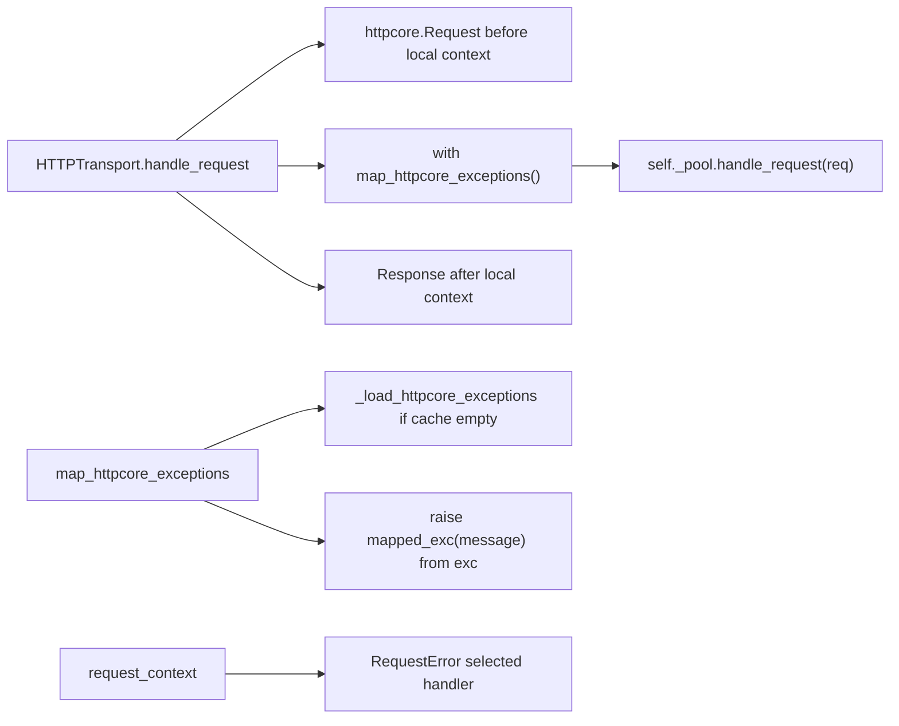

# HTTPX default transport: exception-map ownership and boundaries

Source-reviewed isolated candidate; not published, owner-approved or training gold.

Source cuts: `cc206cf2dad42600479962ac1daaa44675cfaf56` → `26d48e0634e6ee9cdc0533996db289ce4b430177`.

## Purpose and evidence cut

The selected `HTTPTransport` and `AsyncHTTPTransport` bodies adapt a request into `httpcore.Request`, call their pool, then write a `Response` construction. `ResponseStream` and `AsyncResponseStream` wrap the returned stream expressions. This chapter covers the pinned private implementation cuts, not the complete HTTPX API or a tested endpoint. [source:current:HTTPTransport.handle_request] [source:current:AsyncHTTPTransport.handle_async_request] [source:current:ResponseStream.__iter__] [source:current:AsyncResponseStream.__aiter__]

## Architecture and map initialization

At the earlier cut, `HTTPCORE_EXC_MAP` is a module-level literal dictionary. At the later cut it starts as `{}`; `map_httpcore_exceptions` declares it global and calls `_load_httpcore_exceptions()` when its length is zero, before the selected `try`/`yield`. The loader imports `httpcore` locally and returns the literal mapping. This is source structure, not a startup-time, dependency-availability or thread-safety measurement. [source:previous:mapping_provider] [source:previous:context] [source:current:mapping_provider] [source:current:context]

The fourteen ordered source/target reference pairs are unchanged across the two cuts. Each current target resolves through a written relative import to a class declaration in `_exceptions.py`, and its selected declared ancestry includes `RequestError`. Actual external class identity and runtime matching were not executed. An unchanged mapping table does not certify old physical citations after its provider moves. [source:previous:mapping_provider] [source:current:mapping_provider] [source:current:exception:RequestError] [source:current:exception:HTTPError]

## Responsibilities and local call boundaries

In both selected request methods, `httpcore.Request(...)` is constructed before `with map_httpcore_exceptions()`. The protected statement is the pool call, synchronous or awaited. The response-stream assertion and `Response(...)` return construction come after that local block. Claiming that this one block encloses every request/response setup failure would exceed its written scope. [source:current:HTTPTransport.handle_request] [source:current:AsyncHTTPTransport.handle_async_request]

The selected `ResponseStream.__iter__` and `AsyncResponseStream.__aiter__` loop inside an explicit mapper context. Their `close`/`aclose` bodies and the transport `close`/`aclose` bodies contain no explicit mapper context. Separately, `HTTPTransport.__exit__` and `AsyncHTTPTransport.__aexit__` do wrap their pool-exit call in that context. These local differences do not prove that a downstream close implementation can never translate errors. [source:current:ResponseStream.__iter__] [source:current:AsyncResponseStream.__aiter__] [source:current:ResponseStream.close] [source:current:AsyncResponseStream.aclose] [source:current:HTTPTransport.close] [source:current:AsyncHTTPTransport.aclose] [source:current:HTTPTransport.__exit__] [source:current:AsyncHTTPTransport.__aexit__]

## Written inputs and outputs

The request construction forwards written expressions for `method`, `url`, `headers`, `content` and `extensions`. The response construction forwards `resp.status`, `resp.headers` and `resp.extensions`, and supplies the selected stream wrapper. The source body contains assertions about stream interfaces; it does not by itself certify all runtime bindings, body buffering, copying behavior or higher-level status handling. [source:current:HTTPTransport.handle_request] [source:current:AsyncHTTPTransport.handle_async_request]

## Declared configuration and dependencies

Both selected transport constructors declare `retries=0`. Their `ConnectionPool`/`AsyncConnectionPool` call forwards that keyword, while the selected HTTP/SOCKS proxy constructor calls omit it. This is a keyword-forwarding observation, not a verified retry count, failure policy, timeout unit, TLS guarantee or proxy authentication result. The imported SSL/configuration helpers and external pool implementation are outside this evidence closure. [source:current:HTTPTransport.__init__] [source:current:AsyncHTTPTransport.__init__]

Both project manifests declare `requires-python = ">=3.8"` and dependency `httpcore==1.*`. The wildcard constraint is not an exact installed httpcore revision. No package installation, wheel compatibility matrix or supported-version execution was performed, and the later source tag is not presented as the latest release. [source:0.25.2:pyproject] [source:0.28.1:pyproject]

## Error translation and request context

The selected mapper catches `Exception`, tests `isinstance(exc, from_exc)`, and updates its accumulator when empty or when `issubclass(to_exc, mapped_exc)` holds. If no target was selected it uses a bare `raise`; otherwise it writes `message = str(exc)` followed by `raise mapped_exc(message) from exc`. This does not prove that every exception type is mapped, that every target relation is comparable or that every error is swallowed. [source:current:context]

`request_context` selects `RequestError`, assigns `exc.request = request` only under `request is not None`, then writes `raise exc`. `HTTPStatusError` is declared with base `HTTPError`, while `RequestError` is separately declared with base `HTTPError`. The selected handler therefore does not justify a promise about every declared `HTTPError` subtype; no runtime exception hierarchy was instantiated here. [source:current:request_context] [source:current:HTTPStatusError] [source:current:exception:RequestError]

The mapper constructs its selected exception with a message alone. `RequestError.__init__` declares an optional `request` defaulting to `None`, and the selected `HTTPError` property getter has a `RuntimeError` branch when its stored request is absent. These two files do not establish whether a higher client layer later attaches request context; the mapping call alone is not that guarantee. [source:current:context] [source:current:RequestError.__init__] [source:current:exception:HTTPError]

## Written mapping table

| Source expression | Target class name |
|---|---|
| `httpcore.TimeoutException` | `TimeoutException` |
| `httpcore.ConnectTimeout` | `ConnectTimeout` |
| `httpcore.ReadTimeout` | `ReadTimeout` |
| `httpcore.WriteTimeout` | `WriteTimeout` |
| `httpcore.PoolTimeout` | `PoolTimeout` |
| `httpcore.NetworkError` | `NetworkError` |
| `httpcore.ConnectError` | `ConnectError` |
| `httpcore.ReadError` | `ReadError` |
| `httpcore.WriteError` | `WriteError` |
| `httpcore.ProxyError` | `ProxyError` |
| `httpcore.UnsupportedProtocol` | `UnsupportedProtocol` |
| `httpcore.ProtocolError` | `ProtocolError` |
| `httpcore.LocalProtocolError` | `LocalProtocolError` |
| `httpcore.RemoteProtocolError` | `RemoteProtocolError` |

[source:current:mapping_provider] [source:previous:mapping_provider]

## Selected written call relationships



Edges summarize source statements, not verified runtime receivers or a complete network execution trace.

## Illustrative call shape and syntax command

This uses a pinned private helper and supplied placeholder pool/request bindings. It is syntax checked only, not a runnable public SDK recipe or an executed request. Imports and the displayed command were not run.

```python
from httpx._transports.default import map_httpcore_exceptions

def pool_call_shape(pool, req):
    with map_httpcore_exceptions():
        resp = pool.handle_request(req)
    return resp
```

```sh
python -m py_compile httpx-boundary-example.py
```

## FAQs

### Do the same mapping pairs make the whole chapter a NO-OP?

At the earlier cut, `HTTPCORE_EXC_MAP` is a module-level literal dictionary. At the later cut it starts as `{}`; `map_httpcore_exceptions` declares it global and calls `_load_httpcore_exceptions()` when its length is zero, before the selected `try`/`yield`. The loader imports `httpcore` locally and returns the literal mapping. This is source structure, not a startup-time, dependency-availability or thread-safety measurement. [source:previous:mapping_provider] [source:previous:context] [source:current:mapping_provider] [source:current:context]

### Does the mapper swallow or convert every exception?

The selected mapper catches `Exception`, tests `isinstance(exc, from_exc)`, and updates its accumulator when empty or when `issubclass(to_exc, mapped_exc)` holds. If no target was selected it uses a bare `raise`; otherwise it writes `message = str(exc)` followed by `raise mapped_exc(message) from exc`. This does not prove that every exception type is mapped, that every target relation is comparable or that every error is swallowed. [source:current:context]

### Are request construction and response construction inside the pool-call mapper block?

In both selected request methods, `httpcore.Request(...)` is constructed before `with map_httpcore_exceptions()`. The protected statement is the pool call, synchronous or awaited. The response-stream assertion and `Response(...)` return construction come after that local block. Claiming that this one block encloses every request/response setup failure would exceed its written scope. [source:current:HTTPTransport.handle_request] [source:current:AsyncHTTPTransport.handle_async_request]

### Do all close and context-exit paths show the same local mapping scope?

The selected `ResponseStream.__iter__` and `AsyncResponseStream.__aiter__` loop inside an explicit mapper context. Their `close`/`aclose` bodies and the transport `close`/`aclose` bodies contain no explicit mapper context. Separately, `HTTPTransport.__exit__` and `AsyncHTTPTransport.__aexit__` do wrap their pool-exit call in that context. These local differences do not prove that a downstream close implementation can never translate errors. [source:current:ResponseStream.__iter__] [source:current:AsyncResponseStream.__aiter__] [source:current:ResponseStream.close] [source:current:AsyncResponseStream.aclose] [source:current:HTTPTransport.close] [source:current:AsyncHTTPTransport.aclose] [source:current:HTTPTransport.__exit__] [source:current:AsyncHTTPTransport.__aexit__]

### Does request_context cover every HTTPError subtype?

`request_context` selects `RequestError`, assigns `exc.request = request` only under `request is not None`, then writes `raise exc`. `HTTPStatusError` is declared with base `HTTPError`, while `RequestError` is separately declared with base `HTTPError`. The selected handler therefore does not justify a promise about every declared `HTTPError` subtype; no runtime exception hierarchy was instantiated here. [source:current:request_context] [source:current:HTTPStatusError] [source:current:exception:RequestError]

### Does mapping alone prove an attached request object?

The mapper constructs its selected exception with a message alone. `RequestError.__init__` declares an optional `request` defaulting to `None`, and the selected `HTTPError` property getter has a `RuntimeError` branch when its stored request is absent. These two files do not establish whether a higher client layer later attaches request context; the mapping call alone is not that guarantee. [source:current:context] [source:current:RequestError.__init__] [source:current:exception:HTTPError]

### Does the retries parameter establish retries for every proxy or failure mode?

Both selected transport constructors declare `retries=0`. Their `ConnectionPool`/`AsyncConnectionPool` call forwards that keyword, while the selected HTTP/SOCKS proxy constructor calls omit it. This is a keyword-forwarding observation, not a verified retry count, failure policy, timeout unit, TLS guarantee or proxy authentication result. The imported SSL/configuration helpers and external pool implementation are outside this evidence closure. [source:current:HTTPTransport.__init__] [source:current:AsyncHTTPTransport.__init__]

## Limits and rights

The original three-clause redistribution notice is preserved. License presence is not owner approval for training. Prior local HTTPX-name references and post-inspection profile development are declared; these source cuts and chapter/FAQ candidates are excluded from training. Source hashes and declared class relationships do not establish complete application behavior. [source:current:license]

No HTTPX/httpcore source was imported or executed. No application HTTP request, runtime exception instantiation, TLS/authentication check, actual retry observation or performance measurement occurred. The two source cuts are correlated development material, not certified neural holdout data.

## Physical source references

[source:current:context]: ../new-public-sources-v1/encode--httpx/26d48e0634e6ee9cdc0533996db289ce4b430177/httpx/_transports/default.py#L95 "03379a454c95c0271c4f2c8d25ec437f49f57457f3cf2769748420bf0ecf2e79"

[source:current:mapping_provider]: ../new-public-sources-v1/encode--httpx/26d48e0634e6ee9cdc0533996db289ce4b430177/httpx/_transports/default.py#L74 "03379a454c95c0271c4f2c8d25ec437f49f57457f3cf2769748420bf0ecf2e79"

[source:current:exception:TimeoutException]: ../new-public-sources-v1/encode--httpx/26d48e0634e6ee9cdc0533996db289ce4b430177/httpx/_exceptions.py#L132 "6f15bb7f1ce054c01d3536f04f4567ab4e202435b5fe023f1858903ee3328cbd"

[source:current:exception:TransportError]: ../new-public-sources-v1/encode--httpx/26d48e0634e6ee9cdc0533996db289ce4b430177/httpx/_exceptions.py#L123 "6f15bb7f1ce054c01d3536f04f4567ab4e202435b5fe023f1858903ee3328cbd"

[source:current:exception:RequestError]: ../new-public-sources-v1/encode--httpx/26d48e0634e6ee9cdc0533996db289ce4b430177/httpx/_exceptions.py#L107 "6f15bb7f1ce054c01d3536f04f4567ab4e202435b5fe023f1858903ee3328cbd"

[source:current:exception:HTTPError]: ../new-public-sources-v1/encode--httpx/26d48e0634e6ee9cdc0533996db289ce4b430177/httpx/_exceptions.py#L74 "6f15bb7f1ce054c01d3536f04f4567ab4e202435b5fe023f1858903ee3328cbd"

[source:current:exception:ConnectTimeout]: ../new-public-sources-v1/encode--httpx/26d48e0634e6ee9cdc0533996db289ce4b430177/httpx/_exceptions.py#L140 "6f15bb7f1ce054c01d3536f04f4567ab4e202435b5fe023f1858903ee3328cbd"

[source:current:exception:ReadTimeout]: ../new-public-sources-v1/encode--httpx/26d48e0634e6ee9cdc0533996db289ce4b430177/httpx/_exceptions.py#L146 "6f15bb7f1ce054c01d3536f04f4567ab4e202435b5fe023f1858903ee3328cbd"

[source:current:exception:WriteTimeout]: ../new-public-sources-v1/encode--httpx/26d48e0634e6ee9cdc0533996db289ce4b430177/httpx/_exceptions.py#L152 "6f15bb7f1ce054c01d3536f04f4567ab4e202435b5fe023f1858903ee3328cbd"

[source:current:exception:PoolTimeout]: ../new-public-sources-v1/encode--httpx/26d48e0634e6ee9cdc0533996db289ce4b430177/httpx/_exceptions.py#L158 "6f15bb7f1ce054c01d3536f04f4567ab4e202435b5fe023f1858903ee3328cbd"

[source:current:exception:NetworkError]: ../new-public-sources-v1/encode--httpx/26d48e0634e6ee9cdc0533996db289ce4b430177/httpx/_exceptions.py#L167 "6f15bb7f1ce054c01d3536f04f4567ab4e202435b5fe023f1858903ee3328cbd"

[source:current:exception:ConnectError]: ../new-public-sources-v1/encode--httpx/26d48e0634e6ee9cdc0533996db289ce4b430177/httpx/_exceptions.py#L187 "6f15bb7f1ce054c01d3536f04f4567ab4e202435b5fe023f1858903ee3328cbd"

[source:current:exception:ReadError]: ../new-public-sources-v1/encode--httpx/26d48e0634e6ee9cdc0533996db289ce4b430177/httpx/_exceptions.py#L175 "6f15bb7f1ce054c01d3536f04f4567ab4e202435b5fe023f1858903ee3328cbd"

[source:current:exception:WriteError]: ../new-public-sources-v1/encode--httpx/26d48e0634e6ee9cdc0533996db289ce4b430177/httpx/_exceptions.py#L181 "6f15bb7f1ce054c01d3536f04f4567ab4e202435b5fe023f1858903ee3328cbd"

[source:current:exception:ProxyError]: ../new-public-sources-v1/encode--httpx/26d48e0634e6ee9cdc0533996db289ce4b430177/httpx/_exceptions.py#L202 "6f15bb7f1ce054c01d3536f04f4567ab4e202435b5fe023f1858903ee3328cbd"

[source:current:exception:UnsupportedProtocol]: ../new-public-sources-v1/encode--httpx/26d48e0634e6ee9cdc0533996db289ce4b430177/httpx/_exceptions.py#L208 "6f15bb7f1ce054c01d3536f04f4567ab4e202435b5fe023f1858903ee3328cbd"

[source:current:exception:ProtocolError]: ../new-public-sources-v1/encode--httpx/26d48e0634e6ee9cdc0533996db289ce4b430177/httpx/_exceptions.py#L216 "6f15bb7f1ce054c01d3536f04f4567ab4e202435b5fe023f1858903ee3328cbd"

[source:current:exception:LocalProtocolError]: ../new-public-sources-v1/encode--httpx/26d48e0634e6ee9cdc0533996db289ce4b430177/httpx/_exceptions.py#L222 "6f15bb7f1ce054c01d3536f04f4567ab4e202435b5fe023f1858903ee3328cbd"

[source:current:exception:RemoteProtocolError]: ../new-public-sources-v1/encode--httpx/26d48e0634e6ee9cdc0533996db289ce4b430177/httpx/_exceptions.py#L232 "6f15bb7f1ce054c01d3536f04f4567ab4e202435b5fe023f1858903ee3328cbd"

[source:current:HTTPTransport.handle_request]: ../new-public-sources-v1/encode--httpx/26d48e0634e6ee9cdc0533996db289ce4b430177/httpx/_transports/default.py#L230 "03379a454c95c0271c4f2c8d25ec437f49f57457f3cf2769748420bf0ecf2e79"

[source:current:AsyncHTTPTransport.handle_async_request]: ../new-public-sources-v1/encode--httpx/26d48e0634e6ee9cdc0533996db289ce4b430177/httpx/_transports/default.py#L374 "03379a454c95c0271c4f2c8d25ec437f49f57457f3cf2769748420bf0ecf2e79"

[source:current:ResponseStream.__iter__]: ../new-public-sources-v1/encode--httpx/26d48e0634e6ee9cdc0533996db289ce4b430177/httpx/_transports/default.py#L125 "03379a454c95c0271c4f2c8d25ec437f49f57457f3cf2769748420bf0ecf2e79"

[source:current:AsyncResponseStream.__aiter__]: ../new-public-sources-v1/encode--httpx/26d48e0634e6ee9cdc0533996db289ce4b430177/httpx/_transports/default.py#L269 "03379a454c95c0271c4f2c8d25ec437f49f57457f3cf2769748420bf0ecf2e79"

[source:current:ResponseStream.close]: ../new-public-sources-v1/encode--httpx/26d48e0634e6ee9cdc0533996db289ce4b430177/httpx/_transports/default.py#L130 "03379a454c95c0271c4f2c8d25ec437f49f57457f3cf2769748420bf0ecf2e79"

[source:current:AsyncResponseStream.aclose]: ../new-public-sources-v1/encode--httpx/26d48e0634e6ee9cdc0533996db289ce4b430177/httpx/_transports/default.py#L274 "03379a454c95c0271c4f2c8d25ec437f49f57457f3cf2769748420bf0ecf2e79"

[source:current:HTTPTransport.close]: ../new-public-sources-v1/encode--httpx/26d48e0634e6ee9cdc0533996db289ce4b430177/httpx/_transports/default.py#L261 "03379a454c95c0271c4f2c8d25ec437f49f57457f3cf2769748420bf0ecf2e79"

[source:current:AsyncHTTPTransport.aclose]: ../new-public-sources-v1/encode--httpx/26d48e0634e6ee9cdc0533996db289ce4b430177/httpx/_transports/default.py#L405 "03379a454c95c0271c4f2c8d25ec437f49f57457f3cf2769748420bf0ecf2e79"

[source:current:request_context]: ../new-public-sources-v1/encode--httpx/26d48e0634e6ee9cdc0533996db289ce4b430177/httpx/_exceptions.py#L366 "6f15bb7f1ce054c01d3536f04f4567ab4e202435b5fe023f1858903ee3328cbd"

[source:current:HTTPStatusError]: ../new-public-sources-v1/encode--httpx/26d48e0634e6ee9cdc0533996db289ce4b430177/httpx/_exceptions.py#L258 "6f15bb7f1ce054c01d3536f04f4567ab4e202435b5fe023f1858903ee3328cbd"

[source:current:RequestError.__init__]: ../new-public-sources-v1/encode--httpx/26d48e0634e6ee9cdc0533996db289ce4b430177/httpx/_exceptions.py#L112 "6f15bb7f1ce054c01d3536f04f4567ab4e202435b5fe023f1858903ee3328cbd"

[source:previous:context]: ../new-public-sources-v1/encode--httpx/cc206cf2dad42600479962ac1daaa44675cfaf56/httpx/_transports/default.py#L63 "ffdfd927d06a865abc2f5d328302ff62e1d0cca014fda38ae00c9983fc46fd13"

[source:previous:mapping_provider]: ../new-public-sources-v1/encode--httpx/cc206cf2dad42600479962ac1daaa44675cfaf56/httpx/_transports/default.py#L86 "ffdfd927d06a865abc2f5d328302ff62e1d0cca014fda38ae00c9983fc46fd13"

[source:current:HTTPTransport.__init__]: ../new-public-sources-v1/encode--httpx/26d48e0634e6ee9cdc0533996db289ce4b430177/httpx/_transports/default.py#L136 "03379a454c95c0271c4f2c8d25ec437f49f57457f3cf2769748420bf0ecf2e79"

[source:current:HTTPTransport.__exit__]: ../new-public-sources-v1/encode--httpx/26d48e0634e6ee9cdc0533996db289ce4b430177/httpx/_transports/default.py#L221 "03379a454c95c0271c4f2c8d25ec437f49f57457f3cf2769748420bf0ecf2e79"

[source:current:AsyncHTTPTransport.__init__]: ../new-public-sources-v1/encode--httpx/26d48e0634e6ee9cdc0533996db289ce4b430177/httpx/_transports/default.py#L280 "03379a454c95c0271c4f2c8d25ec437f49f57457f3cf2769748420bf0ecf2e79"

[source:current:AsyncHTTPTransport.__aexit__]: ../new-public-sources-v1/encode--httpx/26d48e0634e6ee9cdc0533996db289ce4b430177/httpx/_transports/default.py#L365 "03379a454c95c0271c4f2c8d25ec437f49f57457f3cf2769748420bf0ecf2e79"

[source:0.25.2:pyproject]: ../new-public-sources-v1/encode--httpx/cc206cf2dad42600479962ac1daaa44675cfaf56/pyproject.toml#L1 "ebdd530f4666646a9f09eceeb86d176801eec7c651d61a9a0f55b8616e4cf6c3"

[source:0.28.1:pyproject]: ../new-public-sources-v1/encode--httpx/26d48e0634e6ee9cdc0533996db289ce4b430177/pyproject.toml#L1 "df6ead82c82909bacc1f54fa0de8edc52dab17742d548d41c284506e3c05706f"

[source:current:license]: ../new-public-sources-v1/encode--httpx/26d48e0634e6ee9cdc0533996db289ce4b430177/LICENSE.md#L1 "4ec59d544f12b5f539a3a716fd321ac58ccd8030b465221f2c880200cdf28d8d"
