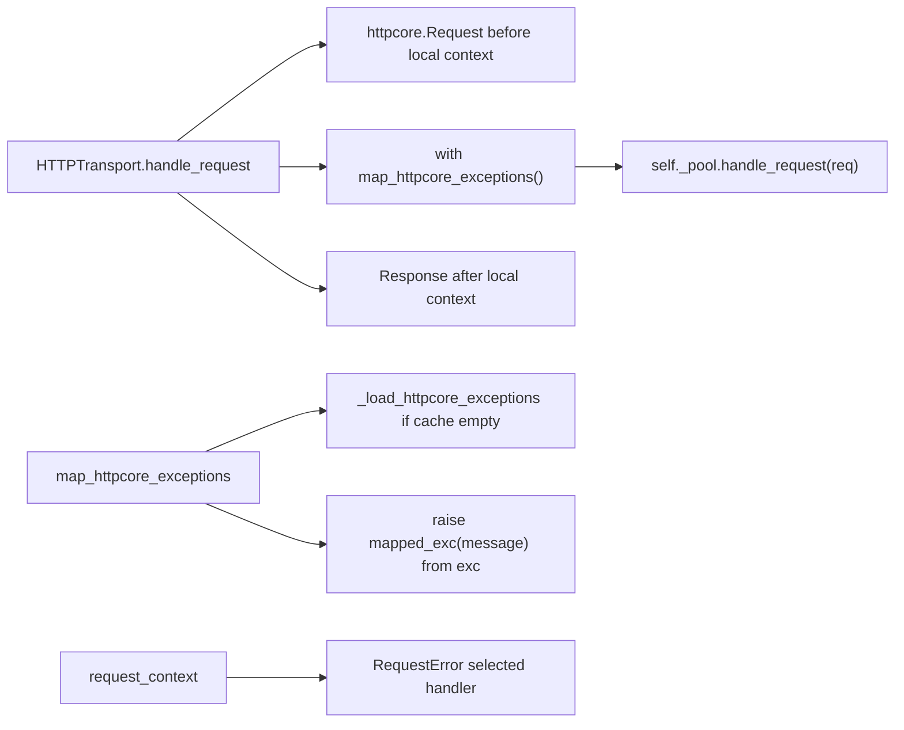

# HTTPX default transport: exception-map ownership and boundaries

Source-reviewed isolated candidate; not published, owner-approved or training gold.

Source cuts: `cc206cf2dad42600479962ac1daaa44675cfaf56` → `26d48e0634e6ee9cdc0533996db289ce4b430177`.

## Purpose and evidence cut

The selected `HTTPTransport` and `AsyncHTTPTransport` bodies adapt a request into `httpcore.Request`, call their pool, then write a `Response` construction. `ResponseStream` and `AsyncResponseStream` wrap the returned stream expressions. This chapter covers the pinned private implementation cuts, not the complete HTTPX API or a tested endpoint. [source:current:HTTPTransport.handle_request] [source:current:AsyncHTTPTransport.handle_async_request] [source:current:ResponseStream.__iter__] [source:current:AsyncResponseStream.__aiter__]

## Architecture and map initialization

At the earlier cut, `HTTPCORE_EXC_MAP` is a module-level literal dictionary. At the later cut it starts as `{}`; `map_httpcore_exceptions` declares it global and calls `_load_httpcore_exceptions()` when its length is zero, before the selected `try`/`yield`. The loader imports `httpcore` locally and returns the literal mapping. This is source structure, not a startup-time, dependency-availability or thread-safety measurement. [source:previous:mapping_provider] [source:previous:context] [source:current:mapping_provider] [source:current:context]

The fourteen ordered source/target reference pairs are unchanged across the two cuts. Each current target resolves through a written relative import to a class declaration in `_exceptions.py`, and its selected declared ancestry includes `RequestError`. The initial phase did not import or execute the external classes. The later confined phase below instantiates selected source definitions in owned namespaces; it does not verify installed package bindings. An unchanged mapping table does not certify old physical citations after its provider moves. [source:previous:mapping_provider] [source:current:mapping_provider] [source:current:exception-import-wire] [source:current:exception:TransportError] [source:current:exception:RequestError] [source:current:exception:HTTPError]

## Responsibilities and local call boundaries

In both selected request methods, `httpcore.Request(...)` is constructed before `with map_httpcore_exceptions()`. The protected statement is the pool call, synchronous or awaited. The response-stream assertion and `Response(...)` return construction come after that local block. Claiming that this one block encloses every request/response setup failure would exceed its written scope. [source:current:HTTPTransport.handle_request] [source:current:AsyncHTTPTransport.handle_async_request]

The selected `ResponseStream.__iter__` and `AsyncResponseStream.__aiter__` loop inside an explicit mapper context. Their `close`/`aclose` bodies and the transport `close`/`aclose` bodies contain no explicit mapper context. Separately, `HTTPTransport.__exit__` and `AsyncHTTPTransport.__aexit__` do wrap their pool-exit call in that context. These local differences do not prove that a downstream close implementation can never translate errors. [source:current:ResponseStream.__iter__] [source:current:AsyncResponseStream.__aiter__] [source:current:ResponseStream.close] [source:current:AsyncResponseStream.aclose] [source:current:HTTPTransport.close] [source:current:AsyncHTTPTransport.aclose] [source:current:HTTPTransport.__exit__] [source:current:AsyncHTTPTransport.__aexit__]

## Written inputs and outputs

The request construction forwards written expressions for `method`, `url`, `headers`, `content` and `extensions`. The response construction forwards `resp.status`, `resp.headers` and `resp.extensions`, and supplies the selected stream wrapper. The source body contains assertions about stream interfaces; it does not by itself certify all runtime bindings, body buffering, copying behavior or higher-level status handling. [source:current:HTTPTransport.handle_request] [source:current:AsyncHTTPTransport.handle_async_request]

## Declared configuration and dependencies

Both selected transport constructors declare `retries=0`. Their `ConnectionPool`/`AsyncConnectionPool` call forwards that keyword, while the selected HTTP/SOCKS proxy constructor calls omit it. This is a keyword-forwarding observation, not a verified retry count, failure policy, timeout unit, TLS guarantee or proxy authentication result. The imported SSL/configuration helpers and external pool implementation are outside this evidence closure. [source:current:HTTPTransport.__init__] [source:current:AsyncHTTPTransport.__init__]

Both project manifests declare `requires-python = ">=3.8"` and dependency `httpcore==1.*`. The wildcard constraint is not an exact installed httpcore revision. No package installation, wheel compatibility matrix or supported-version execution was performed, and the later source tag is not presented as the latest release. [source:0.25.2:pyproject] [source:0.28.1:pyproject]

## Error translation and request context

The selected mapper catches `Exception`, tests `isinstance(exc, from_exc)`, and updates its accumulator when empty or when `issubclass(to_exc, mapped_exc)` holds. If no target was selected it uses a bare `raise`; otherwise it writes `message = str(exc)` followed by `raise mapped_exc(message) from exc`. This does not prove that every exception type is mapped, that every target relation is comparable or that every error is swallowed. [source:current:context]

`request_context` selects `RequestError`, assigns `exc.request = request` only under `request is not None`, then writes `raise exc`. `HTTPStatusError` is declared with base `HTTPError`, while `RequestError` is separately declared with base `HTTPError`. The selected handler therefore does not justify a promise about every declared `HTTPError` subtype; the initial phase did not instantiate the runtime exception hierarchy; the confined follow-up below observes selected class definitions. [source:current:request_context] [source:current:HTTPStatusError] [source:current:exception:RequestError]

The mapper constructs its selected exception with a message alone. `RequestError.__init__` declares an optional `request` defaulting to `None`, and the selected `HTTPError` property getter has a `RuntimeError` branch when its stored request is absent. These two files do not establish whether a higher client layer later attaches request context; the mapping call alone is not that guarantee. [source:current:context] [source:current:RequestError.__init__] [source:current:exception:HTTPError]

## Written mapping table

| Source expression | Target class name | Declared source path |
|---|---|---|
| `httpcore.TimeoutException` | `TimeoutException` | `TimeoutException` → `TransportError` → `RequestError` → `HTTPError` → `Exception` [source:current:exception:TimeoutException] [source:current:exception:TransportError] [source:current:exception:RequestError] [source:current:exception:HTTPError] |
| `httpcore.ConnectTimeout` | `ConnectTimeout` | `ConnectTimeout` → `TimeoutException` → `TransportError` → `RequestError` → `HTTPError` → `Exception` [source:current:exception:ConnectTimeout] [source:current:exception:TimeoutException] [source:current:exception:TransportError] [source:current:exception:RequestError] [source:current:exception:HTTPError] |
| `httpcore.ReadTimeout` | `ReadTimeout` | `ReadTimeout` → `TimeoutException` → `TransportError` → `RequestError` → `HTTPError` → `Exception` [source:current:exception:ReadTimeout] [source:current:exception:TimeoutException] [source:current:exception:TransportError] [source:current:exception:RequestError] [source:current:exception:HTTPError] |
| `httpcore.WriteTimeout` | `WriteTimeout` | `WriteTimeout` → `TimeoutException` → `TransportError` → `RequestError` → `HTTPError` → `Exception` [source:current:exception:WriteTimeout] [source:current:exception:TimeoutException] [source:current:exception:TransportError] [source:current:exception:RequestError] [source:current:exception:HTTPError] |
| `httpcore.PoolTimeout` | `PoolTimeout` | `PoolTimeout` → `TimeoutException` → `TransportError` → `RequestError` → `HTTPError` → `Exception` [source:current:exception:PoolTimeout] [source:current:exception:TimeoutException] [source:current:exception:TransportError] [source:current:exception:RequestError] [source:current:exception:HTTPError] |
| `httpcore.NetworkError` | `NetworkError` | `NetworkError` → `TransportError` → `RequestError` → `HTTPError` → `Exception` [source:current:exception:NetworkError] [source:current:exception:TransportError] [source:current:exception:RequestError] [source:current:exception:HTTPError] |
| `httpcore.ConnectError` | `ConnectError` | `ConnectError` → `NetworkError` → `TransportError` → `RequestError` → `HTTPError` → `Exception` [source:current:exception:ConnectError] [source:current:exception:NetworkError] [source:current:exception:TransportError] [source:current:exception:RequestError] [source:current:exception:HTTPError] |
| `httpcore.ReadError` | `ReadError` | `ReadError` → `NetworkError` → `TransportError` → `RequestError` → `HTTPError` → `Exception` [source:current:exception:ReadError] [source:current:exception:NetworkError] [source:current:exception:TransportError] [source:current:exception:RequestError] [source:current:exception:HTTPError] |
| `httpcore.WriteError` | `WriteError` | `WriteError` → `NetworkError` → `TransportError` → `RequestError` → `HTTPError` → `Exception` [source:current:exception:WriteError] [source:current:exception:NetworkError] [source:current:exception:TransportError] [source:current:exception:RequestError] [source:current:exception:HTTPError] |
| `httpcore.ProxyError` | `ProxyError` | `ProxyError` → `TransportError` → `RequestError` → `HTTPError` → `Exception` [source:current:exception:ProxyError] [source:current:exception:TransportError] [source:current:exception:RequestError] [source:current:exception:HTTPError] |
| `httpcore.UnsupportedProtocol` | `UnsupportedProtocol` | `UnsupportedProtocol` → `TransportError` → `RequestError` → `HTTPError` → `Exception` [source:current:exception:UnsupportedProtocol] [source:current:exception:TransportError] [source:current:exception:RequestError] [source:current:exception:HTTPError] |
| `httpcore.ProtocolError` | `ProtocolError` | `ProtocolError` → `TransportError` → `RequestError` → `HTTPError` → `Exception` [source:current:exception:ProtocolError] [source:current:exception:TransportError] [source:current:exception:RequestError] [source:current:exception:HTTPError] |
| `httpcore.LocalProtocolError` | `LocalProtocolError` | `LocalProtocolError` → `ProtocolError` → `TransportError` → `RequestError` → `HTTPError` → `Exception` [source:current:exception:LocalProtocolError] [source:current:exception:ProtocolError] [source:current:exception:TransportError] [source:current:exception:RequestError] [source:current:exception:HTTPError] |
| `httpcore.RemoteProtocolError` | `RemoteProtocolError` | `RemoteProtocolError` → `ProtocolError` → `TransportError` → `RequestError` → `HTTPError` → `Exception` [source:current:exception:RemoteProtocolError] [source:current:exception:ProtocolError] [source:current:exception:TransportError] [source:current:exception:RequestError] [source:current:exception:HTTPError] |

[source:current:mapping_provider] [source:previous:mapping_provider]

## Selected written call relationships



Edges summarize source statements, not verified runtime receivers or a complete network execution trace.

## Illustrative call shape and syntax command

This uses a pinned private helper and supplied placeholder pool/request bindings. It is syntax checked only, not a runnable public SDK recipe or an executed request. Imports and the displayed command were not run.

```python
from httpx._transports.default import map_httpcore_exceptions

def pool_call_shape(pool, req):
    with map_httpcore_exceptions():
        resp = pool.handle_request(req)
    return resp
```

```sh
python -m py_compile httpx-boundary-example.py
```

## FAQs

### Do the same mapping pairs make the whole chapter a NO-OP?

At the earlier cut, `HTTPCORE_EXC_MAP` is a module-level literal dictionary. At the later cut it starts as `{}`; `map_httpcore_exceptions` declares it global and calls `_load_httpcore_exceptions()` when its length is zero, before the selected `try`/`yield`. The loader imports `httpcore` locally and returns the literal mapping. This is source structure, not a startup-time, dependency-availability or thread-safety measurement. [source:previous:mapping_provider] [source:previous:context] [source:current:mapping_provider] [source:current:context]

### Does the mapper swallow or convert every exception?

The selected mapper catches `Exception`, tests `isinstance(exc, from_exc)`, and updates its accumulator when empty or when `issubclass(to_exc, mapped_exc)` holds. If no target was selected it uses a bare `raise`; otherwise it writes `message = str(exc)` followed by `raise mapped_exc(message) from exc`. This does not prove that every exception type is mapped, that every target relation is comparable or that every error is swallowed. [source:current:context]

### Are request construction and response construction inside the pool-call mapper block?

In both selected request methods, `httpcore.Request(...)` is constructed before `with map_httpcore_exceptions()`. The protected statement is the pool call, synchronous or awaited. The response-stream assertion and `Response(...)` return construction come after that local block. Claiming that this one block encloses every request/response setup failure would exceed its written scope. [source:current:HTTPTransport.handle_request] [source:current:AsyncHTTPTransport.handle_async_request]

### Do all close and context-exit paths show the same local mapping scope?

The selected `ResponseStream.__iter__` and `AsyncResponseStream.__aiter__` loop inside an explicit mapper context. Their `close`/`aclose` bodies and the transport `close`/`aclose` bodies contain no explicit mapper context. Separately, `HTTPTransport.__exit__` and `AsyncHTTPTransport.__aexit__` do wrap their pool-exit call in that context. These local differences do not prove that a downstream close implementation can never translate errors. [source:current:ResponseStream.__iter__] [source:current:AsyncResponseStream.__aiter__] [source:current:ResponseStream.close] [source:current:AsyncResponseStream.aclose] [source:current:HTTPTransport.close] [source:current:AsyncHTTPTransport.aclose] [source:current:HTTPTransport.__exit__] [source:current:AsyncHTTPTransport.__aexit__]

### Does request_context cover every HTTPError subtype?

`request_context` selects `RequestError`, assigns `exc.request = request` only under `request is not None`, then writes `raise exc`. `HTTPStatusError` is declared with base `HTTPError`, while `RequestError` is separately declared with base `HTTPError`. The selected handler therefore does not justify a promise about every declared `HTTPError` subtype; the initial phase did not instantiate the runtime exception hierarchy; the confined follow-up below observes selected class definitions. [source:current:request_context] [source:current:HTTPStatusError] [source:current:exception:RequestError]

### Does mapping alone prove an attached request object?

The mapper constructs its selected exception with a message alone. `RequestError.__init__` declares an optional `request` defaulting to `None`, and the selected `HTTPError` property getter has a `RuntimeError` branch when its stored request is absent. These two files do not establish whether a higher client layer later attaches request context; the mapping call alone is not that guarantee. [source:current:context] [source:current:RequestError.__init__] [source:current:exception:HTTPError]

### Does the retries parameter establish retries for every proxy or failure mode?

Both selected transport constructors declare `retries=0`. Their `ConnectionPool`/`AsyncConnectionPool` call forwards that keyword, while the selected HTTP/SOCKS proxy constructor calls omit it. This is a keyword-forwarding observation, not a verified retry count, failure policy, timeout unit, TLS guarantee or proxy authentication result. The imported SSL/configuration helpers and external pool implementation are outside this evidence closure. [source:current:HTTPTransport.__init__] [source:current:AsyncHTTPTransport.__init__]

## Limits and rights

The original three-clause redistribution notice is preserved. License presence is not owner approval for training. Prior local HTTPX-name references and post-inspection profile development are declared; these source cuts and chapter/FAQ candidates are excluded from training. Source hashes and declared class relationships do not establish complete application behavior. [source:current:license]

The initial static phase imported or executed no HTTPX/httpcore source. No application HTTP request, runtime exception instantiation in that phase, TLS/authentication check, actual retry observation or performance measurement occurred. The two source cuts are correlated development material, not certified neural holdout data.

## Physical source references

[source:current:context]: ../new-public-sources-v1/encode--httpx/26d48e0634e6ee9cdc0533996db289ce4b430177/httpx/_transports/default.py#L95 "03379a454c95c0271c4f2c8d25ec437f49f57457f3cf2769748420bf0ecf2e79"

[source:current:mapping_provider]: ../new-public-sources-v1/encode--httpx/26d48e0634e6ee9cdc0533996db289ce4b430177/httpx/_transports/default.py#L74 "03379a454c95c0271c4f2c8d25ec437f49f57457f3cf2769748420bf0ecf2e79"

[source:current:exception:TimeoutException]: ../new-public-sources-v1/encode--httpx/26d48e0634e6ee9cdc0533996db289ce4b430177/httpx/_exceptions.py#L132 "6f15bb7f1ce054c01d3536f04f4567ab4e202435b5fe023f1858903ee3328cbd"

[source:current:exception:TransportError]: ../new-public-sources-v1/encode--httpx/26d48e0634e6ee9cdc0533996db289ce4b430177/httpx/_exceptions.py#L123 "6f15bb7f1ce054c01d3536f04f4567ab4e202435b5fe023f1858903ee3328cbd"

[source:current:exception:RequestError]: ../new-public-sources-v1/encode--httpx/26d48e0634e6ee9cdc0533996db289ce4b430177/httpx/_exceptions.py#L107 "6f15bb7f1ce054c01d3536f04f4567ab4e202435b5fe023f1858903ee3328cbd"

[source:current:exception:HTTPError]: ../new-public-sources-v1/encode--httpx/26d48e0634e6ee9cdc0533996db289ce4b430177/httpx/_exceptions.py#L74 "6f15bb7f1ce054c01d3536f04f4567ab4e202435b5fe023f1858903ee3328cbd"

[source:current:exception:ConnectTimeout]: ../new-public-sources-v1/encode--httpx/26d48e0634e6ee9cdc0533996db289ce4b430177/httpx/_exceptions.py#L140 "6f15bb7f1ce054c01d3536f04f4567ab4e202435b5fe023f1858903ee3328cbd"

[source:current:exception:ReadTimeout]: ../new-public-sources-v1/encode--httpx/26d48e0634e6ee9cdc0533996db289ce4b430177/httpx/_exceptions.py#L146 "6f15bb7f1ce054c01d3536f04f4567ab4e202435b5fe023f1858903ee3328cbd"

[source:current:exception:WriteTimeout]: ../new-public-sources-v1/encode--httpx/26d48e0634e6ee9cdc0533996db289ce4b430177/httpx/_exceptions.py#L152 "6f15bb7f1ce054c01d3536f04f4567ab4e202435b5fe023f1858903ee3328cbd"

[source:current:exception:PoolTimeout]: ../new-public-sources-v1/encode--httpx/26d48e0634e6ee9cdc0533996db289ce4b430177/httpx/_exceptions.py#L158 "6f15bb7f1ce054c01d3536f04f4567ab4e202435b5fe023f1858903ee3328cbd"

[source:current:exception:NetworkError]: ../new-public-sources-v1/encode--httpx/26d48e0634e6ee9cdc0533996db289ce4b430177/httpx/_exceptions.py#L167 "6f15bb7f1ce054c01d3536f04f4567ab4e202435b5fe023f1858903ee3328cbd"

[source:current:exception:ConnectError]: ../new-public-sources-v1/encode--httpx/26d48e0634e6ee9cdc0533996db289ce4b430177/httpx/_exceptions.py#L187 "6f15bb7f1ce054c01d3536f04f4567ab4e202435b5fe023f1858903ee3328cbd"

[source:current:exception:ReadError]: ../new-public-sources-v1/encode--httpx/26d48e0634e6ee9cdc0533996db289ce4b430177/httpx/_exceptions.py#L175 "6f15bb7f1ce054c01d3536f04f4567ab4e202435b5fe023f1858903ee3328cbd"

[source:current:exception:WriteError]: ../new-public-sources-v1/encode--httpx/26d48e0634e6ee9cdc0533996db289ce4b430177/httpx/_exceptions.py#L181 "6f15bb7f1ce054c01d3536f04f4567ab4e202435b5fe023f1858903ee3328cbd"

[source:current:exception:ProxyError]: ../new-public-sources-v1/encode--httpx/26d48e0634e6ee9cdc0533996db289ce4b430177/httpx/_exceptions.py#L202 "6f15bb7f1ce054c01d3536f04f4567ab4e202435b5fe023f1858903ee3328cbd"

[source:current:exception:UnsupportedProtocol]: ../new-public-sources-v1/encode--httpx/26d48e0634e6ee9cdc0533996db289ce4b430177/httpx/_exceptions.py#L208 "6f15bb7f1ce054c01d3536f04f4567ab4e202435b5fe023f1858903ee3328cbd"

[source:current:exception:ProtocolError]: ../new-public-sources-v1/encode--httpx/26d48e0634e6ee9cdc0533996db289ce4b430177/httpx/_exceptions.py#L216 "6f15bb7f1ce054c01d3536f04f4567ab4e202435b5fe023f1858903ee3328cbd"

[source:current:exception:LocalProtocolError]: ../new-public-sources-v1/encode--httpx/26d48e0634e6ee9cdc0533996db289ce4b430177/httpx/_exceptions.py#L222 "6f15bb7f1ce054c01d3536f04f4567ab4e202435b5fe023f1858903ee3328cbd"

[source:current:exception:RemoteProtocolError]: ../new-public-sources-v1/encode--httpx/26d48e0634e6ee9cdc0533996db289ce4b430177/httpx/_exceptions.py#L232 "6f15bb7f1ce054c01d3536f04f4567ab4e202435b5fe023f1858903ee3328cbd"

[source:current:HTTPTransport.handle_request]: ../new-public-sources-v1/encode--httpx/26d48e0634e6ee9cdc0533996db289ce4b430177/httpx/_transports/default.py#L230 "03379a454c95c0271c4f2c8d25ec437f49f57457f3cf2769748420bf0ecf2e79"

[source:current:AsyncHTTPTransport.handle_async_request]: ../new-public-sources-v1/encode--httpx/26d48e0634e6ee9cdc0533996db289ce4b430177/httpx/_transports/default.py#L374 "03379a454c95c0271c4f2c8d25ec437f49f57457f3cf2769748420bf0ecf2e79"

[source:current:ResponseStream.__iter__]: ../new-public-sources-v1/encode--httpx/26d48e0634e6ee9cdc0533996db289ce4b430177/httpx/_transports/default.py#L125 "03379a454c95c0271c4f2c8d25ec437f49f57457f3cf2769748420bf0ecf2e79"

[source:current:AsyncResponseStream.__aiter__]: ../new-public-sources-v1/encode--httpx/26d48e0634e6ee9cdc0533996db289ce4b430177/httpx/_transports/default.py#L269 "03379a454c95c0271c4f2c8d25ec437f49f57457f3cf2769748420bf0ecf2e79"

[source:current:ResponseStream.close]: ../new-public-sources-v1/encode--httpx/26d48e0634e6ee9cdc0533996db289ce4b430177/httpx/_transports/default.py#L130 "03379a454c95c0271c4f2c8d25ec437f49f57457f3cf2769748420bf0ecf2e79"

[source:current:AsyncResponseStream.aclose]: ../new-public-sources-v1/encode--httpx/26d48e0634e6ee9cdc0533996db289ce4b430177/httpx/_transports/default.py#L274 "03379a454c95c0271c4f2c8d25ec437f49f57457f3cf2769748420bf0ecf2e79"

[source:current:HTTPTransport.close]: ../new-public-sources-v1/encode--httpx/26d48e0634e6ee9cdc0533996db289ce4b430177/httpx/_transports/default.py#L261 "03379a454c95c0271c4f2c8d25ec437f49f57457f3cf2769748420bf0ecf2e79"

[source:current:AsyncHTTPTransport.aclose]: ../new-public-sources-v1/encode--httpx/26d48e0634e6ee9cdc0533996db289ce4b430177/httpx/_transports/default.py#L405 "03379a454c95c0271c4f2c8d25ec437f49f57457f3cf2769748420bf0ecf2e79"

[source:current:request_context]: ../new-public-sources-v1/encode--httpx/26d48e0634e6ee9cdc0533996db289ce4b430177/httpx/_exceptions.py#L366 "6f15bb7f1ce054c01d3536f04f4567ab4e202435b5fe023f1858903ee3328cbd"

[source:current:HTTPStatusError]: ../new-public-sources-v1/encode--httpx/26d48e0634e6ee9cdc0533996db289ce4b430177/httpx/_exceptions.py#L258 "6f15bb7f1ce054c01d3536f04f4567ab4e202435b5fe023f1858903ee3328cbd"

[source:current:RequestError.__init__]: ../new-public-sources-v1/encode--httpx/26d48e0634e6ee9cdc0533996db289ce4b430177/httpx/_exceptions.py#L112 "6f15bb7f1ce054c01d3536f04f4567ab4e202435b5fe023f1858903ee3328cbd"

[source:previous:context]: ../new-public-sources-v1/encode--httpx/cc206cf2dad42600479962ac1daaa44675cfaf56/httpx/_transports/default.py#L63 "ffdfd927d06a865abc2f5d328302ff62e1d0cca014fda38ae00c9983fc46fd13"

[source:previous:mapping_provider]: ../new-public-sources-v1/encode--httpx/cc206cf2dad42600479962ac1daaa44675cfaf56/httpx/_transports/default.py#L86 "ffdfd927d06a865abc2f5d328302ff62e1d0cca014fda38ae00c9983fc46fd13"

[source:current:exception-import-wire]: ../new-public-sources-v1/encode--httpx/26d48e0634e6ee9cdc0533996db289ce4b430177/httpx/_transports/default.py#L39 "03379a454c95c0271c4f2c8d25ec437f49f57457f3cf2769748420bf0ecf2e79"

[source:current:HTTPTransport.__init__]: ../new-public-sources-v1/encode--httpx/26d48e0634e6ee9cdc0533996db289ce4b430177/httpx/_transports/default.py#L136 "03379a454c95c0271c4f2c8d25ec437f49f57457f3cf2769748420bf0ecf2e79"

[source:current:HTTPTransport.__exit__]: ../new-public-sources-v1/encode--httpx/26d48e0634e6ee9cdc0533996db289ce4b430177/httpx/_transports/default.py#L221 "03379a454c95c0271c4f2c8d25ec437f49f57457f3cf2769748420bf0ecf2e79"

[source:current:AsyncHTTPTransport.__init__]: ../new-public-sources-v1/encode--httpx/26d48e0634e6ee9cdc0533996db289ce4b430177/httpx/_transports/default.py#L280 "03379a454c95c0271c4f2c8d25ec437f49f57457f3cf2769748420bf0ecf2e79"

[source:current:AsyncHTTPTransport.__aexit__]: ../new-public-sources-v1/encode--httpx/26d48e0634e6ee9cdc0533996db289ce4b430177/httpx/_transports/default.py#L365 "03379a454c95c0271c4f2c8d25ec437f49f57457f3cf2769748420bf0ecf2e79"

[source:0.25.2:pyproject]: ../new-public-sources-v1/encode--httpx/cc206cf2dad42600479962ac1daaa44675cfaf56/pyproject.toml#L1 "ebdd530f4666646a9f09eceeb86d176801eec7c651d61a9a0f55b8616e4cf6c3"

[source:0.28.1:pyproject]: ../new-public-sources-v1/encode--httpx/26d48e0634e6ee9cdc0533996db289ce4b430177/pyproject.toml#L1 "df6ead82c82909bacc1f54fa0de8edc52dab17742d548d41c284506e3c05706f"

[source:current:license]: ../new-public-sources-v1/encode--httpx/26d48e0634e6ee9cdc0533996db289ce4b430177/LICENSE.md#L1 "4ec59d544f12b5f539a3a716fd321ac58ccd8030b465221f2c880200cdf28d8d"

## Confined runtime follow-up

The confined follow-up uses HTTPX 0.28.1 and httpcore 1.0.9 at the pinned revisions. It executes 15 plain httpcore exception class definitions, 18 HTTPX exception classes and three selected functions in owned namespaces. The source reexport statement covers all 15 classes. The real package initializer is not imported; its later class `__module__` rewriting is not executed. This is not an assertion about the installed dependency version. [source:core:classes] [source:core:reexports] [source:current:context] [source:current:mapping_provider]

For each of the 14 exact source classes, an owned message maps to the expected exact HTTPX target, preserving the message and original object as explicit cause. The mapped request property is unset. The same 21 frozen cases and 70 assertions pass on Python 3.14/macOS and Python 3.11/Linux; these are 21 distinct cases, not 42. A separate owned subclass of `ReadTimeout` also maps to `ReadTimeout`. [source:core:classes] [source:current:context] [source:current:RequestError.__init__] [source:current:exception:HTTPError]

The owned observations preserve unmatched exception identity and a synthetic `KeyboardInterrupt` object, attach an exact request sentinel through `request_context`, preserve an existing request when its argument is absent, and leave `HTTPStatusError` outside that handler. A deliberately failing intercepted import escapes before the context body begins. Two successful contexts in one owned namespace call the intercepted loader import once and reuse the same 14-pair dictionary. No installed-package startup, concurrency or network behavior is established. [source:current:context] [source:current:mapping_provider] [source:current:request_context] [source:current:HTTPStatusError]

Six additional owned subclass/message cases bound broader promises. Multiple inheritance across unrelated target branches keeps the first matching unrelated target in map order: `ReadTimeout` with `ReadError` maps to `ReadTimeout`, and `LocalProtocolError` with `RemoteProtocolError` maps to `LocalProtocolError`. If `__str__` raises an owned `ValueError` or returns an integer, message conversion escapes as `ValueError` or `TypeError` before the mapped exception is built; the original remains implicit context rather than explicit cause. A valid custom Unicode string is preserved. These are synthetic edge observations, not an upstream defect claim. [source:current:context] [source:current:mapping_provider] [source:core:classes]

### Does the mapper always produce one universally most-specific translated exception?

Six additional owned subclass/message cases bound broader promises. Multiple inheritance across unrelated target branches keeps the first matching unrelated target in map order: `ReadTimeout` with `ReadError` maps to `ReadTimeout`, and `LocalProtocolError` with `RemoteProtocolError` maps to `LocalProtocolError`. If `__str__` raises an owned `ValueError` or returns an integer, message conversion escapes as `ValueError` or `TypeError` before the mapped exception is built; the original remains implicit context rather than explicit cause. A valid custom Unicode string is preserved. These are synthetic edge observations, not an upstream defect claim. [source:current:context] [source:current:mapping_provider] [source:core:classes]

Observation receipts: [httpx-exception-composition-protocol-v1.json](../httpx-exception-composition-protocol-v1.json), [httpx-exception-composition-macos-v1.json](../httpx-exception-composition-macos-v1.json), [httpx-exception-composition-linux-v1.json](../httpx-exception-composition-linux-v1.json), [httpx-exception-edge-protocol-v1.json](../httpx-exception-edge-protocol-v1.json), [httpx-exception-edge-results-v1.json](../httpx-exception-edge-results-v1.json).

[source:core:classes]: ../new-public-sources-v1/encode--httpcore/98209758cc14e1a5f966fe1dfdc1064b94055d8c/httpcore/_exceptions.py#L1 "968a022a06b7fd8558bb7b3e7772fd44c3d127286c63b7e2bae1b1be4383d1cd"

[source:core:reexports]: ../new-public-sources-v1/encode--httpcore/98209758cc14e1a5f966fe1dfdc1064b94055d8c/httpcore/__init__.py#L20 "f644ff92a0a10822544c7c30db866647f7b371d6e94585a4b03fa060dce464ff"
