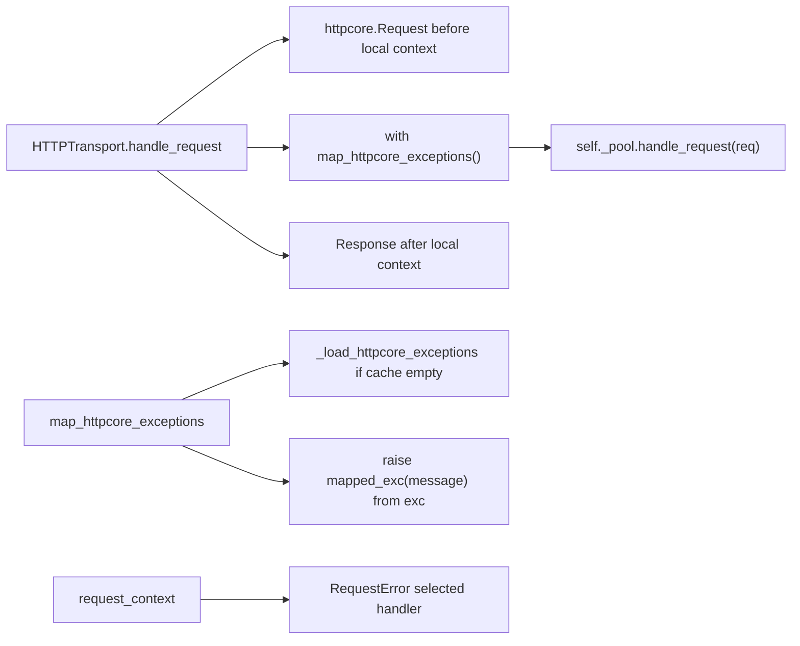

# Transporte padrão do HTTPX: propriedade do mapa de exceções e limites

Candidato isolado revisado a partir do código; sem publicação, aprovação do proprietário ou gold de treinamento.

Recortes de código: `cc206cf2dad42600479962ac1daaa44675cfaf56` → `26d48e0634e6ee9cdc0533996db289ce4b430177`.

## Propósito e recorte de evidência

Os corpos selecionados de `HTTPTransport` e `AsyncHTTPTransport` adaptam uma requisição para `httpcore.Request`, chamam seu pool e depois escrevem a construção de `Response`. `ResponseStream` e `AsyncResponseStream` envolvem as expressões dos streams retornados. Este capítulo cobre os recortes privados de implementação fixados, em vez da API HTTPX completa ou de um endpoint testado. [source:current:HTTPTransport.handle_request] [source:current:AsyncHTTPTransport.handle_async_request] [source:current:ResponseStream.__iter__] [source:current:AsyncResponseStream.__aiter__]

## Arquitetura e inicialização do mapa

No recorte anterior, `HTTPCORE_EXC_MAP` é um dicionário literal no nível do módulo. No recorte posterior ele começa como `{}`; `map_httpcore_exceptions` declara esse nome global e chama `_load_httpcore_exceptions()` quando seu tamanho é zero, antes do `try`/`yield` selecionado. O carregador importa `httpcore` localmente e retorna o mapa literal. Isso é estrutura de código, sem medir tempo de inicialização, disponibilidade da dependência ou segurança entre threads. [source:previous:mapping_provider] [source:previous:context] [source:current:mapping_provider] [source:current:context]

Os quatorze pares ordenados de referências de origem/destino permanecem iguais entre os dois recortes. Cada destino atual se vincula, por uma importação relativa escrita, a uma declaração de classe em `_exceptions.py`, e sua ancestralidade declarada selecionada inclui `RequestError`. A fase inicial não importou nem executou as classes externas. A fase isolada posterior abaixo instancia definições selecionadas do código em namespaces próprios; ela não verifica as vinculações dos pacotes instalados. Um mapa inalterado não certifica citações físicas antigas depois que seu provedor muda de lugar. [source:previous:mapping_provider] [source:current:mapping_provider] [source:current:exception-import-wire] [source:current:exception:TransportError] [source:current:exception:RequestError] [source:current:exception:HTTPError]

## Responsabilidades e limites locais das chamadas

Nos dois métodos de requisição selecionados, `httpcore.Request(...)` é construído antes de `with map_httpcore_exceptions()`. A instrução protegida é a chamada ao pool, síncrona ou aguardada. A asserção do stream de resposta e a construção de retorno `Response(...)` ficam depois desse bloco local. Afirmar que esse único bloco abrange toda falha de preparação de requisição/resposta excederia seu escopo escrito. [source:current:HTTPTransport.handle_request] [source:current:AsyncHTTPTransport.handle_async_request]

Os métodos selecionados `ResponseStream.__iter__` e `AsyncResponseStream.__aiter__` executam seus laços dentro de um contexto explícito do mapeador. Seus corpos `close`/`aclose` e os corpos `close`/`aclose` dos transportes não contêm contexto explícito do mapeador. Separadamente, `HTTPTransport.__exit__` e `AsyncHTTPTransport.__aexit__` envolvem a chamada de saída do pool nesse contexto. Essas diferenças locais não provam que uma implementação posterior de fechamento nunca possa traduzir erros. [source:current:ResponseStream.__iter__] [source:current:AsyncResponseStream.__aiter__] [source:current:ResponseStream.close] [source:current:AsyncResponseStream.aclose] [source:current:HTTPTransport.close] [source:current:AsyncHTTPTransport.aclose] [source:current:HTTPTransport.__exit__] [source:current:AsyncHTTPTransport.__aexit__]

## Entradas e saídas escritas

A construção da requisição encaminha expressões escritas para `method`, `url`, `headers`, `content` e `extensions`. A construção da resposta encaminha `resp.status`, `resp.headers` e `resp.extensions`, além de fornecer o wrapper de stream selecionado. O corpo do código contém asserções sobre interfaces de stream; ele não certifica por si só todas as vinculações em execução, armazenamento do corpo em memória, comportamento de cópia nem tratamento de status em camadas superiores. [source:current:HTTPTransport.handle_request] [source:current:AsyncHTTPTransport.handle_async_request]

## Configuração declarada e dependências

Ambos os construtores de transporte selecionados declaram `retries=0`. A chamada de `ConnectionPool`/`AsyncConnectionPool` encaminha essa opção, enquanto as chamadas selecionadas dos construtores de proxy HTTP/SOCKS a omitem. Isso é uma observação de encaminhamento de opção, sem verificar contagem de tentativas, política de falhas, unidade de timeout, garantia TLS ou resultado de autenticação de proxy. Os auxiliares importados de SSL/configuração e a implementação externa do pool ficam fora deste fechamento de evidências. [source:current:HTTPTransport.__init__] [source:current:AsyncHTTPTransport.__init__]

Ambos os manifestos do projeto declaram `requires-python = ">=3.8"` e a dependência `httpcore==1.*`. A restrição com curinga não é uma revisão instalada exata do httpcore. Não houve instalação de pacote, matriz de compatibilidade de wheels nem execução de versões suportadas, e a tag de código posterior não é apresentada como a versão mais recente. [source:0.25.2:pyproject] [source:0.28.1:pyproject]

## Tradução de erros e contexto da requisição

O mapeador selecionado captura `Exception`, testa `isinstance(exc, from_exc)` e atualiza seu acumulador quando ele está vazio ou quando `issubclass(to_exc, mapped_exc)` é verdadeiro. Se nenhum destino foi selecionado, usa `raise` sem argumento; caso contrário, escreve `message = str(exc)` seguido de `raise mapped_exc(message) from exc`. Isso não prova que todo tipo de exceção é mapeado, que toda relação entre destinos é comparável nem que todo erro é suprimido. [source:current:context]

`request_context` seleciona `RequestError`, atribui `exc.request = request` apenas sob `request is not None` e depois escreve `raise exc`. `HTTPStatusError` é declarado com base `HTTPError`, enquanto `RequestError` é declarado separadamente com base `HTTPError`. Portanto, o handler selecionado não justifica uma promessa sobre todo subtipo declarado de `HTTPError`; a fase inicial não instanciou a hierarquia de exceções em execução; a etapa isolada abaixo observa definições selecionadas de classes. [source:current:request_context] [source:current:HTTPStatusError] [source:current:exception:RequestError]

O mapeador constrói a exceção selecionada apenas com uma mensagem. `RequestError.__init__` declara `request` opcional com padrão `None`, e o getter de propriedade selecionado em `HTTPError` possui um ramo de `RuntimeError` quando a requisição armazenada está ausente. Esses dois arquivos não estabelecem se uma camada superior do cliente depois acrescenta contexto da requisição; a chamada de mapeamento sozinha não fornece essa garantia. [source:current:context] [source:current:RequestError.__init__] [source:current:exception:HTTPError]

## Tabela de mapeamento escrita

| Expressão de origem | Nome da classe de destino | Caminho declarado no código |
|---|---|---|
| `httpcore.TimeoutException` | `TimeoutException` | `TimeoutException` → `TransportError` → `RequestError` → `HTTPError` → `Exception` [source:current:exception:TimeoutException] [source:current:exception:TransportError] [source:current:exception:RequestError] [source:current:exception:HTTPError] |
| `httpcore.ConnectTimeout` | `ConnectTimeout` | `ConnectTimeout` → `TimeoutException` → `TransportError` → `RequestError` → `HTTPError` → `Exception` [source:current:exception:ConnectTimeout] [source:current:exception:TimeoutException] [source:current:exception:TransportError] [source:current:exception:RequestError] [source:current:exception:HTTPError] |
| `httpcore.ReadTimeout` | `ReadTimeout` | `ReadTimeout` → `TimeoutException` → `TransportError` → `RequestError` → `HTTPError` → `Exception` [source:current:exception:ReadTimeout] [source:current:exception:TimeoutException] [source:current:exception:TransportError] [source:current:exception:RequestError] [source:current:exception:HTTPError] |
| `httpcore.WriteTimeout` | `WriteTimeout` | `WriteTimeout` → `TimeoutException` → `TransportError` → `RequestError` → `HTTPError` → `Exception` [source:current:exception:WriteTimeout] [source:current:exception:TimeoutException] [source:current:exception:TransportError] [source:current:exception:RequestError] [source:current:exception:HTTPError] |
| `httpcore.PoolTimeout` | `PoolTimeout` | `PoolTimeout` → `TimeoutException` → `TransportError` → `RequestError` → `HTTPError` → `Exception` [source:current:exception:PoolTimeout] [source:current:exception:TimeoutException] [source:current:exception:TransportError] [source:current:exception:RequestError] [source:current:exception:HTTPError] |
| `httpcore.NetworkError` | `NetworkError` | `NetworkError` → `TransportError` → `RequestError` → `HTTPError` → `Exception` [source:current:exception:NetworkError] [source:current:exception:TransportError] [source:current:exception:RequestError] [source:current:exception:HTTPError] |
| `httpcore.ConnectError` | `ConnectError` | `ConnectError` → `NetworkError` → `TransportError` → `RequestError` → `HTTPError` → `Exception` [source:current:exception:ConnectError] [source:current:exception:NetworkError] [source:current:exception:TransportError] [source:current:exception:RequestError] [source:current:exception:HTTPError] |
| `httpcore.ReadError` | `ReadError` | `ReadError` → `NetworkError` → `TransportError` → `RequestError` → `HTTPError` → `Exception` [source:current:exception:ReadError] [source:current:exception:NetworkError] [source:current:exception:TransportError] [source:current:exception:RequestError] [source:current:exception:HTTPError] |
| `httpcore.WriteError` | `WriteError` | `WriteError` → `NetworkError` → `TransportError` → `RequestError` → `HTTPError` → `Exception` [source:current:exception:WriteError] [source:current:exception:NetworkError] [source:current:exception:TransportError] [source:current:exception:RequestError] [source:current:exception:HTTPError] |
| `httpcore.ProxyError` | `ProxyError` | `ProxyError` → `TransportError` → `RequestError` → `HTTPError` → `Exception` [source:current:exception:ProxyError] [source:current:exception:TransportError] [source:current:exception:RequestError] [source:current:exception:HTTPError] |
| `httpcore.UnsupportedProtocol` | `UnsupportedProtocol` | `UnsupportedProtocol` → `TransportError` → `RequestError` → `HTTPError` → `Exception` [source:current:exception:UnsupportedProtocol] [source:current:exception:TransportError] [source:current:exception:RequestError] [source:current:exception:HTTPError] |
| `httpcore.ProtocolError` | `ProtocolError` | `ProtocolError` → `TransportError` → `RequestError` → `HTTPError` → `Exception` [source:current:exception:ProtocolError] [source:current:exception:TransportError] [source:current:exception:RequestError] [source:current:exception:HTTPError] |
| `httpcore.LocalProtocolError` | `LocalProtocolError` | `LocalProtocolError` → `ProtocolError` → `TransportError` → `RequestError` → `HTTPError` → `Exception` [source:current:exception:LocalProtocolError] [source:current:exception:ProtocolError] [source:current:exception:TransportError] [source:current:exception:RequestError] [source:current:exception:HTTPError] |
| `httpcore.RemoteProtocolError` | `RemoteProtocolError` | `RemoteProtocolError` → `ProtocolError` → `TransportError` → `RequestError` → `HTTPError` → `Exception` [source:current:exception:RemoteProtocolError] [source:current:exception:ProtocolError] [source:current:exception:TransportError] [source:current:exception:RequestError] [source:current:exception:HTTPError] |

[source:current:mapping_provider] [source:previous:mapping_provider]

## Relações de chamadas escritas selecionadas



As setas resumem instruções do código, sem verificar receptores em execução nem constituir um rastreamento completo de rede.

## Forma ilustrativa de chamada e comando de sintaxe

Este exemplo usa um auxiliar privado fixado e vinculações exemplificativas de pool/requisição fornecidas pelo chamador. Apenas a sintaxe foi verificada; não é uma receita executável da API pública nem uma requisição executada. As importações e o comando exibido não foram executados.

```python
from httpx._transports.default import map_httpcore_exceptions

def pool_call_shape(pool, req):
    with map_httpcore_exceptions():
        resp = pool.handle_request(req)
    return resp
```

```sh
python -m py_compile httpx-boundary-example.py
```

## Perguntas frequentes

### Os mesmos pares de mapeamento tornam o capítulo inteiro um NO-OP?

No recorte anterior, `HTTPCORE_EXC_MAP` é um dicionário literal no nível do módulo. No recorte posterior ele começa como `{}`; `map_httpcore_exceptions` declara esse nome global e chama `_load_httpcore_exceptions()` quando seu tamanho é zero, antes do `try`/`yield` selecionado. O carregador importa `httpcore` localmente e retorna o mapa literal. Isso é estrutura de código, sem medir tempo de inicialização, disponibilidade da dependência ou segurança entre threads. [source:previous:mapping_provider] [source:previous:context] [source:current:mapping_provider] [source:current:context]

### O mapeador suprime ou converte toda exceção?

O mapeador selecionado captura `Exception`, testa `isinstance(exc, from_exc)` e atualiza seu acumulador quando ele está vazio ou quando `issubclass(to_exc, mapped_exc)` é verdadeiro. Se nenhum destino foi selecionado, usa `raise` sem argumento; caso contrário, escreve `message = str(exc)` seguido de `raise mapped_exc(message) from exc`. Isso não prova que todo tipo de exceção é mapeado, que toda relação entre destinos é comparável nem que todo erro é suprimido. [source:current:context]

### A construção da requisição e a da resposta ficam dentro do bloco de mapeamento da chamada ao pool?

Nos dois métodos de requisição selecionados, `httpcore.Request(...)` é construído antes de `with map_httpcore_exceptions()`. A instrução protegida é a chamada ao pool, síncrona ou aguardada. A asserção do stream de resposta e a construção de retorno `Response(...)` ficam depois desse bloco local. Afirmar que esse único bloco abrange toda falha de preparação de requisição/resposta excederia seu escopo escrito. [source:current:HTTPTransport.handle_request] [source:current:AsyncHTTPTransport.handle_async_request]

### Todos os caminhos de fechamento e saída de contexto mostram o mesmo escopo local de mapeamento?

Os métodos selecionados `ResponseStream.__iter__` e `AsyncResponseStream.__aiter__` executam seus laços dentro de um contexto explícito do mapeador. Seus corpos `close`/`aclose` e os corpos `close`/`aclose` dos transportes não contêm contexto explícito do mapeador. Separadamente, `HTTPTransport.__exit__` e `AsyncHTTPTransport.__aexit__` envolvem a chamada de saída do pool nesse contexto. Essas diferenças locais não provam que uma implementação posterior de fechamento nunca possa traduzir erros. [source:current:ResponseStream.__iter__] [source:current:AsyncResponseStream.__aiter__] [source:current:ResponseStream.close] [source:current:AsyncResponseStream.aclose] [source:current:HTTPTransport.close] [source:current:AsyncHTTPTransport.aclose] [source:current:HTTPTransport.__exit__] [source:current:AsyncHTTPTransport.__aexit__]

### request_context cobre todo subtipo de HTTPError?

`request_context` seleciona `RequestError`, atribui `exc.request = request` apenas sob `request is not None` e depois escreve `raise exc`. `HTTPStatusError` é declarado com base `HTTPError`, enquanto `RequestError` é declarado separadamente com base `HTTPError`. Portanto, o handler selecionado não justifica uma promessa sobre todo subtipo declarado de `HTTPError`; a fase inicial não instanciou a hierarquia de exceções em execução; a etapa isolada abaixo observa definições selecionadas de classes. [source:current:request_context] [source:current:HTTPStatusError] [source:current:exception:RequestError]

### Somente o mapeamento prova a presença de um objeto de requisição associado?

O mapeador constrói a exceção selecionada apenas com uma mensagem. `RequestError.__init__` declara `request` opcional com padrão `None`, e o getter de propriedade selecionado em `HTTPError` possui um ramo de `RuntimeError` quando a requisição armazenada está ausente. Esses dois arquivos não estabelecem se uma camada superior do cliente depois acrescenta contexto da requisição; a chamada de mapeamento sozinha não fornece essa garantia. [source:current:context] [source:current:RequestError.__init__] [source:current:exception:HTTPError]

### O parâmetro retries estabelece tentativas para todo proxy ou modo de falha?

Ambos os construtores de transporte selecionados declaram `retries=0`. A chamada de `ConnectionPool`/`AsyncConnectionPool` encaminha essa opção, enquanto as chamadas selecionadas dos construtores de proxy HTTP/SOCKS a omitem. Isso é uma observação de encaminhamento de opção, sem verificar contagem de tentativas, política de falhas, unidade de timeout, garantia TLS ou resultado de autenticação de proxy. Os auxiliares importados de SSL/configuração e a implementação externa do pool ficam fora deste fechamento de evidências. [source:current:HTTPTransport.__init__] [source:current:AsyncHTTPTransport.__init__]

## Limites e direitos

O aviso original de redistribuição com três cláusulas está preservado. A presença da licença não é aprovação do proprietário para treinamento. As referências locais anteriores ao nome HTTPX e o desenvolvimento do perfil depois da inspeção estão declarados; esses recortes de código e os candidatos de capítulo/perguntas frequentes estão excluídos do treinamento. Hashes de código e relações declaradas entre classes não estabelecem o comportamento completo da aplicação. [source:current:license]

A fase estática inicial não importou nem executou código HTTPX/httpcore. Não houve requisição HTTP de aplicação, instanciação de exceção em execução naquela fase, verificação TLS/autenticação, observação real de tentativas nem medição de desempenho. Os dois recortes são material correlacionado de desenvolvimento, sem constituir dados de avaliação neural com independência certificada.

## Referências físicas de código

[source:current:context]: ../new-public-sources-v1/encode--httpx/26d48e0634e6ee9cdc0533996db289ce4b430177/httpx/_transports/default.py#L95 "03379a454c95c0271c4f2c8d25ec437f49f57457f3cf2769748420bf0ecf2e79"

[source:current:mapping_provider]: ../new-public-sources-v1/encode--httpx/26d48e0634e6ee9cdc0533996db289ce4b430177/httpx/_transports/default.py#L74 "03379a454c95c0271c4f2c8d25ec437f49f57457f3cf2769748420bf0ecf2e79"

[source:current:exception:TimeoutException]: ../new-public-sources-v1/encode--httpx/26d48e0634e6ee9cdc0533996db289ce4b430177/httpx/_exceptions.py#L132 "6f15bb7f1ce054c01d3536f04f4567ab4e202435b5fe023f1858903ee3328cbd"

[source:current:exception:TransportError]: ../new-public-sources-v1/encode--httpx/26d48e0634e6ee9cdc0533996db289ce4b430177/httpx/_exceptions.py#L123 "6f15bb7f1ce054c01d3536f04f4567ab4e202435b5fe023f1858903ee3328cbd"

[source:current:exception:RequestError]: ../new-public-sources-v1/encode--httpx/26d48e0634e6ee9cdc0533996db289ce4b430177/httpx/_exceptions.py#L107 "6f15bb7f1ce054c01d3536f04f4567ab4e202435b5fe023f1858903ee3328cbd"

[source:current:exception:HTTPError]: ../new-public-sources-v1/encode--httpx/26d48e0634e6ee9cdc0533996db289ce4b430177/httpx/_exceptions.py#L74 "6f15bb7f1ce054c01d3536f04f4567ab4e202435b5fe023f1858903ee3328cbd"

[source:current:exception:ConnectTimeout]: ../new-public-sources-v1/encode--httpx/26d48e0634e6ee9cdc0533996db289ce4b430177/httpx/_exceptions.py#L140 "6f15bb7f1ce054c01d3536f04f4567ab4e202435b5fe023f1858903ee3328cbd"

[source:current:exception:ReadTimeout]: ../new-public-sources-v1/encode--httpx/26d48e0634e6ee9cdc0533996db289ce4b430177/httpx/_exceptions.py#L146 "6f15bb7f1ce054c01d3536f04f4567ab4e202435b5fe023f1858903ee3328cbd"

[source:current:exception:WriteTimeout]: ../new-public-sources-v1/encode--httpx/26d48e0634e6ee9cdc0533996db289ce4b430177/httpx/_exceptions.py#L152 "6f15bb7f1ce054c01d3536f04f4567ab4e202435b5fe023f1858903ee3328cbd"

[source:current:exception:PoolTimeout]: ../new-public-sources-v1/encode--httpx/26d48e0634e6ee9cdc0533996db289ce4b430177/httpx/_exceptions.py#L158 "6f15bb7f1ce054c01d3536f04f4567ab4e202435b5fe023f1858903ee3328cbd"

[source:current:exception:NetworkError]: ../new-public-sources-v1/encode--httpx/26d48e0634e6ee9cdc0533996db289ce4b430177/httpx/_exceptions.py#L167 "6f15bb7f1ce054c01d3536f04f4567ab4e202435b5fe023f1858903ee3328cbd"

[source:current:exception:ConnectError]: ../new-public-sources-v1/encode--httpx/26d48e0634e6ee9cdc0533996db289ce4b430177/httpx/_exceptions.py#L187 "6f15bb7f1ce054c01d3536f04f4567ab4e202435b5fe023f1858903ee3328cbd"

[source:current:exception:ReadError]: ../new-public-sources-v1/encode--httpx/26d48e0634e6ee9cdc0533996db289ce4b430177/httpx/_exceptions.py#L175 "6f15bb7f1ce054c01d3536f04f4567ab4e202435b5fe023f1858903ee3328cbd"

[source:current:exception:WriteError]: ../new-public-sources-v1/encode--httpx/26d48e0634e6ee9cdc0533996db289ce4b430177/httpx/_exceptions.py#L181 "6f15bb7f1ce054c01d3536f04f4567ab4e202435b5fe023f1858903ee3328cbd"

[source:current:exception:ProxyError]: ../new-public-sources-v1/encode--httpx/26d48e0634e6ee9cdc0533996db289ce4b430177/httpx/_exceptions.py#L202 "6f15bb7f1ce054c01d3536f04f4567ab4e202435b5fe023f1858903ee3328cbd"

[source:current:exception:UnsupportedProtocol]: ../new-public-sources-v1/encode--httpx/26d48e0634e6ee9cdc0533996db289ce4b430177/httpx/_exceptions.py#L208 "6f15bb7f1ce054c01d3536f04f4567ab4e202435b5fe023f1858903ee3328cbd"

[source:current:exception:ProtocolError]: ../new-public-sources-v1/encode--httpx/26d48e0634e6ee9cdc0533996db289ce4b430177/httpx/_exceptions.py#L216 "6f15bb7f1ce054c01d3536f04f4567ab4e202435b5fe023f1858903ee3328cbd"

[source:current:exception:LocalProtocolError]: ../new-public-sources-v1/encode--httpx/26d48e0634e6ee9cdc0533996db289ce4b430177/httpx/_exceptions.py#L222 "6f15bb7f1ce054c01d3536f04f4567ab4e202435b5fe023f1858903ee3328cbd"

[source:current:exception:RemoteProtocolError]: ../new-public-sources-v1/encode--httpx/26d48e0634e6ee9cdc0533996db289ce4b430177/httpx/_exceptions.py#L232 "6f15bb7f1ce054c01d3536f04f4567ab4e202435b5fe023f1858903ee3328cbd"

[source:current:HTTPTransport.handle_request]: ../new-public-sources-v1/encode--httpx/26d48e0634e6ee9cdc0533996db289ce4b430177/httpx/_transports/default.py#L230 "03379a454c95c0271c4f2c8d25ec437f49f57457f3cf2769748420bf0ecf2e79"

[source:current:AsyncHTTPTransport.handle_async_request]: ../new-public-sources-v1/encode--httpx/26d48e0634e6ee9cdc0533996db289ce4b430177/httpx/_transports/default.py#L374 "03379a454c95c0271c4f2c8d25ec437f49f57457f3cf2769748420bf0ecf2e79"

[source:current:ResponseStream.__iter__]: ../new-public-sources-v1/encode--httpx/26d48e0634e6ee9cdc0533996db289ce4b430177/httpx/_transports/default.py#L125 "03379a454c95c0271c4f2c8d25ec437f49f57457f3cf2769748420bf0ecf2e79"

[source:current:AsyncResponseStream.__aiter__]: ../new-public-sources-v1/encode--httpx/26d48e0634e6ee9cdc0533996db289ce4b430177/httpx/_transports/default.py#L269 "03379a454c95c0271c4f2c8d25ec437f49f57457f3cf2769748420bf0ecf2e79"

[source:current:ResponseStream.close]: ../new-public-sources-v1/encode--httpx/26d48e0634e6ee9cdc0533996db289ce4b430177/httpx/_transports/default.py#L130 "03379a454c95c0271c4f2c8d25ec437f49f57457f3cf2769748420bf0ecf2e79"

[source:current:AsyncResponseStream.aclose]: ../new-public-sources-v1/encode--httpx/26d48e0634e6ee9cdc0533996db289ce4b430177/httpx/_transports/default.py#L274 "03379a454c95c0271c4f2c8d25ec437f49f57457f3cf2769748420bf0ecf2e79"

[source:current:HTTPTransport.close]: ../new-public-sources-v1/encode--httpx/26d48e0634e6ee9cdc0533996db289ce4b430177/httpx/_transports/default.py#L261 "03379a454c95c0271c4f2c8d25ec437f49f57457f3cf2769748420bf0ecf2e79"

[source:current:AsyncHTTPTransport.aclose]: ../new-public-sources-v1/encode--httpx/26d48e0634e6ee9cdc0533996db289ce4b430177/httpx/_transports/default.py#L405 "03379a454c95c0271c4f2c8d25ec437f49f57457f3cf2769748420bf0ecf2e79"

[source:current:request_context]: ../new-public-sources-v1/encode--httpx/26d48e0634e6ee9cdc0533996db289ce4b430177/httpx/_exceptions.py#L366 "6f15bb7f1ce054c01d3536f04f4567ab4e202435b5fe023f1858903ee3328cbd"

[source:current:HTTPStatusError]: ../new-public-sources-v1/encode--httpx/26d48e0634e6ee9cdc0533996db289ce4b430177/httpx/_exceptions.py#L258 "6f15bb7f1ce054c01d3536f04f4567ab4e202435b5fe023f1858903ee3328cbd"

[source:current:RequestError.__init__]: ../new-public-sources-v1/encode--httpx/26d48e0634e6ee9cdc0533996db289ce4b430177/httpx/_exceptions.py#L112 "6f15bb7f1ce054c01d3536f04f4567ab4e202435b5fe023f1858903ee3328cbd"

[source:previous:context]: ../new-public-sources-v1/encode--httpx/cc206cf2dad42600479962ac1daaa44675cfaf56/httpx/_transports/default.py#L63 "ffdfd927d06a865abc2f5d328302ff62e1d0cca014fda38ae00c9983fc46fd13"

[source:previous:mapping_provider]: ../new-public-sources-v1/encode--httpx/cc206cf2dad42600479962ac1daaa44675cfaf56/httpx/_transports/default.py#L86 "ffdfd927d06a865abc2f5d328302ff62e1d0cca014fda38ae00c9983fc46fd13"

[source:current:exception-import-wire]: ../new-public-sources-v1/encode--httpx/26d48e0634e6ee9cdc0533996db289ce4b430177/httpx/_transports/default.py#L39 "03379a454c95c0271c4f2c8d25ec437f49f57457f3cf2769748420bf0ecf2e79"

[source:current:HTTPTransport.__init__]: ../new-public-sources-v1/encode--httpx/26d48e0634e6ee9cdc0533996db289ce4b430177/httpx/_transports/default.py#L136 "03379a454c95c0271c4f2c8d25ec437f49f57457f3cf2769748420bf0ecf2e79"

[source:current:HTTPTransport.__exit__]: ../new-public-sources-v1/encode--httpx/26d48e0634e6ee9cdc0533996db289ce4b430177/httpx/_transports/default.py#L221 "03379a454c95c0271c4f2c8d25ec437f49f57457f3cf2769748420bf0ecf2e79"

[source:current:AsyncHTTPTransport.__init__]: ../new-public-sources-v1/encode--httpx/26d48e0634e6ee9cdc0533996db289ce4b430177/httpx/_transports/default.py#L280 "03379a454c95c0271c4f2c8d25ec437f49f57457f3cf2769748420bf0ecf2e79"

[source:current:AsyncHTTPTransport.__aexit__]: ../new-public-sources-v1/encode--httpx/26d48e0634e6ee9cdc0533996db289ce4b430177/httpx/_transports/default.py#L365 "03379a454c95c0271c4f2c8d25ec437f49f57457f3cf2769748420bf0ecf2e79"

[source:0.25.2:pyproject]: ../new-public-sources-v1/encode--httpx/cc206cf2dad42600479962ac1daaa44675cfaf56/pyproject.toml#L1 "ebdd530f4666646a9f09eceeb86d176801eec7c651d61a9a0f55b8616e4cf6c3"

[source:0.28.1:pyproject]: ../new-public-sources-v1/encode--httpx/26d48e0634e6ee9cdc0533996db289ce4b430177/pyproject.toml#L1 "df6ead82c82909bacc1f54fa0de8edc52dab17742d548d41c284506e3c05706f"

[source:current:license]: ../new-public-sources-v1/encode--httpx/26d48e0634e6ee9cdc0533996db289ce4b430177/LICENSE.md#L1 "4ec59d544f12b5f539a3a716fd321ac58ccd8030b465221f2c880200cdf28d8d"

## Etapa posterior com execução isolada

A etapa isolada usa HTTPX 0.28.1 e httpcore 1.0.9 nas revisões fixadas. Ela executa 15 definições simples de classes de exceção do httpcore, 18 classes de exceção do HTTPX e três funções selecionadas em namespaces próprios. A instrução de reexportação do código cobre as 15 classes. O inicializador real do pacote não é importado; sua reescrita posterior de `__module__` das classes não é executada. Isso não afirma qual versão da dependência está instalada. [source:core:classes] [source:core:reexports] [source:current:context] [source:current:mapping_provider]

Para cada uma das 14 classes exatas do código, uma mensagem própria é mapeada ao alvo HTTPX exato esperado, preservando a mensagem e o objeto original como causa explícita. A propriedade de requisição da exceção mapeada fica sem valor. Os mesmos 21 casos congelados e 70 asserções passam em Python 3.14/macOS e Python 3.11/Linux; são 21 casos distintos, sem dobrar para 42. Uma subclasse própria separada de `ReadTimeout` também é mapeada para `ReadTimeout`. [source:core:classes] [source:current:context] [source:current:RequestError.__init__] [source:current:exception:HTTPError]

As observações próprias preservam a identidade de uma exceção sem correspondência e de um objeto sintético `KeyboardInterrupt`, acrescentam uma sentinela exata de requisição por `request_context`, preservam uma requisição existente quando seu argumento está ausente e deixam `HTTPStatusError` fora desse handler. Uma importação interceptada que falha deliberadamente escapa antes do início do corpo do contexto. Dois contextos bem-sucedidos no mesmo namespace próprio chamam a importação interceptada do carregador uma vez e reutilizam o mesmo dicionário de 14 pares. Isso não estabelece inicialização de pacote instalado, concorrência nem comportamento de rede. [source:current:context] [source:current:mapping_provider] [source:current:request_context] [source:current:HTTPStatusError]

Seis casos adicionais próprios de subclasses/mensagens limitam promessas mais amplas. A herança múltipla entre ramos de alvos sem relação conserva o primeiro alvo correspondente sem relação na ordem do mapa: `ReadTimeout` com `ReadError` é mapeado para `ReadTimeout`, e `LocalProtocolError` com `RemoteProtocolError` é mapeado para `LocalProtocolError`. Se `__str__` lança um `ValueError` próprio ou retorna um inteiro, a conversão da mensagem escapa como `ValueError` ou `TypeError` antes da construção da exceção mapeada; a original permanece como contexto implícito, em vez de causa explícita. Uma string Unicode personalizada válida é preservada. São observações sintéticas de limites, sem afirmar defeito do projeto externo. [source:current:context] [source:current:mapping_provider] [source:core:classes]

### O mapeador sempre produz uma exceção traduzida universalmente mais específica?

Seis casos adicionais próprios de subclasses/mensagens limitam promessas mais amplas. A herança múltipla entre ramos de alvos sem relação conserva o primeiro alvo correspondente sem relação na ordem do mapa: `ReadTimeout` com `ReadError` é mapeado para `ReadTimeout`, e `LocalProtocolError` com `RemoteProtocolError` é mapeado para `LocalProtocolError`. Se `__str__` lança um `ValueError` próprio ou retorna um inteiro, a conversão da mensagem escapa como `ValueError` ou `TypeError` antes da construção da exceção mapeada; a original permanece como contexto implícito, em vez de causa explícita. Uma string Unicode personalizada válida é preservada. São observações sintéticas de limites, sem afirmar defeito do projeto externo. [source:current:context] [source:current:mapping_provider] [source:core:classes]

Registros das observações: [httpx-exception-composition-protocol-v1.json](../httpx-exception-composition-protocol-v1.json), [httpx-exception-composition-macos-v1.json](../httpx-exception-composition-macos-v1.json), [httpx-exception-composition-linux-v1.json](../httpx-exception-composition-linux-v1.json), [httpx-exception-edge-protocol-v1.json](../httpx-exception-edge-protocol-v1.json), [httpx-exception-edge-results-v1.json](../httpx-exception-edge-results-v1.json).

[source:core:classes]: ../new-public-sources-v1/encode--httpcore/98209758cc14e1a5f966fe1dfdc1064b94055d8c/httpcore/_exceptions.py#L1 "968a022a06b7fd8558bb7b3e7772fd44c3d127286c63b7e2bae1b1be4383d1cd"

[source:core:reexports]: ../new-public-sources-v1/encode--httpcore/98209758cc14e1a5f966fe1dfdc1064b94055d8c/httpcore/__init__.py#L20 "f644ff92a0a10822544c7c30db866647f7b371d6e94585a4b03fa060dce464ff"
