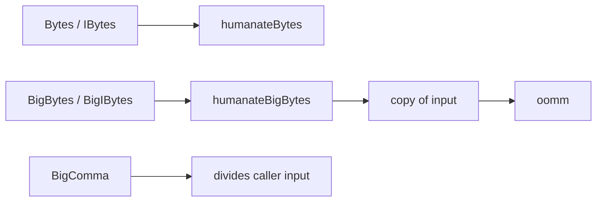

# Byte units, precision and input ownership

Research candidate; not published, owner-approved or training gold.

Revisions: `9f541cc9db5d55bce703bd99987c9d5cb8eea45e` → `9ec74ab2f7a7161664182fd4e5e292fccffbc75f`.

## Purpose

The pinned `humanize` package converts sizes to display strings and parses size strings. Fixed-width byte APIs, arbitrary-precision byte APIs and SI magnitude/unit parsing have distinct contracts. Similar names do not imply identical accepted units or precision. [source:v1.0.1:Bytes] [source:v1.0.1:ParseBytes] [source:v1.0.1:ParseBigBytes] [source:v1.0.1:ParseSI]

## Architecture

`Bytes` and `IBytes` delegate to `humanateBytes`, using bases 1000 and 1024. `BigBytes` and `BigIBytes` delegate to `humanateBigBytes`, which copies its input before passing that copy to the mutating `oomm` helper. `ParseSI` follows a separate regular-expression and prefix-table path. [source:v1.0.1:Bytes] [source:v1.0.1:IBytes] [source:v1.0.1:humanateBytes] [source:v1.0.1:BigBytes] [source:v1.0.1:BigIBytes] [source:v1.0.1:humanateBigBytes] [source:v1.0.1:oomm] [source:v1.0.1:ParseSI]

## Dependencies and configuration

The selected root package imports only Go standard-library packages. The current module file declares `github.com/dustin/go-humanize` and `go 1.16`; the earlier selected tree has no root module file. This does not establish a tested minimum Go version. Observations used existing Go1.27.4 on Linux/ARM64, with CGO and package downloads disabled. [source:v1.0.1:ParseBytes] [source:v1.0.1:ParseBigBytes]

## Inputs and outputs

Observed `Bytes(82854982)` returned `83 MB`; `IBytes(82854982)` returned `79 MiB`. The decimal and binary boundaries 1000 and 1024 returned `1.0 kB` and `1.0 KiB`. These are rounded display representations, not lossless serialization contracts. [source:v1.0.1:Bytes] [source:v1.0.1:IBytes] [source:v1.0.1:humanateBytes] [runtime:format-decimal,format-binary,format-boundary,format-binary-boundary]

`ParseBytes` scans an initial digit/dot/comma prefix, removes its commas, calls `strconv.ParseFloat`, and lowercases and trims only the remaining unit text. Observations accepted `1,2,3 KB` as 123000, `1.5 KiB` as 1536 and `1.9 B` as 1. This is not strict grouping validation or a guarantee that every Unicode digit can be parsed. [source:v1.0.1:ParseBytes] [runtime:parse-loose-commas,parse-fraction-scale,parse-fraction-truncate,parse-unicode-digit]

## Errors

The observed leading-space input ` 1 KB` and signed input `-1KB` failed numeric parsing. `1 QQ` failed unit lookup. `1e3` did not become exponent notation: the scanned number was followed by an unsupported unit. However, `1e` used the supported unit alias and produced 1000000000000000000. [source:v1.0.1:ParseBytes] [runtime:parse-leading-space,parse-negative,parse-unknown,parse-exponent,parse-e-unit]

## Precision

`ParseBytes` uses `float64`: the observed input `9007199254740993` returned `9007199254740992`, and `18446744073709551615` was rejected as too large. `ParseBigBytes` preserved the former integer exactly through its rational-number path. The arbitrary-precision API still truncated observed `1.9 B` to 1; arbitrary precision does not imply a fractional-byte result. [source:v1.0.1:ParseBytes] [source:v1.0.1:ParseBigBytes] [runtime:parse-float-precision,parse-uint64-max,bigparse-exact-large,bigparse-fraction]

## Revision changes

Between the pinned revisions, `ParseBigBytes` gained `RB`, `QB`, `RiB` and `QiB` aliases and their suffix-free forms. Observations accepted `1 QB` as 10^30 and `1 QiB` as 2^100 in the current cut; the earlier cut rejected them. This does not extend `ParseBytes`, which rejected `1 Rb` in both cuts. The two copies of the fixed-width parser source file are byte-identical. [source:v1.0.0:ParseBigBytes] [source:v1.0.1:ParseBigBytes] [source:v1.0.1:ParseBytes] [runtime:bigparse-quettabyte,bigparse-quebibyte,parse-new-big-unit]

For 10^30 bytes, observed `BigBytes` changed from `1000000 YB` to `1.0 QB`. For 2^100 bytes, `BigIBytes` changed from `1048576 YiB` to `1.0 QiB`. Both formatting paths preserved the supplied integer in these observations. [source:v1.0.0:BigBytes] [source:v1.0.1:BigBytes] [source:v1.0.0:BigIBytes] [source:v1.0.1:BigIBytes] [source:v1.0.1:humanateBigBytes] [source:v1.0.1:oomm] [runtime:bigformat-quettabyte,bigformat-quebibyte]

## State and ownership

`BigComma` has a different ownership contract: its loop divides the caller-supplied `big.Int` itself. Observed inputs 1234567 and -1234567 produced the expected signed grouped strings, but both input objects ended as 1. Pass an explicit copy when preservation is required; do not infer non-mutation from `BigBytes`. [source:v1.0.1:BigComma] [source:v1.0.1:oom] [source:v1.0.1:humanateBigBytes] [runtime:bigcomma-positive,bigcomma-negative]

## SI parsing

Observed `ParseSI("1 QB")` changed from magnitude 1 with unit `QB` to magnitude 1e30 with unit `B`, because the prefix table acquired `Q`. Byte parsing and SI parsing therefore require separate statements about unknown suffixes. These observations do not verify every SI prefix, unit spelling or release. [source:v1.0.0:ParseSI] [source:v1.0.1:ParseSI] [source:v1.0.1:init] [source:v1.0.1:revfmap] [runtime:parse-si-quetta]

## Limitations

The 36 frozen cases ran once per revision. Exactly 35 predictions matched in each cut: `ComputeSI(1e-30)` rendered `1.0000000000000002` rather than the owned exact prediction `1`. The prefix changed from empty to `q` as predicted. The unmatched expectation is preserved as an owned prediction error, without an upstream-defect or broad numerical-accuracy claim. [source:v1.0.0:ComputeSI] [source:v1.0.1:ComputeSI] [source:v1.0.1:logn] [runtime:si-quecto]

The experiments compiled the complete selected non-test root package and executed its reviewed initializers and finite synthetic calls. They did not install packages, run upstream tests, contact application services or test Windows/macOS runtime behavior, concurrency, mutable-global tampering or arbitrary inputs. The module directive and license are source metadata, not compatibility or training-approval certificates. [source:v1.0.1:init] [source:v1.0.1:ParseBytes] [source:v1.0.1:ParseBigBytes] [source:v1.0.1:BigComma]

## Illustrative example and command

Example and command are illustrative and unexecuted; no output or installation success is claimed.

```go
package main

import (
    "fmt"
    "math/big"
    "github.com/dustin/go-humanize"
)

func main() {
    n := big.NewInt(1234567)
    copied := new(big.Int).Set(n)
    fmt.Println(humanize.BigComma(copied))
    _, err := humanize.ParseBigBytes("1 QB")
    if err != nil { panic(err) }
}
```

```sh
go doc github.com/dustin/go-humanize.ParseBigBytes
```

[source:v1.0.1:BigComma] [source:v1.0.1:ParseBigBytes]

## API comparison

| API | Representation / ownership |
|---|---|
| `ParseBytes` | `uint64`, `float64` |
| `ParseBigBytes` | `*big.Int`, `big.Rat` |
| `BigBytes` | Copies input before helper |
| `BigComma` | Mutates observed input |

## Written helper relationships



[source:v1.0.1:humanateBigBytes] [source:v1.0.1:BigComma]

## FAQ

### Do the new units also work in ParseBytes?

Between the pinned revisions, `ParseBigBytes` gained `RB`, `QB`, `RiB` and `QiB` aliases and their suffix-free forms. Observations accepted `1 QB` as 10^30 and `1 QiB` as 2^100 in the current cut; the earlier cut rejected them. This does not extend `ParseBytes`, which rejected `1 Rb` in both cuts. The two copies of the fixed-width parser source file are byte-identical. [source:v1.0.0:ParseBigBytes] [source:v1.0.1:ParseBigBytes] [source:v1.0.1:ParseBytes]

### Which parser preserved the integer above 2^53?

`ParseBytes` uses `float64`: the observed input `9007199254740993` returned `9007199254740992`, and `18446744073709551615` was rejected as too large. `ParseBigBytes` preserved the former integer exactly through its rational-number path. The arbitrary-precision API still truncated observed `1.9 B` to 1; arbitrary precision does not imply a fractional-byte result. [source:v1.0.1:ParseBytes] [source:v1.0.1:ParseBigBytes]

### Does accepting commas prove strict thousands grouping?

`ParseBytes` scans an initial digit/dot/comma prefix, removes its commas, calls `strconv.ParseFloat`, and lowercases and trims only the remaining unit text. Observations accepted `1,2,3 KB` as 123000, `1.5 KiB` as 1536 and `1.9 B` as 1. This is not strict grouping validation or a guarantee that every Unicode digit can be parsed. [source:v1.0.1:ParseBytes]

### Can the caller reuse a BigComma input unchanged?

`BigComma` has a different ownership contract: its loop divides the caller-supplied `big.Int` itself. Observed inputs 1234567 and -1234567 produced the expected signed grouped strings, but both input objects ended as 1. Pass an explicit copy when preservation is required; do not infer non-mutation from `BigBytes`. [source:v1.0.1:BigComma] [source:v1.0.1:oom] [source:v1.0.1:humanateBigBytes]

### Why document SI parsing separately?

Observed `ParseSI("1 QB")` changed from magnitude 1 with unit `QB` to magnitude 1e30 with unit `B`, because the prefix table acquired `Q`. Byte parsing and SI parsing therefore require separate statements about unknown suffixes. These observations do not verify every SI prefix, unit spelling or release. [source:v1.0.0:ParseSI] [source:v1.0.1:ParseSI] [source:v1.0.1:init] [source:v1.0.1:revfmap]

### Did every exact numerical prediction match?

The 36 frozen cases ran once per revision. Exactly 35 predictions matched in each cut: `ComputeSI(1e-30)` rendered `1.0000000000000002` rather than the owned exact prediction `1`. The prefix changed from empty to `q` as predicted. The unmatched expectation is preserved as an owned prediction error, without an upstream-defect or broad numerical-accuracy claim. [source:v1.0.0:ComputeSI] [source:v1.0.1:ComputeSI] [source:v1.0.1:logn]

## Physical evidence and license

[Runtime receipt](../humanize-confined-runtime-results-v1.json); [prediction review](../humanize-runtime-prediction-review-v1.json).

- [source:v1.0.0:BigBytes] [bigbytes.go:117–120](https://github.com/dustin/go-humanize/blob/9f541cc9db5d55bce703bd99987c9d5cb8eea45e/bigbytes.go#L117-L120); SHA-256 `0628800f4b07d9b08c7e005c54027c0fa89b129c4a83180674860196c92ae615`.
- [source:v1.0.0:BigIBytes] [bigbytes.go:127–130](https://github.com/dustin/go-humanize/blob/9f541cc9db5d55bce703bd99987c9d5cb8eea45e/bigbytes.go#L127-L130); SHA-256 `0628800f4b07d9b08c7e005c54027c0fa89b129c4a83180674860196c92ae615`.
- [source:v1.0.0:ComputeSI] [si.go:60–81](https://github.com/dustin/go-humanize/blob/9f541cc9db5d55bce703bd99987c9d5cb8eea45e/si.go#L60-L81); SHA-256 `f682e76b01dfcb82957423e891761b1d91b8ca03081b8b07f33be03eda7a3a3b`.
- [source:v1.0.0:ParseBigBytes] [bigbytes.go:139–173](https://github.com/dustin/go-humanize/blob/9f541cc9db5d55bce703bd99987c9d5cb8eea45e/bigbytes.go#L139-L173); SHA-256 `0628800f4b07d9b08c7e005c54027c0fa89b129c4a83180674860196c92ae615`.
- [source:v1.0.0:ParseSI] [si.go:113–123](https://github.com/dustin/go-humanize/blob/9f541cc9db5d55bce703bd99987c9d5cb8eea45e/si.go#L113-L123); SHA-256 `f682e76b01dfcb82957423e891761b1d91b8ca03081b8b07f33be03eda7a3a3b`.
- [source:v1.0.1:BigBytes] [bigbytes.go:133–136](https://github.com/dustin/go-humanize/blob/9ec74ab2f7a7161664182fd4e5e292fccffbc75f/bigbytes.go#L133-L136); SHA-256 `9318dd523505253f686747635394232cabe2968984df14b2f49d91926ea80c70`.
- [source:v1.0.1:BigComma] [comma.go:89–116](https://github.com/dustin/go-humanize/blob/9ec74ab2f7a7161664182fd4e5e292fccffbc75f/comma.go#L89-L116); SHA-256 `067d9654d89f6d55df0e10cdb907a1c5eaca786ae7d4225126ce6e68836bf3bf`.
- [source:v1.0.1:BigIBytes] [bigbytes.go:143–146](https://github.com/dustin/go-humanize/blob/9ec74ab2f7a7161664182fd4e5e292fccffbc75f/bigbytes.go#L143-L146); SHA-256 `9318dd523505253f686747635394232cabe2968984df14b2f49d91926ea80c70`.
- [source:v1.0.1:Bytes] [bytes.go:88–91](https://github.com/dustin/go-humanize/blob/9ec74ab2f7a7161664182fd4e5e292fccffbc75f/bytes.go#L88-L91); SHA-256 `9fb2391c3896a42cd4091279701f6274c19f3c3f15145503477229a67835d5da`.
- [source:v1.0.1:ComputeSI] [si.go:64–85](https://github.com/dustin/go-humanize/blob/9ec74ab2f7a7161664182fd4e5e292fccffbc75f/si.go#L64-L85); SHA-256 `7159cff48cad974637868726cf45ff255b4a9c522a7b2eafcad3dfd537ba058e`.
- [source:v1.0.1:IBytes] [bytes.go:98–101](https://github.com/dustin/go-humanize/blob/9ec74ab2f7a7161664182fd4e5e292fccffbc75f/bytes.go#L98-L101); SHA-256 `9fb2391c3896a42cd4091279701f6274c19f3c3f15145503477229a67835d5da`.
- [source:v1.0.1:ParseBigBytes] [bigbytes.go:155–189](https://github.com/dustin/go-humanize/blob/9ec74ab2f7a7161664182fd4e5e292fccffbc75f/bigbytes.go#L155-L189); SHA-256 `9318dd523505253f686747635394232cabe2968984df14b2f49d91926ea80c70`.
- [source:v1.0.1:ParseBytes] [bytes.go:110–143](https://github.com/dustin/go-humanize/blob/9ec74ab2f7a7161664182fd4e5e292fccffbc75f/bytes.go#L110-L143); SHA-256 `9fb2391c3896a42cd4091279701f6274c19f3c3f15145503477229a67835d5da`.
- [source:v1.0.1:ParseSI] [si.go:117–127](https://github.com/dustin/go-humanize/blob/9ec74ab2f7a7161664182fd4e5e292fccffbc75f/si.go#L117-L127); SHA-256 `7159cff48cad974637868726cf45ff255b4a9c522a7b2eafcad3dfd537ba058e`.
- [source:v1.0.1:humanateBigBytes] [bigbytes.go:112–126](https://github.com/dustin/go-humanize/blob/9ec74ab2f7a7161664182fd4e5e292fccffbc75f/bigbytes.go#L112-L126); SHA-256 `9318dd523505253f686747635394232cabe2968984df14b2f49d91926ea80c70`.
- [source:v1.0.1:humanateBytes] [bytes.go:68–81](https://github.com/dustin/go-humanize/blob/9ec74ab2f7a7161664182fd4e5e292fccffbc75f/bytes.go#L68-L81); SHA-256 `9fb2391c3896a42cd4091279701f6274c19f3c3f15145503477229a67835d5da`.
- [source:v1.0.1:init] [si.go:47–55](https://github.com/dustin/go-humanize/blob/9ec74ab2f7a7161664182fd4e5e292fccffbc75f/si.go#L47-L55); SHA-256 `7159cff48cad974637868726cf45ff255b4a9c522a7b2eafcad3dfd537ba058e`.
- [source:v1.0.1:logn] [bytes.go:64–66](https://github.com/dustin/go-humanize/blob/9ec74ab2f7a7161664182fd4e5e292fccffbc75f/bytes.go#L64-L66); SHA-256 `9fb2391c3896a42cd4091279701f6274c19f3c3f15145503477229a67835d5da`.
- [source:v1.0.1:oom] [big.go:23–31](https://github.com/dustin/go-humanize/blob/9ec74ab2f7a7161664182fd4e5e292fccffbc75f/big.go#L23-L31); SHA-256 `26c2e7a009a1579f126853cbfb6c9ffc7cda00b4f5ca3faea4705c384cff5edf`.
- [source:v1.0.1:oomm] [big.go:8–19](https://github.com/dustin/go-humanize/blob/9ec74ab2f7a7161664182fd4e5e292fccffbc75f/big.go#L8-L19); SHA-256 `26c2e7a009a1579f126853cbfb6c9ffc7cda00b4f5ca3faea4705c384cff5edf`.
- [source:v1.0.1:revfmap] [si.go:37–43](https://github.com/dustin/go-humanize/blob/9ec74ab2f7a7161664182fd4e5e292fccffbc75f/si.go#L37-L43); SHA-256 `7159cff48cad974637868726cf45ff255b4a9c522a7b2eafcad3dfd537ba058e`.
- v1.0.0 [LICENSE](../new-public-sources-v1/dustin--go-humanize/9f541cc9db5d55bce703bd99987c9d5cb8eea45e/LICENSE); SHA-256 `a973b4498c13eb74baa2a8e5c351426a6826f2fcdd909916dbe53ee2e755fd71`.
- v1.0.1 [LICENSE](../new-public-sources-v1/dustin--go-humanize/9ec74ab2f7a7161664182fd4e5e292fccffbc75f/LICENSE); SHA-256 `a973b4498c13eb74baa2a8e5c351426a6826f2fcdd909916dbe53ee2e755fd71`.
- v1.0.1 [go.mod](../new-public-sources-v1/dustin--go-humanize/9ec74ab2f7a7161664182fd4e5e292fccffbc75f/go.mod); SHA-256 `4325999d0a6841031258a2561c22879d9fbdf77abc6b32a17b1cb6edf0810fb2`.
