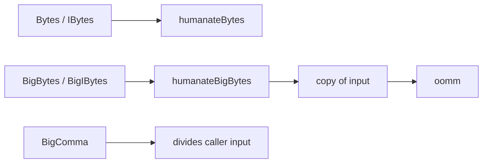

# Unidades de bytes, precisão e posse da entrada

Candidato de pesquisa; sem publicação, aprovação do proprietário ou gold de treinamento.

Revisions: `9f541cc9db5d55bce703bd99987c9d5cb8eea45e` → `9ec74ab2f7a7161664182fd4e5e292fccffbc75f`.

## Propósito

O pacote `humanize` fixado converte tamanhos em textos de exibição e interpreta textos de tamanho. APIs de bytes de largura fixa, APIs de precisão arbitrária e interpretação de magnitude e unidade SI possuem contratos distintos. Nomes semelhantes não implicam unidades aceitas ou precisão idênticas. [source:v1.0.1:Bytes] [source:v1.0.1:ParseBytes] [source:v1.0.1:ParseBigBytes] [source:v1.0.1:ParseSI]

## Arquitetura

`Bytes` e `IBytes` delegam a `humanateBytes`, usando bases 1000 e 1024. `BigBytes` e `BigIBytes` delegam a `humanateBigBytes`, que copia sua entrada antes de passar essa cópia ao auxiliar mutável `oomm`. `ParseSI` segue um caminho separado de expressão regular e tabela de prefixos. [source:v1.0.1:Bytes] [source:v1.0.1:IBytes] [source:v1.0.1:humanateBytes] [source:v1.0.1:BigBytes] [source:v1.0.1:BigIBytes] [source:v1.0.1:humanateBigBytes] [source:v1.0.1:oomm] [source:v1.0.1:ParseSI]

## Dependências e configuração

O pacote raiz selecionado importa apenas pacotes da biblioteca padrão Go. O arquivo de módulo atual declara `github.com/dustin/go-humanize` e `go 1.16`; a árvore anterior selecionada não possui arquivo de módulo na raiz. Isso não estabelece uma versão mínima de Go testada. As observações usaram o Go1.27.4 existente em Linux/ARM64, com CGO e downloads de pacotes desativados. [source:v1.0.1:ParseBytes] [source:v1.0.1:ParseBigBytes]

## Entradas e saídas

O valor observado de `Bytes(82854982)` foi `83 MB`; `IBytes(82854982)` retornou `79 MiB`. Os limites decimal e binário 1000 e 1024 retornaram `1.0 kB` e `1.0 KiB`. São representações arredondadas para exibição, não contratos de serialização sem perdas. [source:v1.0.1:Bytes] [source:v1.0.1:IBytes] [source:v1.0.1:humanateBytes] [runtime:format-decimal,format-binary,format-boundary,format-binary-boundary]

`ParseBytes` percorre um prefixo inicial de dígitos, pontos e vírgulas, remove suas vírgulas, chama `strconv.ParseFloat` e converte para minúsculas e apara apenas o texto de unidade restante. As observações aceitaram `1,2,3 KB` como 123000, `1.5 KiB` como 1536 e `1.9 B` como 1. Isso não é validação estrita de agrupamento nem garantia de interpretação de todo dígito Unicode. [source:v1.0.1:ParseBytes] [runtime:parse-loose-commas,parse-fraction-scale,parse-fraction-truncate,parse-unicode-digit]

## Erros

A entrada observada com espaço inicial ` 1 KB` e a entrada com sinal `-1KB` falharam na interpretação numérica. `1 QQ` falhou na busca da unidade. `1e3` não virou notação exponencial: o número percorrido foi seguido de uma unidade não aceita. Porém, `1e` usou o alias de unidade aceito e produziu 1000000000000000000. [source:v1.0.1:ParseBytes] [runtime:parse-leading-space,parse-negative,parse-unknown,parse-exponent,parse-e-unit]

## Precisão

`ParseBytes` usa `float64`: a entrada observada `9007199254740993` retornou `9007199254740992`, e `18446744073709551615` foi rejeitada por ser grande demais. `ParseBigBytes` preservou exatamente o primeiro inteiro por seu caminho de número racional. A API de precisão arbitrária ainda truncou o valor observado `1.9 B` para 1; precisão arbitrária não implica resultado de bytes fracionários. [source:v1.0.1:ParseBytes] [source:v1.0.1:ParseBigBytes] [runtime:parse-float-precision,parse-uint64-max,bigparse-exact-large,bigparse-fraction]

## Mudanças entre revisões

Entre as revisões fixadas, `ParseBigBytes` ganhou aliases `RB`, `QB`, `RiB` e `QiB` e suas formas sem sufixo. As observações aceitaram `1 QB` como 10^30 e `1 QiB` como 2^100 no recorte atual; o anterior os rejeitou. Isso não amplia `ParseBytes`, que rejeitou `1 Rb` nos dois recortes. As duas cópias do arquivo de código do parser de largura fixa são idênticas em bytes. [source:v1.0.0:ParseBigBytes] [source:v1.0.1:ParseBigBytes] [source:v1.0.1:ParseBytes] [runtime:bigparse-quettabyte,bigparse-quebibyte,parse-new-big-unit]

Para 10^30 bytes, o valor observado de `BigBytes` mudou de `1000000 YB` para `1.0 QB`. Para 2^100 bytes, `BigIBytes` mudou de `1048576 YiB` para `1.0 QiB`. Os dois caminhos de formatação preservaram o inteiro recebido nestas observações. [source:v1.0.0:BigBytes] [source:v1.0.1:BigBytes] [source:v1.0.0:BigIBytes] [source:v1.0.1:BigIBytes] [source:v1.0.1:humanateBigBytes] [source:v1.0.1:oomm] [runtime:bigformat-quettabyte,bigformat-quebibyte]

## Estado e posse

`BigComma` possui outro contrato de posse: seu laço divide o próprio `big.Int` recebido do chamador. As entradas observadas 1234567 e -1234567 produziram os textos agrupados com sinal esperados, mas ambos os objetos de entrada terminaram como 1. Passe uma cópia explícita quando a preservação for necessária; não deduza ausência de mutação a partir de `BigBytes`. [source:v1.0.1:BigComma] [source:v1.0.1:oom] [source:v1.0.1:humanateBigBytes] [runtime:bigcomma-positive,bigcomma-negative]

## Interpretação SI

O valor observado de `ParseSI("1 QB")` mudou de magnitude 1 com unidade `QB` para magnitude 1e30 com unidade `B`, pois a tabela de prefixos ganhou `Q`. Portanto, a interpretação de bytes e a interpretação SI exigem afirmações separadas sobre sufixos desconhecidos. Estas observações não verificam todo prefixo SI, escrita de unidade ou lançamento. [source:v1.0.0:ParseSI] [source:v1.0.1:ParseSI] [source:v1.0.1:init] [source:v1.0.1:revfmap] [runtime:parse-si-quetta]

## Limitações

Os 36 casos congelados foram executados uma vez por revisão. Exatamente 35 previsões coincidiram em cada recorte: `ComputeSI(1e-30)` exibiu `1.0000000000000002`, em vez da previsão própria exata `1`. O prefixo mudou de vazio para `q`, como previsto. A expectativa divergente está preservada como erro de previsão próprio, sem alegação de defeito no projeto externo ou de precisão numérica ampla. [source:v1.0.0:ComputeSI] [source:v1.0.1:ComputeSI] [source:v1.0.1:logn] [runtime:si-quecto]

Os experimentos compilaram o pacote raiz selecionado completo sem testes e executaram seus inicializadores revisados e chamadas sintéticas finitas. Não instalaram pacotes, executaram testes externos, contataram serviços de aplicação nem testaram execução em Windows/macOS, concorrência, adulteração de globais mutáveis ou entradas arbitrárias. A diretiva de módulo e a licença são metadados do código, não certificados de compatibilidade ou aprovação de treinamento. [source:v1.0.1:init] [source:v1.0.1:ParseBytes] [source:v1.0.1:ParseBigBytes] [source:v1.0.1:BigComma]

## Exemplo e comando ilustrativos

Exemplo e comando são ilustrativos e não foram executados; nenhuma saída ou instalação bem-sucedida é afirmada.

```go
package main

import (
    "fmt"
    "math/big"
    "github.com/dustin/go-humanize"
)

func main() {
    n := big.NewInt(1234567)
    copied := new(big.Int).Set(n)
    fmt.Println(humanize.BigComma(copied))
    _, err := humanize.ParseBigBytes("1 QB")
    if err != nil { panic(err) }
}
```

```sh
go doc github.com/dustin/go-humanize.ParseBigBytes
```

[source:v1.0.1:BigComma] [source:v1.0.1:ParseBigBytes]

## Comparação de APIs

| API | Representação / posse |
|---|---|
| `ParseBytes` | `uint64`, `float64` |
| `ParseBigBytes` | `*big.Int`, `big.Rat` |
| `BigBytes` | Copia a entrada antes do auxiliar |
| `BigComma` | Altera a entrada observada |

## Relações escritas entre auxiliares



[source:v1.0.1:humanateBigBytes] [source:v1.0.1:BigComma]

## FAQ

### As novas unidades também funcionam em ParseBytes?

Entre as revisões fixadas, `ParseBigBytes` ganhou aliases `RB`, `QB`, `RiB` e `QiB` e suas formas sem sufixo. As observações aceitaram `1 QB` como 10^30 e `1 QiB` como 2^100 no recorte atual; o anterior os rejeitou. Isso não amplia `ParseBytes`, que rejeitou `1 Rb` nos dois recortes. As duas cópias do arquivo de código do parser de largura fixa são idênticas em bytes. [source:v1.0.0:ParseBigBytes] [source:v1.0.1:ParseBigBytes] [source:v1.0.1:ParseBytes]

### Qual parser preservou o inteiro acima de 2^53?

`ParseBytes` usa `float64`: a entrada observada `9007199254740993` retornou `9007199254740992`, e `18446744073709551615` foi rejeitada por ser grande demais. `ParseBigBytes` preservou exatamente o primeiro inteiro por seu caminho de número racional. A API de precisão arbitrária ainda truncou o valor observado `1.9 B` para 1; precisão arbitrária não implica resultado de bytes fracionários. [source:v1.0.1:ParseBytes] [source:v1.0.1:ParseBigBytes]

### Aceitar vírgulas comprova agrupamento estrito de milhares?

`ParseBytes` percorre um prefixo inicial de dígitos, pontos e vírgulas, remove suas vírgulas, chama `strconv.ParseFloat` e converte para minúsculas e apara apenas o texto de unidade restante. As observações aceitaram `1,2,3 KB` como 123000, `1.5 KiB` como 1536 e `1.9 B` como 1. Isso não é validação estrita de agrupamento nem garantia de interpretação de todo dígito Unicode. [source:v1.0.1:ParseBytes]

### O chamador pode reutilizar sem alterações uma entrada de BigComma?

`BigComma` possui outro contrato de posse: seu laço divide o próprio `big.Int` recebido do chamador. As entradas observadas 1234567 e -1234567 produziram os textos agrupados com sinal esperados, mas ambos os objetos de entrada terminaram como 1. Passe uma cópia explícita quando a preservação for necessária; não deduza ausência de mutação a partir de `BigBytes`. [source:v1.0.1:BigComma] [source:v1.0.1:oom] [source:v1.0.1:humanateBigBytes]

### Por que documentar a interpretação SI separadamente?

O valor observado de `ParseSI("1 QB")` mudou de magnitude 1 com unidade `QB` para magnitude 1e30 com unidade `B`, pois a tabela de prefixos ganhou `Q`. Portanto, a interpretação de bytes e a interpretação SI exigem afirmações separadas sobre sufixos desconhecidos. Estas observações não verificam todo prefixo SI, escrita de unidade ou lançamento. [source:v1.0.0:ParseSI] [source:v1.0.1:ParseSI] [source:v1.0.1:init] [source:v1.0.1:revfmap]

### Todas as previsões numéricas exatas coincidiram?

Os 36 casos congelados foram executados uma vez por revisão. Exatamente 35 previsões coincidiram em cada recorte: `ComputeSI(1e-30)` exibiu `1.0000000000000002`, em vez da previsão própria exata `1`. O prefixo mudou de vazio para `q`, como previsto. A expectativa divergente está preservada como erro de previsão próprio, sem alegação de defeito no projeto externo ou de precisão numérica ampla. [source:v1.0.0:ComputeSI] [source:v1.0.1:ComputeSI] [source:v1.0.1:logn]

## Evidência física e licença

[Runtime receipt](../humanize-confined-runtime-results-v1.json); [prediction review](../humanize-runtime-prediction-review-v1.json).

- [source:v1.0.0:BigBytes] [bigbytes.go:117–120](https://github.com/dustin/go-humanize/blob/9f541cc9db5d55bce703bd99987c9d5cb8eea45e/bigbytes.go#L117-L120); SHA-256 `0628800f4b07d9b08c7e005c54027c0fa89b129c4a83180674860196c92ae615`.
- [source:v1.0.0:BigIBytes] [bigbytes.go:127–130](https://github.com/dustin/go-humanize/blob/9f541cc9db5d55bce703bd99987c9d5cb8eea45e/bigbytes.go#L127-L130); SHA-256 `0628800f4b07d9b08c7e005c54027c0fa89b129c4a83180674860196c92ae615`.
- [source:v1.0.0:ComputeSI] [si.go:60–81](https://github.com/dustin/go-humanize/blob/9f541cc9db5d55bce703bd99987c9d5cb8eea45e/si.go#L60-L81); SHA-256 `f682e76b01dfcb82957423e891761b1d91b8ca03081b8b07f33be03eda7a3a3b`.
- [source:v1.0.0:ParseBigBytes] [bigbytes.go:139–173](https://github.com/dustin/go-humanize/blob/9f541cc9db5d55bce703bd99987c9d5cb8eea45e/bigbytes.go#L139-L173); SHA-256 `0628800f4b07d9b08c7e005c54027c0fa89b129c4a83180674860196c92ae615`.
- [source:v1.0.0:ParseSI] [si.go:113–123](https://github.com/dustin/go-humanize/blob/9f541cc9db5d55bce703bd99987c9d5cb8eea45e/si.go#L113-L123); SHA-256 `f682e76b01dfcb82957423e891761b1d91b8ca03081b8b07f33be03eda7a3a3b`.
- [source:v1.0.1:BigBytes] [bigbytes.go:133–136](https://github.com/dustin/go-humanize/blob/9ec74ab2f7a7161664182fd4e5e292fccffbc75f/bigbytes.go#L133-L136); SHA-256 `9318dd523505253f686747635394232cabe2968984df14b2f49d91926ea80c70`.
- [source:v1.0.1:BigComma] [comma.go:89–116](https://github.com/dustin/go-humanize/blob/9ec74ab2f7a7161664182fd4e5e292fccffbc75f/comma.go#L89-L116); SHA-256 `067d9654d89f6d55df0e10cdb907a1c5eaca786ae7d4225126ce6e68836bf3bf`.
- [source:v1.0.1:BigIBytes] [bigbytes.go:143–146](https://github.com/dustin/go-humanize/blob/9ec74ab2f7a7161664182fd4e5e292fccffbc75f/bigbytes.go#L143-L146); SHA-256 `9318dd523505253f686747635394232cabe2968984df14b2f49d91926ea80c70`.
- [source:v1.0.1:Bytes] [bytes.go:88–91](https://github.com/dustin/go-humanize/blob/9ec74ab2f7a7161664182fd4e5e292fccffbc75f/bytes.go#L88-L91); SHA-256 `9fb2391c3896a42cd4091279701f6274c19f3c3f15145503477229a67835d5da`.
- [source:v1.0.1:ComputeSI] [si.go:64–85](https://github.com/dustin/go-humanize/blob/9ec74ab2f7a7161664182fd4e5e292fccffbc75f/si.go#L64-L85); SHA-256 `7159cff48cad974637868726cf45ff255b4a9c522a7b2eafcad3dfd537ba058e`.
- [source:v1.0.1:IBytes] [bytes.go:98–101](https://github.com/dustin/go-humanize/blob/9ec74ab2f7a7161664182fd4e5e292fccffbc75f/bytes.go#L98-L101); SHA-256 `9fb2391c3896a42cd4091279701f6274c19f3c3f15145503477229a67835d5da`.
- [source:v1.0.1:ParseBigBytes] [bigbytes.go:155–189](https://github.com/dustin/go-humanize/blob/9ec74ab2f7a7161664182fd4e5e292fccffbc75f/bigbytes.go#L155-L189); SHA-256 `9318dd523505253f686747635394232cabe2968984df14b2f49d91926ea80c70`.
- [source:v1.0.1:ParseBytes] [bytes.go:110–143](https://github.com/dustin/go-humanize/blob/9ec74ab2f7a7161664182fd4e5e292fccffbc75f/bytes.go#L110-L143); SHA-256 `9fb2391c3896a42cd4091279701f6274c19f3c3f15145503477229a67835d5da`.
- [source:v1.0.1:ParseSI] [si.go:117–127](https://github.com/dustin/go-humanize/blob/9ec74ab2f7a7161664182fd4e5e292fccffbc75f/si.go#L117-L127); SHA-256 `7159cff48cad974637868726cf45ff255b4a9c522a7b2eafcad3dfd537ba058e`.
- [source:v1.0.1:humanateBigBytes] [bigbytes.go:112–126](https://github.com/dustin/go-humanize/blob/9ec74ab2f7a7161664182fd4e5e292fccffbc75f/bigbytes.go#L112-L126); SHA-256 `9318dd523505253f686747635394232cabe2968984df14b2f49d91926ea80c70`.
- [source:v1.0.1:humanateBytes] [bytes.go:68–81](https://github.com/dustin/go-humanize/blob/9ec74ab2f7a7161664182fd4e5e292fccffbc75f/bytes.go#L68-L81); SHA-256 `9fb2391c3896a42cd4091279701f6274c19f3c3f15145503477229a67835d5da`.
- [source:v1.0.1:init] [si.go:47–55](https://github.com/dustin/go-humanize/blob/9ec74ab2f7a7161664182fd4e5e292fccffbc75f/si.go#L47-L55); SHA-256 `7159cff48cad974637868726cf45ff255b4a9c522a7b2eafcad3dfd537ba058e`.
- [source:v1.0.1:logn] [bytes.go:64–66](https://github.com/dustin/go-humanize/blob/9ec74ab2f7a7161664182fd4e5e292fccffbc75f/bytes.go#L64-L66); SHA-256 `9fb2391c3896a42cd4091279701f6274c19f3c3f15145503477229a67835d5da`.
- [source:v1.0.1:oom] [big.go:23–31](https://github.com/dustin/go-humanize/blob/9ec74ab2f7a7161664182fd4e5e292fccffbc75f/big.go#L23-L31); SHA-256 `26c2e7a009a1579f126853cbfb6c9ffc7cda00b4f5ca3faea4705c384cff5edf`.
- [source:v1.0.1:oomm] [big.go:8–19](https://github.com/dustin/go-humanize/blob/9ec74ab2f7a7161664182fd4e5e292fccffbc75f/big.go#L8-L19); SHA-256 `26c2e7a009a1579f126853cbfb6c9ffc7cda00b4f5ca3faea4705c384cff5edf`.
- [source:v1.0.1:revfmap] [si.go:37–43](https://github.com/dustin/go-humanize/blob/9ec74ab2f7a7161664182fd4e5e292fccffbc75f/si.go#L37-L43); SHA-256 `7159cff48cad974637868726cf45ff255b4a9c522a7b2eafcad3dfd537ba058e`.
- v1.0.0 [LICENSE](../new-public-sources-v1/dustin--go-humanize/9f541cc9db5d55bce703bd99987c9d5cb8eea45e/LICENSE); SHA-256 `a973b4498c13eb74baa2a8e5c351426a6826f2fcdd909916dbe53ee2e755fd71`.
- v1.0.1 [LICENSE](../new-public-sources-v1/dustin--go-humanize/9ec74ab2f7a7161664182fd4e5e292fccffbc75f/LICENSE); SHA-256 `a973b4498c13eb74baa2a8e5c351426a6826f2fcdd909916dbe53ee2e755fd71`.
- v1.0.1 [go.mod](../new-public-sources-v1/dustin--go-humanize/9ec74ab2f7a7161664182fd4e5e292fccffbc75f/go.mod); SHA-256 `4325999d0a6841031258a2561c22879d9fbdf77abc6b32a17b1cb6edf0810fb2`.
