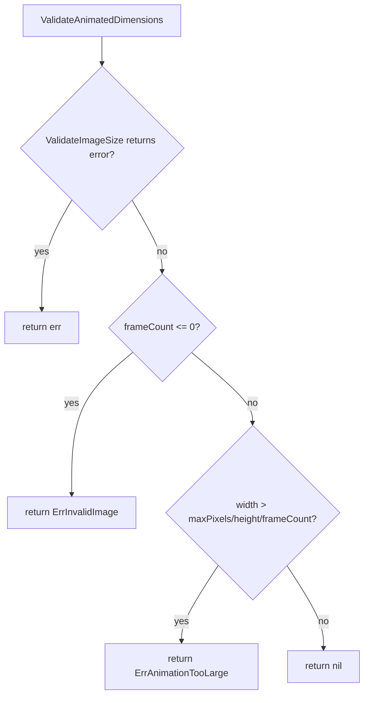

# Animated dimensions: two budgets and ordered failure checks

Codex source-reviewed experimental draft, pending human factual and bilingual approval. Source: go-image-optimizer revision `48476de6e4450294b7769ab7af90805100bb21b5`, `backend/internal/infrastructure/imaging/limits.go`. Original local-agent outputs `gio-animated-limits-caller` and `gio-animated-limits-helpers` remain preserved. The actual protocol identifiers are recorded in the accompanying review; this chapter is a correction rather than evidence of neural learning. The external application was not executed.

## The animation function accepts dimensions and a frame count

The declaration `ValidateAnimatedDimensions(width, height, frameCount, maxPixels int) error` receives four integer parameters. Width and height describe the dimensions checked by this function; the frame count participates in a later budget expression. The final parameter is an aggregate pixel-work budget supplied by the caller. It is distinct from the named static-image budget used in the first call. Calling both values a single image-size limit would hide a dependency.

The first operation is `ValidateImageSize(width, height, DefaultMaxDecodedPixels)`. A non-nil error is returned unchanged before checking the frame count or evaluating the animation division. The selected helper first rejects nonpositive width or height, then checks its static pixel bound. Consequently, the animation function can return a static-dimension error even when the frame count is also invalid. The source order gives the earlier validation priority; the model must not reorder conditions merely to group similar error names.

## The helper guards make later divisors positive

The helper's first guard is `width <= 0 || height <= 0`. Either condition returns the invalid-image error. Its later static-budget condition is `width > maxPixels/height`, returning the image-too-large error when true, followed by a normal nil return when neither condition fails. In the animation call, the helper receives the named static budget rather than the function's final parameter.

After that helper succeeds, the explicit check `frameCount <= 0` returns `imageprocessing.ErrInvalidImage`. Only after this guard does the animation-specific division occur. On the source path reaching it, the height has passed the helper's positivity guard and the frame count has passed its own guard. These local facts explain the order of the divisor checks. They do not prove decoder behavior, import bindings or the validity of an entire encoded animation.

## The aggregate comparison preserves equality and division order

The animation budget condition is `width > maxPixels/height/frameCount`. The written division includes both height and frame count, and the comparison is strict. If it is true, the function returns `imageprocessing.ErrAnimationTooLarge`; otherwise the final result is `nil`. A description that omits the frame-count divisor loses the aggregate-work distinction. A description that uses greater than or equal changes the boundary.

The implementation writes integer division rather than directly computing a product of all three dimensions. The order and integer nature of the written operations belong in the documentation. The body does not contain a separate positivity check for its aggregate budget. It also does not convert pixels to bytes or inspect the size of an encoded file. Source comments describe an intended canvas-sized animation-work limit, which is a different quantity from exact resident memory.

## Named defaults are separate inputs to callers

The file declares `DefaultMaxDecodedPixels` as `32_000_000` and `DefaultMaxAnimatedFramePixels` as `64_000_000`. The first constant is directly selected inside this function for static validation. The second constant is available for callers to pass as the aggregate budget; this function still uses the value of its parameter in the final expression. The two declarations alone do not establish every actual calling configuration.

The caller-only model response contained a critical Portuguese logical error: it described failure only when none of the conditions were met, reversing the source's early-return logic. The helper response improved some positivity coverage but used a strict “less than” description where the source rejects nonpositive values, omitted the exact aggregate expression and included Spanish terminology. The correction preserves “any failing condition,” nonpositive boundaries, distinct errors and final nil in both languages. Successful citation checks do not establish these logical equivalences. This source-reviewed chapter remains a candidate, with no automatic promotion into training gold or published documentation.

## Engineer FAQ

<!-- reading-section: faq:guard-error-order -->
### Which error wins if dimensions and frame count both fail?

The static helper runs first and its non-nil result is returned immediately. The frame-count guard is reached only after that helper succeeds. Reordering the checks would change this source contract.

<!-- reading-section: faq:aggregate-pixels-not-bytes -->
### Is the aggregate limit a byte or exact memory limit?

The source describes canvas-sized pixel work across frames. The expression divides the supplied budget by height and frame count before comparing width. It does not measure encoded bytes, decoded object allocation or total process memory.

<!-- reading-section: faq:static-versus-aggregate-budget -->
### Is the aggregate parameter also used for static validation?

The first call uses the named static default. The later expression uses the aggregate parameter. The separately declared aggregate default is available to callers, but this body does not replace its parameter with that constant.

## Ordered validation flow

This diagram follows only the written guards and normal helper-completion paths; it does not execute a decoder or resolve imported error identities.

