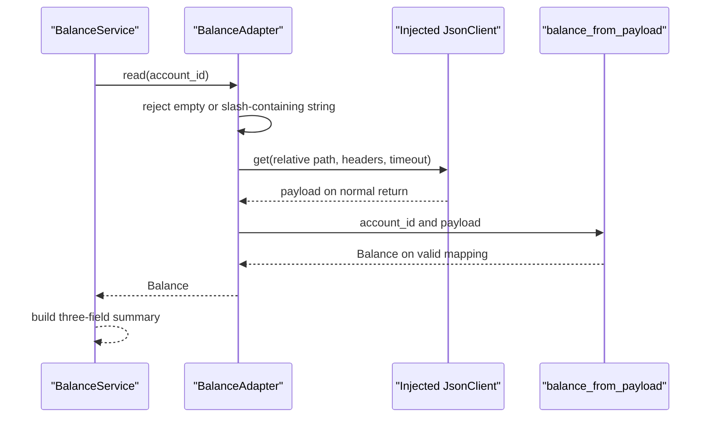

# Understanding a synthetic balance adapter across files

This owned Python fixture demonstrates a port, adapter, mapper and consumer.
It is unrelated to Viva Bem and contains no real account, credential or financial
payload. The [source manifest](../references/ref-39e6f9dfda9259243ae5.md) identifies the exact synthetic
revision; [source excerpts](../references/ref-7350d01a378aa007aa6a.md) retain full-file hashes and
physical line references. This is a source-reviewed documentation candidate,
pending owner approval.

## Responsibilities and dependency direction

`BalanceService` receives a `BalancePort` and calls its `read` operation.
`BalanceAdapter` provides that method and receives a `JsonClient` through its
constructor. Python protocol compatibility is structural here: the adapter does
not subclass the port, and no runtime protocol check appears in the fixture.
The client is an interface rather than a concrete HTTP implementation.

The service converts the resulting `Balance` into a dictionary with `account`,
`available_minor` and `currency`. It has no timeout parameter, retry loop or error
translation. Its caller, application startup and production dependency wiring
are not supplied. The executable example explicitly composes the service with
the adapter and a fake client.



The sequence shows the normal written call path. It does not depict observed
network traffic. Error paths and unknown client behavior are described below.

## Request, mapping and configuration

For a nonempty string identifier without a slash, the adapter constructs
`/sandbox/accounts/{account_id}/balance` and forwards an `Authorization` header
whose value is `Bearer {self._token}`. It passes its stored timeout, default
`2.0`, to the injected client. The adapter contains no general URL encoding,
token validation or timeout validation.

| Input or field | Written responsibility | Limit |
|---|---|---|
| account identifier | Adapter rejects empty and slash-containing values | This is not complete URL validation; annotations do not enforce types |
| token | Constructor stores it; adapter interpolates the header | No credential validation or server authorization is visible |
| timeout | Constructor stores the default or override; adapter forwards it | No concrete network deadline is proved |
| available amount | Mapper requires the exact built-in integer type | Booleans are rejected; nonnegative values and bounds are not required |
| currency | Mapper requires a string of three characters | No ISO membership, uppercase or byte-length rule is checked |

The mapper reads `available_minor` and `currency` by key and constructs
`Balance(account_id=account_id, available_minor=amount, currency=currency)`.
It does not divide monetary units or obtain the account identifier from the
response. Missing keys propagate as `KeyError`. Its explicit validation failures
raise `ValueError`. Dataclass annotations alone are not a runtime validator.

## Error boundaries and side effects

Only the client call is inside the adapter's try block. A `GatewayUnavailable`
from that call becomes `BalanceUnavailable` with the original exception retained
as its cause. The mapper is called after the try block, so its validation
failures are not translated by that handler. A different client exception,
including `TimeoutError`, propagates through this adapter and service.

One valid call path invokes the injected client's method once in the adapter's
body. This is not proof that the concrete client never retries internally.
The shown service, adapter and mapper contain no cache or persistence operation;
hidden client behavior remains unknown. No concrete host, transport, TLS,
authorization policy or external service contract is supplied.

## Executable fake-client example

From the Engineering Library repository root, with Python 3.10 or newer, run:

```sh
python3 agent/research/documentation-intelligence-20261119/owned-adapter/examples/balance_summary.py
```

The [example](../references/ref-d26104e8f2a188241c51.md) uses the preserved fake from the
synthetic tests. It makes no network request and prints:

```json
{"account": "fixture-account", "available_minor": 7, "currency": "TST"}
```

The fake records the relative path, header and timeout. The eight source tests
cover normal composition, exact request forwarding, translated error cause,
boolean rejection, missing keys, unrelated client errors, invalid identifiers,
timeout overrides and the currency rule. Some tests cover more than one concern.
Run them from the same repository root:

```sh
python3 -m unittest discover -s agent/research/documentation-intelligence-20261119/owned-adapter/source -p test_adapter.py
```

Passing these tests verifies this synthetic composition with a fake. It does not
verify a real gateway or production integration.

## Engineer FAQ

<!-- reading-section: faq:adapter-timeout-ownership -->
### Which component owns the timeout?

The adapter stores and forwards the configured argument. The service exposes no
timeout setting. Whether the forwarded value enforces any real deadline depends
on the missing concrete client.

<!-- reading-section: faq:gateway-error-translation-boundary -->
### Does the adapter handle every external failure?

It translates only the named gateway exception from the client call. Other
client exceptions and mapping failures propagate. The service adds no catch.

<!-- reading-section: faq:currency-length-not-iso -->
### Is the currency guaranteed to be a valid uppercase ISO code?

No. The mapper checks only string type and three-character length. The tests
deliberately accept a lowercase three-character value.

<!-- reading-section: faq:fake-client-observation-limit -->
### Do the tests establish retries, caching or production persistence?

They establish one adapter-level fake call on the exercised path. They do not
inspect a real client's internal retries, cache, persistence or transport.

<!-- reading-section: faq:helper-experiment-no-improvement -->
### Did supplying helpers improve the local model's architecture explanation?

The [paired review](../references/ref-b73070f5fc0865b428fe.md) found no demonstrated
improvement in the two development calls. The caller-only answer incorrectly
assigned the adapter's timeout to the service. The helper answer did not use its
helper citations. This chapter is a Codex-authored source review, not evidence
of neural learning or owner-approved training gold.
