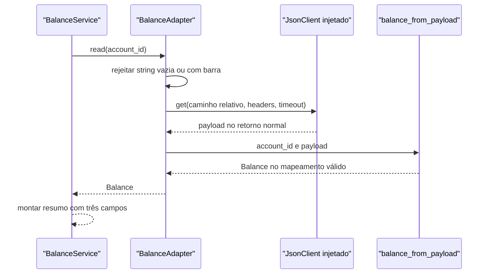

# Entendendo um adaptador sintético de saldo entre arquivos

Este fixture Python próprio demonstra uma porta, um adaptador, um mapeador e um
consumidor. Não tem relação com o Viva Bem e não contém conta, credencial ou
payload financeiro real. O [manifesto de fontes](../references/ref-39e6f9dfda9259243ae5.md) identifica
a revisão sintética exata; os [trechos de fonte](../references/ref-7350d01a378aa007aa6a.md) preservam
hashes dos arquivos completos e referências de linhas físicas. Este é um
candidato de documentação revisado contra a fonte, pendente de aprovação do
proprietário.

## Responsabilidades e direção das dependências

`BalanceService` recebe uma `BalancePort` e chama sua operação `read`.
`BalanceAdapter` fornece esse método e recebe um `JsonClient` pelo construtor.
A compatibilidade com protocolos Python é estrutural aqui: o adaptador não
herda da porta, e o fixture não verifica o protocolo em execução. O cliente é
uma interface, não uma implementação HTTP concreta.

O serviço converte o `Balance` resultante em um dicionário com `account`,
`available_minor` e `currency`. Não tem parâmetro de timeout, laço de tentativas
ou tradução de erros. Seu chamador, a inicialização da aplicação e a composição
de dependências de produção não foram fornecidos. O exemplo executável compõe
explicitamente o serviço com o adaptador e um cliente falso.



A sequência mostra o caminho normal de chamadas escrito. Não representa tráfego
de rede observado. Os caminhos de erro e o comportamento desconhecido do cliente
são descritos abaixo.

## Requisição, mapeamento e configuração

Para um identificador string não vazio e sem barra, o adaptador constrói
`/sandbox/accounts/{account_id}/balance` e encaminha um header `Authorization`
cujo valor é `Bearer {self._token}`. Passa seu timeout armazenado, por padrão
`2.0`, ao cliente injetado. O adaptador não contém codificação geral de URL,
validação de token ou validação de timeout.

| Entrada ou campo | Responsabilidade escrita | Limite |
|---|---|---|
| identificador da conta | Adaptador rejeita valores vazios e com barra | Não é validação completa de URL; anotações não impõem tipos |
| token | Construtor armazena; adaptador interpola o header | Não há validação de credencial ou autorização do servidor visível |
| timeout | Construtor armazena padrão ou substituição; adaptador encaminha | Nenhum deadline real de rede é provado |
| valor disponível | Mapeador exige o tipo inteiro embutido exato | Booleanos são rejeitados; valores não negativos e limites não são exigidos |
| moeda | Mapeador exige string com três caracteres | Não verifica presença na ISO, maiúsculas ou tamanho em bytes |

O mapeador lê `available_minor` e `currency` pelas chaves e constrói
`Balance(account_id=account_id, available_minor=amount, currency=currency)`.
Não divide unidades monetárias nem obtém o identificador da conta da resposta.
Chaves ausentes propagam `KeyError`. Suas falhas explícitas de validação lançam
`ValueError`. Anotações de dataclass isoladas não validam em execução.

## Fronteiras de erro e efeitos observáveis

Somente a chamada ao cliente está dentro do bloco try do adaptador. Uma
`GatewayUnavailable` dessa chamada se torna `BalanceUnavailable` com a exceção
original preservada como causa. O mapeador é chamado depois do bloco try, então
suas falhas de validação não são traduzidas por esse handler. Uma exceção
diferente do cliente, incluindo `TimeoutError`, se propaga por este adaptador
e serviço.

Um caminho de chamada válido invoca uma vez o método do cliente injetado no
corpo do adaptador. Isso não prova que o cliente concreto nunca faça tentativas
internas. O serviço, adaptador e mapeador mostrados não contêm operação de cache
ou persistência; o comportamento oculto do cliente continua desconhecido.
Nenhum host concreto, transporte, TLS, política de autorização ou contrato de
serviço externo foi fornecido.

## Exemplo executável com cliente falso

Na raiz do repositório Engineering Library, com Python 3.10 ou mais recente,
execute:

```sh
python3 agent/research/documentation-intelligence-20261119/owned-adapter/examples/balance_summary.py
```

O [exemplo](../references/ref-d26104e8f2a188241c51.md) usa o cliente falso preservado nos testes
sintéticos. Não faz requisição de rede e imprime:

```json
{"account": "fixture-account", "available_minor": 7, "currency": "TST"}
```

O cliente falso registra caminho relativo, header e timeout. Os oito testes de
fonte cobrem composição normal, encaminhamento exato da requisição, causa do
erro traduzido, rejeição de booleanos, chaves ausentes, erros não relacionados do
cliente, identificadores inválidos, substituição do timeout e regra de moeda.
Alguns testes cobrem mais de um aspecto. Execute na mesma raiz de repositório:

```sh
python3 -m unittest discover -s agent/research/documentation-intelligence-20261119/owned-adapter/source -p test_adapter.py
```

A aprovação nesses testes verifica esta composição sintética com um cliente
falso. Não verifica um gateway real ou integração de produção.

## FAQ de engenharia

<!-- reading-section: faq:adapter-timeout-ownership -->
### Qual componente é responsável pelo timeout?

O adaptador armazena e encaminha o argumento configurado. O serviço não expõe
configuração de timeout. Se o valor encaminhado impõe um deadline real depende
do cliente concreto ausente.

<!-- reading-section: faq:gateway-error-translation-boundary -->
### O adaptador trata toda falha externa?

Traduz apenas a exceção de gateway nomeada que vem da chamada ao cliente.
Outras exceções do cliente e falhas do mapeamento se propagam. O serviço não
adiciona captura.

<!-- reading-section: faq:currency-length-not-iso -->
### A moeda é garantidamente um código ISO válido em maiúsculas?

Não. O mapeador verifica somente tipo string e comprimento de três caracteres.
Os testes aceitam deliberadamente um valor de três caracteres em minúsculas.

<!-- reading-section: faq:fake-client-observation-limit -->
### Os testes estabelecem tentativas, cache ou persistência de produção?

Estabelecem uma chamada falsa no nível do adaptador no caminho exercitado.
Não inspecionam tentativas internas, cache, persistência ou transporte de um
cliente real.

<!-- reading-section: faq:helper-experiment-no-improvement -->
### Fornecer helpers melhorou a explicação arquitetural do modelo local?

A [revisão pareada](../references/ref-b73070f5fc0865b428fe.md) não encontrou
melhoria demonstrada nas duas chamadas de desenvolvimento. A resposta com
somente o chamador atribuiu incorretamente o timeout do adaptador ao serviço.
A resposta com helpers não usou suas citações de helpers. Este capítulo é uma
revisão de fonte escrita pelo Codex, não evidência de aprendizado neural ou
treinamento gold aprovado pelo proprietário.
