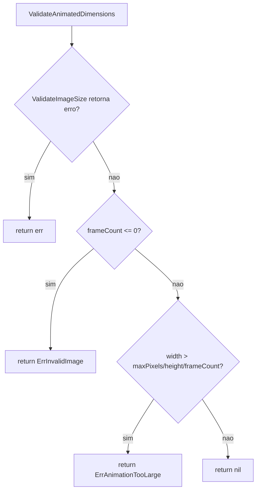

# Dimensões animadas: dois orçamentos e verificações de falha ordenadas

Rascunho experimental revisado na fonte pelo Codex, pendente de aprovação humana factual e bilíngue. Fonte: go-image-optimizer na revisão `48476de6e4450294b7769ab7af90805100bb21b5`, `backend/internal/infrastructure/imaging/limits.go`. As saídas originais do agente local, `gio-animated-limits-caller` e `gio-animated-limits-helpers`, permanecem preservadas. Os identificadores efetivos do protocolo estão registrados na revisão associada; este capítulo é uma correção, não evidência de aprendizado neural. A aplicação externa não foi executada.

## A função de animação recebe dimensões e quantidade de quadros

A declaração `ValidateAnimatedDimensions(width, height, frameCount, maxPixels int) error` recebe quatro parâmetros inteiros. Largura e altura descrevem as dimensões examinadas; a quantidade de quadros participa de uma expressão posterior de orçamento. O último parâmetro é um orçamento agregado de trabalho em pixels fornecido pelo chamador. Ele difere do orçamento nomeado de imagem estática usado na primeira chamada. Chamar os dois valores de um único limite de tamanho esconderia uma dependência.

A primeira operação é `ValidateImageSize(width, height, DefaultMaxDecodedPixels)`. Um erro diferente de nil é retornado sem alteração antes da verificação de quadros e da divisão de animação. O auxiliar selecionado primeiro rejeita largura ou altura não positiva e depois verifica seu limite de pixels estáticos. Assim, a função de animação pode retornar um erro de dimensão estática mesmo quando a quantidade de quadros também é inválida. A ordem da fonte dá prioridade à validação anterior; o modelo não deve reordenar condições apenas para agrupar nomes de erros semelhantes.

## As guardas do auxiliar tornam positivos os divisores posteriores

A primeira guarda do auxiliar é `width <= 0 || height <= 0`. Qualquer condição retorna o erro de imagem inválida. Sua condição posterior de orçamento estático é `width > maxPixels/height`, que retorna o erro de imagem grande demais quando verdadeira; quando nenhuma condição falha, há retorno nil normal. Na chamada de animação, o auxiliar recebe o orçamento estático nomeado, em vez do último parâmetro da função.

Depois do sucesso desse auxiliar, a verificação explícita `frameCount <= 0` retorna `imageprocessing.ErrInvalidImage`. A divisão específica de animação ocorre somente após essa guarda. No caminho da fonte que a alcança, a altura já ultrapassou a guarda de positividade do auxiliar e a quantidade de quadros já ultrapassou sua própria guarda. Esses fatos locais explicam a ordem das verificações dos divisores. Não provam o comportamento do decodificador, vínculos de importação ou a validade de uma animação codificada inteira.

## A comparação agregada preserva igualdade e ordem da divisão

A condição do orçamento de animação é `width > maxPixels/height/frameCount`. A divisão escrita inclui altura e quantidade de quadros, e a comparação é estrita. Quando verdadeira, a função retorna `imageprocessing.ErrAnimationTooLarge`; caso contrário, o resultado final é `nil`. Uma descrição que omita o divisor de quadros perde a distinção de trabalho agregado. Uma descrição que use maior ou igual altera o limite.

A implementação escreve uma divisão inteira em vez de calcular diretamente o produto das três dimensões. A ordem e a natureza inteira das operações escritas pertencem à documentação. O corpo não contém uma verificação separada de positividade do orçamento agregado. Também não converte pixels para bytes nem examina o tamanho de um arquivo codificado. Os comentários descrevem a intenção de limitar trabalho de animação do tamanho do canvas, uma quantidade diferente da memória residente exata.

## Os padrões nomeados são entradas separadas para chamadores

O arquivo declara `DefaultMaxDecodedPixels` como `32_000_000` e `DefaultMaxAnimatedFramePixels` como `64_000_000`. A primeira constante é selecionada diretamente nesta função para validação estática. A segunda fica disponível para que chamadores a passem como orçamento agregado; a função continua usando o valor do parâmetro na expressão final. As duas declarações isoladas não estabelecem todas as configurações efetivamente usadas por chamadores.

A resposta do modelo com somente o chamador continha um erro lógico crítico em português: descrevia falha apenas quando nenhuma condição fosse satisfeita, invertendo a lógica dos retornos antecipados. A resposta com auxiliar ampliou parte da cobertura de positividade, mas usou “menor que” no limite superior da largura onde a fonte permite igualdade, omitiu a expressão agregada exata e incluiu terminologia espanhola. A correção preserva “qualquer condição de falha”, limites não positivos, erros distintos e nil final nos dois idiomas. Conferir citações com sucesso não estabelece essas equivalências lógicas. Este capítulo revisado continua como candidato, sem promoção automática a dado de treinamento ou documentação publicada.

## FAQ de engenharia

<!-- reading-section: faq:guard-error-order -->
### Qual erro tem prioridade se dimensões e quantidade de quadros falharem?

O helper estático executa primeiro e seu resultado diferente de nil é retornado imediatamente. A guarda de quantidade de quadros só é alcançada após o sucesso desse helper. Reordenar as verificações alteraria esse contrato da fonte.

<!-- reading-section: faq:aggregate-pixels-not-bytes -->
### O limite agregado é um limite de bytes ou de memória exata?

A fonte descreve trabalho em pixels do tamanho do canvas ao longo dos quadros. A expressão divide o orçamento recebido por altura e quantidade de quadros antes de comparar a largura. Não mede bytes codificados, alocação de objetos decodificados ou memória total do processo.

<!-- reading-section: faq:static-versus-aggregate-budget -->
### O parâmetro agregado também é usado para validação estática?

A primeira chamada usa o padrão estático nomeado. A expressão posterior usa o parâmetro agregado. O padrão agregado declarado separadamente está disponível para chamadores, mas esse corpo não substitui seu parâmetro por aquela constante.

## Fluxo ordenado de validação

Este diagrama segue apenas as guardas escritas e os caminhos de conclusão normal do helper; não executa decodificador ou resolve identidades dos erros importados.

