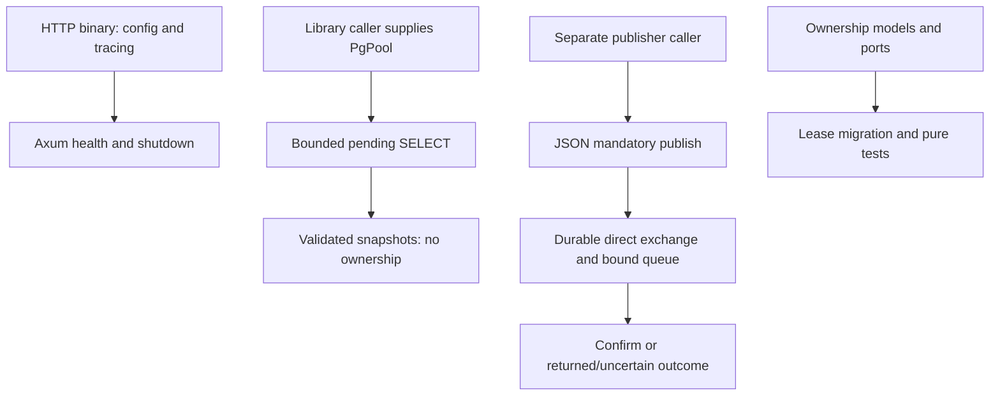

# Verified flows and non-integrations

These flows stay within independent projects. No inter-repository API/event relationship is established. Missing producer/consumer/payment implementations are explicit boundaries, not omitted steps in a working ecosystem.

## Browser image request

A user selects an original file in React. Settings choose an operation; Next.js receives multipart at a same-origin API route, rebuilds FormData and sends it to Go. Go validates the HTTP/form boundary and actual content, invokes an operation-specific use case and imaging adapter, and returns metadata or binary bytes. Next.js forwards status/content and selected headers; the UI stores the result, uses browser object URLs for display/download and separates fallback preview from output. No authentication token or persistent record is created. A proxy exception yields 502; backend validation/codec errors preserve the relevant HTTP status. Retry starts new processing; temporary results are not durable jobs.

## Short-code creation and resolution

POST creation checks Basic credentials, validates HttpUrl, allocates Redis ID, encodes/obfuscates it and stores Cassandra mapping. 201 is emitted only after the store call returns. There is no cross-store transaction, so failed creation can consume an ID or leave an uncertain mapping. Public GET reverses the seven-character code, queries Cassandra and returns 301. Redis is not queried on GET. Syntax/authentication/obfuscation and TLS are different boundaries; the current app does not configure public TLS. No other portfolio project calls this API in inspected code.

## Catalog read

Angular lazy `/products` calls `/api/v1/products` through its development proxy. Spring's allowlisted GET reaches controller/service; the read-only transaction queries visible availability states in JPA and maps them to DTOs before serialization. PostgreSQL enforces persisted constraints, Angular distinguishes loading/error/empty/results, and manual retry repeats the GET. No payment provider, signature, webhook, order or reconciliation job participates. A generic server failure is Problem Details 500; readiness checks database connectivity, not payment functionality.

## Separate relay paths

There are deliberately no arrows from HTTP to reader/publisher or snapshot to publication: current composition does not connect them. The publisher authenticates to a configured broker vhost, confirms acceptance and handles uncertain send outcomes without automatic retry. No consumer effect is implemented. Future local producer transaction plus outbox, acquisition, publication, completion and deduplicating consumer would form a new path requiring code and tests. UUID stability, mandatory routing and confirms cannot supply that missing path or prove exactly-once effects.

## Filesystem synchronization

ENV Auditor discovers directory-local pairs, parses literal blocks, calculates one plan and either reports preview or backs up/replaces a target. It exchanges no HTTP/event payload with another application. Key membership changes can affect a future application startup, but no runtime verification or orchestration follows from the CLI. Per-file failure continuation and backups do not give a workspace transaction.
