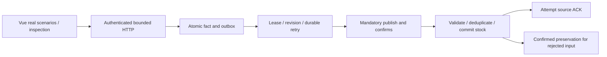

# Verified flows and independent projects

Static source review: 2026-10-18. No application-to-application runtime integration was found across the five portfolio repositories. Shared languages, Compose or PostgreSQL do not establish a call graph. Engineering Library reads documentation; it is not a deployed dependency. ENV Auditor may inspect sibling directories as local filesystem input, not an HTTP service. No private workspace was accessed.

| Project | Caller → receiver | Transport and data | Security / failures |
| --- | --- | --- | --- |
| Go Image Optimizer | React → Next.js → Go | Same-origin multipart HTTP, reconstructed FormData, metadata or binary image | No identity token inserted; server BACKEND_URL; backend status propagated, proxy failure 502; retries repeat work |
| URL Shortener | Client → FastAPI → Redis/Cassandra | POST URL → INCR identity → mapping INSERT; GET code → Cassandra lookup → 301 | Basic Auth on create only, public redirect; obfuscation is not encryption; no two-store transaction, expected store failures 503 |
| Payment Lab | Angular → Spring → PostgreSQL | GET catalog through development proxy; DTO list from JPA read-only transaction | GET allowlist, configured CORS without credentials, other routes denied; no Stripe/webhook/payment exchange |
| Rust Event Relay | Vue → HTTP producer → PostgreSQL → relay → RabbitMQ → consumer → PostgreSQL | Fixed JSON intent, atomic fact/outbox, canonical AMQP envelope, atomic effect/receipt and manual ACK attempt; HTTP GET evidence | Demo Bearer separate from operator replay/broker credentials; unknown outcomes retained; no exactly-once transport |
| ENV Auditor | CLI → local directory pairs | Literal assignment blocks, plan, private backup and per-file replace | No shell evaluation or network; per-pair failures can leave partial workspace progress |

## Rust delivery sequence and boundaries

Consumer commit is independent of observed outbox completion; local ACK send is independent of broker receipt. Duplicate actions reuse the envelope and correlate action evidence while stock stays 15. The before-send rejection scenario is real controlled policy behavior, not an infrastructure outage. Crash/race/ACK-loss playback is illustrative; actual fault schedules belong to isolated integration tests. HTTP inspection does not publish, and no WebSocket delivery path is implied.

Read the [self-contained Rust dossier](../architecture/rust-event-relay.md) for contracts, ownership, retries, schema and limitations. The other [project dossiers](../architecture/workspace-catalog.md) explain internal calls in depth. [Earlier flow reviews](../operations/historical-flow-reviews.md) retain their historical missing-worker/consumer/API statements; they do not describe present implementation. No application-level encryption or production TLS is inferred from credentials or broker use.
