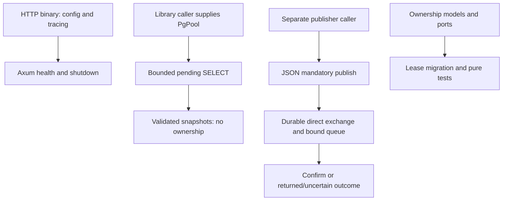

# Verified flows and non-integrations

## Current engineering update — Milestone 2.5, 2026-10-12

The [separate Rust worker](../../../../rust-event-relay/docs/en/architecture/milestone-2-5.md) composes validated configuration, JSON tracing, a dedicated PostgreSQL pool/repository and RabbitMQ lifecycle. [Application scheduling](../../../../rust-event-relay/src/application/worker.rs) uses static dispatch and controlled dependencies; [composition](../../../../rust-event-relay/src/bin/relay.rs) constructs concrete infrastructure. It admits one delivery at a time, creates no worker tasks and obtains a fresh acquisition token per invocation. NoEvent paces one invocation, without proving an empty backlog. Confirmed acceptance plus Applied completion alone permits immediate next admission.

General lesson: pacing between invocations controls operational pressure; it does not write a durable retry schedule. Rust uses 1000 ms idle/failure waits and 5000 ms reconnect waits by default, preserving available_at/last_error/attempt semantics. Invalid or permanently failing eligible rows can still obstruct progress. Fairness, backoff/jitter, quarantine and DLQ need separate policies and evidence.

General lesson: a unusable connection is a lifecycle fact, not a reason to replay a prior effect. Rust closes/replaces after Unavailable/Uncertain or a known retired/disconnected channel and acquires nothing while knowingly lacking a usable publisher. Serialization/Unroutable/Rejected keep a usable connection. Reconnection does not reconcile previous broker acceptance. Unknown acquisition has no confirmed claim; unknown completion may conceal processed state. No compensation or previous-claim republication is introduced.

Concrete Rust pattern (abridged from the worker; meaningful types belong to existing ports):

```rust
let request = AcquireRequest::new(config.lease); // fresh ownership token
let outcome = deliver_once(repository, publisher, request).await;
let action = decision(&outcome); // inspect completion and publication separately
// Continue, Idle, Pace or Replace; waits must race the shutdown signal.
```

General lesson: shutdown is one finite resource budget. Stop admission first, allow current work to drain, cancel only when its drain expires, then close publisher and pool using the same absolute deadline. Dropping a future can suppress the outcome after committed/accepted effects; blindly releasing an abandoned claim is unsafe. Rust defaults to 15 s drain within 25 s total, Supervisor 30 s per child and Compose 65 s for sequential groups. Pool acquisition timeout does not bound queries: dedicated session statement/lock defaults are 5 s/3 s, distinct from RabbitMQ network waits and the 60 s durable lease. These durations cannot guarantee that the lease remains live.

[Controlled tests](../../../../rust-event-relay/tests/worker.rs) prove scheduling/lifecycle policy; [isolated real composition](../../../../rust-event-relay/tests/worker_smoke.rs) verifies delivery/completion and Supervisor named/collective operation. Happy-path evidence is not crash/recovery evidence. Shared ownership migration remains pending, relay autostart is false and /health proves HTTP liveness only. Configuration/setup failures terminate with sanitized diagnostics; RabbitMQ runtime outages reconnect explicitly. Only the app image/container was updated, preserving shared infrastructure/state.

Transferable reference for future Viva Bem improvements: bound admission, keep infrastructure construction outside scheduling, separate external acceptance from durable completion, preserve uncertainty and primary/cleanup errors, and plan finite cleanup. This is a future engineering reference; no claim is made that Viva Bem uses this architecture, and no private implementation is described or modified. An optional graphical interface belongs after core completion if a concrete operational need exists. Next Rust scope: 2.6 integrated crash/failure/recovery experiments and milestone closure, with no throughput/fairness/consumer-effect or end-to-end at-least-once claim.

Earlier dated sections retain historical scope and are superseded on worker status by this update.


## Callable relay use case — Milestone 2.4

Acquisition → original-envelope publication → completion now exists as a callable Rust application use case. Completion requires confirmed broker acceptance. Definitive publication failures attempt release once, while Uncertain retains the lease. Primary/cleanup outcomes remain distinct; lease expiration and cancellation can lead to duplicate recovery. See the [current dossier](../architecture/rust-event-relay.md). No worker, producer/consumer or cross-project runtime integration is established; older reviews below describe their dated scope.


These flows stay within independent projects. No inter-repository API/event relationship is established. Missing producer/consumer/payment implementations are explicit boundaries, not omitted steps in a working ecosystem.

## Browser image request

A user selects an original file in React. Settings choose an operation; Next.js receives multipart at a same-origin API route, rebuilds FormData and sends it to Go. Go validates the HTTP/form boundary and actual content, invokes an operation-specific use case and imaging adapter, and returns metadata or binary bytes. Next.js forwards status/content and selected headers; the UI stores the result, uses browser object URLs for display/download and separates fallback preview from output. No authentication token or persistent record is created. A proxy exception yields 502; backend validation/codec errors preserve the relevant HTTP status. Retry starts new processing; temporary results are not durable jobs.

## Short-code creation and resolution

POST creation checks Basic credentials, validates HttpUrl, allocates Redis ID, encodes/obfuscates it and stores Cassandra mapping. 201 is emitted only after the store call returns. There is no cross-store transaction, so failed creation can consume an ID or leave an uncertain mapping. Public GET reverses the seven-character code, queries Cassandra and returns 301. Redis is not queried on GET. Syntax/authentication/obfuscation and TLS are different boundaries; the current app does not configure public TLS. No other portfolio project calls this API in inspected code.

## Catalog read

Angular lazy `/products` calls `/api/v1/products` through its development proxy. Spring's allowlisted GET reaches controller/service; the read-only transaction queries visible availability states in JPA and maps them to DTOs before serialization. PostgreSQL enforces persisted constraints, Angular distinguishes loading/error/empty/results, and manual retry repeats the GET. No payment provider, signature, webhook, order or reconciliation job participates. A generic server failure is Problem Details 500; readiness checks database connectivity, not payment functionality.

## Separate relay paths



There are deliberately no arrows from HTTP to reader/publisher or snapshot to publication: current composition does not connect them. The publisher authenticates to a configured broker vhost, confirms acceptance and handles uncertain send outcomes without automatic retry. No consumer effect is implemented. Future local producer transaction plus outbox, acquisition, publication, completion and deduplicating consumer would form a new path requiring code and tests. UUID stability, mandatory routing and confirms cannot supply that missing path or prove exactly-once effects.

## Filesystem synchronization

ENV Auditor discovers directory-local pairs, parses literal blocks, calculates one plan and either reports preview or backs up/replaces a target. It exchanges no HTTP/event payload with another application. Key membership changes can affect a future application startup, but no runtime verification or orchestration follows from the CLI. Per-file failure continuation and backups do not give a workspace transaction.


## Milestone 2.6 — Demonstrated recovery, 2026-10-12

Rust experiments with real PostgreSQL/RabbitMQ and owned processes observed pending state after SIGKILL before send and after confirmation; actual lease expiration followed by fresh token/count 2 and processed. The latter window produced two messages with the original ID. Lost AMQP confirmation left pending/Uncertain while an independent observer already had the message; the worker replaced its connection without replaying the live claim. Lost completion COMMIT response produced CommitUncertain despite durable processed/count 1; restart did not reacquire it.

Two binaries were blocked in completion after publication: distinct durable tokens and live leases support concurrent ownership protection for this schedule. An old owner could not complete/release after B acquired; the former publisher could still send. Database authority protects transitions, not external fencing. SQL rejection/deadlines and TERM cancellation retained recoverable pending work; restored availability/expiration/restart completed it. Observer ACK is fixture behavior, not a business effect.

This evidence supports Milestone 2 implemented-scope closure as an at-least-once foundation with committed source events, supported storage/contracts, eventual availability, a running worker and valid events whose failures resolve. It does not prove universal/exactly-once delivery, fairness, ordering, power-loss behavior, poison/permanent rejection, exhausted counters or productive HA/TLS. Shared rollout stays pending/relay STOPPED. Next: durable retry/classification/quarantine-dead-letter/auditable replay decisions. These principles transfer without claims about another product's private architecture.

[Evidence and boundaries](../../../../rust-event-relay/docs/en/architecture/milestone-2-6.md) | [Acceptance and assumptions](../../../../rust-event-relay/docs/en/operations/milestone-2-review.md).
