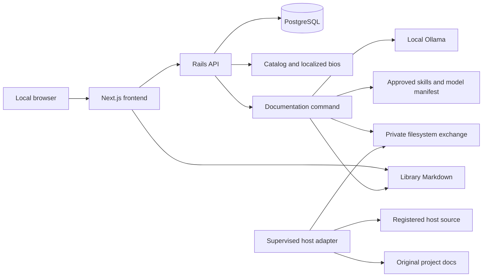
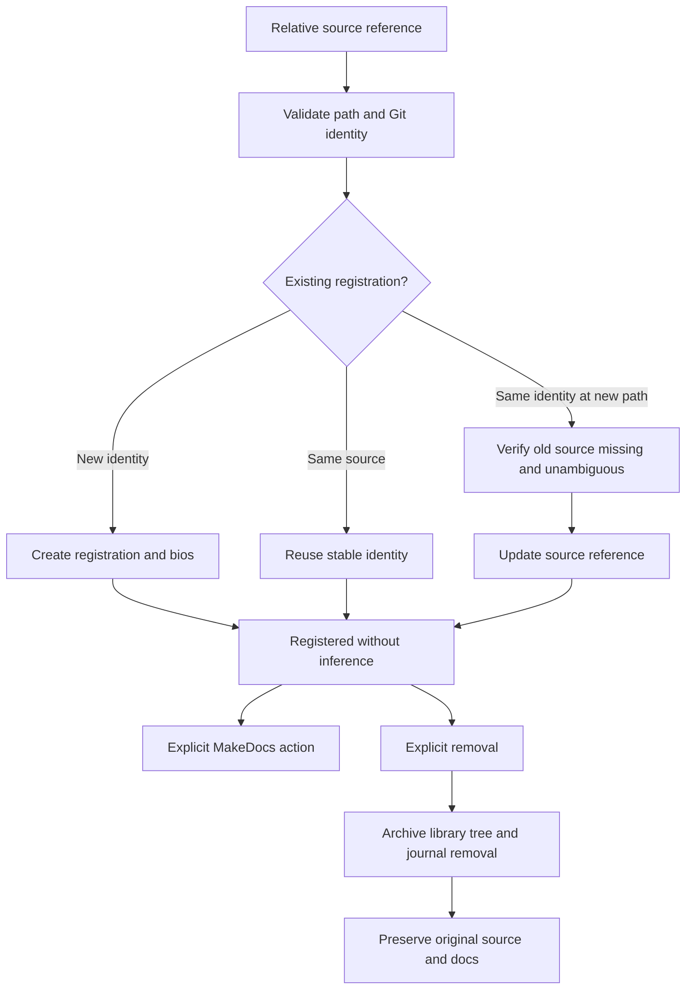

# Engineering Library: current implementation

[Architecture index](index.md) · [Project index](../index.md)

Reviewed against the source at `246f58be` on 2026-11-26. This is the current technical baseline; dated audit reports remain historical evidence. Engineering Library is a private Viva Bem application. Examples below use synthetic project names and checkout-relative paths.

<!-- reading-section: current-implementation-1 -->
## Responsibilities and data ownership

The application combines a project catalog, a bilingual Markdown book reader, shared annotations and local documentation drafting. Next.js renders the catalog and reader; Rails exposes catalog, annotation and development-only management APIs; PostgreSQL persists metadata and annotations. Markdown remains the source of document bodies. Ollama supplies local inference, while a supervised Python process mediates access to registered repositories on the host.

| Data | Authority | Consequence |
| --- | --- | --- |
| Registered projects | `docs/.catalog.json` | Registration is explicit; arbitrary sibling repositories are not automatically enrolled. |
| Display metadata | Matching localized `bio.md` files | Rails validates and synchronizes these into catalog rows. |
| Chapter bodies and navigation | `docs/<slug>/en` and `docs/<slug>/pt-br` | The frontend reads files; PostgreSQL is not the chapter-body store. |
| Notes, highlights, bookmarks | PostgreSQL | Shared by the installation, scoped by project, document and language. |
| Generation ownership and recovery | Private MakeDocs state, manifests and journals | Generated output is not free to overwrite manually maintained files. |
| Source acquisition | Registered relative reference, Git identity and bounded host snapshot | A source snapshot is neither a Git clone nor the entire working tree. |

<!-- reading-section: current-implementation-2 -->
## Frontend and Rails integration

The Next server fetches catalog JSON through `BACKEND_URL`, with a five-second timeout and no-store requests. Rails paginates five projects at a time using a deterministic display-name/stable-ID order. Localized bios provide presentation data. `Catalog::Sync` validates input before applying a transaction and uses an advisory lock; stable identity supports updates and absent entries become inactive rather than deleting shared annotations.

Reader discovery maps API language `pt-BR` to disk directory `pt-br`. Markdown is recursively discovered within the project collection. Navigation-only indexes are excluded from ordinary chapter duplication; the README has a reader identity of its own. Heading slugs, question identifiers and reading-section markers support logical navigation. Physical book pages depend on viewport and font metrics and are not persistent document identifiers.

The reader supports GFM tables, fenced code, Mermaid diagrams and approved source disclosures. Source disclosures use their own approved snapshot catalog and integrity checks; registering a host repository does not expose its arbitrary files in the browser. Search is bounded literal matching, including approved source snapshots where supported, with an 80-result cap. It is not vector retrieval or a PostgreSQL full-text index.

Notes and highlights use logical locations and location variants. Rich notes have a separate content/sanitization pipeline from chapter Markdown; dependency presence does not authorize arbitrary embedded HTML. Deleting a highlight can preserve its note through a nullable relationship. There are no personal accounts or per-browser annotation ownership: CSRF protection and the local management key do not create user identity.

<!-- reading-section: current-implementation-3 -->
## Host access and relative paths

The managed launcher starts a host supervisor before the application containers. The supervisor starts the filesystem worker only while the backend is running, monitors it and restarts an exited worker. Requests and responses cross a private bind-mounted directory; no arbitrary host filesystem HTTP endpoint is exposed.

A reference such as `../example-project` resolves from the Engineering Library checkout root on the host, regardless of shell working directory or container paths. Backslashes are normalized; absolute paths, drive paths, control characters, symlinks and unsafe repository layouts are rejected. A standalone Git repository is required. Identity is derived from sorted root commit hashes, not the remote URL or current HEAD; it identifies lineage, while source-file hashes detect content changes. Shared history alone does not authorize silently selecting among multiple copies.

The adapter acquires bounded, allowlisted source files and existing documentation into a private workspace. It excludes Git objects, secrets-related locations, dependencies, generated output, tests and other configured directories. The caller applies additional source/context and credential checks. The model receives selected evidence, not every acquired byte. See [runtime and recovery](../operations/runtime-and-recovery.md) for the directory layout and publication checks.

<!-- reading-section: current-implementation-4 -->
## Registration, relocation and removal

Registration initializes catalog metadata and localized bios without running inference. Repeating an equivalent request reuses the registration instead of creating duplicates. A 32-hex request ID also protects retries; conflicting reuse is rejected. Stable project identity, normalized references and physical-source checks handle equivalent source aliases.

Relocation is a verified operation: the same repository identity must be found at the new relative reference and the old location must be confirmed missing. An available previous copy or ambiguous identity is refused. This is not an unrestricted rename or automatic migration between unrelated repositories. A temporarily unavailable host source is not sufficient reason to delete its registration.

Removal archives the served library project tree, verifies its hash, journals the transition and updates the catalog. The original project's source and manually maintained `docs/` are preserved. Re-registering the same eligible identity/slug can restore the archive and stable ID. Pending generation recovery or delivery can block conflicting operations. No manual lock, state or archive deletion belongs in the normal lifecycle.

Expected user lifecycle: register → generate → update → remove registration → register again → generate again. First generation supports an absent original `docs/`; publication creates the required directories. Registration success alone does not prove model readiness or publication success.

<!-- reading-section: current-implementation-5 -->
## Generation and publication

The frontend management route and command-line `make docs` both invoke `Documentation::Command`. The frontend additionally coordinates operation status and deferred host delivery; it does not use a second generator. The command reads approved local skills and model identity, selects source evidence, requests bounded bilingual facts, validates responses, renders managed Markdown, verifies ownership and journals publication.

The current output is a bounded generated source summary and managed navigation entries, not a complete manually reviewed book. For external projects the two destinations are the library collection and the original project's `docs/`. The host adapter validates source identity, directory identity, source hashes and existing document hashes before delivery. A job is completed only after deferred host delivery succeeds. File replacement is atomic per file; there is no distributed transaction across destinations. Journals and retryable delivery provide recovery.

<!-- reading-section: current-implementation-6 -->
## Runtime boundaries and present limitations

The default Compose stack contains frontend, backend, PostgreSQL and Ollama. Source and agent mounts have explicit read/write scopes; both frontend and backend receive the library mount writable in the current Compose configuration. A host process is also required. The backend `/up` returns unavailable when the required adapter heartbeat is absent. It does not prove database integrity, approved model availability, generation quality or successful publication.

Management is development-only and guarded by a private key, loopback/origin checks and bounded request bodies. These controls target local operation; they are not a public multi-user authentication system. Do not expose the application or its evidence directories as a public service.

MakeDocs is operational, but generated prose still requires factual and bilingual review. Evidence checks cannot establish full semantic correctness, complete source coverage or the desired writing quality. Existing Ollama weights and local skills do not demonstrate completed neural fine-tuning. A future quality campaign is separate from normal operation and from this documentation update.

<!-- reading-section: current-implementation-7 -->
## Source map

Paths are relative to the repository root; symbols describe the inspected implementation rather than frozen line numbers.

| Source | Responsibility |
| --- | --- |
| `compose.yaml`, `docker/Dockerfile`, `docker/backend-entrypoint.sh`, `docker/frontend-entrypoint.sh` | Containers, mounts, dependencies and startup |
| `tools/init_dev_env.py`, `tools/library_runtime.py`, `tools/host_filesystem.py` | Managed host lifecycle and filesystem protocol |
| `backend/lib/documentation/catalog.rb`, `catalog_management.rb`, `host_filesystem.rb`, `command.rb` in the same directory | Source identity, catalog lifecycle, acquisition and generation |
| `backend/app/services/catalog/sync.rb`, `page.rb`, `files.rb` in the same directory | Metadata validation, persistence and pagination |
| `backend/app/controllers/runtime_health_controller.rb`, `backend/config/routes.rb` | Health and API routing |
| `frontend/lib/catalog.ts`, `documentation.ts`, `markdown.ts`, `reading-order.ts` in the same directory | Server data access and reader discovery |
| `frontend/lib/source-snapshot.ts`, `source-references.ts`, `source-search.ts` in the same directory | Approved source presentation and search |
| `frontend/app/api/catalog-management/[[...operation]]/route.ts` | Local management proxy |

Continue with [MakeDocs](../training/local-documentation-command.md), [operations](../operations/runtime-and-recovery.md) and [architecture decisions](decisions.md).
