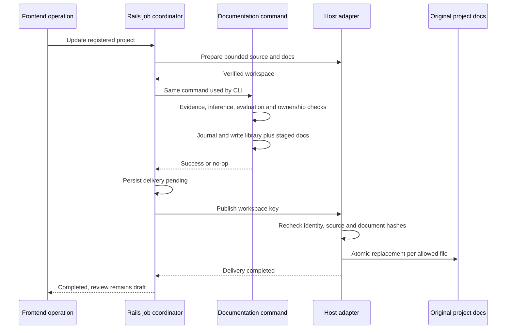

# Runtime, filesystem publication and recovery

[Operations index](index.md) · [Architecture](../architecture/current-implementation.md)

<!-- reading-section: runtime-and-recovery-1 -->
## Managed lifecycle

Use these commands from the checkout root in a POSIX host environment with Python 3.10+ and Docker Compose. On Windows use WSL2; native PowerShell is not supported by the current filesystem adapter. macOS and Linux have different permission and case-sensitivity behavior; these instructions do not establish cross-platform homologation.

```sh
# Creates .env only when absent, preserves existing credentials, starts the supervisor,
# builds/starts existing services and waits for their health checks.
python3 -B tools/init_dev_env.py up -d --build --wait --wait-timeout 600
# Reads supervisor status; this helper also initializes missing local environment files.
python3 -B tools/init_dev_env.py status
# Preserve persistent data and stop the supervisor when the backend is stopped.
python3 -B tools/init_dev_env.py stop
python3 -B tools/init_dev_env.py up -d
python3 -B tools/init_dev_env.py restart
python3 -B tools/init_dev_env.py down
```

`up` and `restart` ensure the supervisor exists before invoking Compose. A partial frontend stop leaves a running backend's adapter available. `down` rejects volume/image-removal options. Plain `docker compose up` does not bootstrap the host supervisor. Backend startup waits for the required adapter, then runs `db:prepare catalog:sync`; these are operational mutations, not read-only diagnostics. Review migrations and back up persistent data before upgrades.

The supervisor is scoped to the current OS user, validates process ownership before stopping it and uses a nonblocking lifecycle lock. It polls backend state and supervises the worker. The worker is not a root daemon, service installation or HTTP server. Dependency startup reuses verified frontend dependencies when its runtime/lockfile/entrypoint fingerprint and native bindings match; otherwise it runs locked `npm ci`. Backend startup checks Bundler dependencies. Lockfiles do not make installations independent of platform or network availability.

<!-- reading-section: runtime-and-recovery-2 -->
## Private operational directories

All paths below are checkout-relative, deliberately avoiding machine-specific absolute paths. The main deployment stores operational data under `backend/storage/makedocs/`.

| Path under that base | Purpose and contents | Retention |
| --- | --- | --- |
| `runtime/` | Management key and management/command locks | Required operational/recovery data; never publish keys or raw logs. |
| `state/` | Ownership manifests, per-project pending journals and `removal.pending.json` | Required to prove ownership and recover interrupted writes. |
| `state/management/` | Operation records, private logs/configs and verified removal archives | Preserve for retries, recovery and re-registration. |
| `state/runs/` | Immutable run input, model request/response evidence, candidates, before-images and events | Preserve as provenance and recovery evidence. |
| `filesystem/host/` | Managed/lifecycle status, locks, heartbeat, requests, responses and workspaces | Required for managed host access. A request/response may be transient; the whole directory is not disposable. |
| `filesystem/host/workspaces/<reference-sha256>/<source-name>/` | Bounded source snapshot and staged `docs/` | Internal workspace, not another registered project or a training dataset. |
| `filesystem/host/workspaces/<reference-sha256>/snapshot.json` | Source/document hashes, directory identity, reference and pending-publication state | Preserve while work or delivery is pending. |
| `evaluations/` | Evaluation outputs when those explicit workflows are used | Evidence; not proof that every normal operation runs a training campaign. |

A newly observed workspace is created by source preparation. The directory key hashes the normalized relative reference; the repository basename remains the source directory name. It can therefore survive more than one execution. Preparation refreshes owned snapshot content only when staged documentation is safe to refresh; pending or changed staged output is retained for delivery. Do not delete unfamiliar directories, locks, archives, model storage or research evidence to make a retry succeed.

<!-- reading-section: runtime-and-recovery-3 -->
## Acquisition and first generation

`tools/host_filesystem.py` resolves the registered relative reference from the checkout root. Its no-follow, descriptor-based filesystem primitive is reused from `agent/tools/documentation_workspace.py`. It verifies a standalone Git identity, rejects unsafe paths and acquires only permitted regular files. Defaults are 32 MiB per file, 512 MiB total source, 128 MiB documentation, 200,000 visited entries and 100,000 acquired files. These are acquisition limits, separate from the much smaller inference evidence budget.

The original `docs/` need not exist. Preparation creates the staged documentation destination; successful publication creates safe original directories. Source code is not executed. Code changes after acquisition invalidate publication rather than silently writing documentation for a different source version.

On a case-insensitive filesystem, `pt-BR` and `pt-br` may name the same file. Alias lookup requires both case-insensitive spelling and physical-file identity. Distinct directories on a case-sensitive filesystem are not merged; ambiguity is refused. This prevents false ownership conflicts on macOS without weakening Linux path separation.

<!-- reading-section: runtime-and-recovery-4 -->
## Publication sequence



For external host projects, allowed publication targets are exactly the English and Portuguese `guides/generated-source-summary.md` and their language `index.md` files. The caller restricts generated navigation changes to its managed blocks and preserves surrounding manual index content. The adapter refuses changed source identity, changed source bytes and conflicting manual document edits. Atomic replacement and fsync protect each file, but a multi-file, two-destination update is not globally atomic.

The coordinator records pending delivery before contacting the host. A later update of the same project can finish that saved delivery without rerunning inference. A failure must remain visible; a successful model response, a library-only write or a green `/up` cannot be called completed publication.

<!-- reading-section: runtime-and-recovery-5 -->
## Errors and recovery

| Evidence | Meaning and safe response |
| --- | --- |
| `/up` returns 503 with host-filesystem component | Required adapter heartbeat is absent/stale or unsafe. Use managed startup and inspect private supervisor/worker logs. |
| Operation is queued/running | Poll its existing ID. Do not submit parallel conflicting changes. |
| Worker disappeared or was interrupted | Status verifies process/boot identity and can mark interruption; inspect retained operation evidence before retry. |
| `delivery: pending` | Resume the same project's update; preserve its saved config and workspace. |
| Ownership/hash conflict | Compare current document with owned before/candidate hashes. Preserve manual edits; do not bypass by deleting the manifest. |
| `<slug>.pending.json` | Command publication needs explicit verified recovery. Review the journal and before-images first. |
| `removal.pending.json` | Catalog removal recovery uses its archive and catalog-before evidence; later management requests reconcile it or refuse ambiguity. |
| Inference/evaluation rejection | No accepted draft for this execution. Inspect exact private evidence; a timeout does not establish a model training defect. |

The command exposes `--recover complete` and `--recover rollback`, always scoped with `--project <slug>` and the same source/config context. They are mutating recovery tools, not routine cleanup. Completion/rollback verifies paths, ownership and hashes; preserve evidence and review the intended action before using it. Management locks serialize catalog transitions; the command lock prevents overlapping generation/removal/relocation. A lock file existing on disk is not by itself proof of a live lock holder.

UI error categories are intentionally generic. Private operation logs retain implementation details, and run evidence retains model envelopes and validation failures. Do not copy these into public reports: source snippets, paths and generated text may be confidential. Acknowledging an error does not authorize deleting its evidence or bypassing a pending delivery.

<!-- reading-section: runtime-and-recovery-6 -->
## Health and diagnosis

```sh
docker compose ps
docker compose logs --tail=100 backend frontend ollama
curl --fail --silent --show-error http://127.0.0.1:3098/up
docker compose exec -T ollama ollama list
```

Inspect logs locally and redact before sharing. `/up` proves Rails response and required adapter readiness for that instant. PostgreSQL's health check uses `pg_isready`; Ollama's uses `ollama list`; the frontend health check fetches its homepage. None certifies approved-model identity, database restore integrity, semantic documentation quality or complete lifecycle acceptance. The catalog API can synchronize metadata, so it is not a strictly read-only database probe.

Persistent PostgreSQL data lives in `.dockerized-postgres/18/docker`; Ollama resources live under `ollama/`. Container removal is not a backup. Preserve existing environment credentials, database storage, model resources, agent artifacts and recovery archives. See [development operations](../guides/application-development.md) and the retained [database migration procedure](database-migration.md).

Sources: `tools/init_dev_env.py`, `tools/library_runtime.py`, `tools/host_filesystem.py`, `backend/lib/documentation/locations.rb`, `backend/lib/documentation/host_filesystem.rb`, `backend/lib/documentation/catalog_management.rb`, `backend/lib/documentation/command.rb`, `backend/app/controllers/runtime_health_controller.rb` and `compose.yaml`.
