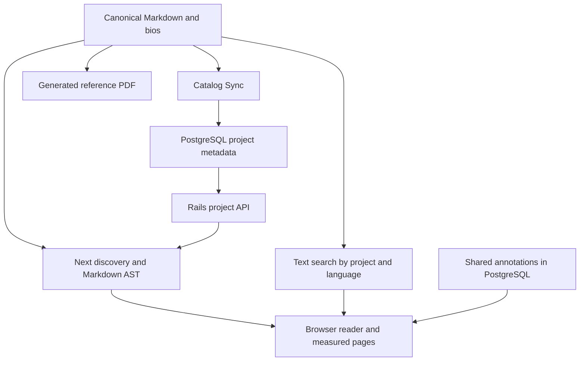

# Engineering Library documentation standard

[English](../../en/training/documentation-standard.md) | [Português brasileiro](../../pt-br/training/documentation-standard.md) | [training](index.md)

<!-- reading-section: standard-purpose -->
## 1. Purpose, scope and authority

This is the reusable VivaBem documentation standard, version 1.0, researched on 2026-11-10 against Engineering Library revision `a51a908ace9d1b386ee01158c361e56d0293d3ba`. Audience: maintainers, reviewers, onboarding engineers and future retrieval-system designers. It covers documentation architecture, authoring, bilingual maintenance and evidence. It does not certify sibling applications or authorize their migration.

The canonical sources are this English Markdown and its complete Brazilian Portuguese counterpart. The root PDF is a generated reference, never a separate authority. Editorial status: ready for owner review, not owner-approved. Runtime evidence and source inspection are separate statements.

Owner clarification, 2026-11-15: The current Engineering Library repository/version is private. It centralizes and preserves documentation from portfolio projects and private Viva Bem projects across both existing owner-authorized source collections. Source confidentiality classifications do not change this installation’s private status. A separate public Engineering Library repository/version is planned for later. Preserving documentation does not establish verified backup or restoration of source code, databases or project environments. Authorized access does not permit arbitrary filesystem inspection or publication of confidential material. Public summaries must still omit confidential endpoints, production topology, identifiers, business rules and private implementation.

For the separate future public version, the owner plans to retain only Engineering Library documentation and restrict discovery to sibling repositories at its directory level. They do not apply to the current private version: no documentation is deleted and no discovery configuration or repository visibility is changed. The editorial standard remains ready for owner review; only explicitly approved decisions have owner-approved status.

Classification applies throughout:

| Label | Meaning | Required evidence |
| --- | --- | --- |
| A | Existing implemented convention | Current code/configuration/test definition; execution is separately reported |
| B | Recurring documentation pattern | Multiple current documents; no implied enforcement |
| C | Proposed standardization rule | Editorial recommendation requiring adoption |
| D | Future AI retrieval recommendation | Design advice, not running infrastructure |

Unqualified normative authoring instructions below are C; AI-specific instructions are D. A and B are explicitly marked. A rule in a test definition is evidence of an expected contract, not proof that the test passed today.

<!-- reading-section: standard-method -->
## 2. Evidence methodology and limits

A: inspect the working tree before authoring; it was clean. Read current discovery, parser, renderer, routing, search, synchronization and validation code. Inventory every Markdown path and category in this repository. Sample recurring patterns across architecture, ADR, environment, FAQ and validation documents. Read project bios and indexes as metadata; do not infer that imported documentation verifies its source application's present behavior.

Historical scope of the original 2026-11-10 investigation: it stayed inside Engineering Library and excluded sibling contents. The separately authorized 2026-11-15 authoring preparation may inspect relevant documentation and source across both specified Viva Bem and portfolio collections; it does not retroactively expand the original study. Real dotenv values, credentials, private keys, database payloads and runtime data remain excluded. Existing validators may inspect configured sibling documentation/import hashes; use scoped checks when this exceeds the requested source scope. No provider homologation, production health, external URL availability or complete semantic translation certification follows from static analysis.

Evidence precedence: current source contract; current configuration/schema and relevant test assertions; current maintained documentation; dated audit records; proposals. Resolve disagreement by checking the execution path, not by selecting the newest prose automatically. Record historical intent without rewriting it as current implementation.

For a claim, retain label, repository path, symbol/heading, inspected revision/date, observation and verification method. Prefer symbols over fragile line numbers; optional line ranges help navigation but must be refreshed after refactoring. Negative claims must name the searched scope: no vector service was found in the inspected routes, services and dependency manifest, rather than a universal claim about all deployments.

<!-- reading-section: standard-architecture -->
## 3. Documentation architecture and data ownership

A: `backend/app/services/catalog/files.rb`, `Catalog::Files.root`, selects `CATALOG_ROOT`, defaulting to `../docs` from Rails. Next uses `DOCUMENTATION_ROOT`, defaulting to `../docs` from its working directory in `frontend/lib/documentation.ts`. Compose supplies `/docs` to both. These roots must address the same collection.

A: `Catalog::Sync.call` scans immediate non-symlink project directories matching the slug expression. A project with either bio must provide both valid bios. YAML is safely parsed; `id` is a slug, `name` is optional in the reader with a compatibility display-name fallback, and description must be nonempty. Both bios must agree on ID/name. Duplicate stable IDs abort the entire sync before writes. A transaction and PostgreSQL advisory lock protect updates; absent projects become inactive rather than being deleted. The `catalog:sync` rake task is an explicit database mutation, not a Markdown validation command.

A: `backend/db/schema.rb` stores `catalog_projects(stable_id, slug, display_name, active, timestamps)` with unique identity/slug indexes. It contains no document-body column. Bookmarks, highlights and notes store shared installation annotations with project/document/language context; note bodies are user annotations, not canonical technical chapters. Do not add reader accounts or browser ownership to explain these records.

A: `Catalog::Page` orders active projects by lowercase display name with C collation, then stable ID, with five projects per catalog page. `Catalog::Presenter` reads localized descriptions/categories from files. `Api::ProjectsController` accepts `en`/`pt-BR`, defaults to Portuguese, reports invalid/unavailable catalog input as HTTP 503 and serves verified WebP icons from `img/icon.webp` (missing icon: 404). Missing project records follow Rails record lookup behavior; this study does not assert a custom error envelope for them.

A: Next independently loads Markdown and constructs a canonical bilingual table of contents. `documentationEntries` recursively discovers `.md`, skips symlink entries, checks real-path containment, excludes bios, handles README specially, suppresses navigation-only indexes, and excludes `faq/study-guide.md` from reading entries. A substantive index may remain a chapter. Order is canonical case-insensitive ID order with a deterministic tie-break, not translated title order or manual root-index list order. The union of language IDs exposes unavailable translations without silently substituting content.

A: the document route loads local source, returns not-found for missing content, and can keep local documents readable with a fallback project name when the backend metadata request fails. `index.md` routes to the project contents. `reading-order.ts` derives neighbors from actual document entries, starting with contents. Physical pages are browser-measured presentation, not document identity or database pagination.



Source provenance catalogs under language `links/` and approved text snapshots are a separate source-reference mechanism. They are not the document-body database or a general machine-file reader. `source-references.ts`, `source-snapshot.ts` and `source-links.ts` govern integration; only available approved sources should be exposed or searched. This task does not regenerate them.

<!-- reading-section: standard-layout -->
## 4. Canonical layout, identity and lifecycle

A: the previously suggested `docs/projects/<slug>/bio/` plus nested `docs/en` layout is obsolete for this checkout. Use the actual project-first tree:

```text
docs/
  index.en.md
  index.md
  <project-slug>/
    img/icon.webp
    en/
      bio.md
      README.md
      index.md
      <category>/index.md
      <category>/<document>.md
    pt-br/
      bio.md
      README.md
      index.md
      <category>/index.md
      <category>/<document>.md
```

A: API language is `pt-BR`, physical folder is `pt-br`; `en` is unchanged. Project slug matches `[a-z0-9]+(?:-[a-z0-9]+)*`. A project stable ID is stored in both bios; directory slug is routing identity. A document ID is language-independent relative path such as `training/documentation-standard.md`; README is exposed as virtual ID `README`. Heading slugs and logical block identities locate content inside documents.

C: require both bios with explicit identical `id` and official `name`, both READMEs and language indexes for a new maintained project. This is stricter than runtime's optional-name fallback. An icon is optional content but must be valid WebP at the implemented path to be served. Create category folders only when there is substantive content; language-local `img/` is suitable for translated media, shared project `img/` for neutral assets. `links/` is controlled provenance storage, not an editorial category.

C: use lowercase kebab-case document/category filenames, retain `README.md`, `index.md` and existing historical exceptions. Keep technical IDs equal across translations, localize H1 and prose, and avoid date-based filenames unless the document is a dated audit or incident. The renderer numbers the contents; author headings should not depend on physical chapter numbers.

C: distinguish display-name rename from slug change. Keep stable ID when renaming a project, update both bios, inspect links and annotation references before an approved catalog synchronization. A slug change affects routes and annotation scope; sync matching by stable ID alone does not migrate bookmarks or install redirects. A document move changes its ID and can break links, search references and annotations. Inventory incoming references and logical anchors, propose a migration/compatibility plan, and do not assume redirect support exists.

C: deprecate with reason, replacement, date and maintenance boundary; retain old content only when historically useful and clearly marked. Proposed editorial states are prose, not implemented workflow fields. Do not remove old categories or rewrite existing documents as part of adopting this standard. Missing translations should be recorded and completed before approval; the reader's unavailable entry is not translation completion.

### Owner-approved project icon policy — 2026-11-15

This policy is owner-approved and overrides conflicting icon guidance; it is not a proposed rule C or approval of the rest of this standard. Project icons represent the primary technology or functional nature of the project: prefer recognizable language/technology logos, or a meaningful functional symbol when more appropriate. An icon is a visual identifier, not a complete stack description; keep the documented stack accurate.

| Project | Approved icon |
| --- | --- |
| Acesso Servidor (`acesso-servidor`) | Terminal symbol for terminal/operational tooling |
| Carteira Digital (`carteira-digital`) | PHP logo |
| Cofre Paciente (`cofre-paciente`) | PHP logo |
| Criptografia Lib (`criptografia-lib`) | PHP logo |
| Engineering Library (`engineering-library`) | TypeScript logo, preserving the approved visual/frontend emphasis even though Rails and Next.js also belong to the stack |
| Go Image Optimizer (`go-image-optimizer`) | Go logo; current Go entry identified from its bio, reusing its approved asset |
| Hub do Viva Bem (catalog name: Hub VivaBem, `hub-vivabem`) | JavaScript logo |

Do not infer mappings for other projects from names alone or automatically replace approved icons based on backend framework, file counts or language statistics. For another Go project, verify the actual catalog entry and documented stack before proposing the Go logo; do not invent entries or assignments.

For onboarding/catalog maintenance, inspect the project's documented purpose and stack, check the mappings above and reuse existing approved assets. For a new project or an icon change, propose the symbol/logo and obtain explicit owner approval before creating or changing any visual asset. Carry this requirement into future onboarding prompts; documentation maintenance alone does not authorize image generation or UI changes.

Project icon images use WebP; do not introduce SVG, PNG or JPEG as final project icons. GIF remains allowed for animated assets where applicable, but the current project icon endpoint serves WebP only. Observed on 2026-11-15: all 14 project icons are `docs/<slug>/img/icon.webp`, 96×96 pixels with an alpha channel. These are existing conventions, not a newly imposed dimension/transparency requirement. `ProjectIcon` renders at 32×32 with CSS `object-fit: contain`; Rails checks the RIFF/WEBP signature and responds with `image/webp`. Bios are `en/bio.md` and `pt-br/bio.md`, with `id`, `name` and localized description; the icon path is derived, not an icon metadata field. The shared fallback is `/assets/project-fallback.webp`, not a policy of assigning the same icon to every project. Inspect current files before documenting further technical requirements. The supplied screenshot illustrates approved visible examples only; it does not verify other catalog pages or implementation details.

<!-- reading-section: standard-taxonomy -->
## 5. Category taxonomy and ownership

B: existing Markdown categories are `architecture`, `adr`, `api`, `database`, `docker`, `env`, `faq`, `guides`, `img`, `integrations`, `operations`, `security`, `testing`. The inventory appendix gives exact counts and coverage. `training` is introduced here as C for documentation standards and future corpus guidance. It is not an AI execution feature. Existing validator allowlists also mention unused categories; allowance is not evidence of maintained content.

Use one authoritative document per subject. Create a document when it has a distinct audience, lifecycle, evidence set or operational task; expand an existing one when the same contract is being clarified. Link related categories rather than copy their prose. The following category contracts are C; B examples are paths in the inventory.

| Category | Purpose and recommended structure | Depth, example and boundary |
| --- | --- | --- |
| architecture | Context, components, flows, boundaries, decisions, reliability, security, deployment | System-level explanation; `overview.md`; link ADR rationale and API contracts instead of duplicating them |
| adr | Status, context, problem, decision, alternatives, consequences, evidence, revisit conditions | One consequential choice; `001-native-image-codecs.md`; avoid retrospective invented decisions |
| api | Purpose, access, endpoints, schemas, validation, errors, examples, versions | Exact caller contract; `contracts.md`; distinguish defined endpoint from provider homologation |
| database | Entities, relationships, indexes, constraints, transactions, migrations, lifecycle, recovery | Storage behavior; `outbox-schema.md`; do not repeat generic ORM tutorials |
| docker | Existing targets, build/runtime dependencies, mounts, ports, startup and constraints | Container-specific explanation; `development.md`; operations owns incident procedures, env owns variable contract |
| env | Boot/feature requirements, required/optional variables, empty/absent behavior, defaults, validation, secret handling | Configuration reference; `configuration-contract.md`; never effective secret values |
| faq | Direct questions, substantive answers, context, example, evidence, related questions | Explanation/interview depth; `failure-scenarios.md`; avoid a mandatory intermediate study guide |
| guides | Objective, prerequisites, safe steps, expected result, verification, troubleshooting | Reproducible task; `project-guide.md`; architecture explains why, guide explains how |
| img | Media purpose, provenance, accessibility, localization and supporting explanations | Existing Markdown media guides plus assets; avoid an uncurated screenshot dump |
| integrations | External boundary, contracts, access, formats, retries, timeouts, idempotency, failures, recovery | Cross-system semantics; `peer-contracts.md`; never infer retry policy from a dependency name |
| operations | Start/stop, monitoring, diagnosis, incidents, backup/restore, recovery, ownership | Actionable runbook; `source-review.md`; mark historical audits as dated evidence |
| security | Threat boundaries, identity, access, encryption, sensitive data, logging, keys, failure responsibilities | Concrete controls and gaps; `boundaries.md`; do not claim certification from design |
| testing | Strategy, levels, isolation, mocks/fakes, commands, evidence, limitations | Explain actual validation; `strategy.md`; never create tests through a documentation recommendation |
| training | Evidence-based authoring, corpus governance, retrieval recommendations, evaluation | Cross-cutting standard; `documentation-standard.md`; do not duplicate project architecture or imply model training |

For each category index, use a localized H1, a parent backlink and links to all maintained documents. Add explanatory prose only if it is intended to be a substantive reader chapter. Keep filenames semantic and stable; ADR numeric IDs and dated operations records are justified exceptions to ordinary subject naming.

<!-- reading-section: standard-writing -->
## 6. Technical writing and substantive completeness

C: open with the purpose and behavior a reader needs to understand. State audience, scope and prerequisites before commands. Define ambiguous domain terms and expand acronyms once; preserve official product names. Describe the problem, current mechanism, decision rationale, alternatives and concrete trade-offs. A useful trade-off names benefit, cost and circumstance where the choice should be revisited.

Explain implementation at the abstraction level needed to maintain the contract: entry point, responsible component, state transitions, data ownership and integration boundaries. Include operational behavior, security implications, failure modes, recovery, limits and verification. Separate a caller-visible error from an internal exception and describe partial failure when relevant. Document absent behavior explicitly when evidence supports it, without inventing a roadmap.

Use direct technical English or natural Brazilian Portuguese. Prefer one idea per paragraph, precise verbs and meaningful headings. Tables suit contracts and comparisons; prose suits causality. Avoid filler such as “robust and scalable” without measured evidence. Do not invent latency, coverage, throughput, business outcomes, incidents or tests. If a measurement is authorized and available, state workload, environment, method, date and uncertainty; otherwise label performance as unmeasured.

Onboarding needs a short entry path and safe verification, while deep references retain exact contracts. Portfolio/interview explanations may connect implementation to engineering reasoning, but must not turn hypothetical designs into personal achievements or expose private details. Link from the short explanation to the detailed source rather than maintaining duplicate narratives.

Every maintained document should answer: what is covered, who needs it, what exists now, why it works this way, how it fails, how to verify, what remains unknown, and where evidence lives. Mark genuinely irrelevant topics with a reason rather than forcing identical sections or document counts on every project.

<!-- reading-section: standard-markdown -->
## 7. Markdown support and authoring rules

A: `frontend/lib/markdown.ts` parses with `remark-parse` and `remark-gfm`, generates heading IDs using `github-slugger`, and divides content into semantic units. Definitions are retained with units. `frontend/components/markdown-unit.tsx` uses `react-markdown` with `skipHtml` and GFM. Raw HTML nodes are filtered from units; do not rely on HTML anchors, HTML layout, inline styling, scripts or `<details>` authored in Markdown. Note-editor rendering is a different pipeline and does not establish documentation support.

| Feature | Verified contract (A) and author rule (C) |
| --- | --- |
| Headings | AST headings H1-H6 participate in navigation; use one H1, sequential H2/H3, descriptive localized titles |
| Paragraphs and emphasis | Ordinary Markdown text/emphasis; separate paragraphs with blank lines, avoid manual visual wrapping requirements |
| Lists and tasks | GFM lists/task syntax parses; use short parallel entries, no assumption that a checkbox persists state |
| Tables | GFM pipe tables become semantic reader tables; keep cells short, escape literal pipes, do not depend on rowspan/HTML |
| Code | Fenced non-Mermaid blocks become reader code units; specify `sh`, `ruby`, `typescript`, `json`, `sql`, `text`; unknown grammars must remain readable |
| Inline code | Use for paths, symbols, variables and literals, not entire prose paragraphs |
| Links | Inline/reference-style Markdown links are parsed; use explicit relative file paths and descriptive labels |
| Images | Markdown images route through media handling; provide meaningful alt text and approved local supported assets |
| Mermaid | A `mermaid` fence uses isolated diagram rendering; on failure the reader preserves source and shows an error |
| Blockquotes | Ordinary quotation syntax; use labeled prose for cautions, no claim of custom GitHub alert boxes |
| Rules and escaping | Ordinary Markdown thematic rules and backslash escaping; use rules sparingly and keep blank lines around blocks |
| Unsupported extensions | No inspected plugin establishes math, MDX, custom admonitions, footnotes or arbitrary frontmatter semantics for document bodies |

C: do not use YAML frontmatter in ordinary chapters as if it were metadata; only bios have the verified YAML contract. Use a visible metadata paragraph or small table. Avoid huge single paragraphs and unbreakable tables. Rendering support does not guarantee layout at every viewport; review long code, rows, diagrams and accents in the reader and export.

C: use fenced examples without shell prompt prefixes so they can be copied. State working directory, service and effects. Keep destructive actions out of routine validation instructions. Use quoted synthetic values and no credentials. Code examples shared across languages must preserve behavior. Annotate output as illustrative when not executed.

```sh
# Repository root; existing running frontend; read-only type check
 docker compose exec -T frontend npm run typecheck
```

```json
{"project":"engineering-library","document":"training/documentation-standard.md","language":"pt-BR"}
```

```sql
-- Illustrative read-only contract inspection, not a recorded execution
SELECT stable_id, slug, active FROM catalog_projects ORDER BY stable_id;
```

C: incorrect practice is an undocumented `export SECRET_KEY_BASE=real-value` or a raw HTML anchor presented as supported. Correct practice names the variable without its value, gives a synthetic example only when necessary, and links to a generated heading anchor.

<!-- reading-section: standard-links -->
## 8. Links, anchors, navigation and search

A: `document-links.ts` resolves Markdown links against the current physical collection path and produces internal `/projects/<slug>/docs/<id>?lang=<language>` routes. `#fragment` stays local; explicit language folders select that language. README physical links become virtual `README`. Shared project/language images map to asset endpoints. HTTP(S)/mailto retain external meaning except specifically recognized legacy GitHub document URLs. Do not infer that arbitrary GitHub links or repository-root code paths open as documents.

C: from this chapter, `[Architecture](../architecture/current-implementation.md)` is a document link; `[Português](../../pt-br/training/documentation-standard.md)` selects the peer language. A source evidence path in backticks is a reference, not a promise of an inline source disclosure. Only approved source catalogs enable those disclosures. Do not add arbitrary source links merely to activate snapshot generation.

A: heading slugs are language-specific. `<!-- reading-section: stable-key -->` immediately before a heading supplies a verified cross-language navigation key in `markdown.ts`; unique Q-number headings also have canonical question identity. These comments guide reading-position correspondence, not HTML anchor creation. Duplicate canonical keys are ambiguous. C: preserve unique semantic keys in both translations, and validate the actual localized fragment when constructing a link. Renaming heading text can break old URLs despite a stable reading key.

A: `frontend/app/api/document-search/[project]/route.ts` trims queries, accepts lengths 2-100 and scans selected-language authoritative Markdown units. It returns at most 80 results with `truncated`, snippets, document routes and logical anchors; approved integrated source lines are also eligible through `source-search.ts`. Matching is case-insensitive substring matching, not stemming, semantic ranking, embeddings, cross-project retrieval or a PostgreSQL full-text index.

C: headings and first sentences should contain the actual domain terms a maintainer searches for. Include useful synonyms naturally, not keyword stuffing. Reader discovery and static graph reachability differ: a recursively discovered page can render while remaining unlinked in the Markdown graph. Ensure both work. The backend category list additionally requires the exact root-index bullet shape `- [label](category/index.md)` and an existing category index.

<!-- reading-section: standard-bilingual -->
## 9. Bilingual maintenance and equivalence

C: English and Brazilian Portuguese are complete peers. Preserve project IDs, document IDs, reading-section keys, API/class/method names, environment variables, protocol identifiers, filenames and executable examples. Localize explanatory titles, prose, alt text and descriptive link labels. Official project names remain unchanged. Directory spelling is an A constraint, not a translation preference.

Translate meaning and technical depth naturally: both languages must explain the same contracts, caveats, decisions, alternatives and verification limits. Literal sentence order is optional; omission of failure behavior is not. Keep tables' semantic rows and example inputs/outputs equivalent. Technical terms may retain the English identifier with a Portuguese explanation on first use.

Review both versions in the same change. Use a parity matrix keyed by stable section IDs: source fact, English section, Portuguese section, evidence, reviewer decision. Compare headings, code fences, links, configuration identifiers and normative force. Automated section equality detects structure, not semantic mistranslation. Have a bilingual technical reviewer inspect facts, negations, units, optional/required wording and security constraints.

A: missing translated IDs appear unavailable in the union contents; direct missing-language document reads return not-found. There is no verified automatic translation fallback. C: report gaps explicitly and keep them out of an approved bilingual release. If an urgent correction precedes its translation, mark the counterpart outdated and create an owner-reviewed follow-up; never silently leave contradictory safety advice.

C: record common revision/date and change rationale in visible metadata; Git records changes, not review approval. Do not introduce a new metadata parser or automatic translation job just to enforce this standard. Cross-language links should target real physical counterparts; same-language related links should be relative and reviewed after moves.

<!-- reading-section: standard-traceability -->
## 10. Source traceability and claim status

C: reference repository-relative paths and durable symbols: `backend/app/services/catalog/sync.rb` / `Catalog::Sync.call`, `frontend/lib/documentation.ts` / `documentationEntries`, or `backend/db/schema.rb` / `catalog_projects`. State the precise behavior supported. A path alone is not evidence for every sentence in a paragraph. For configuration cite key and declaring file; for API cite route, controller/action and schema; for domain entities cite model/constraints; for migrations cite filename and change method.

For jobs/consumers, identify producer, consumer, message contract, acknowledgement, retry/dead-letter behavior and relevant tests only if implemented. This repository's `application_job.rb` base does not establish a documentation ingestion queue. For dependencies cite the lockfile/manifest and actual integration site; installed package presence does not establish every feature it offers.

| Claim status (C) | Required wording and evidence |
| --- | --- |
| Implemented | Current code path and relevant constraints, label A |
| Planned | Explicit proposal with owner/source and acceptance conditions; no present-tense capability |
| Historical | Date/revision and whether superseded; preserve decision context |
| Assumption | Rationale, uncertainty and how to verify |
| Verified result | Exact command, environment, date, exit/result and limitations |
| Reported, unverified | Attribute report, distinguish from diagnosis and test evidence |

After refactoring, search for old paths/symbols, follow the new responsibility, recheck the claim and refresh both languages. Keep a short evidence register for consequential claims. Use revision plus symbol for historical snapshots; do not silently cite current code as proof of an old release. Do not fabricate permanent URLs for private repositories.

<!-- reading-section: standard-templates -->
## 11. Reusable templates by document type

C: templates are authoring contracts, not mandatory boilerplate. Replace each instruction with verified content; remove genuinely irrelevant fields with a short reason. A draft may record an unresolved question, but a ready document must not use empty TODO placeholders for facts that can be inspected. No template authorizes application changes or new tests.

General template:

```text
# Localized descriptive title
Status; reviewed date/revision; audience; scope; evidence labels
Purpose and prerequisites
Current behavior and architectural context
Contracts and implementation evidence
Decisions, alternatives and trade-offs
Operational behavior, failures and recovery
Security and limitations
Verification: command, expected observation, actual result or not executed
Maintenance owner/trigger; related documentation; source register
```

### Architecture template

Define system boundary, actors and external dependencies first. Draw components and dependency direction, then trace a representative data flow from entry to persistence/response. Explain who owns state and where contracts cross trust boundaries. Cover reliability (timeouts, partial failures and recovery), security, deployment/mount/port implications and explicit trade-offs. Cite actual services/routes/schema. Separate the present diagram from a proposed future diagram; neither arrows nor package names prove runtime connectivity.

### ADR template

Use stable numbered identity, localized title, status (proposed/accepted/superseded/rejected), decision date and evidence revision. Describe context and the concrete problem, constraints, chosen decision and alternatives considered. Explain positive/negative consequences, migration impact, evidence and conditions that would reopen the choice. Link a superseding ADR without erasing history. Do not invent who approved an existing decision; record attribution as unavailable if not evidenced.

### API template

State purpose, consumers, base path/version, transport and access boundary. Distinguish authentication from authorization and explicitly document absence where verified. For each endpoint record method/path, input location, required/optional fields, types, validation, success status/body, error statuses/body and side effects. Include synthetic request/response and pagination/idempotency behavior only where implemented. Cite route/controller/schema/tests. Explain versioning and compatibility. A mock passing is not live provider certification.

Illustrative shape only, not a new endpoint:

```text
Method/path: GET /api/projects?lang=en&page=1
Input: language selection; page clamping follows Catalog::Page
Success: projects plus pagination, from ProjectsController#index
Failure: catalog_unavailable / 503 for rescued catalog errors
Evidence: backend/config/routes.rb and api/projects_controller.rb
Execution: separately record whether the request was actually made
```

### Database template

Name storage technology and deployment context; list entities and relationships with keys and ownership. Explain unique/nonunique indexes, constraints, transaction boundaries, concurrent writes, migration ordering and rollback limitations. Address retention/deletion, backup, restore verification, sensitive fields and access. Cite schema plus migrations and code using them. An index declaration is not a measured performance improvement. Recovery procedures must identify the target installation and destructive steps; do not execute them as documentation validation.

### Environment template

For each variable list name, declaring path/key, boot or feature scope, required/optional status, default, absent/empty semantics, validation failure, secret classification and deployment implications. Separate Compose substitution from application lookup. `env()`/`ENV[]` usage alone does not establish global requirement. Never include real values. Show synthetic nonsecret examples only; secret examples should describe obtaining an approved value rather than embedding it. Record unverified conditions instead of guessing defaults.

### Security template

Identify assets and trust boundaries, threats, authentication, authorization and shared-data scope. Describe encryption in transit/at rest only where evidenced, sensitive-data minimization, logging redaction, key custody/rotation and failure behavior. Name operational responsibilities and known gaps; do not promise regulatory compliance or audit certification. Link API/configuration/runbooks, avoiding duplicated secret instructions. Explain access controls outside this repository as unverified unless inspected in authorized scope.

### Testing template

Explain actual strategy and risk, unit/integration/feature/browser boundaries, mocks/fakes and isolation. Map representative contracts to existing test paths. State prerequisites and safe commands, actual executed results and date, coverage source/method if measured, and known gaps. Distinguish test transport mocks from persistence/provider execution. Running existing checks is separate from authoring tests; additional test files, scaffolds or dependencies require specific owner authorization. Do not infer zero defects from a passing suite.

### Operations template

State installation/environment, owner, prerequisites and permissions. Explain safe startup/shutdown, health signals, logs/monitoring, diagnosis by symptom, incident triage and recovery. Specify backup scope, restore target, integrity verification and rollback boundary. Mark destructive commands explicitly, with preservation requirements and separate approval. Include expected observations and escalation points. Keep dated incidents/audits distinct from the current runbook. Never restart or delete data merely to conceal an unexplained failure.

### Integration template

Identify systems and responsibility on each side, contract/version and authentication/authorization. Define message/request schemas, ordering, delivery/acknowledgement, retries/backoff, timeouts, idempotency and duplicate handling. Describe failure modes, reconciliation, recovery and observability. Each item may be “not implemented” or “unverified” when justified; do not supply plausible defaults. Use synthetic messages and cite producer/consumer/configuration/tests. Avoid copying financial or clinical payloads.

### Guide template

Open with objective and completion criteria. List prerequisites, working directory, existing service state and side effects. Number executable steps; provide synthetic input and expected observations. End with read-only verification and troubleshooting keyed to symptoms. Link deeper contracts rather than embedding an architecture essay. A rollback that mutates data needs its own explicit scope and approval; do not conceal it inside a harmless-looking verification command.

### FAQ template

Use one clear technical question and a direct answer before explanation. Add context, practical synthetic example, implementation references, limitations and related questions. B: current FAQ documents include Q-numbered questions and historical numbered material. A: `check_docs.py` checks new `### Q001`-style sequences and explicit Answer/Resposta and Follow-up/Aprofundamento markers in its applicable scope. C: when using that format, keep matching sequential IDs across languages and follow the existing validator; do not renumber historical questions merely for cosmetic consistency. FAQ is the maintained category; do not recreate `interviews/` from stale manifests.

### Media and training templates

For media explain the concept, source/rights, creation or review date, alt text, language and verification of displayed labels. A screenshot is evidence of a particular state, not a complete implementation test. For training references state corpus scope, provenance, labels, identity, retrieval assumptions, sensitive-data exclusions and evaluation limitations. Keep future architecture explicitly D. The canonical standard itself is an example, not a license to ingest the entire private workspace.

<!-- reading-section: standard-quality -->
## 12. Quality gates and reusable review checklist

C: editorial states are proposed human review states, not application fields or automated gates.

| State | Entry/exit criterion |
| --- | --- |
| Draft | Scope and evidence under investigation; unresolved claims explicitly identified |
| Ready for review | Relevant sections complete, source claims traceable, examples checked, bilingual structure aligned, static checks reported |
| Approved | Owner/designated reviewer accepts technical accuracy, privacy and language parity; record date/revision and scope |
| Outdated | Known implementation drift or untranslated substantive correction; identify affected claims and safe current reference |
| Deprecated | Maintainer deliberately retires guidance; record replacement/reason and historical retention policy |

Copy this checklist into a review record, not automatically into every chapter:

- [ ] Purpose, audience, scope and prerequisites are explicit.
- [ ] A/B/C/D and implemented/planned/historical claims are distinguishable.
- [ ] Every consequential contract cites a current path and symbol/heading.
- [ ] Architecture, data ownership, failures, security and limitations are covered where applicable.
- [ ] Alternatives and trade-offs explain actual decisions without invented history.
- [ ] Examples use synthetic data, correct syntax, working directory and declared effects.
- [ ] Commands/results distinguish executed verification from illustrative output.
- [ ] No unsupported measurements, certifications, incidents or outcomes appear.
- [ ] Both languages retain equivalent facts, section keys, code and warnings.
- [ ] IDs, relative links, heading fragments, images and category indexes resolve.
- [ ] Search terms are meaningful and sections remain understandable in isolation.
- [ ] No secrets, personal records, proprietary material or unapproved snapshots appear.
- [ ] Duplicate or conflicting documents have one canonical reference and explicit resolution.
- [ ] Review owner, date/revision, maintenance trigger and remaining limits are recorded.
- [ ] Reader/PDF layout is checked where relevant; automated success is not semantic approval.

Project completeness matrix (C): use `complete`, `partial`, `absent`, `not applicable with reason`; add evidence and next action for each applicable row. Do not create empty folders to satisfy the matrix.

| Topic | Applicability question | Minimum evidence of completeness |
| --- | --- | --- |
| Identity/onboarding | Can a new engineer locate purpose and safe setup? | Matching bios, README, indexes and guide |
| Architecture/decisions | Are boundaries and consequential choices understandable? | Current flow and evidenced decisions; ADR only when justified |
| API/integrations | Are there consumers or external contracts? | Exact inputs/errors, access, failure/recovery responsibilities |
| Data | Is state persisted or migrated? | Entities, constraints, transactions, lifecycle and recovery |
| Environment/deployment | What changes startup and feature behavior? | Required/optional/default/empty handling, existing topology |
| Security/privacy | What can cross trust boundaries? | Controls, shared/private scope, sensitive-data exclusion and gaps |
| Validation | What evidence supports the claims? | Existing checks, actual results and untested boundaries |
| Operations | Who diagnoses and recovers failures? | Signals, safe actions, backup/restore boundaries |
| FAQ/media | What recurring explanation benefits maintainers? | Substantive answers, sourced diagrams/media |
| Bilingual/navigation | Can both audiences find equivalent content? | Path/section parity, links and reviewed semantics |
| Retrieval readiness | Can future answers cite authoritative sections? | Stable identities, provenance and uncertainty labels |

<!-- reading-section: standard-security -->
## 13. Security and publication boundaries

C: apply the destination's privacy rules before collecting evidence. The current Engineering Library version is private and includes both authorized source collections; the separate future public version does not authorize publication of confidential material. Future release cleanup and sibling-level discovery restrictions remain planned work. Reference permitted paths and minimal implementation facts rather than copying source. A read-only mount is not publication authorization. Existing approved snapshots do not authorize new files, projects or revisions.

Never ingest real `.env*`, credentials, signing/private keys, runtime database/storage, personal or patient data, financial payloads, internal identifiers traceable to people, or proprietary implementation into a public corpus, search result, screenshot, prompt or PDF. Use synthetic names/IDs and obviously illustrative domains. Do not print secret-bearing command output. Explain configuration names and defaults only from permitted declarations.

Review screenshots, diagrams, code comments and source snapshots as carefully as prose. Redaction should remove the underlying content, not merely overlay a visible rectangle. If exposure is discovered, stop redistribution, inform the owner, scope affected artifacts and follow an authorized rotation/removal process; do not silently rewrite Git history. Preserve rights and provenance for third-party media/code.

D: future retrieval must enforce corpus access before retrieval and citation. Local execution alone does not establish privacy: logs, exports, model prompts and cached chunks also need access/retention decisions. Treat document text as evidence, not executable agent instructions. Exclude secrets before indexing and recheck output for leakage; do not rely solely on a model to redact them.

<!-- reading-section: standard-retrieval -->
## 14. Future AI corpus and retrieval design

D: a documentation corpus is a curated evidence collection. RAG retrieves relevant source passages at answer time and supplies them as context. Fine-tuning changes model weights using examples; it is not a reliable replacement for an updatable fact repository. Training from scratch builds model weights from a large training process and is a separate undertaking. Ollama-style local inference is not automatically training. A folder named `training` performs none of these operations by itself.

Prefer a retrieval-first experiment when authorized: this corpus changes with code and needs inspectable citations, language control and corrections without weight updates. This recommendation does not prescribe a vector database; compare lexical retrieval and other approaches through evaluation before adding infrastructure. No Ollama, embeddings, dependency, background job or agent is implemented by this standard.

Recommended future record identity: project stable ID + canonical document ID + language + revision + stable section key. Retain source path, title, evidence class, editorial status, inspection date, content hash and access classification. These are proposed ingestion metadata, not current frontmatter/database fields. Keep historical revisions distinct; do not answer current-behavior questions from superseded content without warning.

Chunk at meaningful section boundaries; keep title, local context, evidence references and qualifications with the claim. Avoid a fixed token size as the sole criterion. Preserve code fences and table headers; split large tables with semantic continuity. Each chunk should identify the system and behavior without relying on the previous page. Index both languages with shared identity and language filters, while preventing translations from counting as independent corroboration.

Prevent duplication by hashing normalized content and tracing canonical ownership; avoid merging semantically different revisions. Detect contradictions by grouping claims for the same project/contract and comparing status/date/evidence. Flag conflicts for a human; newest text is not automatically correct. Preserve explicit unknowns so the answerer can abstain rather than fill gaps.

Ground answers in retrieved passages, cite source path/section/revision and distinguish inference from stated behavior. If evidence is absent, stale or contradictory, state the limitation and request targeted review. Never let a retrieved document override tool permissions or instruct an agent to execute commands. Citation fidelity and evidence authority matter more than fluent output.

Evaluation dataset proposal: bilingual questions with expected facts, authoritative paths/sections, revision, acceptable uncertainty and excluded sensitive content. Include answerable contract questions, missing-translation cases, outdated audits, false-premise questions, cross-project name collisions and prompt-injection passages. Example: “Where are canonical chapter bodies stored?” should cite Markdown ownership and reject a claim that `catalog_projects` contains them. Example: “Does training/ train Ollama?” must answer no with the corpus/RAG distinction.

Evaluate retrieval relevance, citation correctness, factual support, abstention, language parity, contradiction handling and leakage. Use held-out questions and human technical review; do not invent scores or promise hallucination elimination. Fine-tuning should be considered only if measured deficiencies remain after retrieval/prompt/context improvements and explicit data/compute approval. Hardware/model selection and deployment remain open future decisions.

<!-- reading-section: standard-migration -->
## 15. Future migration and maintenance procedure

C: apply this procedure only after project-specific owner authorization. Intended future candidates include VivaBem Portal (`vivabem`), Carteira Digital, Cofre do Paciente, Hub VivaBem, TracePaw, Engineering Library and other explicitly authorized projects. Display names are not proof of repository slugs; TracePaw has no current catalog directory in this inventory. Do not create it on that basis.

1. Inventory the exact repository, clean/dirty status, revision, documentation roots, language folders, metadata, generated files and privacy boundaries. Preserve unrelated work.
2. Assess existing documentation by current/historical/proposed status, audience, depth, duplicates, missing translations and broken references. Keep useful evidence and decisions.
3. Map code to documentation: routes/controllers, domain/services, persistence/migrations, configuration, jobs/consumers, integrations and existing tests. Record unverified areas instead of inferring architecture from framework names.
4. Identify missing topics with the completeness matrix, proportionate to actual complexity and risk. Do not impose a universal chapter count or invent a database/API for a library without one.
5. Propose canonical document ownership and stable IDs before moving content. Distinguish display-name edits from routing/identity migration. Determine annotation/link compatibility requirements.
6. Map current categories to maintained categories. FAQ succeeds old interview structures; unused allowlist entries do not justify new folders. Retain historical records with explicit status.
7. Produce complete bilingual counterparts with shared section keys and identical technical identifiers. Review translations together, especially failure/security semantics.
8. Validate incoming/outgoing links, localized anchors, indexes, media and source references; check filesystem existence separately from reader rendering and graph reachability.
9. Perform a privacy/rights review for the actual destination. Exclude private source/data from public artifacts; publication remains a separate authorization.
10. Review consistency against code, run only safe relevant existing checks, report results/limits and obtain owner review of the concrete diff. Do not stage, commit or push automatically.

Maintenance triggers: a contract, source path/symbol, configuration default, failure policy, schema, dependency integration or privacy boundary changes; a reported documentation error is confirmed; translation drifts; an approved decision is superseded. Reinspect affected claims and both languages, update links and evidence dates, and regenerate derived exports when separately within authorized scope. Do not rewrite all catalog projects on every code change or institute an unauthorized scheduled process.

<!-- reading-section: standard-integration -->
## 16. Catalog integration, validation and derived PDF

A: `training` needs no new UI or database category record. Recursive Next discovery accepts the directory and falls back to the raw category name when no label is in `categoryLabels`. The backend accepts the root-index bullet plus an existing `training/index.md`. This task adds those bilingual navigation-only indexes and root links; the label remains `training` without visual modification. Do not run catalog sync merely for these chapters: project bios/identity are unchanged.

A: `tools/check_catalog.py` checks collection links/anchors, project inventory, bilingual paths and reachability, plus historical import provenance. It can consult sibling documentation/import sources using the manifest. `check_docs.py` is the broader configured source-document validator and has a static parser subset and category allowlist. This task avoids changing validator code or test scaffolding; a scoped in-memory call can validate only this checkout without reading sibling content. An unmodified full provenance run is a different scope and must not be claimed if not executed.

C: validate UTF-8, balanced fences, exactly one H1, matching section keys, file/link/fragment existence, discovery, root/category links, search and PDF completeness. Use existing container runtimes for application checks; host Python standard-library inspection is the accepted exception. Do not prepare databases, refresh snapshots, execute demos or mutate annotations as documentation checks. Record commands and limitations in the delivery report; do not embed fabricated test counts in canonical guidance.

The PDF is generated from both full Markdown files, with a cover, contents, section numbering, tables, examples and inventory. Its generation date is 2026-11-10. Browser print tooling in the existing frontend can render a temporary HTML conversion without adding production dependencies or a permanent pipeline. Preserve exact Markdown content; HTML comments may guide identity but need not print. Mermaid should be rendered where tooling permits; otherwise preserve source and explicitly report the limitation. Validate extracted text and representative pages, especially dense tables, code and Portuguese accents.

C: regeneration should use the canonical files and be reviewed with them. The PDF cannot independently amend policy. Page count is a generation result in the delivery report, not a stable document identifier. Temporary builders, reports and page images belong outside the maintained repository unless explicitly authorized as deliverables.

<!-- reading-section: standard-decisions -->
## 17. Conflicts, open decisions and limitations

A/B conflicts resolved for this standard: current `docs/<slug>/{en,pt-br}` replaces the historical `docs/projects` layout; shared installation annotations replace older anonymous-reader identity descriptions; the current private version, authorized source collections and separate future public version are distinct under the owner clarification above; current FAQ handling supersedes stale `interviews` manifest labels. Preserve historical records, but cite the current implementation when describing current behavior.

A/C mismatch: runtime tolerates missing bio names while the static catalog validator expects explicit ID/name fields; this standard recommends explicit matching names. Reader discovery is broader than hand-maintained indexes; maintain links for graph reachability too. The validator category allowlist includes categories without current content; do not promote those into an “existing taxonomy.” `training` works through generic runtime discovery and local indexes; no category-label UI change is required.

Pending owner decisions before broader adoption: approve the editorial standard and review responsibilities; authorize each project's migration and identity moves; decide private/public destination scope; later authorize retrieval evaluation, data access, model/hardware and infrastructure if needed. There is no technical decision required to merely preserve these Markdown files.

Limits: static inspection does not certify every viewport, deployment, security control, external link, source project's implementation or bilingual nuance. Historical audit/test outcomes are not new results. This study inventories all Markdown paths in this checkout, but does not claim exhaustive semantic review of every imported chapter or inspect other repositories. Some legacy content and missing language counterparts remain untouched. Full-corpus remediation and publication are outside this task.

<!-- reading-section: standard-sources -->
## 18. Source evidence register

A: current implementation sources and B: sampled documentation patterns. Links are repository-relative; source disclosure is not promised.

- [backend/app/services/catalog/files.rb](../../../../backend/app/services/catalog/files.rb) — `Catalog::Files.root/read/bio/categories`.
- [backend/app/services/catalog/sync.rb](../../../../backend/app/services/catalog/sync.rb) — `Catalog::Sync.call`.
- [backend/app/services/catalog/page.rb](../../../../backend/app/services/catalog/page.rb) — `Catalog::Page.call`.
- [backend/app/services/catalog/presenter.rb](../../../../backend/app/services/catalog/presenter.rb) — `Catalog::Presenter.call`.
- [backend/app/controllers/api/projects_controller.rb](../../../../backend/app/controllers/api/projects_controller.rb) — `index/show/icon/language/catalog_unavailable`.
- [backend/app/models/catalog_project.rb](../../../../backend/app/models/catalog_project.rb) — `CatalogProject validations`.
- [backend/lib/tasks/catalog.rake](../../../../backend/lib/tasks/catalog.rake) — `catalog:sync`.
- [backend/config/routes.rb](../../../../backend/config/routes.rb) — `api projects and annotations routes`.
- [backend/db/schema.rb](../../../../backend/db/schema.rb) — `catalog_projects/bookmarks/highlights/notes`.
- [frontend/lib/documentation.ts](../../../../frontend/lib/documentation.ts) — `content discovery`.
- [frontend/lib/catalog.ts](../../../../frontend/lib/catalog.ts) — `metadata fetch`.
- [frontend/lib/catalog-paths.ts](../../../../frontend/lib/catalog-paths.ts) — `physical paths`.
- [frontend/lib/document-links.ts](../../../../frontend/lib/document-links.ts) — `document resolution`.
- [frontend/lib/markdown.ts](../../../../frontend/lib/markdown.ts) — `AST and identities`.
- [frontend/lib/i18n.ts](../../../../frontend/lib/i18n.ts) — `language and label selection`.
- [frontend/lib/reading-order.ts](../../../../frontend/lib/reading-order.ts) — `canonical neighbors`.
- [frontend/components/markdown-unit.tsx](../../../../frontend/components/markdown-unit.tsx) — `MarkdownUnit/Diagram`.
- [frontend/app/projects/[slug]/docs/[...document]/page.tsx](../../../../frontend/app/projects/[slug]/docs/[...document]/page.tsx) — `DocumentPage`.
- [frontend/app/api/document-search/[project]/route.ts](../../../../frontend/app/api/document-search/[project]/route.ts) — `GET`.
- [frontend/lib/source-search.ts](../../../../frontend/lib/source-search.ts) — `approved source search`.
- [frontend/package.json](../../../../frontend/package.json) — `scripts and dependencies`.
- [compose.yaml](../../../../compose.yaml) — `services and documentation mounts`.
- [README.md](../../../../README.md) — `private installation / Docker execution`.
- [tools/check_catalog.py](../../../../tools/check_catalog.py) — `main / collection graph and bilingual checks`.
- [tools/check_docs.py](../../../../tools/check_docs.py) — `CATEGORIES / links / anchors / validate / discover_projects`.
- [tools/docs_manifest.json](../../../../tools/docs_manifest.json) — `historical mappings; not authority for current physical layout`.
- [docs/engineering-library/en/architecture/current-implementation.md](../../../../docs/engineering-library/en/architecture/current-implementation.md) — `current private/shared baseline`.
- [docs/engineering-library/en/architecture/source-references.md](../../../../docs/engineering-library/en/architecture/source-references.md) — `historical source-reference description`.
- [docs/engineering-library/en/env/configuration-contract.md](../../../../docs/engineering-library/en/env/configuration-contract.md) — `configuration pattern`.
- [docs/engineering-library/en/guides/documentation-validator.md](../../../../docs/engineering-library/en/guides/documentation-validator.md) — `validator scope`.
- [docs/engineering-library/en/testing/documentation.md](../../../../docs/engineering-library/en/testing/documentation.md) — `dated verification limits`.
- [docs/go-image-optimizer/en/adr/001-native-image-codecs.md](../../../../docs/go-image-optimizer/en/adr/001-native-image-codecs.md) — `recurring ADR structure`.

<!-- reading-section: standard-inventory -->
## 19. Appendix: full Markdown inventory

A/B: snapshot before this task: 736 Markdown files, 13 project collections. Counts below include both languages, all nested Markdown and category indexes, not just reader-visible chapters. Top-level language files and bios are outside category counts. Non-Markdown images, source snapshots, JSON provenance, database data and dependencies are intentionally excluded. Inventory paths under each project heading are relative to `docs/<project>/`; this is a file inventory, not endorsement of all imported claims.

| Category | Markdown files |
| --- | --- |
| adr | 34 |
| api | 22 |
| architecture | 115 |
| database | 24 |
| docker | 24 |
| env | 28 |
| faq | 56 |
| guides | 74 |
| img | 6 |
| integrations | 44 |
| operations | 136 |
| security | 48 |
| testing | 44 |

Task additions after the snapshot: both `training/documentation-standard.md` and `training/index.md` under `docs/engineering-library/en/` and `pt-br/`. Existing project language indexes receive links. No old documents are migrated.

### acesso-servidor

```text
en/README.md
en/architecture/contracts.md
en/architecture/index.md
en/architecture/overview.md
en/bio.md
en/env/index.md
en/faq/failure-scenarios.md
en/faq/index.md
en/guides/index.md
en/guides/project-guide.md
en/index.md
en/integrations/index.md
en/integrations/peer-contracts.md
en/operations/index.md
en/operations/source-review.md
en/security/boundaries.md
en/security/index.md
en/testing/index.md
en/testing/strategy.md
pt-br/README.md
pt-br/architecture/contracts.md
pt-br/architecture/index.md
pt-br/architecture/overview.md
pt-br/bio.md
pt-br/env/index.md
pt-br/faq/failure-scenarios.md
pt-br/faq/index.md
pt-br/guides/index.md
pt-br/guides/project-guide.md
pt-br/index.md
pt-br/integrations/index.md
pt-br/integrations/peer-contracts.md
pt-br/operations/index.md
pt-br/operations/source-review.md
pt-br/security/boundaries.md
pt-br/security/index.md
pt-br/testing/index.md
pt-br/testing/strategy.md
```

### carteira-digital

```text
en/README.md
en/api/http-contracts.md
en/api/index.md
en/architecture/contracts.md
en/architecture/index.md
en/architecture/overview.md
en/bio.md
en/database/index.md
en/env/index.md
en/faq/failure-scenarios.md
en/faq/index.md
en/guides/index.md
en/guides/project-guide.md
en/index.md
en/integrations/index.md
en/integrations/mercado-pago.md
en/integrations/peer-contracts.md
en/operations/backend-testing.md
en/operations/index.md
en/operations/source-review.md
en/security/boundaries.md
en/security/index.md
pt-br/README.md
pt-br/api/http-contracts.md
pt-br/api/index.md
pt-br/architecture/contracts.md
pt-br/architecture/index.md
pt-br/architecture/overview.md
pt-br/bio.md
pt-br/database/index.md
pt-br/env/index.md
pt-br/faq/failure-scenarios.md
pt-br/faq/index.md
pt-br/guides/index.md
pt-br/guides/project-guide.md
pt-br/index.md
pt-br/integrations/index.md
pt-br/integrations/mercado-pago.md
pt-br/integrations/peer-contracts.md
pt-br/operations/backend-testing.md
pt-br/operations/index.md
pt-br/operations/source-review.md
pt-br/security/boundaries.md
pt-br/security/index.md
```

### cofre-paciente

```text
en/README.md
en/api/index.md
en/architecture/contracts.md
en/architecture/index.md
en/architecture/overview.md
en/architecture/rating-lifecycle.md
en/bio.md
en/database/index.md
en/env/index.md
en/faq/failure-scenarios.md
en/faq/index.md
en/guides/index.md
en/guides/project-guide.md
en/index.md
en/integrations/cleanup-handoff.md
en/integrations/index.md
en/integrations/peer-contracts.md
en/integrations/saved-cards.md
en/operations/backend-testing.md
en/operations/index.md
en/operations/source-review.md
en/security/boundaries.md
en/security/index.md
pt-br/README.md
pt-br/api/index.md
pt-br/architecture/contracts.md
pt-br/architecture/index.md
pt-br/architecture/overview.md
pt-br/architecture/rating-lifecycle.md
pt-br/bio.md
pt-br/database/index.md
pt-br/env/index.md
pt-br/faq/failure-scenarios.md
pt-br/faq/index.md
pt-br/guides/index.md
pt-br/guides/project-guide.md
pt-br/index.md
pt-br/integrations/cleanup-handoff.md
pt-br/integrations/index.md
pt-br/integrations/peer-contracts.md
pt-br/integrations/saved-cards.md
pt-br/operations/backend-testing.md
pt-br/operations/index.md
pt-br/operations/source-review.md
pt-br/security/boundaries.md
pt-br/security/index.md
```

### criptografia-lib

```text
en/README.md
en/architecture/contracts.md
en/architecture/index.md
en/architecture/overview.md
en/bio.md
en/env/index.md
en/faq/failure-scenarios.md
en/faq/index.md
en/guides/index.md
en/guides/project-guide.md
en/index.md
en/integrations/index.md
en/integrations/peer-contracts.md
en/operations/index.md
en/operations/source-review.md
en/security/boundaries.md
en/security/index.md
en/testing/index.md
en/testing/strategy.md
pt-br/README.md
pt-br/architecture/contracts.md
pt-br/architecture/index.md
pt-br/architecture/overview.md
pt-br/bio.md
pt-br/env/index.md
pt-br/faq/failure-scenarios.md
pt-br/faq/index.md
pt-br/guides/index.md
pt-br/guides/project-guide.md
pt-br/index.md
pt-br/integrations/index.md
pt-br/integrations/peer-contracts.md
pt-br/operations/index.md
pt-br/operations/source-review.md
pt-br/security/boundaries.md
pt-br/security/index.md
pt-br/testing/index.md
pt-br/testing/strategy.md
```

### engineering-library

```text
en/README.md
en/architecture/current-implementation.md
en/architecture/current-state.md
en/architecture/future-direction.md
en/architecture/index.md
en/architecture/source-reference-verification.md
en/architecture/source-references.md
en/bio.md
en/env/configuration-contract.md
en/env/index.md
en/faq/application-and-catalog.md
en/faq/cross-project-boundaries.md
en/faq/index.md
en/faq/study-guide.md
en/guides/application-development.md
en/guides/book-frontend.md
en/guides/development.md
en/guides/documentation-validator.md
en/guides/index.md
en/img/development-demos.md
en/img/index.md
en/img/visual-components.md
en/index.md
en/operations/database-migration.md
en/operations/documentation-audit-2026-10-19.md
en/operations/documentation-modernization-2026-11-04.md
en/operations/index.md
en/operations/source-review.md
en/operations/taxonomy-environment-review.md
en/operations/validation/contents-toolbar.md
en/operations/validation/heading-numbering.md
en/operations/validation/navigation-audit.md
en/operations/vivabem-documentation-review.md
en/testing/documentation.md
en/testing/index.md
img/README.md
pt-br/README.md
pt-br/architecture/current-implementation.md
pt-br/architecture/current-state.md
pt-br/architecture/future-direction.md
pt-br/architecture/index.md
pt-br/architecture/source-references.md
pt-br/bio.md
pt-br/env/configuration-contract.md
pt-br/env/index.md
pt-br/faq/application-and-catalog.md
pt-br/faq/cross-project-boundaries.md
pt-br/faq/index.md
pt-br/faq/study-guide.md
pt-br/guides/application-development.md
pt-br/guides/book-frontend.md
pt-br/guides/development.md
pt-br/guides/documentation-validator.md
pt-br/guides/index.md
pt-br/img/development-demos.md
pt-br/img/index.md
pt-br/img/visual-components.md
pt-br/index.md
pt-br/operations/catalog-review.md
pt-br/operations/database-migration.md
pt-br/operations/documentation-audit-2026-10-19.md
pt-br/operations/documentation-modernization-2026-11-04.md
pt-br/operations/index.md
pt-br/operations/source-review.md
pt-br/operations/taxonomy-environment-review.md
pt-br/operations/vivabem-documentation-review.md
pt-br/testing/documentation.md
pt-br/testing/index.md
```

### go-image-optimizer

```text
en/README.md
en/adr/001-native-image-codecs.md
en/adr/index.md
en/api/contracts.md
en/api/index.md
en/architecture/index.md
en/architecture/overview.md
en/bio.md
en/docker/development.md
en/docker/index.md
en/docker/runtime.md
en/env/index.md
en/faq/index.md
en/faq/study-guide.md
en/guides/implementation-study.md
en/guides/index.md
en/guides/project-guide.md
en/index.md
en/operations/completion-checklist.md
en/operations/deployment-and-diagnosis.md
en/operations/documentation-audit-2026-10-19.md
en/operations/index.md
en/operations/source-review.md
en/security/index.md
en/security/resource-boundaries.md
en/testing/index.md
en/testing/strategy.md
en/testing/verification.md
pt-br/README.md
pt-br/adr/001-native-image-codecs.md
pt-br/adr/index.md
pt-br/api/contracts.md
pt-br/api/index.md
pt-br/architecture/index.md
pt-br/architecture/overview.md
pt-br/bio.md
pt-br/docker/development.md
pt-br/docker/index.md
pt-br/docker/runtime.md
pt-br/env/index.md
pt-br/faq/index.md
pt-br/faq/study-guide.md
pt-br/guides/implementation-study.md
pt-br/guides/index.md
pt-br/guides/project-guide.md
pt-br/index.md
pt-br/operations/completion-checklist.md
pt-br/operations/deployment-and-diagnosis.md
pt-br/operations/documentation-audit-2026-10-19.md
pt-br/operations/index.md
pt-br/operations/source-review.md
pt-br/security/index.md
pt-br/security/resource-boundaries.md
pt-br/testing/index.md
pt-br/testing/strategy.md
pt-br/testing/verification.md
```

### hub-vivabem

```text
en/README.md
en/architecture/contracts.md
en/architecture/index.md
en/architecture/overview.md
en/bio.md
en/env/index.md
en/faq/failure-scenarios.md
en/faq/index.md
en/guides/index.md
en/guides/project-guide.md
en/index.md
en/integrations/index.md
en/integrations/peer-contracts.md
en/operations/backend-testing.md
en/operations/index.md
en/operations/source-review.md
en/security/boundaries.md
en/security/index.md
pt-br/README.md
pt-br/architecture/contracts.md
pt-br/architecture/index.md
pt-br/architecture/overview.md
pt-br/bio.md
pt-br/env/index.md
pt-br/faq/failure-scenarios.md
pt-br/faq/index.md
pt-br/guides/index.md
pt-br/guides/project-guide.md
pt-br/index.md
pt-br/integrations/index.md
pt-br/integrations/peer-contracts.md
pt-br/operations/backend-testing.md
pt-br/operations/index.md
pt-br/operations/source-review.md
pt-br/security/boundaries.md
pt-br/security/index.md
```

### img

```text

```

### payment-reconciliation-lab

```text
en/README.md
en/adr/architecture-decisions.md
en/adr/index.md
en/api/catalog-contract.md
en/api/index.md
en/architecture/index.md
en/architecture/overview.md
en/architecture/roadmap.md
en/bio.md
en/database/catalog-and-transition.md
en/database/index.md
en/docker/development.md
en/docker/index.md
en/docker/runtime.md
en/env/index.md
en/faq/index.md
en/faq/study-guide.md
en/guides/implementation-study.md
en/guides/index.md
en/guides/setup.md
en/guides/toolchain.md
en/index.md
en/operations/completion-checklist.md
en/operations/deployment-and-evidence.md
en/operations/documentation-audit-2026-10-19.md
en/operations/historical-refactor-report.md
en/operations/index.md
en/operations/source-review.md
en/security/index.md
en/security/read-api-boundaries.md
en/testing/index.md
en/testing/strategy.md
en/testing/verification.md
pt-br/README.md
pt-br/adr/architecture-decisions.md
pt-br/adr/index.md
pt-br/api/catalog-contract.md
pt-br/api/index.md
pt-br/architecture/index.md
pt-br/architecture/overview.md
pt-br/architecture/roadmap.md
pt-br/bio.md
pt-br/database/catalog-and-transition.md
pt-br/database/index.md
pt-br/docker/development.md
pt-br/docker/index.md
pt-br/docker/runtime.md
pt-br/env/index.md
pt-br/faq/index.md
pt-br/faq/study-guide.md
pt-br/guides/implementation-study.md
pt-br/guides/index.md
pt-br/guides/setup.md
pt-br/guides/toolchain.md
pt-br/index.md
pt-br/operations/completion-checklist.md
pt-br/operations/deployment-and-evidence.md
pt-br/operations/documentation-audit-2026-10-19.md
pt-br/operations/historical-refactor-report.md
pt-br/operations/index.md
pt-br/operations/source-review.md
pt-br/security/index.md
pt-br/security/read-api-boundaries.md
pt-br/testing/index.md
pt-br/testing/strategy.md
pt-br/testing/verification.md
```

### rust-event-relay

```text
en/README.md
en/adr/001-use-rust-for-the-relay.md
en/adr/002-use-postgresql-for-durable-event-storage.md
en/adr/003-use-versioned-sql-migrations.md
en/adr/004-use-postgresql-transactional-outbox-schema.md
en/adr/005-separate-persistence-contracts-from-postgresql.md
en/adr/006-rabbitmq-publisher-and-supervisor.md
en/adr/007-durable-delivery-ownership.md
en/adr/008-durable-failure-policy.md
en/adr/009-authorized-idempotent-replay.md
en/adr/010-atomic-consumer-and-quarantine.md
en/adr/011-persistent-demo-runs.md
en/adr/012-one-application-real-scenarios.md
en/adr/index.md
en/architecture/failure-and-transactions.md
en/architecture/index.md
en/architecture/milestone-2-1.md
en/architecture/milestone-2-2.md
en/architecture/milestone-2-3.md
en/architecture/milestone-2-4.md
en/architecture/milestone-2-5.md
en/architecture/milestone-2-6.md
en/architecture/milestone-3-1.md
en/architecture/milestone-3-2.md
en/architecture/milestone-3-3.md
en/architecture/milestone-3-4.md
en/architecture/milestone-3-5.md
en/architecture/milestone-4-1.md
en/architecture/milestone-4-2.md
en/architecture/milestone-4-3.md
en/architecture/overview.md
en/architecture/persistence-contracts.md
en/bio.md
en/database/index.md
en/database/migrations.md
en/database/outbox-schema.md
en/database/postgres-repository.md
en/database/postgresql.md
en/docker/configuration.md
en/docker/environment-inventory.md
en/docker/index.md
en/env/index.md
en/faq/index.md
en/faq/study-guide.md
en/guides/dependencies.md
en/guides/frontend-backend.md
en/guides/implementation-study.md
en/guides/index.md
en/guides/project-guide.md
en/index.md
en/integrations/index.md
en/integrations/rabbitmq-contract.md
en/operations/application-scenarios.md
en/operations/completion-checklist.md
en/operations/demo-token-connectivity.md
en/operations/deployment-and-evidence.md
en/operations/documentation-audit-2026-10-19.md
en/operations/final-audit.md
en/operations/handoff-marco-1.md
en/operations/index.md
en/operations/local-relay-rollout.md
en/operations/milestone-1-review.md
en/operations/milestone-2-review.md
en/operations/milestone-3-review.md
en/operations/milestone-4-4-review.md
en/operations/milestone-4-5-rollout.md
en/operations/milestone-5-1.md
en/operations/milestone-5-2.md
en/operations/milestone-5-3.md
en/operations/milestone-6-1.md
en/operations/milestone-6-2.md
en/operations/milestone-6-3.md
en/operations/milestone-6-preparation.md
en/operations/replay.md
en/operations/source-review.md
en/security/diagnostic-and-authority-boundaries.md
en/security/index.md
en/testing/index.md
en/testing/strategy.md
en/testing/validation-results.md
pt-br/README.md
pt-br/adr/001-use-rust-for-the-relay.md
pt-br/adr/002-use-postgresql-for-durable-event-storage.md
pt-br/adr/003-use-versioned-sql-migrations.md
pt-br/adr/004-use-postgresql-transactional-outbox-schema.md
pt-br/adr/005-separate-persistence-contracts-from-postgresql.md
pt-br/adr/006-rabbitmq-publisher-and-supervisor.md
pt-br/adr/007-durable-delivery-ownership.md
pt-br/adr/008-durable-failure-policy.md
pt-br/adr/009-authorized-idempotent-replay.md
pt-br/adr/010-atomic-consumer-and-quarantine.md
pt-br/adr/011-persistent-demo-runs.md
pt-br/adr/012-one-application-real-scenarios.md
pt-br/adr/index.md
pt-br/architecture/failure-and-transactions.md
pt-br/architecture/index.md
pt-br/architecture/milestone-2-1.md
pt-br/architecture/milestone-2-2.md
pt-br/architecture/milestone-2-3.md
pt-br/architecture/milestone-2-4.md
pt-br/architecture/milestone-2-5.md
pt-br/architecture/milestone-2-6.md
pt-br/architecture/milestone-3-1.md
pt-br/architecture/milestone-3-2.md
pt-br/architecture/milestone-3-3.md
pt-br/architecture/milestone-3-4.md
pt-br/architecture/milestone-3-5.md
pt-br/architecture/milestone-4-1.md
pt-br/architecture/milestone-4-2.md
pt-br/architecture/milestone-4-3.md
pt-br/architecture/overview.md
pt-br/architecture/persistence-contracts.md
pt-br/bio.md
pt-br/database/index.md
pt-br/database/migrations.md
pt-br/database/outbox-schema.md
pt-br/database/postgres-repository.md
pt-br/database/postgresql.md
pt-br/docker/configuration.md
pt-br/docker/environment-inventory.md
pt-br/docker/index.md
pt-br/env/index.md
pt-br/faq/index.md
pt-br/faq/study-guide.md
pt-br/guides/dependencies.md
pt-br/guides/frontend-backend.md
pt-br/guides/implementation-study.md
pt-br/guides/index.md
pt-br/guides/project-guide.md
pt-br/index.md
pt-br/integrations/index.md
pt-br/integrations/rabbitmq-contract.md
pt-br/operations/application-scenarios.md
pt-br/operations/completion-checklist.md
pt-br/operations/demo-token-connectivity.md
pt-br/operations/deployment-and-evidence.md
pt-br/operations/documentation-audit-2026-10-19.md
pt-br/operations/final-audit.md
pt-br/operations/handoff-marco-1.md
pt-br/operations/index.md
pt-br/operations/local-relay-rollout.md
pt-br/operations/milestone-1-review.md
pt-br/operations/milestone-2-review.md
pt-br/operations/milestone-3-review.md
pt-br/operations/milestone-4-4-review.md
pt-br/operations/milestone-4-5-rollout.md
pt-br/operations/milestone-5-1.md
pt-br/operations/milestone-5-2.md
pt-br/operations/milestone-5-3.md
pt-br/operations/milestone-6-1.md
pt-br/operations/milestone-6-2.md
pt-br/operations/milestone-6-3.md
pt-br/operations/milestone-6-preparation.md
pt-br/operations/replay.md
pt-br/operations/source-review.md
pt-br/security/diagnostic-and-authority-boundaries.md
pt-br/security/index.md
pt-br/testing/index.md
pt-br/testing/strategy.md
pt-br/testing/validation-results.md
```

### script-auditoria-envs

```text
en/README.md
en/architecture/contracts.md
en/architecture/index.md
en/architecture/overview.md
en/bio.md
en/env/index.md
en/faq/failure-scenarios.md
en/faq/index.md
en/guides/index.md
en/guides/project-guide.md
en/index.md
en/integrations/index.md
en/integrations/peer-contracts.md
en/operations/index.md
en/operations/source-review.md
en/security/boundaries.md
en/security/index.md
en/testing/index.md
en/testing/strategy.md
pt-br/README.md
pt-br/architecture/contracts.md
pt-br/architecture/index.md
pt-br/architecture/overview.md
pt-br/bio.md
pt-br/env/index.md
pt-br/faq/failure-scenarios.md
pt-br/faq/index.md
pt-br/guides/index.md
pt-br/guides/project-guide.md
pt-br/index.md
pt-br/integrations/index.md
pt-br/integrations/peer-contracts.md
pt-br/operations/index.md
pt-br/operations/source-review.md
pt-br/security/boundaries.md
pt-br/security/index.md
pt-br/testing/index.md
pt-br/testing/strategy.md
```

### url-shortener

```text
en/README.md
en/api/contracts.md
en/api/index.md
en/api/postman.md
en/architecture/index.md
en/architecture/overview.md
en/bio.md
en/database/identity-and-consistency.md
en/database/index.md
en/docker/development.md
en/docker/index.md
en/docker/runtime.md
en/env/index.md
en/faq/index.md
en/faq/study-guide.md
en/guides/implementation-study.md
en/guides/index.md
en/guides/project-guide.md
en/index.md
en/operations/completion-checklist.md
en/operations/deployment-and-recovery.md
en/operations/documentation-audit-2026-10-19.md
en/operations/index.md
en/operations/source-review.md
en/security/identity-and-transport.md
en/security/index.md
en/testing/index.md
en/testing/strategy.md
en/testing/verification.md
pt-br/README.md
pt-br/api/contracts.md
pt-br/api/index.md
pt-br/api/postman.md
pt-br/architecture/index.md
pt-br/architecture/overview.md
pt-br/bio.md
pt-br/database/identity-and-consistency.md
pt-br/database/index.md
pt-br/docker/development.md
pt-br/docker/index.md
pt-br/docker/runtime.md
pt-br/env/index.md
pt-br/faq/index.md
pt-br/faq/study-guide.md
pt-br/guides/implementation-study.md
pt-br/guides/index.md
pt-br/guides/project-guide.md
pt-br/index.md
pt-br/operations/completion-checklist.md
pt-br/operations/deployment-and-recovery.md
pt-br/operations/documentation-audit-2026-10-19.md
pt-br/operations/index.md
pt-br/operations/source-review.md
pt-br/security/identity-and-transport.md
pt-br/security/index.md
pt-br/testing/index.md
pt-br/testing/strategy.md
pt-br/testing/verification.md
```

### vivabem

```text
en/README.md
en/api/index.md
en/architecture/appointment-and-conference-boundaries.md
en/architecture/authenticated-navbar.md
en/architecture/contracts.md
en/architecture/index.md
en/architecture/overview.md
en/bio.md
en/database/index.md
en/env/index.md
en/faq/failure-scenarios.md
en/faq/index.md
en/guides/index.md
en/guides/local-https.md
en/guides/project-guide.md
en/index.md
en/integrations/index.md
en/integrations/mercado-pago.md
en/integrations/peer-contracts.md
en/operations/backend-testing.md
en/operations/index.md
en/operations/source-review.md
en/security/boundaries.md
en/security/index.md
pt-br/README.md
pt-br/api/index.md
pt-br/architecture/appointment-and-conference-boundaries.md
pt-br/architecture/authenticated-navbar.md
pt-br/architecture/contracts.md
pt-br/architecture/index.md
pt-br/architecture/overview.md
pt-br/bio.md
pt-br/database/index.md
pt-br/env/index.md
pt-br/faq/failure-scenarios.md
pt-br/faq/index.md
pt-br/guides/index.md
pt-br/guides/local-https.md
pt-br/guides/project-guide.md
pt-br/index.md
pt-br/integrations/index.md
pt-br/integrations/mercado-pago.md
pt-br/integrations/peer-contracts.md
pt-br/operations/backend-testing.md
pt-br/operations/index.md
pt-br/operations/source-review.md
pt-br/security/boundaries.md
pt-br/security/index.md
```

### vivabem-android

```text
en/README.md
en/architecture/contracts.md
en/architecture/index.md
en/architecture/overview.md
en/bio.md
en/env/index.md
en/faq/failure-scenarios.md
en/faq/index.md
en/guides/index.md
en/guides/project-guide.md
en/index.md
en/integrations/index.md
en/integrations/peer-contracts.md
en/operations/index.md
en/operations/source-review.md
en/security/boundaries.md
en/security/index.md
en/testing/index.md
en/testing/strategy.md
pt-br/README.md
pt-br/architecture/contracts.md
pt-br/architecture/index.md
pt-br/architecture/overview.md
pt-br/bio.md
pt-br/env/index.md
pt-br/faq/failure-scenarios.md
pt-br/faq/index.md
pt-br/guides/index.md
pt-br/guides/project-guide.md
pt-br/index.md
pt-br/integrations/index.md
pt-br/integrations/peer-contracts.md
pt-br/operations/index.md
pt-br/operations/source-review.md
pt-br/security/boundaries.md
pt-br/security/index.md
pt-br/testing/index.md
pt-br/testing/strategy.md
```

### docs/

```text
docs/index.en.md
docs/index.md
```

## Current local command and dual-destination authorization (2026-11-15)

Owner authorization now permits make docs to write its owned documentation in both Engineering Library and each selected project's docs/. Application code remains read-only during normal execution. This supersedes earlier library-only write restrictions; it does not authorize blindly migrating or replacing human documents. The backend command, context assembly, bounded-source coverage, ownership, recovery, catalog-wrapper scope and observed quality limitations are documented in [the local command guide](local-documentation-command.md). Skills/context optimization is not model-weight training. The original research classifications and historical evidence above retain their recorded meaning.
