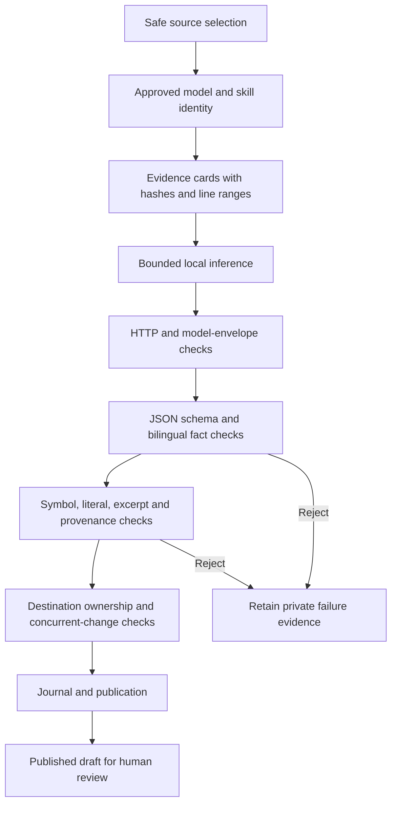

# Local documentation command: generation, evaluation and publication

[Training index](index.md) · [Current architecture](../architecture/current-implementation.md)

<!-- reading-section: local-documentation-command-1 -->
## Operational status and scope

MakeDocs uses the existing local Ollama runtime and approved agent resources. It can acquire real project source, produce evaluated bilingual drafts and publish to the library and original project documentation. Operational success does not establish the desired writing quality. Outputs remain drafts requiring human review; full-project acceptance belongs to the owner. This guide documents source behavior, not a new end-to-end execution or a completed training campaign.

The normal command produces `guides/generated-source-summary.md` in both languages and managed navigation blocks. It does not reconstruct every architecture, FAQ or operations chapter. Do not describe bounded selected declarations as complete project documentation. No neural fine-tuning, new weights or approved adapter checkpoint can be inferred from a model tag, skill file, successful inference or accumulated research artifacts.

<!-- reading-section: local-documentation-command-2 -->
## One normal generator, two entry points

The frontend registers a project first, without inference. Its MakeDocs/update action asks `CatalogManagement` to reconcile the source, prepare a verified workspace and launch `Documentation::Command`. Operation phases report ownership validation, evidence collection, generation and publication. The child writes library and staged destinations; the coordinator records and completes host delivery before marking the operation completed.

The normal CLI uses the same Ruby command and publishes host-backed snapshots directly after success. Always select the intended project explicitly:

```sh
# Mutating operation: use only after authorizing generation for this project.
docker compose exec -T backend make docs DOCS_ARGS='--project example-project'
```

Run from the checkout root after managed startup. `example-project` is a placeholder for an existing registration. No sibling discovery, manual original `docs/` creation, new Docker bind mount per external project or manual state deletion is required by the managed host path. The legacy mount-preparation helper remains compatibility infrastructure; it is not the ordinary external-project onboarding procedure.

`backend/Makefile` also exposes a separate opt-in `DOCS_WORKFLOW=project` implementation. The normal frontend action does not select it. Its existence does not imply that the default summary generator produces a whole book; do not switch workflows or claim equivalent acceptance without explicit verification.

<!-- reading-section: local-documentation-command-3 -->
## Source and context preparation

The registered source reference resolves on the host, not relative to `/app/backend`. Acquisition verifies Git and filesystem identity and copies allowed source bytes into a private bounded workspace. Source files are never executed. Existing documentation is staged for ownership comparison, not used as replacement source evidence.

The caller filters source extensions, excluded locations and credential-bearing content. Automatic selection starts with a 6 KiB/four-file budget and can expand to 24 KiB if no eligible initial evidence is found. Explicit selections use their own bounded 24 KiB/12-file path. These are context-selection limits, not acquisition limits and not proof of complete source coverage.

For automatic Python declarations, the existing AST helper identifies complete callable units, qualified symbols and exact line ranges. A complete quoted unit is limited to 6,144 bytes; oversized units can be omitted. The default fact limit is four, configurable from one to five. Eligible evidence order determines the selected units. A coverage record must be interpreted at its actual level: selected files or declarations are not all application behavior.

<!-- reading-section: local-documentation-command-4 -->
## Approved resources and local inference

The default model is `llama3.2:3b`, endpoint `http://ollama:11434`, context `skills`, transport `chat`, evidence mode `declarations`, context window 16,384 tokens and request deadline 1,800 seconds. The caller checks approved model identity against the recovery manifest and Ollama tags before and after inference. Missing resources or digest mismatch fail closed; there is no automatic model download or cloud fallback.

Normal skill context comes from exactly `agent/skills/evidence/SKILL.md`, `agent/skills/authoring/SKILL.md` and `agent/skills/review/SKILL.md`, with integrity hashes. Where available, their English context sections are extracted. The entire agent directory, learning corpus and optional retrieval utilities are not automatically injected into every request. Skills are prompt context, not modified neural weights.

Requests use deterministic options (`temperature: 0`, `seed: 42`) and bounded structured JSON output. Automatic multi-declaration Python generation makes separate evidence-bound requests under one overall deadline, then validates the combined result. Each such request uses a 600-token prediction budget; the ordinary request builder uses 1,800. A repeatable seed does not guarantee identical runtime behavior across platforms or model versions. `keep_alive: 0` releases the model runner after the request; it does not delete model resources.

<!-- reading-section: local-documentation-command-5 -->
## Evaluation gates



The caller verifies HTTP success, UTF-8, completion status, stop reason and exact model identity. Structured facts must refer to selected evidence IDs, source hashes, symbols, line ranges and exact excerpts. Schemas bind declaration references to their evidence cards. Evaluation also checks bilingual fact structure, selected-evidence coverage where required, complete sentences, declared/called names, quoted literals, exceptions and supported type/return claims. The final draft is rendered only after acceptance of the combined facts.

These are mechanical and heuristic gates. They can reject useful prose or accept semantically misleading prose. Known quality risks include incorrect explanation of prefix/suffix predicates, mistranslated code literals, unsupported relationships between quotes and claims, mixed-language text and incomplete coverage. Passing them does not certify factual completeness, translation equivalence or editorial quality. Original prose is not silently truncated to a short fragment to make an invalid answer pass.

<!-- reading-section: local-documentation-command-6 -->
## Ownership, no-op and recoverability

A fingerprint includes caller version, approved model/skills, inference settings, selected source evidence and targets. Matching fingerprint and owned output hashes allow a no-op without another inference. A no-op may still need pending host delivery; it is not permission to skip publication status. Changes to source, skills, caller, settings or managed outputs alter this decision.

The command owns only its generated summary files and marked navigation blocks. Unowned existing output or changed owned content is refused. Manual text surrounding index blocks is preserved. Run evidence retains inputs, requests, responses, validation events, candidates and before-images. A per-project pending journal records application progress; verified completion or rollback recovers interrupted writes. See [runtime and recovery](../operations/runtime-and-recovery.md) before using recovery options.

For host projects, a second publication check compares current source identity/content and original document baselines. `docs/` is created safely on first publication. A partial library/staged write or pending host delivery is not full success. Removal and re-registration preserve source/manual docs, archive eligible library content and retain ownership/recovery data.

<!-- reading-section: local-documentation-command-7 -->
## Optional research and quality work

Normal research mode is offline. Separate research/retrieval/evaluation utilities and an optional research Compose overlay exist, but their presence does not make the normal caller a universal RAG system. Using those workflows, changing prompts/skills/model settings or running a quality campaign requires its own authorized scope. Preserve all existing datasets, checkpoints, manifests, learning evidence and model files.

The recent corrections address source acquisition/publication, host path and case aliases, adapter readiness, bounded Python declaration requests, shared deadlines and preservation of complete fact text. They make operation possible; they do not prove the desired quality level. The current review performs technical writing directly and does not run MakeDocs or inference.

Sources: `backend/Makefile`, `backend/lib/documentation/command.rb` (`VERSION = 1.9.49`, `skill_context`, `infer`, `source_model_request`), `backend/lib/documentation/catalog_management.rb`, `backend/lib/documentation/host_filesystem.rb`, `tools/host_filesystem.py` and `backend/lib/documentation/python_structure.py`.
