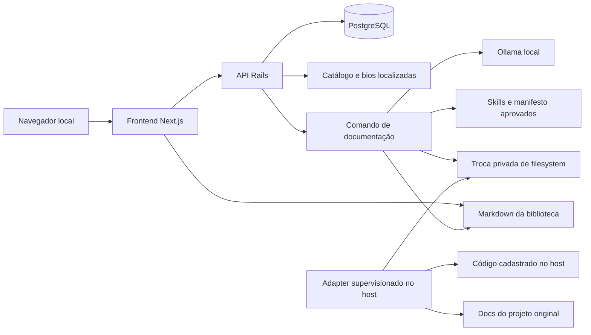
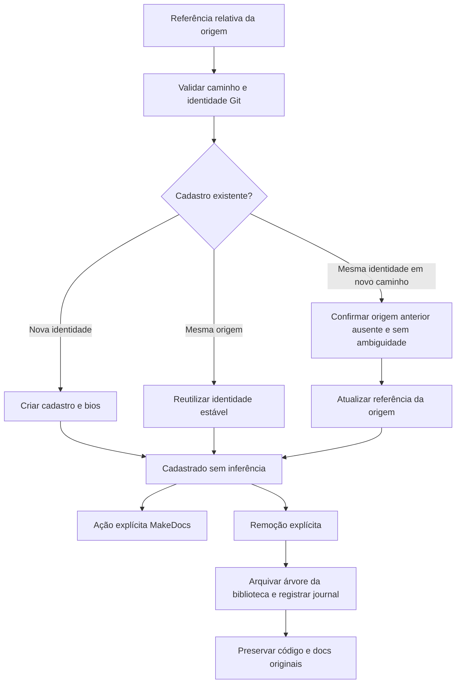

# Engineering Library: implementação atual

[Índice de arquitetura](index.md) · [Índice do projeto](../index.md)

Revisado contra o código em `246f58be` em 26/11/2026. Esta é a referência técnica atual; relatórios de auditoria datados permanecem como evidência histórica. Engineering Library é uma aplicação privada da Viva Bem. Os exemplos usam projetos fictícios e caminhos relativos ao checkout.

<!-- reading-section: current-implementation-1 -->
## Responsabilidades e autoridade dos dados

A aplicação reúne catálogo de projetos, leitor de livros Markdown bilíngues, anotações compartilhadas e elaboração local de documentação. Next.js apresenta catálogo e leitor; Rails expõe APIs de catálogo, anotações e gerenciamento restrito a desenvolvimento; PostgreSQL persiste metadados e anotações. Markdown continua sendo a fonte dos capítulos. Ollama fornece inferência local, enquanto um processo Python supervisionado intermedeia o acesso aos repositórios cadastrados no host.

| Dado | Autoridade | Consequência |
| --- | --- | --- |
| Projetos cadastrados | `docs/.catalog.json` | Cadastro explícito; repositórios vizinhos arbitrários não entram automaticamente. |
| Metadados de apresentação | Arquivos `bio.md` localizados e correspondentes | Rails valida e sincroniza os dados nas linhas do catálogo. |
| Capítulos e navegação | `docs/<slug>/en` e `docs/<slug>/pt-br` | O frontend lê arquivos; PostgreSQL não armazena os corpos dos capítulos. |
| Notas, destaques e marcadores | PostgreSQL | Compartilhados na instalação, por projeto, documento e idioma. |
| Propriedade e recuperação da geração | Estado privado, manifestos e journals do MakeDocs | Saídas geradas não podem sobrescrever livremente arquivos manuais. |
| Aquisição de código | Referência relativa cadastrada, identidade Git e snapshot limitado | O snapshot não é um clone Git nem a árvore de trabalho inteira. |

<!-- reading-section: current-implementation-2 -->
## Integração entre frontend e Rails

O servidor Next consulta o catálogo por `BACKEND_URL`, com timeout de cinco segundos e requisições no-store. Rails pagina cinco projetos por vez, ordenados deterministicamente por nome de exibição e ID estável. Bios localizadas fornecem os dados de apresentação. `Catalog::Sync` valida a entrada antes da transação e usa advisory lock; a identidade estável permite atualizações e entradas ausentes ficam inativas sem excluir anotações compartilhadas.

A descoberta do leitor mapeia o idioma de API `pt-BR` para o diretório `pt-br`. Markdown é descoberto recursivamente dentro da coleção do projeto. Índices apenas navegacionais não duplicam capítulos comuns; o README possui identidade própria no leitor. Slugs de títulos, identificadores de perguntas e marcadores reading-section sustentam a navegação lógica. Páginas físicas dependem da janela e das métricas da fonte; não são identificadores persistentes de documentos.

O leitor suporta tabelas GFM, blocos de código, diagramas Mermaid e referências expansíveis a código aprovado. Essas referências têm catálogo de snapshots e verificações de integridade próprios; cadastrar um repositório no host não expõe arquivos arbitrários no navegador. A busca usa correspondência literal limitada, incluindo snapshots aprovados quando aplicável, com teto de 80 resultados. Não é busca vetorial nem índice full-text PostgreSQL.

Notas e destaques usam localizações lógicas e variantes de localização. Notas ricas têm fluxo de conteúdo e sanitização separado do Markdown dos capítulos; a presença de dependências não autoriza HTML arbitrário. Excluir um destaque pode preservar sua nota por uma relação anulável. Não existem contas pessoais nem propriedade de anotações por navegador: CSRF e a chave local de gerenciamento não criam identidade de usuário.

<!-- reading-section: current-implementation-3 -->
## Acesso ao host e caminhos relativos

O launcher gerenciado inicia um supervisor no host antes dos containers. O supervisor inicia o worker de filesystem somente enquanto o backend está ativo, monitora sua execução e reinicia um worker encerrado. Requisições e respostas atravessam um diretório privado compartilhado por bind mount; não existe endpoint HTTP de acesso arbitrário ao filesystem do host.

Uma referência como `../example-project` resolve a partir da raiz do checkout da Engineering Library no host, independentemente do diretório do shell ou dos caminhos do container. Barras invertidas são normalizadas; caminhos absolutos, unidades de disco, caracteres de controle, symlinks e layouts inseguros de repositório são recusados. Exige-se repositório Git independente. A identidade deriva dos hashes ordenados dos commits raiz, e não da URL remota ou do HEAD atual; identifica linhagem, enquanto hashes de arquivos detectam mudanças de conteúdo. Histórico compartilhado não autoriza escolher silenciosamente entre cópias.

O adapter adquire arquivos de código permitidos e documentação existente em um workspace privado, com limites. Exclui objetos Git, locais relacionados a segredos, dependências, saídas geradas, testes e outros diretórios configurados. O chamador aplica verificações adicionais de código, contexto e credenciais. O modelo recebe evidências selecionadas, não todos os bytes adquiridos. Veja [operação e recuperação](../operations/runtime-and-recovery.md) para layout e verificações da publicação.

<!-- reading-section: current-implementation-4 -->
## Cadastro, relocação e remoção

O cadastro inicializa metadados e bios localizadas sem executar inferência. Repetir uma solicitação equivalente reutiliza o cadastro em vez de criar duplicatas. Um request ID hexadecimal de 32 caracteres também protege retries; reutilização conflitante é rejeitada. Identidade estável, referências normalizadas e verificações da origem física tratam aliases equivalentes.

Relocação é verificada: a mesma identidade do repositório deve existir na nova referência relativa e a origem anterior deve estar comprovadamente ausente. Cópia anterior disponível ou identidade ambígua é recusada. Não é renomeação irrestrita nem migração automática entre repositórios distintos. Indisponibilidade temporária de uma origem no host não basta para excluir seu cadastro.

A remoção arquiva a árvore servida do projeto, verifica seu hash, registra a transição em journal e atualiza o catálogo. O código e o `docs/` manual do projeto original são preservados. Recadastrar a mesma combinação elegível de identidade e slug pode restaurar o arquivo e o ID estável. Recuperação de geração ou entrega pendente pode bloquear ações conflitantes. Excluir locks, estados ou arquivos de recuperação manualmente não faz parte do ciclo normal.

Ciclo esperado: cadastrar → gerar → atualizar → remover cadastro → cadastrar novamente → gerar novamente. A primeira geração suporta ausência de `docs/` original; a publicação cria os diretórios necessários. Cadastro bem-sucedido, isoladamente, não prova disponibilidade do modelo nem sucesso de publicação.

<!-- reading-section: current-implementation-5 -->
## Geração e publicação

A rota de gerenciamento do frontend e o `make docs` da linha de comando invocam `Documentation::Command`. O frontend também coordena status operacional e entrega posterior ao host; não usa outro gerador. O comando lê skills locais e identidade do modelo aprovadas, seleciona evidências, solicita fatos bilíngues limitados, valida respostas, renderiza Markdown gerenciado, verifica propriedade e registra a publicação.

A saída atual é um resumo limitado do código e entradas de navegação gerenciadas, não um livro completo revisado manualmente. Para projetos externos, os dois destinos são a coleção da biblioteca e o `docs/` do projeto original. O adapter verifica identidade do código e do diretório, hashes de origem e hashes da documentação existente antes da entrega. A operação conclui somente após sucesso da entrega posterior ao host. A substituição é atômica por arquivo; não existe transação distribuída entre destinos. Journals e entrega repetível fornecem recuperação.

<!-- reading-section: current-implementation-6 -->
## Limites operacionais e técnicos atuais

O Compose padrão contém frontend, backend, PostgreSQL e Ollama. Os mounts de código e agente têm permissões explícitas; frontend e backend recebem a biblioteca gravável no Compose atual. Também é necessário um processo no host. `/up` do backend retorna indisponível quando falta heartbeat do adapter obrigatório. Não comprova integridade do banco, disponibilidade do modelo aprovado, qualidade da geração ou publicação bem-sucedida.

O gerenciamento funciona apenas em desenvolvimento, protegido por chave privada, verificações de loopback/origem e limites de corpo. Esses controles atendem operação local; não constituem autenticação pública multiusuário. Não exponha a aplicação ou seus diretórios de evidência como serviço público.

MakeDocs está operacional, mas os textos gerados ainda exigem revisão factual e bilíngue. As verificações de evidência não demonstram correção semântica completa, cobertura integral do código ou qualidade desejada de redação. Pesos existentes no Ollama e skills locais não demonstram fine-tuning neural concluído. Uma futura campanha de qualidade é separada da operação normal e desta atualização documental.

<!-- reading-section: current-implementation-7 -->
## Mapa de código

Caminhos relativos à raiz do repositório; símbolos descrevem a implementação inspecionada, sem congelar números de linha.

| Código | Responsabilidade |
| --- | --- |
| `compose.yaml`, `docker/Dockerfile`, `docker/backend-entrypoint.sh`, `docker/frontend-entrypoint.sh` | Containers, mounts, dependências e startup |
| `tools/init_dev_env.py`, `tools/library_runtime.py`, `tools/host_filesystem.py` | Ciclo gerenciado no host e protocolo de filesystem |
| `backend/lib/documentation/catalog.rb`, `catalog_management.rb`, `host_filesystem.rb`, `command.rb` no mesmo diretório | Identidade, ciclo do catálogo, aquisição e geração |
| `backend/app/services/catalog/sync.rb`, `page.rb`, `files.rb` no mesmo diretório | Validação de metadados, persistência e paginação |
| `backend/app/controllers/runtime_health_controller.rb`, `backend/config/routes.rb` | Health e rotas da API |
| `frontend/lib/catalog.ts`, `documentation.ts`, `markdown.ts`, `reading-order.ts` no mesmo diretório | Acesso do servidor e descoberta do leitor |
| `frontend/lib/source-snapshot.ts`, `source-references.ts`, `source-search.ts` no mesmo diretório | Apresentação e busca em código aprovado |
| `frontend/app/api/catalog-management/[[...operation]]/route.ts` | Proxy local de gerenciamento |

Continue em [MakeDocs](../training/local-documentation-command.md), [operação](../operations/runtime-and-recovery.md) e [decisões arquiteturais](decisions.md).
