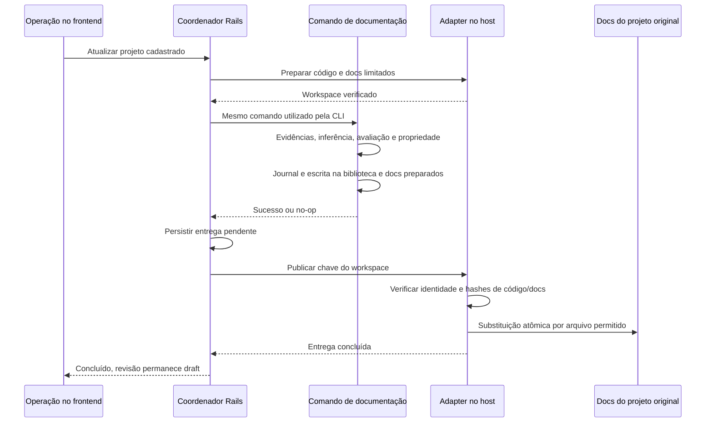

# Operação, publicação no filesystem e recuperação

[Índice operacional](index.md) · [Arquitetura](../architecture/current-implementation.md)

<!-- reading-section: runtime-and-recovery-1 -->
## Ciclo gerenciado

Execute os comandos na raiz do checkout, em host POSIX com Python 3.10+ e Docker Compose. No Windows, use WSL2; PowerShell nativo não é suportado pelo adapter atual. macOS e Linux diferem em permissões e sensibilidade a maiúsculas; estas instruções não representam homologação multiplataforma.

```sh
# Cria .env somente se ausente, preserva credenciais existentes, inicia o supervisor,
# constrói/inicia os serviços existentes e aguarda os health checks.
python3 -B tools/init_dev_env.py up -d --build --wait --wait-timeout 600
# Lê status do supervisor; o helper também inicializa arquivos locais ausentes.
python3 -B tools/init_dev_env.py status
# Preserva os dados persistentes e para o supervisor quando o backend está parado.
python3 -B tools/init_dev_env.py stop
python3 -B tools/init_dev_env.py up -d
python3 -B tools/init_dev_env.py restart
python3 -B tools/init_dev_env.py down
```

`up` e `restart` garantem o supervisor antes do Compose. Parar apenas o frontend mantém o adapter disponível ao backend ativo. `down` recusa opções de remoção de volumes/imagens. `docker compose up` sozinho não inicializa o supervisor no host. O backend aguarda o adapter obrigatório e executa `db:prepare catalog:sync`; são mutações operacionais, não diagnósticos somente leitura. Revise migrations e proteja os dados persistentes antes de upgrades.

O supervisor pertence ao usuário atual do SO, verifica propriedade dos processos antes de pará-los e usa lock de ciclo não bloqueante. Consulta o estado do backend e supervisiona o worker. O worker não é daemon root, instalação de serviço ou servidor HTTP. O startup reutiliza dependências verificadas do frontend quando a impressão de runtime/lockfiles/entrypoint e os bindings nativos conferem; caso contrário executa `npm ci` com lockfile. O backend verifica dependências Bundler. Lockfiles não tornam instalações independentes de plataforma ou rede.

<!-- reading-section: runtime-and-recovery-2 -->
## Diretórios operacionais privados

Todos os caminhos são relativos ao checkout, sem caminhos absolutos específicos da máquina. A instalação principal armazena dados operacionais em `backend/storage/makedocs/`.

| Caminho dentro dessa base | Finalidade e conteúdo | Retenção |
| --- | --- | --- |
| `runtime/` | Chave de gerenciamento e locks de gerenciamento/comando | Dados operacionais e de recuperação necessários; nunca publique chaves ou logs brutos. |
| `state/` | Manifestos de propriedade, journals pendentes por projeto e `removal.pending.json` | Necessário para comprovar propriedade e recuperar escritas interrompidas. |
| `state/management/` | Registros, logs/configs privados e arquivos de remoção verificados | Preservar para retries, recuperação e recadastro. |
| `state/runs/` | Entrada imutável, evidências de requisição/resposta do modelo, candidatos, versões anteriores e eventos | Preservar como proveniência e recuperação. |
| `filesystem/host/` | Status gerenciado e de ciclo, locks, heartbeat, requisições, respostas e workspaces | Necessário ao acesso gerenciado. Requisições/respostas podem ser transitórias; o diretório inteiro não é descartável. |
| `filesystem/host/workspaces/<reference-sha256>/<source-name>/` | Snapshot limitado do código e `docs/` de preparação | Workspace interno, não outro projeto cadastrado nem dataset de treinamento. |
| `filesystem/host/workspaces/<reference-sha256>/snapshot.json` | Hashes de código/docs, identidade do diretório, referência e estado de publicação pendente | Preservar enquanto houver trabalho ou entrega pendente. |
| `evaluations/` | Saídas de avaliação quando esses fluxos explícitos são usados | Evidência; não demonstra que toda operação normal executa campanha de treinamento. |

Um workspace recém-observado é criado na preparação da origem. A chave deriva da referência relativa normalizada; o nome-base do repositório permanece como diretório da origem. Assim, pode sobreviver a várias execuções. A preparação atualiza conteúdo próprio do snapshot somente quando é seguro renovar a documentação preparada; saídas alteradas ou pendentes são mantidas para entrega. Não exclua diretórios desconhecidos, locks, arquivos de recuperação, modelos ou evidências de pesquisa para fazer um retry funcionar.

<!-- reading-section: runtime-and-recovery-3 -->
## Aquisição e primeira geração

`tools/host_filesystem.py` resolve a referência cadastrada a partir da raiz do checkout. Reutiliza a primitiva de filesystem baseada em descritores e no-follow de `agent/tools/documentation_workspace.py`. Verifica identidade Git independente, recusa caminhos inseguros e adquire somente arquivos regulares permitidos. Defaults: 32 MiB por arquivo, 512 MiB de código total, 128 MiB de documentação, 200.000 entradas visitadas e 100.000 arquivos adquiridos. São limites de aquisição, separados do orçamento muito menor de evidências para inferência.

O `docs/` original não precisa existir. A preparação cria o destino de documentação no workspace; a publicação bem-sucedida cria diretórios originais seguros. O código não é executado. Alterações posteriores à aquisição invalidam a publicação, evitando documentar silenciosamente outra versão do código.

Em filesystem sem distinção de maiúsculas, `pt-BR` e `pt-br` podem indicar o mesmo arquivo. A consulta por alias exige grafia equivalente e identidade física do arquivo. Diretórios distintos em filesystem sensível a maiúsculas não são mesclados; ambiguidades são recusadas. Isso evita falsos conflitos de propriedade no macOS sem enfraquecer a separação de caminhos no Linux.

<!-- reading-section: runtime-and-recovery-4 -->
## Sequência de publicação



Para projetos externos no host, os alvos permitidos são exatamente `guides/generated-source-summary.md` em inglês e português e seus `index.md` de idioma. O chamador restringe mudanças navegacionais a blocos gerenciados e preserva o conteúdo manual ao redor. O adapter recusa mudanças de identidade ou bytes da origem e edições manuais conflitantes nos documentos. Substituição atômica e fsync protegem cada arquivo, mas a atualização de vários arquivos e dois destinos não é globalmente atômica.

O coordenador registra entrega pendente antes de contatar o host. Outra atualização do mesmo projeto pode concluir a entrega salva sem nova inferência. Uma falha deve continuar visível; resposta do modelo, escrita apenas na biblioteca ou `/up` verde não equivalem a publicação concluída.

<!-- reading-section: runtime-and-recovery-5 -->
## Erros e recuperação

| Evidência | Significado e resposta segura |
| --- | --- |
| `/up` retorna 503 no componente host-filesystem | Heartbeat obrigatório ausente, vencido ou inseguro. Use startup gerenciado e inspecione logs privados do supervisor/worker. |
| Operação queued/running | Consulte seu ID existente. Não envie mudanças paralelas conflitantes. |
| Worker desapareceu ou foi interrompido | O status verifica identidade do processo/boot e pode marcar interrupção; inspecione a evidência retida antes de repetir. |
| `delivery: pending` | Retome a atualização do mesmo projeto; preserve configuração e workspace salvos. |
| Conflito de propriedade/hash | Compare documento atual com hashes anteriores/candidatos. Preserve edições manuais; não contorne excluindo o manifesto. |
| `<slug>.pending.json` | A publicação exige recuperação explícita verificada. Revise journal e versões anteriores primeiro. |
| `removal.pending.json` | A recuperação usa arquivo de remoção e catálogo anterior; solicitações posteriores reconciliam ou recusam ambiguidades. |
| Rejeição de inferência/avaliação | Não há rascunho aceito nesta execução. Inspecione a evidência privada exata; timeout não comprova defeito de treinamento. |

O comando expõe `--recover complete` e `--recover rollback`, sempre limitados por `--project <slug>` e pelo mesmo contexto de origem/configuração. São ferramentas de recuperação que escrevem dados, não limpeza rotineira. Conclusão/rollback verificam caminhos, propriedade e hashes; preserve evidências e revise a ação antes do uso. Locks de gerenciamento serializam transições do catálogo; o lock do comando impede sobreposição de geração, remoção e relocação. Existir um arquivo de lock não comprova um detentor ativo.

As categorias de erro da interface são propositalmente genéricas. Logs privados retêm detalhes de implementação e evidências preservam envelopes do modelo e falhas de validação. Não copie esses dados em relatórios públicos: trechos de código, caminhos e texto gerado podem ser confidenciais. Reconhecer um erro não autoriza apagar evidências ou ignorar entrega pendente.

<!-- reading-section: runtime-and-recovery-6 -->
## Health e diagnóstico

```sh
docker compose ps
docker compose logs --tail=100 backend frontend ollama
curl --fail --silent --show-error http://127.0.0.1:3098/up
docker compose exec -T ollama ollama list
```

Inspecione logs localmente e remova dados privados antes de compartilhar. `/up` demonstra resposta Rails e disponibilidade do adapter obrigatório naquele instante. PostgreSQL usa `pg_isready`; Ollama usa `ollama list`; o frontend consulta sua página inicial. Nenhum comprova identidade do modelo aprovado, integridade de restauração, qualidade semântica ou aceitação integral do ciclo. A API do catálogo pode sincronizar metadados, portanto não é uma consulta estritamente somente leitura ao banco.

Dados persistentes PostgreSQL ficam em `.dockerized-postgres/18/docker`; recursos Ollama ficam em `ollama/`. Remover containers não é backup. Preserve credenciais existentes, armazenamento do banco, modelos, artefatos do agente e recuperação. Veja [operação de desenvolvimento](../guides/application-development.md) e o [procedimento de migração preservado](database-migration.md).

Fontes: `tools/init_dev_env.py`, `tools/library_runtime.py`, `tools/host_filesystem.py`, `backend/lib/documentation/locations.rb`, `backend/lib/documentation/host_filesystem.rb`, `backend/lib/documentation/catalog_management.rb`, `backend/lib/documentation/command.rb`, `backend/app/controllers/runtime_health_controller.rb` e `compose.yaml`.
