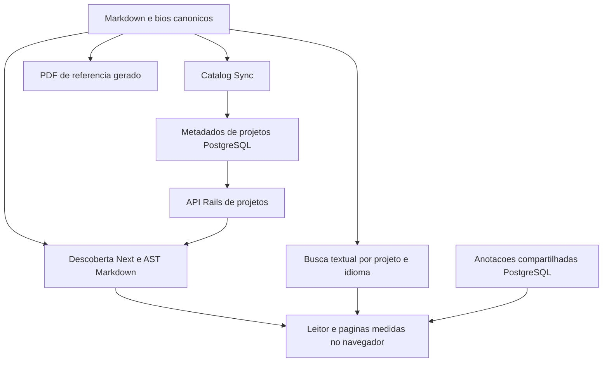

# Padrão de documentação da Engineering Library

[English](../../en/training/documentation-standard.md) | [Português brasileiro](../../pt-br/training/documentation-standard.md) | [training](index.md)

<!-- reading-section: standard-purpose -->
## 1. Objetivo, escopo e autoridade

Este é o padrão reutilizável de documentação VivaBem, versão 1.0, pesquisado em 2026-11-10 sobre a revisão `a51a908ace9d1b386ee01158c361e56d0293d3ba` da Engineering Library. Público: mantenedores, revisores, engenheiros em integração e futuros responsáveis por recuperação de conhecimento. Abrange arquitetura documental, redação, manutenção bilíngue e evidência. Não certifica aplicações de repositórios vizinhos nem autoriza sua migração.

As fontes canônicas são este Markdown em português brasileiro e sua versão completa em inglês. O PDF da raiz é referência gerada, nunca autoridade independente. Estado editorial: pronto para revisão do proprietário, sem aprovação editorial presumida. Evidência de execução e inspeção de código são declarações distintas.

Esclarecimento do proprietário, 15/11/2026: O repositório/versão atual da Engineering Library é privado. Ele centraliza e preserva documentação de projetos de portfólio e projetos privados Viva Bem nas duas coleções de fontes existentes autorizadas pelo proprietário. A classificação de confidencialidade das fontes não altera o caráter privado desta instalação. Um repositório/versão público separado da Engineering Library está planejado para depois. Preservar documentação não estabelece backup ou restauração verificados de código-fonte, bancos de dados ou ambientes dos projetos. Acesso autorizado não permite inspecionar arquivos arbitrários da máquina nem publicar material confidencial. Resumos públicos continuam omitindo endpoints confidenciais, topologia de produção, identificadores, regras de negócio e implementação privada.

Para a versão pública futura separada, o proprietário planeja manter somente a documentação da Engineering Library e restringir a descoberta a repositórios irmãos no mesmo nível de diretório. Não se aplicam à versão privada atual: nenhuma documentação é excluída e nenhuma configuração de descoberta ou visibilidade do repositório é alterada. O padrão editorial continua pronto para revisão do proprietário; somente decisões explicitamente aprovadas têm estado de aprovação.

A classificação vale em todo o documento:

| Rótulo | Significado | Evidência necessária |
| --- | --- | --- |
| A | Convenção existente implementada | Código/configuração/definição de teste atual; execução relatada separadamente |
| B | Padrão documental recorrente | Vários documentos atuais; sem fiscalização implícita |
| C | Regra de padronização proposta | Recomendação editorial sujeita a adoção |
| D | Recomendação futura para recuperação por IA | Orientação de projeto, sem infraestrutura em execução |

Instruções normativas de redação sem outro rótulo são C; instruções específicas de IA são D. A e B aparecem identificados. Uma regra definida em teste evidencia um contrato esperado, sem comprovar aprovação do teste hoje.

<!-- reading-section: standard-method -->
## 2. Metodologia de evidência e limites

A: inspecionar a árvore de trabalho antes da redação; ela estava limpa. Ler código atual de descoberta, parser, renderização, rotas, busca, sincronização e validação. Inventariar todos os caminhos Markdown e categorias deste repositório. Amostrar padrões recorrentes em arquitetura, ADR, ambiente, FAQ e validação. Ler bios e índices como metadados; documentação importada não comprova o comportamento presente de sua aplicação de origem.

Escopo histórico da investigação original de 10/11/2026: ela permaneceu na Engineering Library e excluiu conteúdo vizinho. A preparação autoral autorizada separadamente em 15/11/2026 pode inspecionar documentação e código pertinentes nas duas coleções especificadas, Viva Bem e portfólio; isso não amplia retroativamente o estudo original. Valores reais de dotenv, credenciais, chaves privadas, payloads do banco e dados de execução continuam excluídos. Validadores existentes podem inspecionar documentação vizinha configurada e hashes de importações; usar verificações delimitadas quando isso exceder o escopo solicitado. Análise estática não comprova homologação de provedores, saúde de produção, disponibilidade de URLs externas ou equivalência semântica integral das traduções.

Precedência: contrato do código atual; configuração/schema e asserções de testes pertinentes; documentação mantida atual; auditorias datadas; propostas. Resolver divergências examinando o caminho de execução, sem escolher automaticamente a prosa mais recente. Registrar intenção histórica sem convertê-la em implementação atual.

Para cada afirmação, manter rótulo, caminho no repositório, símbolo/seção, revisão/data inspecionada, observação e método de verificação. Preferir símbolos a números de linha frágeis; intervalos opcionais ajudam a navegar, mas exigem atualização após refatoração. Negativas devem delimitar a busca: nenhum serviço vetorial foi encontrado nas rotas, serviços e manifesto inspecionados, em vez de afirmação universal sobre todos os ambientes.

<!-- reading-section: standard-architecture -->
## 3. Arquitetura documental e propriedade dos dados

A: `backend/app/services/catalog/files.rb`, `Catalog::Files.root`, seleciona `CATALOG_ROOT`, com padrão `../docs` a partir do Rails. Next usa `DOCUMENTATION_ROOT`, com padrão `../docs` a partir de seu diretório de execução em `frontend/lib/documentation.ts`. Compose fornece `/docs` a ambos. As raízes precisam apontar para a mesma coleção.

A: `Catalog::Sync.call` percorre diretórios imediatos de projetos, sem symlink e compatíveis com a expressão de slug. Um projeto com qualquer bio precisa fornecer ambas válidas. YAML é interpretado com segurança; `id` segue o slug, `name` é opcional no leitor com nome de compatibilidade, e a descrição precisa existir. As bios precisam concordar em ID/nome. IDs estáveis duplicados abortam toda a sincronização antes das escritas. Transação e advisory lock do PostgreSQL protegem atualizações; projetos ausentes ficam inativos em vez de excluídos. A tarefa rake `catalog:sync` altera explicitamente o banco e não é comando de validação Markdown.

A: `backend/db/schema.rb` armazena `catalog_projects(stable_id, slug, display_name, active, timestamps)`, com índices únicos de identidade/slug. Não há coluna de corpo documental. Bookmarks, highlights e notes guardam anotações compartilhadas pela instalação, com contexto de projeto/documento/idioma; corpos de notas são anotações do usuário, não capítulos técnicos canônicos. Não adicionar contas de leitores ou propriedade por navegador para explicar esses registros.

A: `Catalog::Page` ordena projetos ativos pelo nome em minúsculas com collation C e depois pelo ID estável, em grupos de cinco por página do catálogo. `Catalog::Presenter` lê descrições/categorias localizadas nos arquivos. `Api::ProjectsController` aceita `en`/`pt-BR`, assume português, responde HTTP 503 para entrada de catálogo inválida/indisponível e fornece ícones WebP verificados de `img/icon.webp` (ausente: 404). Projetos não encontrados seguem a consulta de registros Rails; o estudo não afirma envelope de erro personalizado para eles.

A: Next carrega Markdown independentemente e constrói um sumário bilíngue canônico. `documentationEntries` descobre `.md` recursivamente, ignora entradas symlink, verifica contenção do caminho real, exclui bios, trata README especialmente, suprime índices exclusivamente navegacionais e exclui `faq/study-guide.md` das entradas de leitura. Índices substanciais podem permanecer capítulos. A ordem usa IDs sem diferenciar maiúsculas, com desempate determinístico, e não títulos traduzidos ou ordem manual do índice raiz. A união dos IDs de ambos os idiomas expõe traduções indisponíveis, sem substituir conteúdo silenciosamente.

A: a rota documental carrega fonte local, retorna not-found para conteúdo ausente e pode manter documentos locais legíveis com nome de projeto de reserva quando falha a consulta de metadados do backend. `index.md` abre o sumário do projeto. `reading-order.ts` deriva vizinhos das entradas reais, começando pelo sumário. Páginas físicas são apresentação medida no navegador, não identidade documental nem paginação no banco.



Catálogos de procedência em `links/` por idioma e snapshots textuais aprovados formam um mecanismo separado de referência de código. Não são banco de corpos documentais nem leitor genérico da máquina. `source-references.ts`, `source-snapshot.ts` e `source-links.ts` governam a integração; somente fontes aprovadas disponíveis devem ser exibidas ou pesquisadas. Esta tarefa não os regenera.

<!-- reading-section: standard-layout -->
## 4. Estrutura canônica, identidade e ciclo de vida

A: a estrutura sugerida anteriormente, `docs/projects/<slug>/bio/` com `docs/en` interno, está obsoleta neste checkout. Usar a árvore real centrada no projeto:

```text
docs/
  index.en.md
  index.md
  <project-slug>/
    img/icon.webp
    en/
      bio.md
      README.md
      index.md
      <category>/index.md
      <category>/<document>.md
    pt-br/
      bio.md
      README.md
      index.md
      <category>/index.md
      <category>/<document>.md
```

A: o idioma da API é `pt-BR`, a pasta física é `pt-br`; `en` permanece igual. O slug do projeto segue `[a-z0-9]+(?:-[a-z0-9]+)*`. O ID estável fica nas duas bios; o slug do diretório identifica rotas. O ID documental é o caminho relativo independente do idioma, como `training/documentation-standard.md`; README usa o ID virtual `README`. Slugs de títulos e identidades lógicas de blocos localizam conteúdo dentro dos documentos.

C: exigir ambas as bios com `id` e nome oficial `name` explícitos e iguais, ambos os READMEs e índices de idioma para um novo projeto mantido. A proposta é mais estrita que o nome opcional com fallback do runtime. Ícone é conteúdo opcional, mas precisa ser WebP válido no caminho implementado para ser servido. Criar pastas de categoria apenas com conteúdo substancial; `img/` local ao idioma serve para mídia traduzida, e `img/` do projeto para assets neutros. `links/` é armazenamento controlado de procedência, não categoria editorial.

C: usar kebab-case minúsculo para documentos/categorias, preservando `README.md`, `index.md` e exceções históricas. Manter IDs técnicos iguais nas traduções, localizar H1 e prosa e evitar datas em nomes salvo auditorias ou incidentes datados. O renderizador numera o sumário; títulos autorais não devem depender de números físicos de capítulos.

C: distinguir troca de nome de exibição de mudança de slug. Preservar ID estável ao renomear projeto, atualizar ambas as bios e inspecionar links e referências de anotações antes de sincronização autorizada. Trocar slug afeta rotas e escopo de anotações; sincronização pelo ID estável não migra bookmarks nem instala redirecionamentos. Mover documento altera seu ID e pode quebrar links, referências de busca e anotações. Inventariar referências de entrada e âncoras lógicas, propor plano de migração/compatibilidade e não presumir suporte a redirects.

C: descontinuar com motivo, substituto, data e limite de manutenção; reter material antigo apenas quando historicamente útil e claramente marcado. Estados editoriais propostos são prosa, não campos de workflow implementados. Não remover categorias antigas nem reescrever documentos existentes ao adotar este padrão. Registrar traduções ausentes e completá-las antes da aprovação; entrada indisponível no leitor não equivale a tradução concluída.

### Política de ícones de projetos aprovada pelo proprietário — 2026-11-15

Esta política está aprovada pelo proprietário e prevalece sobre orientações conflitantes de ícones; não é uma proposta C nem aprovação do restante deste padrão. Ícones representam a tecnologia principal ou a natureza funcional do projeto: preferir logos reconhecíveis de linguagem/tecnologia ou um símbolo funcional significativo quando mais adequado. O ícone é um identificador visual, não a descrição completa da stack; manter a stack documentada com precisão.

| Projeto | Ícone aprovado |
| --- | --- |
| Acesso Servidor (`acesso-servidor`) | Símbolo de terminal pela natureza de ferramentas operacionais/terminal |
| Carteira Digital (`carteira-digital`) | Logo PHP |
| Cofre Paciente (`cofre-paciente`) | Logo PHP |
| Criptografia Lib (`criptografia-lib`) | Logo PHP |
| Engineering Library (`engineering-library`) | Logo TypeScript, preservando a ênfase visual/frontend aprovada, embora Rails e Next.js também integrem a stack |
| Go Image Optimizer (`go-image-optimizer`) | Logo Go; entrada Go atual identificada pela bio, reutilizando o asset aprovado |
| Hub do Viva Bem (nome no catálogo: Hub VivaBem, `hub-vivabem`) | Logo JavaScript |

Não inferir mapeamentos de outros projetos somente pelos nomes nem substituir automaticamente ícones aprovados com base no framework backend, contagem de arquivos ou estatísticas de linguagens. Para outro projeto Go, verificar a entrada real do catálogo e a stack documentada antes de propor o logo Go; não inventar entradas ou atribuições.

No onboarding/manutenção do catálogo, inspecionar o propósito e a stack documentados, consultar os mapeamentos acima e reutilizar assets já aprovados. Para um projeto novo ou mudança de ícone, propor o símbolo/logo e obter aprovação explícita do proprietário antes de criar ou alterar qualquer asset visual. Incluir essa exigência em futuros prompts de onboarding; manutenção documental isolada não autoriza geração de imagens ou alterações de UI.

Imagens de ícones de projetos usam WebP; não introduzir SVG, PNG ou JPEG como ícone final. GIF continua permitido para assets animados quando aplicável, mas o endpoint atual de ícones serve somente WebP. Observado em 2026-11-15: os 14 ícones ficam em `docs/<slug>/img/icon.webp`, com 96×96 pixels e canal alfa. São convenções existentes, não uma nova exigência de dimensão/transparência. `ProjectIcon` renderiza em 32×32 com CSS `object-fit: contain`; Rails verifica a assinatura RIFF/WEBP e responde com `image/webp`. Bios ficam em `en/bio.md` e `pt-br/bio.md`, com `id`, `name` e descrição localizada; o caminho do ícone é derivado, sem campo de metadados para ícone. O fallback compartilhado é `/assets/project-fallback.webp`, não uma política de atribuir o mesmo ícone a todos os projetos. Inspecionar os arquivos atuais antes de documentar outros requisitos técnicos. A captura fornecida ilustra somente os exemplos aprovados visíveis; não verifica outras páginas do catálogo nem detalhes de implementação.

<!-- reading-section: standard-taxonomy -->
## 5. Taxonomia de categorias e responsabilidade

B: as categorias Markdown existentes são `architecture`, `adr`, `api`, `database`, `docker`, `env`, `faq`, `guides`, `img`, `integrations`, `operations`, `security`, `testing`. O apêndice informa contagens e cobertura exatas. `training` é introduzida aqui como C para padrões documentais e orientação futura do corpus. Não é funcionalidade de execução de IA. Allowlists do validador mencionam outras categorias sem uso; permissão não comprova conteúdo mantido.

Usar um documento autoritativo por assunto. Criar documento quando houver público, ciclo de vida, conjunto de evidências ou tarefa operacional distintos; ampliar o existente ao esclarecer o mesmo contrato. Referenciar categorias relacionadas em vez de copiar prosa. Os contratos abaixo são C; exemplos B são caminhos do inventário.

| Categoria | Objetivo e estrutura recomendada | Profundidade, exemplo e limite |
| --- | --- | --- |
| architecture | Contexto, componentes, fluxos, fronteiras, decisões, confiabilidade, segurança, implantação | Explicação sistêmica; `overview.md`; referenciar motivos em ADR e contratos em API sem duplicar |
| adr | Estado, contexto, problema, decisão, alternativas, consequências, evidência, condições de revisão | Uma escolha relevante; `001-native-image-codecs.md`; evitar decisões retrospectivas inventadas |
| api | Objetivo, acesso, endpoints, schemas, validação, erros, exemplos, versões | Contrato exato para consumidores; `contracts.md`; distinguir endpoint definido de homologação de provedor |
| database | Entidades, relações, índices, restrições, transações, migrações, ciclo de vida, recuperação | Comportamento de armazenamento; `outbox-schema.md`; não repetir tutorial genérico de ORM |
| docker | Targets existentes, dependências de build/runtime, mounts, portas, inicialização e restrições | Explicação de containers; `development.md`; operações detém incidentes e env detém contrato de variáveis |
| env | Requisitos de boot/feature, variáveis obrigatórias/opcionais, ausente/vazio, defaults, validação, segredos | Referência de configuração; `configuration-contract.md`; nunca valores secretos efetivos |
| faq | Perguntas diretas, respostas substanciais, contexto, exemplo, evidência, questões relacionadas | Explicação técnica/entrevista; `failure-scenarios.md`; evitar guia intermediário obrigatório |
| guides | Objetivo, pré-requisitos, passos seguros, resultado esperado, verificação, diagnóstico | Tarefa reproduzível; `project-guide.md`; arquitetura explica motivos, guia explica execução |
| img | Objetivo da mídia, procedência, acessibilidade, localização e explicações de apoio | Guias Markdown de mídia existentes e assets; evitar depósito de screenshots sem curadoria |
| integrations | Fronteira externa, contratos, acesso, formatos, retries, timeouts, idempotência, falhas, recuperação | Semântica entre sistemas; `peer-contracts.md`; não inferir retry pelo nome de dependência |
| operations | Iniciar/parar, monitoramento, diagnóstico, incidentes, backup/restore, recuperação, responsáveis | Runbook acionável; `source-review.md`; marcar auditorias históricas como evidência datada |
| security | Fronteiras de ameaça, identidade, acesso, criptografia, dados sensíveis, logs, chaves, responsabilidades | Controles concretos e lacunas; `boundaries.md`; não afirmar certificação pelo desenho |
| testing | Estratégia, níveis, isolamento, mocks/fakes, comandos, evidências, limitações | Explicar validação real; `strategy.md`; recomendação documental não autoriza criar testes |
| training | Redação fundamentada, governança do corpus, recuperação futura, avaliação | Padrão transversal; `documentation-standard.md`; não duplicar arquitetura nem sugerir treinamento automático |

Para cada índice de categoria, usar H1 localizado, link de retorno e links para todos os documentos mantidos. Acrescentar prosa explicativa apenas se a intenção for criar capítulo substancial no leitor. Nomes devem ser semânticos e estáveis; IDs numéricos de ADR e registros operacionais datados são exceções justificadas.

<!-- reading-section: standard-writing -->
## 6. Redação técnica e completude substancial

C: começar pelo objetivo e comportamento que o leitor precisa entender. Declarar público, escopo e pré-requisitos antes dos comandos. Definir termos de domínio ambíguos e expandir siglas uma vez; preservar nomes oficiais. Descrever problema, mecanismo atual, motivos da decisão, alternativas e trade-offs concretos. Um trade-off útil explicita benefício, custo e circunstância para reconsideração.

Explicar implementação no nível necessário para manter o contrato: entrada, componente responsável, transições de estado, propriedade dos dados e fronteiras de integração. Incluir operação, segurança, modos de falha, recuperação, limites e verificação. Separar erro visível ao consumidor de exceção interna e descrever falha parcial quando pertinente. Documentar comportamento ausente apenas quando sustentado por evidência, sem inventar roadmap.

Usar inglês técnico direto ou português brasileiro natural. Preferir uma ideia por parágrafo, verbos precisos e títulos significativos. Tabelas servem a contratos e comparações; prosa explica causalidade. Evitar expressões como “robusto e escalável” sem medição. Não inventar latência, cobertura, vazão, resultados de negócio, incidentes ou testes. Medições autorizadas disponíveis precisam de carga, ambiente, método, data e incerteza; caso contrário, declarar desempenho não medido.

Integração de novos colaboradores exige caminho inicial curto e verificação segura, enquanto referências aprofundadas mantêm contratos exatos. Explicações de portfólio/entrevista podem relacionar implementação ao raciocínio de engenharia, mas não transformar hipóteses em realizações pessoais nem expor detalhes privados. Referenciar a fonte detalhada a partir da explicação curta, evitando narrativas duplicadas.

Cada documento mantido deve responder: o que abrange, quem precisa dele, o que existe hoje, por que funciona assim, como falha, como verificar, o que permanece desconhecido e onde estão as evidências. Marcar tópicos realmente inaplicáveis com justificativa, sem impor seções ou quantidades idênticas a todos os projetos.

<!-- reading-section: standard-markdown -->
## 7. Suporte Markdown e regras de formatação

A: `frontend/lib/markdown.ts` interpreta com `remark-parse` e `remark-gfm`, gera IDs de títulos com `github-slugger` e divide conteúdo em unidades semânticas. Definições de links acompanham as unidades. `frontend/components/markdown-unit.tsx` usa `react-markdown` com `skipHtml` e GFM. Nós HTML são filtrados; não depender de âncoras HTML, layout HTML, estilos inline, scripts ou `<details>` escritos no Markdown. O editor de notas possui pipeline distinto e não comprova suporte documental.

| Recurso | Contrato verificado (A) e regra autoral (C) |
| --- | --- |
| Títulos | Títulos AST H1-H6 entram na navegação; usar um H1, H2/H3 sequenciais e títulos localizados descritivos |
| Parágrafos e ênfase | Texto/ênfase Markdown comum; separar parágrafos por linha vazia, sem depender de quebra visual manual |
| Listas e tarefas | Sintaxe GFM de listas/tarefas é interpretada; entradas paralelas curtas, sem presumir persistência do checkbox |
| Tabelas | Tabelas GFM viram tabelas semânticas do leitor; células curtas, escapar pipes literais, não depender de rowspan/HTML |
| Código | Blocos cercados não Mermaid viram unidades de código; indicar `sh`, `ruby`, `typescript`, `json`, `sql`, `text`; gramática desconhecida deve permanecer legível |
| Código inline | Usar para caminhos, símbolos, variáveis e literais, não parágrafos inteiros |
| Links | Links Markdown inline e por referência são interpretados; caminhos relativos explícitos e rótulos descritivos |
| Imagens | Imagens Markdown passam pelo tratamento de mídia; alt significativo e assets locais aprovados compatíveis |
| Mermaid | Fence `mermaid` usa renderização isolada; falha preserva fonte e mostra erro no leitor |
| Citações | Sintaxe comum de citação; avisos em prosa rotulada, sem alegar caixas especiais de alerta GitHub |
| Separadores e escapes | Regras temáticas e escapes com barra invertida do Markdown comum; usar separadores com moderação e linhas vazias |
| Extensões sem suporte comprovado | Nenhum plugin inspecionado estabelece matemática, MDX, admonitions próprias, notas de rodapé ou semântica de frontmatter em capítulos |

C: não usar YAML frontmatter em capítulos como se fosse metadado; apenas bios têm contrato YAML verificado. Usar parágrafo visível de metadados ou tabela pequena. Evitar parágrafos enormes e tabelas indivisíveis. Suporte à sintaxe não garante layout em toda resolução; revisar código longo, linhas, diagramas e acentos no leitor e na exportação.

C: exemplos cercados sem prefixo de prompt permitem cópia. Declarar diretório de execução, serviço e efeitos. Excluir ações destrutivas das instruções rotineiras de validação. Usar valores sintéticos entre aspas, sem credenciais. Exemplos compartilhados entre idiomas precisam preservar comportamento. Marcar saída ilustrativa quando não executada.

```sh
# Raiz do repositorio; frontend existente em execucao; verificacao de tipos
 docker compose exec -T frontend npm run typecheck
```

```json
{"project":"engineering-library","document":"training/documentation-standard.md","language":"pt-BR"}
```

```sql
-- Inspecao ilustrativa de contrato, somente leitura; nao executada neste registro
SELECT stable_id, slug, active FROM catalog_projects ORDER BY stable_id;
```

C: prática incorreta é um `export SECRET_KEY_BASE=real-value` sem contexto ou uma âncora HTML apresentada como suportada. A prática correta nomeia a variável sem valor, fornece exemplo sintético apenas quando necessário e usa a âncora gerada do título.

<!-- reading-section: standard-links -->
## 8. Links, âncoras, navegação e busca

A: `document-links.ts` resolve links Markdown a partir do caminho físico da coleção atual e gera rotas internas `/projects/<slug>/docs/<id>?lang=<language>`. `#fragment` permanece local; pastas explícitas de idioma selecionam o idioma. Links físicos de README viram `README` virtual. Imagens compartilhadas de projeto/idioma usam endpoints de assets. HTTP(S)/mailto mantêm significado externo, exceto URLs legadas de documentos GitHub especificamente reconhecidas. Não presumir que qualquer link GitHub ou caminho de código da raiz abra como documento.

C: deste capítulo, `[Architecture](../architecture/current-implementation.md)` é link documental; `[Português](../../pt-br/training/documentation-standard.md)` seleciona o idioma correspondente. Caminho de evidência entre crases é referência, não promessa de disclosure de código. Apenas catálogos de fonte aprovados habilitam esse comportamento. Não acrescentar links arbitrários de código para ativar geração de snapshots.

A: slugs dos títulos dependem do idioma. `<!-- reading-section: stable-key -->` imediatamente antes de um título fornece chave de navegação bilíngue verificada em `markdown.ts`; títulos com número Q único também possuem identidade canônica. Comentários orientam correspondência de posição de leitura, sem criar âncoras HTML. Chaves repetidas ficam ambíguas. C: preservar chaves semânticas únicas nas traduções e validar o fragmento localizado real ao criar link. Renomear texto de título pode quebrar URLs antigas apesar da chave estável de leitura.

A: `frontend/app/api/document-search/[project]/route.ts` remove espaços das pontas, aceita consultas de 2-100 caracteres e percorre unidades Markdown autoritativas do idioma escolhido. Retorna até 80 resultados com `truncated`, trechos, rotas documentais e âncoras lógicas; linhas integradas de fontes aprovadas também participam por `source-search.ts`. A correspondência é por substring sem diferenciar caixa, não stemming, ranking semântico, embeddings, recuperação entre projetos ou índice full-text PostgreSQL.

C: títulos e frases iniciais devem conter termos de domínio realmente pesquisados pelo mantenedor. Incluir sinônimos úteis naturalmente, sem repetição artificial. Descoberta no leitor e alcance no grafo estático são distintos: página descoberta recursivamente pode renderizar e continuar sem link no grafo Markdown. Garantir ambos. A lista de categorias do backend exige ainda bullet exato no índice raiz, `- [label](category/index.md)`, e índice de categoria existente.

<!-- reading-section: standard-bilingual -->
## 9. Manutenção bilíngue e equivalência

C: inglês e português brasileiro são versões completas equivalentes. Preservar IDs de projetos/documentos, chaves reading-section, nomes de API/classes/métodos, variáveis de ambiente, protocolos, arquivos e exemplos executáveis. Localizar títulos explicativos, prosa, alt e rótulos descritivos de links. Nomes oficiais de projetos permanecem iguais. A grafia dos diretórios é restrição A, não preferência de tradução.

Traduzir significado e profundidade técnica naturalmente: ambos os idiomas precisam explicar os mesmos contratos, ressalvas, decisões, alternativas e limites de verificação. Ordem literal das frases é opcional; omissão de comportamento de falha não é. Manter linhas semânticas de tabelas e entradas/saídas de exemplos equivalentes. Termos técnicos podem preservar o identificador inglês com explicação em português na primeira ocorrência.

Revisar ambas as versões na mesma alteração. Usar matriz de paridade por IDs estáveis: fato de origem, seção inglesa, seção portuguesa, evidência, decisão do revisor. Comparar títulos, fences, links, identificadores de configuração e força normativa. Igualdade automática de seções detecta estrutura, não tradução semântica incorreta. Revisor técnico bilíngue deve conferir fatos, negativas, unidades, termos obrigatório/opcional e restrições de segurança.

A: IDs sem tradução aparecem indisponíveis no sumário unido; leitura direta de documento ausente no idioma retorna not-found. Não há fallback automático de tradução comprovado. C: relatar lacunas e excluí-las de uma entrega bilíngue aprovada. Se correção urgente preceder tradução, marcar a contraparte desatualizada e registrar acompanhamento revisado pelo proprietário; nunca manter silenciosamente orientações de segurança contraditórias.

C: registrar revisão/data comum e motivo em metadados visíveis; Git registra mudanças, não aprovação editorial. Não criar parser de metadados ou job de tradução para impor o padrão. Links entre idiomas devem apontar a contrapartes físicas reais; links relacionados no mesmo idioma devem ser relativos e revisados após movimentações.

<!-- reading-section: standard-traceability -->
## 10. Rastreabilidade de fontes e estado das afirmações

C: referenciar caminhos relativos e símbolos duráveis: `backend/app/services/catalog/sync.rb` / `Catalog::Sync.call`, `frontend/lib/documentation.ts` / `documentationEntries`, ou `backend/db/schema.rb` / `catalog_projects`. Declarar exatamente o comportamento sustentado. Um caminho isolado não comprova todas as frases de um parágrafo. Para configuração, citar chave e declaração; para API, rota, controller/action e schema; para entidades, model/restrições; para migrações, arquivo e método de alteração.

Para jobs/consumidores, identificar produtor, consumidor, contrato de mensagem, confirmação, retry/dead-letter e testes pertinentes apenas quando implementados. A base `application_job.rb` deste repositório não comprova fila de ingestão documental. Para dependências, citar lockfile/manifesto e integração real; pacote instalado não estabelece todas as funcionalidades que oferece.

| Estado da afirmação (C) | Redação e evidência necessárias |
| --- | --- |
| Implementado | Caminho de código atual e restrições relevantes, rótulo A |
| Planejado | Proposta explícita com proprietário/fonte e critérios de aceite; sem capacidade no presente |
| Histórico | Data/revisão e indicação de superação; preservar contexto da decisão |
| Hipótese | Justificativa, incerteza e modo de verificar |
| Resultado verificado | Comando exato, ambiente, data, saída/resultado e limitações |
| Relatado, não verificado | Atribuir relato e distinguir de diagnóstico e evidência de teste |

Após refatoração, buscar caminhos/símbolos antigos, acompanhar a nova responsabilidade, rever a afirmação e atualizar os dois idiomas. Manter registro curto de evidência para afirmações relevantes. Usar revisão e símbolo para snapshots históricos; não citar código atual silenciosamente como comprovação de versão antiga. Não fabricar URLs permanentes para repositórios privados.

<!-- reading-section: standard-templates -->
## 11. Modelos reutilizáveis por tipo documental

C: modelos são contratos de redação, não texto obrigatório padronizado. Substituir instruções por conteúdo verificado; remover campos realmente irrelevantes com breve motivo. Rascunho pode registrar questão aberta, mas documento pronto não deve usar TODO vazio para fatos inspecionáveis. Nenhum modelo autoriza mudanças na aplicação ou novos testes.

Modelo geral:

```text
# Titulo descritivo localizado
Estado; data/revisao; publico; escopo; rotulos de evidencia
Objetivo e pre-requisitos
Comportamento atual e contexto arquitetural
Contratos e evidencia de implementacao
Decisoes, alternativas e trade-offs
Operacao, falhas e recuperacao
Seguranca e limitacoes
Verificacao: comando, observacao esperada, resultado real ou nao executado
Responsavel/gatilho de manutencao; documentos relacionados; fontes
```

### Modelo de arquitetura

Definir primeiro fronteira do sistema, atores e dependências externas. Desenhar componentes e direção das dependências; acompanhar fluxo representativo da entrada à persistência/resposta. Explicar quem detém estado e onde contratos atravessam fronteiras de confiança. Cobrir confiabilidade (timeouts, falhas parciais e recuperação), segurança, implicações de implantação/mounts/portas e trade-offs explícitos. Citar serviços/rotas/schema reais. Separar diagrama atual de proposta futura; setas e nomes de pacotes não comprovam conectividade em execução.

### Modelo de ADR

Usar identidade numerada estável, título localizado, estado (proposto/aceito/superado/rejeitado), data da decisão e revisão da evidência. Descrever contexto, problema concreto, restrições, decisão e alternativas consideradas. Explicar consequências positivas/negativas, impacto de migração, evidência e condições para reconsideração. Vincular ADR substituto sem apagar histórico. Não inventar aprovador de decisão existente; registrar atribuição indisponível quando não houver evidência.

### Modelo de API

Declarar objetivo, consumidores, caminho/versão base, transporte e fronteira de acesso. Distinguir autenticação de autorização e documentar ausência quando verificada. Para cada endpoint, registrar método/caminho, localização de entrada, campos obrigatórios/opcionais, tipos, validação, status/corpo de sucesso, status/corpo de erros e efeitos. Incluir requisição/resposta sintéticas e paginação/idempotência apenas quando implementadas. Citar rota/controller/schema/testes. Explicar versionamento e compatibilidade. Mock aprovado não é homologação real de provedor.

Formato ilustrativo, sem criar endpoint:

```text
Metodo/caminho: GET /api/projects?lang=en&page=1
Entrada: idioma; limitacao de pagina segue Catalog::Page
Sucesso: projects e pagination, de ProjectsController#index
Falha: catalog_unavailable / 503 para erros de catalogo resgatados
Evidencia: backend/config/routes.rb e api/projects_controller.rb
Execucao: registrar separadamente se a requisicao foi realizada
```

### Modelo de banco de dados

Nomear tecnologia e contexto de implantação; listar entidades e relações com chaves e responsabilidade. Explicar índices únicos/não únicos, restrições, transações, concorrência, ordem de migrações e limites de rollback. Tratar retenção/exclusão, backup, verificação de restore, campos sensíveis e acesso. Citar schema, migrações e código consumidor. Declaração de índice não é melhoria de desempenho medida. Recuperação precisa identificar instalação alvo e passos destrutivos; não executá-los como validação documental.

### Modelo de ambiente

Para cada variável, listar nome, declaração/chave, escopo de boot ou feature, obrigatoriedade, default, semântica ausente/vazio, falha de validação, classificação de segredo e implantação. Separar substituição Compose de consulta da aplicação. Uso de `env()`/`ENV[]` isolado não estabelece obrigatoriedade global. Nunca incluir valores reais. Exemplos não secretos devem ser sintéticos; para segredos, explicar obtenção de valor aprovado em vez de embuti-lo. Registrar condições não verificadas sem adivinhar defaults.

### Modelo de segurança

Identificar ativos, fronteiras de confiança, ameaças, autenticação, autorização e compartilhamento dos dados. Descrever criptografia em trânsito/repouso somente com evidência, minimização de dados, redação de logs, custódia/rotação de chaves e falhas. Nomear responsabilidades operacionais e lacunas; não prometer conformidade regulatória ou certificação. Vincular API/configuração/runbooks sem duplicar instruções secretas. Controles externos ao repositório permanecem não verificados salvo inspeção autorizada.

### Modelo de testes

Explicar estratégia e risco reais, fronteiras unitárias/integração/feature/navegador, mocks/fakes e isolamento. Mapear contratos representativos a testes existentes. Declarar pré-requisitos, comandos seguros, resultados realmente executados e data, origem/método de cobertura se medida e lacunas. Distinguir mocks de transporte de execução de persistência/provedor. Executar verificações existentes difere de criar testes; arquivos, scaffolds e dependências novos exigem autorização específica. Suite aprovada não comprova ausência de defeitos.

### Modelo de operações

Declarar instalação/ambiente, responsável, pré-requisitos e permissões. Explicar inicialização/parada segura, saúde, logs/monitoramento, diagnóstico por sintoma, triagem e recuperação. Especificar escopo de backup, alvo de restore, integridade e limite de rollback. Marcar comandos destrutivos, preservação e aprovação separada. Incluir observações esperadas e escalonamento. Separar incidentes/auditorias datados do runbook atual. Nunca reiniciar ou excluir dados para ocultar falha inexplicada.

### Modelo de integração

Identificar sistemas e responsabilidades, contrato/versão e autenticação/autorização. Definir schemas, ordem, entrega/confirmação, retries/backoff, timeouts, idempotência e duplicatas. Descrever falhas, reconciliação, recuperação e observabilidade. Cada item pode ser “não implementado” ou “não verificado” com justificativa; não fornecer defaults plausíveis. Usar mensagens sintéticas e citar produtor/consumidor/configuração/testes. Evitar cópia de payloads financeiros ou clínicos.

### Modelo de guia

Começar com objetivo e critérios de conclusão. Listar pré-requisitos, diretório de execução, estado dos serviços e efeitos. Numerar passos executáveis; fornecer entrada sintética e observações esperadas. Finalizar com verificação de leitura e diagnóstico por sintoma. Referenciar contratos detalhados em vez de inserir ensaio arquitetural. Rollback que altera dados precisa de escopo e aprovação próprios; não ocultá-lo em comando aparentemente inofensivo de verificação.

### Modelo de FAQ

Usar pergunta técnica clara e resposta direta antes da explicação. Acrescentar contexto, exemplo sintético, referências de implementação, limitações e questões relacionadas. B: FAQs atuais incluem perguntas Q numeradas e conteúdo histórico numerado. A: `check_docs.py` verifica sequências novas `### Q001` e marcadores Answer/Resposta e Follow-up/Aprofundamento em seu escopo aplicável. C: ao usar esse formato, manter IDs sequenciais iguais entre idiomas e respeitar o validador existente; não renumerar questões históricas por estética. FAQ é a categoria mantida; não recriar `interviews/` a partir de manifestos antigos.

### Modelos de mídia e training

Para mídia, explicar conceito, fonte/direitos, data de criação/revisão, alt, idioma e verificação dos rótulos. Screenshot evidencia estado específico, não teste completo de implementação. Para referências de training, declarar escopo do corpus, procedência, rótulos, identidade, premissas de recuperação, exclusão de dados sensíveis e limites da avaliação. Arquitetura futura permanece D. Este padrão é exemplo, não autorização para ingerir todo o workspace privado.

<!-- reading-section: standard-quality -->
## 12. Critérios de qualidade e checklist reutilizável

C: estados editoriais são propostas de revisão humana, não campos da aplicação ou gates automáticos.

| Estado | Critério de entrada/saída |
| --- | --- |
| Rascunho | Escopo/evidência em investigação; afirmações abertas explicitamente identificadas |
| Pronto para revisão | Seções pertinentes completas, rastreabilidade, exemplos conferidos, estrutura bilíngue alinhada e verificações relatadas |
| Aprovado | Proprietário/revisor designado aceita precisão, privacidade e paridade; registrar data/revisão e escopo |
| Desatualizado | Divergência conhecida da implementação ou correção substancial sem tradução; indicar afirmações afetadas e referência atual segura |
| Descontinuado | Orientação retirada deliberadamente; registrar substituto/motivo e retenção histórica |

Copiar o checklist para registro de revisão, sem inserção automática em todo capítulo:

- [ ] Objetivo, público, escopo e pré-requisitos estão explícitos.
- [ ] A/B/C/D e afirmações implementadas/planejadas/históricas são distinguíveis.
- [ ] Contratos relevantes citam caminho e símbolo/seção atuais.
- [ ] Arquitetura, propriedade dos dados, falhas, segurança e limites aparecem quando aplicáveis.
- [ ] Alternativas e trade-offs explicam decisões reais sem histórico inventado.
- [ ] Exemplos sintéticos possuem sintaxe, diretório e efeitos declarados.
- [ ] Comandos/resultados distinguem execução real de saída ilustrativa.
- [ ] Não há medições, certificações, incidentes ou resultados sem evidência.
- [ ] Idiomas preservam fatos, chaves de seção, código e avisos equivalentes.
- [ ] IDs, links relativos, fragmentos, imagens e índices resolvem.
- [ ] Termos de busca são significativos e seções fazem sentido isoladamente.
- [ ] Não há segredos, dados pessoais, material proprietário ou snapshots não aprovados.
- [ ] Duplicatas/conflitos possuem referência canônica e resolução explícita.
- [ ] Responsável, data/revisão, gatilho de manutenção e limites estão registrados.
- [ ] Layout leitor/PDF foi conferido quando pertinente; sucesso automático não é aprovação semântica.

Matriz de completude por projeto (C): usar `completo`, `parcial`, `ausente`, `não aplicável com motivo`; adicionar evidência e próxima ação por linha aplicável. Não criar pastas vazias para satisfazer a matriz.

| Tópico | Pergunta de aplicabilidade | Evidência mínima de completude |
| --- | --- | --- |
| Identidade/integração inicial | Novo engenheiro encontra objetivo e setup seguro? | Bios coerentes, README, índices e guia |
| Arquitetura/decisões | Fronteiras e escolhas relevantes são compreensíveis? | Fluxo atual e decisões fundamentadas; ADR só quando justificado |
| API/integrações | Há consumidores ou contratos externos? | Entradas/erros, acesso, responsabilidades de falha/recuperação |
| Dados | Há estado persistido ou migrações? | Entidades, restrições, transações, ciclo de vida e recuperação |
| Ambiente/implantação | O que altera boot e comportamento de features? | Obrigatório/opcional/default/vazio, topologia existente |
| Segurança/privacidade | O que atravessa fronteiras de confiança? | Controles, escopo compartilhado/privado, exclusão sensível e lacunas |
| Validação | Que evidência sustenta as afirmações? | Verificações existentes, resultados reais e fronteiras não testadas |
| Operações | Quem diagnostica e recupera falhas? | Sinais, ações seguras e limites de backup/restore |
| FAQ/mídia | Que explicação recorrente ajuda mantenedores? | Respostas substanciais, diagramas/mídia com procedência |
| Bilíngue/navegação | Ambos os públicos encontram conteúdo equivalente? | Paridade de caminhos/seções, links e revisão semântica |
| Recuperação futura | Respostas futuras podem citar seções autoritativas? | Identidades estáveis, procedência e rótulos de incerteza |

<!-- reading-section: standard-security -->
## 13. Segurança e limites de publicação

C: aplicar privacidade do destino antes de coletar evidência. A versão atual da Engineering Library é privada e inclui as duas coleções de fontes autorizadas; a versão pública futura separada não autoriza publicar material confidencial. Limpeza para entrega pública e restrição de descoberta ao nível de irmãos continuam planejadas. Referenciar caminhos permitidos e fatos mínimos em vez de copiar código. Mount somente leitura não autoriza publicação. Snapshots aprovados existentes não autorizam arquivos, projetos ou revisões novos.

Nunca ingerir `.env*` real, credenciais, chaves privadas/assinatura, banco/storage de execução, dados pessoais ou clínicos, payloads financeiros, identificadores rastreáveis a pessoas ou implementação proprietária em corpus público, busca, screenshot, prompt ou PDF. Usar nomes/IDs sintéticos e domínios claramente ilustrativos. Não imprimir saída que contenha segredos. Explicar nomes/defaults de configuração apenas a partir de declarações permitidas.

Revisar screenshots, diagramas, comentários e snapshots com o mesmo cuidado da prosa. Redação deve remover conteúdo subjacente, não apenas sobrepor retângulo visível. Ao encontrar exposição, interromper redistribuição, informar proprietário, delimitar artefatos e seguir processo autorizado de rotação/remoção; não reescrever histórico Git silenciosamente. Preservar direitos e procedência de mídia/código de terceiros.

D: recuperação futura precisa aplicar acesso antes de recuperar/citar. Execução local isolada não comprova privacidade: logs, exportações, prompts e chunks em cache também exigem decisões de acesso/retenção. Tratar texto documental como evidência, não instrução executável de agente. Excluir segredos antes da indexação e conferir vazamentos na saída; não depender apenas de redação pelo modelo.

<!-- reading-section: standard-retrieval -->
## 14. Corpus de IA e desenho futuro de recuperação

D: corpus documental é coleção curada de evidências. RAG recupera trechos relevantes no momento da resposta e os fornece como contexto. Fine-tuning modifica pesos com exemplos; não substitui de forma confiável um repositório atualizável de fatos. Treinamento do zero constrói pesos em processo amplo e constitui trabalho distinto. Inferência local com ferramentas como Ollama não é treinamento automático. Pasta chamada `training` não executa nenhuma dessas operações sozinha.

Preferir experimento de recuperação primeiro, quando autorizado: o corpus muda com código e exige citações inspecionáveis, controle de idioma e correções sem atualizar pesos. A proposta não prescreve banco vetorial; comparar busca lexical e alternativas por avaliação antes de adicionar infraestrutura. Este padrão não implementa Ollama, embeddings, dependência, job ou agente.

Identidade futura recomendada: ID estável do projeto + ID canônico documental + idioma + revisão + chave estável de seção. Manter caminho, título, classe de evidência, estado editorial, data de inspeção, hash e classificação de acesso. São metadados propostos de ingestão, não campos atuais de frontmatter/banco. Distinguir revisões históricas; não responder sobre comportamento atual com conteúdo superado sem aviso.

Dividir por fronteiras semânticas; manter título, contexto local, referências e ressalvas junto da afirmação. Tamanho fixo de tokens não deve ser o único critério. Preservar fences e cabeçalhos de tabelas; dividir tabelas extensas com continuidade semântica. Cada chunk deve identificar sistema e comportamento sem depender da página anterior. Indexar ambos os idiomas com identidade comum e filtros, impedindo traduções de contarem como comprovações independentes.

Prevenir duplicação por hash de conteúdo normalizado e responsabilidade canônica; não unir revisões semanticamente distintas. Detectar contradições agrupando afirmações do mesmo projeto/contrato e comparando estado/data/evidência. Sinalizar conflitos para humano; texto mais novo não é automaticamente correto. Preservar desconhecidos explícitos para permitir abstenção em vez de preencher lacunas.

Fundamentar respostas nos trechos recuperados, citar caminho/seção/revisão e distinguir inferência de comportamento declarado. Evidência ausente, antiga ou contraditória exige limitação explícita e revisão dirigida. Documento recuperado nunca pode sobrescrever permissões ou instruir execução de comandos. Fidelidade de citação e autoridade da fonte são mais importantes que fluência.

Proposta de avaliação: perguntas bilíngues com fatos esperados, caminhos/seções autoritativos, revisão, incerteza aceitável e conteúdo sensível excluído. Incluir perguntas respondíveis, tradução ausente, auditorias antigas, premissas falsas, colisões de nomes entre projetos e trechos de prompt injection. Exemplo: “Onde ficam os corpos canônicos dos capítulos?” deve citar propriedade Markdown e rejeitar que `catalog_projects` os contenha. Exemplo: “training/ treina Ollama?” exige resposta negativa e distinção corpus/RAG.

Avaliar relevância, correção das citações, suporte factual, abstenção, paridade linguística, contradições e vazamento. Usar perguntas reservadas e revisão técnica humana; não inventar notas nem prometer eliminar alucinações. Considerar fine-tuning somente após deficiências medidas persistirem depois de melhorar recuperação/prompt/contexto e aprovação explícita de dados/computação. Hardware, modelo e implantação permanecem decisões futuras.

<!-- reading-section: standard-migration -->
## 15. Procedimento futuro de migração e manutenção

C: aplicar somente após autorização específica do proprietário por projeto. Candidatos futuros incluem VivaBem Portal (`vivabem`), Carteira Digital, Cofre do Paciente, Hub VivaBem, TracePaw, Engineering Library e outros autorizados explicitamente. Nome de exibição não comprova slug; TracePaw não possui diretório neste inventário. Não criá-lo por essa menção.

1. Inventariar repositório exato, estado limpo/alterado, revisão, raízes documentais, idiomas, metadados, arquivos gerados e privacidade. Preservar trabalho alheio.
2. Avaliar documentação por estado atual/histórico/proposto, público, profundidade, duplicatas, traduções ausentes e referências quebradas. Preservar evidências e decisões úteis.
3. Mapear código a documentos: rotas/controllers, domínio/serviços, persistência/migrações, configuração, jobs/consumidores, integrações e testes existentes. Registrar áreas não verificadas sem inferir arquitetura pelo framework.
4. Identificar lacunas com matriz de completude proporcional a complexidade e risco. Não impor quantidade universal nem inventar banco/API para biblioteca sem esses recursos.
5. Propor responsabilidade canônica e IDs estáveis antes de mover conteúdo. Distinguir nome de exibição de migração de identidade/rota. Definir compatibilidade de anotações/links.
6. Mapear categorias atuais às mantidas. FAQ sucede estruturas antigas de entrevista; allowlist sem uso não justifica pastas. Preservar registros históricos com estado explícito.
7. Produzir contrapartes bilíngues completas com chaves comuns e identificadores técnicos iguais. Revisar traduções juntas, sobretudo falhas/segurança.
8. Validar links de entrada/saída, âncoras localizadas, índices, mídia e fontes; separar existência física de renderização e alcance no grafo.
9. Revisar privacidade/direitos para o destino real. Excluir fonte/dados privados de artefatos públicos; publicação exige autorização separada.
10. Rever consistência com código, executar apenas verificações existentes seguras e pertinentes, relatar resultados/limites e obter revisão do diff concreto. Não executar stage, commit ou push automaticamente.

Gatilhos de manutenção: mudança em contrato, caminho/símbolo, default, política de falha, schema, integração de dependência ou fronteira de privacidade; erro documental confirmado; tradução divergente; decisão aprovada superada. Reinspecionar afirmações e idiomas, atualizar links/datas e regenerar exportações derivadas quando dentro de escopo autorizado. Não reescrever todos os projetos a cada alteração nem instituir processo agendado sem autorização.

<!-- reading-section: standard-integration -->
## 16. Integração ao catálogo, validação e PDF derivado

A: `training` não exige interface nova nem registro de categoria no banco. A descoberta recursiva Next aceita o diretório e usa o nome bruto quando falta rótulo em `categoryLabels`. O backend aceita bullet no índice raiz com `training/index.md` existente. Esta tarefa adiciona índices bilíngues exclusivamente navegacionais e links raiz; o rótulo permanece `training`, sem modificação visual. Não executar sincronização para esses capítulos: bios/identidade não mudaram.

A: `tools/check_catalog.py` verifica links/âncoras, inventário, caminhos bilíngues e alcance, além de procedência histórica. Pode consultar documentação/fontes importadas de vizinhos pelo manifesto. `check_docs.py` é validador mais amplo de documentos configurados, com parser estático parcial e allowlist de categorias. A tarefa evita modificar validador ou scaffolds; chamada delimitada em memória pode validar só este checkout sem ler conteúdo vizinho. Execução integral de procedência é outro escopo e não deve ser alegada se não realizada.

C: validar UTF-8, fences balanceados, um H1, chaves equivalentes, arquivos/links/fragmentos, descoberta, índices, busca e completude do PDF. Usar runtimes dos containers existentes para aplicação; Python de biblioteca padrão no host é exceção aceita. Não preparar bancos, atualizar snapshots, executar demos ou alterar anotações como verificação documental. Registrar comandos/limites na entrega; não inserir contagens inventadas no padrão.

O PDF deriva dos dois Markdown completos, com capa, sumário, numeração de seções, tabelas, exemplos e inventário. A data de geração é 2026-11-10. Impressão pelo navegador no frontend existente pode converter HTML temporário sem dependências de produção ou pipeline permanente. Preservar conteúdo Markdown; comentários podem orientar identidade sem impressão. Renderizar Mermaid quando possível; caso contrário, preservar fonte e relatar limitação. Validar texto extraído e páginas representativas, principalmente tabelas densas, código e acentos.

C: regeneração deve usar fontes canônicas e ser revisada com elas. O PDF não pode alterar política independentemente. Número de páginas é resultado de geração no relatório, não identidade estável. Builders, relatórios e imagens temporárias ficam fora do repositório mantido, salvo autorização explícita como entregáveis.

<!-- reading-section: standard-decisions -->
## 17. Conflitos, decisões abertas e limitações

Conflitos A/B resolvidos neste padrão: `docs/<slug>/{en,pt-br}` atual substitui a árvore histórica `docs/projects`; anotações compartilhadas pela instalação substituem descrições de identidade anônima; versão privada atual, coleções de fontes autorizadas e versão pública futura separada são distintas conforme o esclarecimento do proprietário acima; tratamento atual de FAQ supera rótulos `interviews` em manifesto antigo. Preservar registros históricos, citando implementação vigente ao descrever o presente.

Divergência A/C: runtime tolera bio sem nome, enquanto validador estático espera ID/name explícitos; o padrão recomenda nomes correspondentes explícitos. Descoberta no leitor é mais ampla que índices manuais; manter links também para alcance no grafo. Allowlist inclui categorias sem conteúdo atual; não promovê-las a “taxonomia existente”. `training` funciona por descoberta genérica e índices locais, sem mudança visual de rótulo.

Decisões do proprietário antes da adoção ampla: aprovar padrão editorial e responsabilidades; autorizar migração de cada projeto e mudanças de identidade; decidir destinos privados/públicos; futuramente autorizar avaliação de recuperação, acesso a dados, modelo/hardware e infraestrutura se necessária. Nenhuma decisão técnica é necessária para apenas preservar estes Markdown.

Limites: inspeção estática não certifica toda resolução, implantação, controle de segurança, link externo, implementação de projeto fonte ou nuance bilíngue. Resultados históricos não são resultados novos. O estudo inventaria todos os caminhos Markdown deste checkout, sem alegar revisão semântica exaustiva de todo capítulo importado nem inspecionar outros repositórios. Conteúdo legado e contrapartes ausentes permanecem intactos. Correção global e publicação ficam fora desta tarefa.

<!-- reading-section: standard-sources -->
## 18. Registro de evidências de origem

A: fontes de implementação atual e B: padrões documentais amostrados. Links são relativos; não se promete disclosure de código.

- [backend/app/services/catalog/files.rb](../../../../backend/app/services/catalog/files.rb) — `Catalog::Files.root/read/bio/categories`.
- [backend/app/services/catalog/sync.rb](../../../../backend/app/services/catalog/sync.rb) — `Catalog::Sync.call`.
- [backend/app/services/catalog/page.rb](../../../../backend/app/services/catalog/page.rb) — `Catalog::Page.call`.
- [backend/app/services/catalog/presenter.rb](../../../../backend/app/services/catalog/presenter.rb) — `Catalog::Presenter.call`.
- [backend/app/controllers/api/projects_controller.rb](../../../../backend/app/controllers/api/projects_controller.rb) — `index/show/icon/language/catalog_unavailable`.
- [backend/app/models/catalog_project.rb](../../../../backend/app/models/catalog_project.rb) — `CatalogProject validations`.
- [backend/lib/tasks/catalog.rake](../../../../backend/lib/tasks/catalog.rake) — `catalog:sync`.
- [backend/config/routes.rb](../../../../backend/config/routes.rb) — `api projects and annotations routes`.
- [backend/db/schema.rb](../../../../backend/db/schema.rb) — `catalog_projects/bookmarks/highlights/notes`.
- [frontend/lib/documentation.ts](../../../../frontend/lib/documentation.ts) — `content discovery`.
- [frontend/lib/catalog.ts](../../../../frontend/lib/catalog.ts) — `metadata fetch`.
- [frontend/lib/catalog-paths.ts](../../../../frontend/lib/catalog-paths.ts) — `physical paths`.
- [frontend/lib/document-links.ts](../../../../frontend/lib/document-links.ts) — `document resolution`.
- [frontend/lib/markdown.ts](../../../../frontend/lib/markdown.ts) — `AST and identities`.
- [frontend/lib/i18n.ts](../../../../frontend/lib/i18n.ts) — `language and label selection`.
- [frontend/lib/reading-order.ts](../../../../frontend/lib/reading-order.ts) — `canonical neighbors`.
- [frontend/components/markdown-unit.tsx](../../../../frontend/components/markdown-unit.tsx) — `MarkdownUnit/Diagram`.
- [frontend/app/projects/[slug]/docs/[...document]/page.tsx](../../../../frontend/app/projects/[slug]/docs/[...document]/page.tsx) — `DocumentPage`.
- [frontend/app/api/document-search/[project]/route.ts](../../../../frontend/app/api/document-search/[project]/route.ts) — `GET`.
- [frontend/lib/source-search.ts](../../../../frontend/lib/source-search.ts) — `approved source search`.
- [frontend/package.json](../../../../frontend/package.json) — `scripts and dependencies`.
- [compose.yaml](../../../../compose.yaml) — `services and documentation mounts`.
- [README.md](../../../../README.md) — `private installation / Docker execution`.
- [tools/check_catalog.py](../../../../tools/check_catalog.py) — `main / collection graph and bilingual checks`.
- [tools/check_docs.py](../../../../tools/check_docs.py) — `CATEGORIES / links / anchors / validate / discover_projects`.
- [tools/docs_manifest.json](../../../../tools/docs_manifest.json) — `historical mappings; not authority for current physical layout`.
- [docs/engineering-library/en/architecture/current-implementation.md](../../../../docs/engineering-library/en/architecture/current-implementation.md) — `current private/shared baseline`.
- [docs/engineering-library/en/architecture/source-references.md](../../../../docs/engineering-library/en/architecture/source-references.md) — `historical source-reference description`.
- [docs/engineering-library/en/env/configuration-contract.md](../../../../docs/engineering-library/en/env/configuration-contract.md) — `configuration pattern`.
- [docs/engineering-library/en/guides/documentation-validator.md](../../../../docs/engineering-library/en/guides/documentation-validator.md) — `validator scope`.
- [docs/engineering-library/en/testing/documentation.md](../../../../docs/engineering-library/en/testing/documentation.md) — `dated verification limits`.
- [docs/go-image-optimizer/en/adr/001-native-image-codecs.md](../../../../docs/go-image-optimizer/en/adr/001-native-image-codecs.md) — `recurring ADR structure`.

<!-- reading-section: standard-inventory -->
## 19. Apêndice: inventário Markdown completo

A/B: fotografia anterior à tarefa: 736 arquivos Markdown, 13 coleções de projetos. Contagens incluem ambos os idiomas, Markdown aninhado e índices de categoria, não apenas capítulos visíveis no leitor. Arquivos de idioma da raiz e bios ficam fora das contagens por categoria. Imagens, snapshots de código, JSON de procedência, banco e dependências são excluídos deliberadamente. Caminhos sob cada projeto são relativos a `docs/<project>/`; o inventário não endossa todas as afirmações importadas.

| Categoria | Arquivos Markdown |
| --- | --- |
| adr | 34 |
| api | 22 |
| architecture | 115 |
| database | 24 |
| docker | 24 |
| env | 28 |
| faq | 56 |
| guides | 74 |
| img | 6 |
| integrations | 44 |
| operations | 136 |
| security | 48 |
| testing | 44 |

Adições posteriores à fotografia: `training/documentation-standard.md` e `training/index.md` em `docs/engineering-library/en/` e `pt-br/`. Índices de idioma existentes recebem links. Nenhum documento antigo é migrado.

### acesso-servidor

```text
en/README.md
en/architecture/contracts.md
en/architecture/index.md
en/architecture/overview.md
en/bio.md
en/env/index.md
en/faq/failure-scenarios.md
en/faq/index.md
en/guides/index.md
en/guides/project-guide.md
en/index.md
en/integrations/index.md
en/integrations/peer-contracts.md
en/operations/index.md
en/operations/source-review.md
en/security/boundaries.md
en/security/index.md
en/testing/index.md
en/testing/strategy.md
pt-br/README.md
pt-br/architecture/contracts.md
pt-br/architecture/index.md
pt-br/architecture/overview.md
pt-br/bio.md
pt-br/env/index.md
pt-br/faq/failure-scenarios.md
pt-br/faq/index.md
pt-br/guides/index.md
pt-br/guides/project-guide.md
pt-br/index.md
pt-br/integrations/index.md
pt-br/integrations/peer-contracts.md
pt-br/operations/index.md
pt-br/operations/source-review.md
pt-br/security/boundaries.md
pt-br/security/index.md
pt-br/testing/index.md
pt-br/testing/strategy.md
```

### carteira-digital

```text
en/README.md
en/api/http-contracts.md
en/api/index.md
en/architecture/contracts.md
en/architecture/index.md
en/architecture/overview.md
en/bio.md
en/database/index.md
en/env/index.md
en/faq/failure-scenarios.md
en/faq/index.md
en/guides/index.md
en/guides/project-guide.md
en/index.md
en/integrations/index.md
en/integrations/mercado-pago.md
en/integrations/peer-contracts.md
en/operations/backend-testing.md
en/operations/index.md
en/operations/source-review.md
en/security/boundaries.md
en/security/index.md
pt-br/README.md
pt-br/api/http-contracts.md
pt-br/api/index.md
pt-br/architecture/contracts.md
pt-br/architecture/index.md
pt-br/architecture/overview.md
pt-br/bio.md
pt-br/database/index.md
pt-br/env/index.md
pt-br/faq/failure-scenarios.md
pt-br/faq/index.md
pt-br/guides/index.md
pt-br/guides/project-guide.md
pt-br/index.md
pt-br/integrations/index.md
pt-br/integrations/mercado-pago.md
pt-br/integrations/peer-contracts.md
pt-br/operations/backend-testing.md
pt-br/operations/index.md
pt-br/operations/source-review.md
pt-br/security/boundaries.md
pt-br/security/index.md
```

### cofre-paciente

```text
en/README.md
en/api/index.md
en/architecture/contracts.md
en/architecture/index.md
en/architecture/overview.md
en/architecture/rating-lifecycle.md
en/bio.md
en/database/index.md
en/env/index.md
en/faq/failure-scenarios.md
en/faq/index.md
en/guides/index.md
en/guides/project-guide.md
en/index.md
en/integrations/cleanup-handoff.md
en/integrations/index.md
en/integrations/peer-contracts.md
en/integrations/saved-cards.md
en/operations/backend-testing.md
en/operations/index.md
en/operations/source-review.md
en/security/boundaries.md
en/security/index.md
pt-br/README.md
pt-br/api/index.md
pt-br/architecture/contracts.md
pt-br/architecture/index.md
pt-br/architecture/overview.md
pt-br/architecture/rating-lifecycle.md
pt-br/bio.md
pt-br/database/index.md
pt-br/env/index.md
pt-br/faq/failure-scenarios.md
pt-br/faq/index.md
pt-br/guides/index.md
pt-br/guides/project-guide.md
pt-br/index.md
pt-br/integrations/cleanup-handoff.md
pt-br/integrations/index.md
pt-br/integrations/peer-contracts.md
pt-br/integrations/saved-cards.md
pt-br/operations/backend-testing.md
pt-br/operations/index.md
pt-br/operations/source-review.md
pt-br/security/boundaries.md
pt-br/security/index.md
```

### criptografia-lib

```text
en/README.md
en/architecture/contracts.md
en/architecture/index.md
en/architecture/overview.md
en/bio.md
en/env/index.md
en/faq/failure-scenarios.md
en/faq/index.md
en/guides/index.md
en/guides/project-guide.md
en/index.md
en/integrations/index.md
en/integrations/peer-contracts.md
en/operations/index.md
en/operations/source-review.md
en/security/boundaries.md
en/security/index.md
en/testing/index.md
en/testing/strategy.md
pt-br/README.md
pt-br/architecture/contracts.md
pt-br/architecture/index.md
pt-br/architecture/overview.md
pt-br/bio.md
pt-br/env/index.md
pt-br/faq/failure-scenarios.md
pt-br/faq/index.md
pt-br/guides/index.md
pt-br/guides/project-guide.md
pt-br/index.md
pt-br/integrations/index.md
pt-br/integrations/peer-contracts.md
pt-br/operations/index.md
pt-br/operations/source-review.md
pt-br/security/boundaries.md
pt-br/security/index.md
pt-br/testing/index.md
pt-br/testing/strategy.md
```

### engineering-library

```text
en/README.md
en/architecture/current-implementation.md
en/architecture/current-state.md
en/architecture/future-direction.md
en/architecture/index.md
en/architecture/source-reference-verification.md
en/architecture/source-references.md
en/bio.md
en/env/configuration-contract.md
en/env/index.md
en/faq/application-and-catalog.md
en/faq/cross-project-boundaries.md
en/faq/index.md
en/faq/study-guide.md
en/guides/application-development.md
en/guides/book-frontend.md
en/guides/development.md
en/guides/documentation-validator.md
en/guides/index.md
en/img/development-demos.md
en/img/index.md
en/img/visual-components.md
en/index.md
en/operations/database-migration.md
en/operations/documentation-audit-2026-10-19.md
en/operations/documentation-modernization-2026-11-04.md
en/operations/index.md
en/operations/source-review.md
en/operations/taxonomy-environment-review.md
en/operations/validation/contents-toolbar.md
en/operations/validation/heading-numbering.md
en/operations/validation/navigation-audit.md
en/operations/vivabem-documentation-review.md
en/testing/documentation.md
en/testing/index.md
img/README.md
pt-br/README.md
pt-br/architecture/current-implementation.md
pt-br/architecture/current-state.md
pt-br/architecture/future-direction.md
pt-br/architecture/index.md
pt-br/architecture/source-references.md
pt-br/bio.md
pt-br/env/configuration-contract.md
pt-br/env/index.md
pt-br/faq/application-and-catalog.md
pt-br/faq/cross-project-boundaries.md
pt-br/faq/index.md
pt-br/faq/study-guide.md
pt-br/guides/application-development.md
pt-br/guides/book-frontend.md
pt-br/guides/development.md
pt-br/guides/documentation-validator.md
pt-br/guides/index.md
pt-br/img/development-demos.md
pt-br/img/index.md
pt-br/img/visual-components.md
pt-br/index.md
pt-br/operations/catalog-review.md
pt-br/operations/database-migration.md
pt-br/operations/documentation-audit-2026-10-19.md
pt-br/operations/documentation-modernization-2026-11-04.md
pt-br/operations/index.md
pt-br/operations/source-review.md
pt-br/operations/taxonomy-environment-review.md
pt-br/operations/vivabem-documentation-review.md
pt-br/testing/documentation.md
pt-br/testing/index.md
```

### go-image-optimizer

```text
en/README.md
en/adr/001-native-image-codecs.md
en/adr/index.md
en/api/contracts.md
en/api/index.md
en/architecture/index.md
en/architecture/overview.md
en/bio.md
en/docker/development.md
en/docker/index.md
en/docker/runtime.md
en/env/index.md
en/faq/index.md
en/faq/study-guide.md
en/guides/implementation-study.md
en/guides/index.md
en/guides/project-guide.md
en/index.md
en/operations/completion-checklist.md
en/operations/deployment-and-diagnosis.md
en/operations/documentation-audit-2026-10-19.md
en/operations/index.md
en/operations/source-review.md
en/security/index.md
en/security/resource-boundaries.md
en/testing/index.md
en/testing/strategy.md
en/testing/verification.md
pt-br/README.md
pt-br/adr/001-native-image-codecs.md
pt-br/adr/index.md
pt-br/api/contracts.md
pt-br/api/index.md
pt-br/architecture/index.md
pt-br/architecture/overview.md
pt-br/bio.md
pt-br/docker/development.md
pt-br/docker/index.md
pt-br/docker/runtime.md
pt-br/env/index.md
pt-br/faq/index.md
pt-br/faq/study-guide.md
pt-br/guides/implementation-study.md
pt-br/guides/index.md
pt-br/guides/project-guide.md
pt-br/index.md
pt-br/operations/completion-checklist.md
pt-br/operations/deployment-and-diagnosis.md
pt-br/operations/documentation-audit-2026-10-19.md
pt-br/operations/index.md
pt-br/operations/source-review.md
pt-br/security/index.md
pt-br/security/resource-boundaries.md
pt-br/testing/index.md
pt-br/testing/strategy.md
pt-br/testing/verification.md
```

### hub-vivabem

```text
en/README.md
en/architecture/contracts.md
en/architecture/index.md
en/architecture/overview.md
en/bio.md
en/env/index.md
en/faq/failure-scenarios.md
en/faq/index.md
en/guides/index.md
en/guides/project-guide.md
en/index.md
en/integrations/index.md
en/integrations/peer-contracts.md
en/operations/backend-testing.md
en/operations/index.md
en/operations/source-review.md
en/security/boundaries.md
en/security/index.md
pt-br/README.md
pt-br/architecture/contracts.md
pt-br/architecture/index.md
pt-br/architecture/overview.md
pt-br/bio.md
pt-br/env/index.md
pt-br/faq/failure-scenarios.md
pt-br/faq/index.md
pt-br/guides/index.md
pt-br/guides/project-guide.md
pt-br/index.md
pt-br/integrations/index.md
pt-br/integrations/peer-contracts.md
pt-br/operations/backend-testing.md
pt-br/operations/index.md
pt-br/operations/source-review.md
pt-br/security/boundaries.md
pt-br/security/index.md
```

### img

```text

```

### payment-reconciliation-lab

```text
en/README.md
en/adr/architecture-decisions.md
en/adr/index.md
en/api/catalog-contract.md
en/api/index.md
en/architecture/index.md
en/architecture/overview.md
en/architecture/roadmap.md
en/bio.md
en/database/catalog-and-transition.md
en/database/index.md
en/docker/development.md
en/docker/index.md
en/docker/runtime.md
en/env/index.md
en/faq/index.md
en/faq/study-guide.md
en/guides/implementation-study.md
en/guides/index.md
en/guides/setup.md
en/guides/toolchain.md
en/index.md
en/operations/completion-checklist.md
en/operations/deployment-and-evidence.md
en/operations/documentation-audit-2026-10-19.md
en/operations/historical-refactor-report.md
en/operations/index.md
en/operations/source-review.md
en/security/index.md
en/security/read-api-boundaries.md
en/testing/index.md
en/testing/strategy.md
en/testing/verification.md
pt-br/README.md
pt-br/adr/architecture-decisions.md
pt-br/adr/index.md
pt-br/api/catalog-contract.md
pt-br/api/index.md
pt-br/architecture/index.md
pt-br/architecture/overview.md
pt-br/architecture/roadmap.md
pt-br/bio.md
pt-br/database/catalog-and-transition.md
pt-br/database/index.md
pt-br/docker/development.md
pt-br/docker/index.md
pt-br/docker/runtime.md
pt-br/env/index.md
pt-br/faq/index.md
pt-br/faq/study-guide.md
pt-br/guides/implementation-study.md
pt-br/guides/index.md
pt-br/guides/setup.md
pt-br/guides/toolchain.md
pt-br/index.md
pt-br/operations/completion-checklist.md
pt-br/operations/deployment-and-evidence.md
pt-br/operations/documentation-audit-2026-10-19.md
pt-br/operations/historical-refactor-report.md
pt-br/operations/index.md
pt-br/operations/source-review.md
pt-br/security/index.md
pt-br/security/read-api-boundaries.md
pt-br/testing/index.md
pt-br/testing/strategy.md
pt-br/testing/verification.md
```

### rust-event-relay

```text
en/README.md
en/adr/001-use-rust-for-the-relay.md
en/adr/002-use-postgresql-for-durable-event-storage.md
en/adr/003-use-versioned-sql-migrations.md
en/adr/004-use-postgresql-transactional-outbox-schema.md
en/adr/005-separate-persistence-contracts-from-postgresql.md
en/adr/006-rabbitmq-publisher-and-supervisor.md
en/adr/007-durable-delivery-ownership.md
en/adr/008-durable-failure-policy.md
en/adr/009-authorized-idempotent-replay.md
en/adr/010-atomic-consumer-and-quarantine.md
en/adr/011-persistent-demo-runs.md
en/adr/012-one-application-real-scenarios.md
en/adr/index.md
en/architecture/failure-and-transactions.md
en/architecture/index.md
en/architecture/milestone-2-1.md
en/architecture/milestone-2-2.md
en/architecture/milestone-2-3.md
en/architecture/milestone-2-4.md
en/architecture/milestone-2-5.md
en/architecture/milestone-2-6.md
en/architecture/milestone-3-1.md
en/architecture/milestone-3-2.md
en/architecture/milestone-3-3.md
en/architecture/milestone-3-4.md
en/architecture/milestone-3-5.md
en/architecture/milestone-4-1.md
en/architecture/milestone-4-2.md
en/architecture/milestone-4-3.md
en/architecture/overview.md
en/architecture/persistence-contracts.md
en/bio.md
en/database/index.md
en/database/migrations.md
en/database/outbox-schema.md
en/database/postgres-repository.md
en/database/postgresql.md
en/docker/configuration.md
en/docker/environment-inventory.md
en/docker/index.md
en/env/index.md
en/faq/index.md
en/faq/study-guide.md
en/guides/dependencies.md
en/guides/frontend-backend.md
en/guides/implementation-study.md
en/guides/index.md
en/guides/project-guide.md
en/index.md
en/integrations/index.md
en/integrations/rabbitmq-contract.md
en/operations/application-scenarios.md
en/operations/completion-checklist.md
en/operations/demo-token-connectivity.md
en/operations/deployment-and-evidence.md
en/operations/documentation-audit-2026-10-19.md
en/operations/final-audit.md
en/operations/handoff-marco-1.md
en/operations/index.md
en/operations/local-relay-rollout.md
en/operations/milestone-1-review.md
en/operations/milestone-2-review.md
en/operations/milestone-3-review.md
en/operations/milestone-4-4-review.md
en/operations/milestone-4-5-rollout.md
en/operations/milestone-5-1.md
en/operations/milestone-5-2.md
en/operations/milestone-5-3.md
en/operations/milestone-6-1.md
en/operations/milestone-6-2.md
en/operations/milestone-6-3.md
en/operations/milestone-6-preparation.md
en/operations/replay.md
en/operations/source-review.md
en/security/diagnostic-and-authority-boundaries.md
en/security/index.md
en/testing/index.md
en/testing/strategy.md
en/testing/validation-results.md
pt-br/README.md
pt-br/adr/001-use-rust-for-the-relay.md
pt-br/adr/002-use-postgresql-for-durable-event-storage.md
pt-br/adr/003-use-versioned-sql-migrations.md
pt-br/adr/004-use-postgresql-transactional-outbox-schema.md
pt-br/adr/005-separate-persistence-contracts-from-postgresql.md
pt-br/adr/006-rabbitmq-publisher-and-supervisor.md
pt-br/adr/007-durable-delivery-ownership.md
pt-br/adr/008-durable-failure-policy.md
pt-br/adr/009-authorized-idempotent-replay.md
pt-br/adr/010-atomic-consumer-and-quarantine.md
pt-br/adr/011-persistent-demo-runs.md
pt-br/adr/012-one-application-real-scenarios.md
pt-br/adr/index.md
pt-br/architecture/failure-and-transactions.md
pt-br/architecture/index.md
pt-br/architecture/milestone-2-1.md
pt-br/architecture/milestone-2-2.md
pt-br/architecture/milestone-2-3.md
pt-br/architecture/milestone-2-4.md
pt-br/architecture/milestone-2-5.md
pt-br/architecture/milestone-2-6.md
pt-br/architecture/milestone-3-1.md
pt-br/architecture/milestone-3-2.md
pt-br/architecture/milestone-3-3.md
pt-br/architecture/milestone-3-4.md
pt-br/architecture/milestone-3-5.md
pt-br/architecture/milestone-4-1.md
pt-br/architecture/milestone-4-2.md
pt-br/architecture/milestone-4-3.md
pt-br/architecture/overview.md
pt-br/architecture/persistence-contracts.md
pt-br/bio.md
pt-br/database/index.md
pt-br/database/migrations.md
pt-br/database/outbox-schema.md
pt-br/database/postgres-repository.md
pt-br/database/postgresql.md
pt-br/docker/configuration.md
pt-br/docker/environment-inventory.md
pt-br/docker/index.md
pt-br/env/index.md
pt-br/faq/index.md
pt-br/faq/study-guide.md
pt-br/guides/dependencies.md
pt-br/guides/frontend-backend.md
pt-br/guides/implementation-study.md
pt-br/guides/index.md
pt-br/guides/project-guide.md
pt-br/index.md
pt-br/integrations/index.md
pt-br/integrations/rabbitmq-contract.md
pt-br/operations/application-scenarios.md
pt-br/operations/completion-checklist.md
pt-br/operations/demo-token-connectivity.md
pt-br/operations/deployment-and-evidence.md
pt-br/operations/documentation-audit-2026-10-19.md
pt-br/operations/final-audit.md
pt-br/operations/handoff-marco-1.md
pt-br/operations/index.md
pt-br/operations/local-relay-rollout.md
pt-br/operations/milestone-1-review.md
pt-br/operations/milestone-2-review.md
pt-br/operations/milestone-3-review.md
pt-br/operations/milestone-4-4-review.md
pt-br/operations/milestone-4-5-rollout.md
pt-br/operations/milestone-5-1.md
pt-br/operations/milestone-5-2.md
pt-br/operations/milestone-5-3.md
pt-br/operations/milestone-6-1.md
pt-br/operations/milestone-6-2.md
pt-br/operations/milestone-6-3.md
pt-br/operations/milestone-6-preparation.md
pt-br/operations/replay.md
pt-br/operations/source-review.md
pt-br/security/diagnostic-and-authority-boundaries.md
pt-br/security/index.md
pt-br/testing/index.md
pt-br/testing/strategy.md
pt-br/testing/validation-results.md
```

### script-auditoria-envs

```text
en/README.md
en/architecture/contracts.md
en/architecture/index.md
en/architecture/overview.md
en/bio.md
en/env/index.md
en/faq/failure-scenarios.md
en/faq/index.md
en/guides/index.md
en/guides/project-guide.md
en/index.md
en/integrations/index.md
en/integrations/peer-contracts.md
en/operations/index.md
en/operations/source-review.md
en/security/boundaries.md
en/security/index.md
en/testing/index.md
en/testing/strategy.md
pt-br/README.md
pt-br/architecture/contracts.md
pt-br/architecture/index.md
pt-br/architecture/overview.md
pt-br/bio.md
pt-br/env/index.md
pt-br/faq/failure-scenarios.md
pt-br/faq/index.md
pt-br/guides/index.md
pt-br/guides/project-guide.md
pt-br/index.md
pt-br/integrations/index.md
pt-br/integrations/peer-contracts.md
pt-br/operations/index.md
pt-br/operations/source-review.md
pt-br/security/boundaries.md
pt-br/security/index.md
pt-br/testing/index.md
pt-br/testing/strategy.md
```

### url-shortener

```text
en/README.md
en/api/contracts.md
en/api/index.md
en/api/postman.md
en/architecture/index.md
en/architecture/overview.md
en/bio.md
en/database/identity-and-consistency.md
en/database/index.md
en/docker/development.md
en/docker/index.md
en/docker/runtime.md
en/env/index.md
en/faq/index.md
en/faq/study-guide.md
en/guides/implementation-study.md
en/guides/index.md
en/guides/project-guide.md
en/index.md
en/operations/completion-checklist.md
en/operations/deployment-and-recovery.md
en/operations/documentation-audit-2026-10-19.md
en/operations/index.md
en/operations/source-review.md
en/security/identity-and-transport.md
en/security/index.md
en/testing/index.md
en/testing/strategy.md
en/testing/verification.md
pt-br/README.md
pt-br/api/contracts.md
pt-br/api/index.md
pt-br/api/postman.md
pt-br/architecture/index.md
pt-br/architecture/overview.md
pt-br/bio.md
pt-br/database/identity-and-consistency.md
pt-br/database/index.md
pt-br/docker/development.md
pt-br/docker/index.md
pt-br/docker/runtime.md
pt-br/env/index.md
pt-br/faq/index.md
pt-br/faq/study-guide.md
pt-br/guides/implementation-study.md
pt-br/guides/index.md
pt-br/guides/project-guide.md
pt-br/index.md
pt-br/operations/completion-checklist.md
pt-br/operations/deployment-and-recovery.md
pt-br/operations/documentation-audit-2026-10-19.md
pt-br/operations/index.md
pt-br/operations/source-review.md
pt-br/security/identity-and-transport.md
pt-br/security/index.md
pt-br/testing/index.md
pt-br/testing/strategy.md
pt-br/testing/verification.md
```

### vivabem

```text
en/README.md
en/api/index.md
en/architecture/appointment-and-conference-boundaries.md
en/architecture/authenticated-navbar.md
en/architecture/contracts.md
en/architecture/index.md
en/architecture/overview.md
en/bio.md
en/database/index.md
en/env/index.md
en/faq/failure-scenarios.md
en/faq/index.md
en/guides/index.md
en/guides/local-https.md
en/guides/project-guide.md
en/index.md
en/integrations/index.md
en/integrations/mercado-pago.md
en/integrations/peer-contracts.md
en/operations/backend-testing.md
en/operations/index.md
en/operations/source-review.md
en/security/boundaries.md
en/security/index.md
pt-br/README.md
pt-br/api/index.md
pt-br/architecture/appointment-and-conference-boundaries.md
pt-br/architecture/authenticated-navbar.md
pt-br/architecture/contracts.md
pt-br/architecture/index.md
pt-br/architecture/overview.md
pt-br/bio.md
pt-br/database/index.md
pt-br/env/index.md
pt-br/faq/failure-scenarios.md
pt-br/faq/index.md
pt-br/guides/index.md
pt-br/guides/local-https.md
pt-br/guides/project-guide.md
pt-br/index.md
pt-br/integrations/index.md
pt-br/integrations/mercado-pago.md
pt-br/integrations/peer-contracts.md
pt-br/operations/backend-testing.md
pt-br/operations/index.md
pt-br/operations/source-review.md
pt-br/security/boundaries.md
pt-br/security/index.md
```

### vivabem-android

```text
en/README.md
en/architecture/contracts.md
en/architecture/index.md
en/architecture/overview.md
en/bio.md
en/env/index.md
en/faq/failure-scenarios.md
en/faq/index.md
en/guides/index.md
en/guides/project-guide.md
en/index.md
en/integrations/index.md
en/integrations/peer-contracts.md
en/operations/index.md
en/operations/source-review.md
en/security/boundaries.md
en/security/index.md
en/testing/index.md
en/testing/strategy.md
pt-br/README.md
pt-br/architecture/contracts.md
pt-br/architecture/index.md
pt-br/architecture/overview.md
pt-br/bio.md
pt-br/env/index.md
pt-br/faq/failure-scenarios.md
pt-br/faq/index.md
pt-br/guides/index.md
pt-br/guides/project-guide.md
pt-br/index.md
pt-br/integrations/index.md
pt-br/integrations/peer-contracts.md
pt-br/operations/index.md
pt-br/operations/source-review.md
pt-br/security/boundaries.md
pt-br/security/index.md
pt-br/testing/index.md
pt-br/testing/strategy.md
```

### docs/

```text
docs/index.en.md
docs/index.md
```

## Comando local e autorização vigente para os dois destinos (15/11/2026)

A autorização do proprietário agora permite ao make docs escrever sua documentação controlada tanto na Engineering Library quanto no docs/ de cada projeto selecionado. O código da aplicação permanece somente leitura na execução normal. Isso supera restrições anteriores de escrita somente na biblioteca; não autoriza migrar ou substituir documentos humanos indiscriminadamente. O comando do backend, montagem do contexto, cobertura limitada das fontes, propriedade, recuperação, escopo dos wrappers de catálogo e limitações observadas de qualidade estão no [guia do comando local](local-documentation-command.md). Otimização de skills/contexto não é treinamento dos pesos do modelo. As classificações da pesquisa original e as evidências históricas acima mantêm seu significado registrado.
