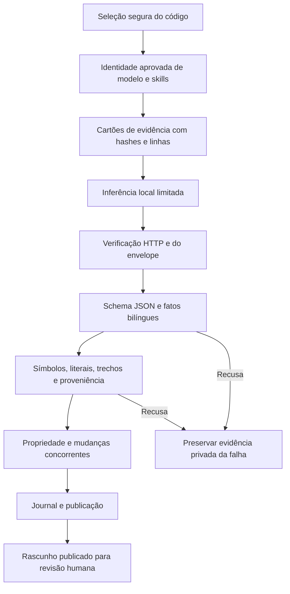

# Comando local de documentação: geração, avaliação e publicação

[Índice de treinamento](index.md) · [Arquitetura atual](../architecture/current-implementation.md)

<!-- reading-section: local-documentation-command-1 -->
## Estado operacional e escopo

MakeDocs utiliza o runtime Ollama local e recursos aprovados do agente. Consegue adquirir código real, produzir rascunhos bilíngues avaliados e publicar na biblioteca e na documentação original. Sucesso operacional não comprova a qualidade desejada de redação. As saídas continuam sendo rascunhos sujeitos à revisão humana; a aceitação integral cabe ao proprietário. Este guia documenta comportamento do código, não nova execução ponta a ponta ou campanha de treinamento concluída.

O comando normal produz `guides/generated-source-summary.md` nos dois idiomas e blocos navegacionais gerenciados. Não reconstrói todos os capítulos de arquitetura, FAQ ou operação. Não apresente declarações selecionadas e limitadas como documentação completa do projeto. Tag de modelo, skill, inferência bem-sucedida ou artefatos acumulados de pesquisa não comprovam fine-tuning neural, novos pesos ou checkpoint de adapter aprovado.

<!-- reading-section: local-documentation-command-2 -->
## Um gerador normal, duas entradas

O frontend cadastra primeiro o projeto, sem inferência. A ação MakeDocs/atualização solicita ao `CatalogManagement` reconciliação da origem, workspace verificado e execução de `Documentation::Command`. As fases informam validação de propriedade, coleta de evidências, geração e publicação. O processo filho escreve na biblioteca e no destino preparado; o coordenador registra e conclui a entrega ao host antes de marcar a operação concluída.

A CLI normal utiliza o mesmo comando Ruby e publica snapshots do host diretamente após sucesso. Sempre selecione explicitamente o projeto desejado:

```sh
# Operação que escreve dados: execute somente com geração autorizada para o projeto.
docker compose exec -T backend make docs DOCS_ARGS='--project example-project'
```

Execute na raiz do checkout após startup gerenciado. `example-project` representa um cadastro existente. O caminho gerenciado não exige descoberta de vizinhos, criação manual do `docs/` original, novo bind mount Docker por projeto externo ou exclusão manual de estado. O helper legado de preparação de mounts permanece para compatibilidade; não é o procedimento normal de cadastro externo.

`backend/Makefile` também expõe uma implementação separada e optativa, `DOCS_WORKFLOW=project`. A ação normal do frontend não a seleciona. Sua existência não significa que o gerador padrão de resumos produz um livro inteiro; não troque fluxos nem afirme aceitação equivalente sem verificação explícita.

<!-- reading-section: local-documentation-command-3 -->
## Preparação de código e contexto

A referência cadastrada resolve no host, não a partir de `/app/backend`. A aquisição verifica identidade Git e do filesystem, copiando bytes permitidos para workspace privado limitado. Arquivos de código nunca são executados. Documentação existente é preparada para comparação de propriedade, não usada como substituta de evidência do código.

O chamador filtra extensões, locais excluídos e conteúdo com aparência de credenciais. A seleção automática começa com 6 KiB/quatro arquivos e pode expandir para 24 KiB se não encontrar evidência elegível inicial. Seleções explícitas usam caminho próprio limitado a 24 KiB/12 arquivos. São limites de seleção de contexto, não limites de aquisição nem comprovação de cobertura integral.

Para declarações Python automáticas, o helper AST existente identifica unidades chamáveis completas, símbolos qualificados e intervalos exatos. Uma unidade citada completa é limitada a 6.144 bytes; unidades maiores podem ser omitidas. O limite padrão é quatro fatos, configurável de um a cinco. A ordem das evidências elegíveis determina as unidades selecionadas. Interprete cobertura no nível efetivo: arquivos ou declarações selecionados não representam todo comportamento da aplicação.

<!-- reading-section: local-documentation-command-4 -->
## Recursos aprovados e inferência local

Defaults: modelo `llama3.2:3b`, endpoint `http://ollama:11434`, contexto `skills`, transporte `chat`, modo `declarations`, janela de 16.384 tokens e prazo de 1.800 segundos. O chamador compara identidade aprovada com manifesto de recuperação e tags Ollama antes e depois da inferência. Recursos ausentes ou digest divergente causam recusa; não há download automático de modelo nem fallback para nuvem.

O contexto normal vem exatamente de `agent/skills/evidence/SKILL.md`, `agent/skills/authoring/SKILL.md` e `agent/skills/review/SKILL.md`, com hashes de integridade. Quando disponíveis, extraem-se as seções inglesas de contexto. O diretório inteiro do agente, o corpus de aprendizado e utilitários opcionais de recuperação não entram automaticamente em toda requisição. Skills são contexto de prompt, não pesos neurais modificados.

As requisições usam opções determinísticas (`temperature: 0`, `seed: 42`) e JSON estruturado limitado. A geração Python automática com várias declarações faz requisições separadas vinculadas às evidências sob um prazo total, validando o resultado combinado. Cada uma usa orçamento de predição de 600 tokens; o construtor comum usa 1.800. Seed repetível não garante comportamento idêntico entre plataformas ou versões. `keep_alive: 0` libera o executor do modelo após a requisição; não exclui seus recursos.

<!-- reading-section: local-documentation-command-5 -->
## Portões de avaliação



O chamador verifica sucesso HTTP, UTF-8, conclusão, motivo de parada e identidade exata do modelo. Fatos estruturados devem referenciar IDs selecionados, hashes de origem, símbolos, linhas e trechos exatos. Schemas vinculam declarações a seus cartões. A avaliação também verifica estrutura bilíngue, cobertura selecionada quando exigida, frases completas, nomes declarados/chamados, literais citados, exceções e alegações suportadas de tipos/retornos. O rascunho final é renderizado somente após aceitar os fatos combinados.

São portões mecânicos e heurísticos. Podem rejeitar prosa útil ou aceitar prosa semanticamente enganosa. Riscos conhecidos incluem explicação errada de predicados de prefixo/sufixo, tradução indevida de literais, relação não sustentada entre citações e alegações, mistura de idiomas e cobertura incompleta. Passar não certifica completude factual, equivalência de tradução ou qualidade editorial. A prosa original não é truncada silenciosamente para fazer uma resposta inválida passar.

<!-- reading-section: local-documentation-command-6 -->
## Propriedade, no-op e recuperação

Uma impressão inclui versão do chamador, modelo/skills aprovados, parâmetros, evidências e destinos. Impressão e hashes próprios correspondentes permitem no-op sem nova inferência. Um no-op ainda pode exigir entrega pendente ao host; não permite ignorar seu status. Mudanças no código, skills, chamador, parâmetros ou saídas gerenciadas alteram essa decisão.

O comando possui somente seus resumos gerados e blocos de navegação marcados. Saída preexistente sem propriedade ou conteúdo próprio alterado é recusado. Texto manual ao redor dos blocos é preservado. Evidências retêm entradas, requisições, respostas, eventos, candidatos e versões anteriores. Um journal pendente por projeto registra o progresso; conclusão ou rollback verificados recuperam escritas interrompidas. Veja [operação e recuperação](../operations/runtime-and-recovery.md) antes das opções de recuperação.

Para projetos no host, outra verificação compara identidade/conteúdo atuais da origem e bases documentais originais. `docs/` é criado com segurança na primeira publicação. Escrita parcial na biblioteca/workspace ou entrega pendente não é sucesso completo. Remoção e recadastro preservam código/docs manuais, arquivam conteúdo elegível da biblioteca e mantêm propriedade/recuperação.

<!-- reading-section: local-documentation-command-7 -->
## Pesquisa opcional e qualidade

O modo normal de pesquisa é offline. Existem utilitários separados de pesquisa/recuperação/avaliação e overlay Compose opcional, mas sua existência não torna o chamador normal um sistema RAG universal. Usar esses fluxos, alterar prompts/skills/parâmetros ou executar campanha de qualidade exige escopo autorizado próprio. Preserve datasets, checkpoints, manifestos, aprendizado e arquivos de modelos existentes.

As correções recentes tratam aquisição/publicação, caminhos e aliases de caixa do host, disponibilidade do adapter, requisições limitadas por declaração Python, prazo compartilhado e preservação de fatos completos. Viabilizam operação; não comprovam qualidade desejada. Esta revisão usa redação técnica direta e não executa MakeDocs ou inferência.

Fontes: `backend/Makefile`, `backend/lib/documentation/command.rb` (`VERSION = 1.9.49`, `skill_context`, `infer`, `source_model_request`), `backend/lib/documentation/catalog_management.rb`, `backend/lib/documentation/host_filesystem.rb`, `tools/host_filesystem.py` e `backend/lib/documentation/python_structure.py`.
