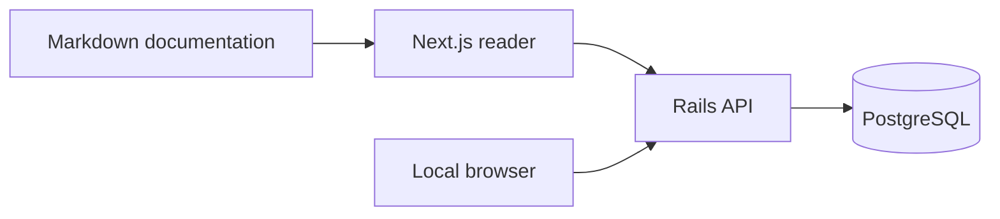
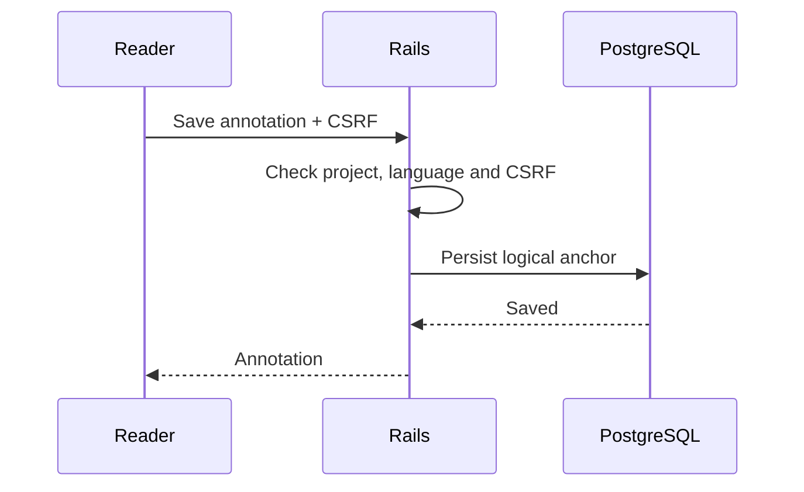

# IMG — Visual components

This guide works without seeds. Notes, colors and ribbons require manual selection or explicit demonstrations.

<!-- reading-section: img-01 -->

## Shared assets

`docs/img/` is the global asset library for all projects and languages.

```markdown


```

Use kebab-case names. The reader resolves /img/ through /api/shared-assets/; /assets/ serves existing public resources. Avoid document-dependent relative paths. Alt text describes the content; captions are italic paragraphs after the image, not special metadata.


*The book interface writer, reused without duplication.*


*Shared persistence, shared SVG with an accessible label.*


<!-- reading-section: img-02 -->

## Mermaid



Markdown remains the source of truth; PostgreSQL stores annotations and metadata. Ollama/RAG are planned, not active services in this diagram.



<!-- reading-section: img-03 -->

## Tables and code

| Component | Storage |
|---|---|
| Documentation | Markdown |
| Annotations | PostgreSQL |

The following table combines width, long cells and many rows to inspect scrolling and continuation.

| Case | Source | Ownership | Language | Position | Content | Expected behavior | Recovery |
|---|---|---|---|---|---|---|---|
| 1 | Markdown logical block | Shared PostgreSQL | en | Stable anchor | A deliberately long description preserves context across responsive layout changes and reader pagination | Scroll horizontally and expand the complete table | Keep the original source intact |
| 2 | Markdown logical block | Shared PostgreSQL | en | Stable anchor | A deliberately long description preserves context across responsive layout changes and reader pagination | Scroll horizontally and expand the complete table | Keep the original source intact |
| 3 | Markdown logical block | Shared PostgreSQL | en | Stable anchor | A deliberately long description preserves context across responsive layout changes and reader pagination | Scroll horizontally and expand the complete table | Keep the original source intact |
| 4 | Markdown logical block | Shared PostgreSQL | en | Stable anchor | A deliberately long description preserves context across responsive layout changes and reader pagination | Scroll horizontally and expand the complete table | Keep the original source intact |
| 5 | Markdown logical block | Shared PostgreSQL | en | Stable anchor | A deliberately long description preserves context across responsive layout changes and reader pagination | Scroll horizontally and expand the complete table | Keep the original source intact |
| 6 | Markdown logical block | Shared PostgreSQL | en | Stable anchor | A deliberately long description preserves context across responsive layout changes and reader pagination | Scroll horizontally and expand the complete table | Keep the original source intact |
| 7 | Markdown logical block | Shared PostgreSQL | en | Stable anchor | A deliberately long description preserves context across responsive layout changes and reader pagination | Scroll horizontally and expand the complete table | Keep the original source intact |
| 8 | Markdown logical block | Shared PostgreSQL | en | Stable anchor | A deliberately long description preserves context across responsive layout changes and reader pagination | Scroll horizontally and expand the complete table | Keep the original source intact |
| 9 | Markdown logical block | Shared PostgreSQL | en | Stable anchor | A deliberately long description preserves context across responsive layout changes and reader pagination | Scroll horizontally and expand the complete table | Keep the original source intact |
| 10 | Markdown logical block | Shared PostgreSQL | en | Stable anchor | A deliberately long description preserves context across responsive layout changes and reader pagination | Scroll horizontally and expand the complete table | Keep the original source intact |
| 11 | Markdown logical block | Shared PostgreSQL | en | Stable anchor | A deliberately long description preserves context across responsive layout changes and reader pagination | Scroll horizontally and expand the complete table | Keep the original source intact |
| 12 | Markdown logical block | Shared PostgreSQL | en | Stable anchor | A deliberately long description preserves context across responsive layout changes and reader pagination | Scroll horizontally and expand the complete table | Keep the original source intact |
| 13 | Markdown logical block | Shared PostgreSQL | en | Stable anchor | A deliberately long description preserves context across responsive layout changes and reader pagination | Scroll horizontally and expand the complete table | Keep the original source intact |
| 14 | Markdown logical block | Shared PostgreSQL | en | Stable anchor | A deliberately long description preserves context across responsive layout changes and reader pagination | Scroll horizontally and expand the complete table | Keep the original source intact |
| 15 | Markdown logical block | Shared PostgreSQL | en | Stable anchor | A deliberately long description preserves context across responsive layout changes and reader pagination | Scroll horizontally and expand the complete table | Keep the original source intact |
| 16 | Markdown logical block | Shared PostgreSQL | en | Stable anchor | A deliberately long description preserves context across responsive layout changes and reader pagination | Scroll horizontally and expand the complete table | Keep the original source intact |
| 17 | Markdown logical block | Shared PostgreSQL | en | Stable anchor | A deliberately long description preserves context across responsive layout changes and reader pagination | Scroll horizontally and expand the complete table | Keep the original source intact |
| 18 | Markdown logical block | Shared PostgreSQL | en | Stable anchor | A deliberately long description preserves context across responsive layout changes and reader pagination | Scroll horizontally and expand the complete table | Keep the original source intact |
| 19 | Markdown logical block | Shared PostgreSQL | en | Stable anchor | A deliberately long description preserves context across responsive layout changes and reader pagination | Scroll horizontally and expand the complete table | Keep the original source intact |
| 20 | Markdown logical block | Shared PostgreSQL | en | Stable anchor | A deliberately long description preserves context across responsive layout changes and reader pagination | Scroll horizontally and expand the complete table | Keep the original source intact |
| 21 | Markdown logical block | Shared PostgreSQL | en | Stable anchor | A deliberately long description preserves context across responsive layout changes and reader pagination | Scroll horizontally and expand the complete table | Keep the original source intact |
| 22 | Markdown logical block | Shared PostgreSQL | en | Stable anchor | A deliberately long description preserves context across responsive layout changes and reader pagination | Scroll horizontally and expand the complete table | Keep the original source intact |
| 23 | Markdown logical block | Shared PostgreSQL | en | Stable anchor | A deliberately long description preserves context across responsive layout changes and reader pagination | Scroll horizontally and expand the complete table | Keep the original source intact |
| 24 | Markdown logical block | Shared PostgreSQL | en | Stable anchor | A deliberately long description preserves context across responsive layout changes and reader pagination | Scroll horizontally and expand the complete table | Keep the original source intact |
| 25 | Markdown logical block | Shared PostgreSQL | en | Stable anchor | A deliberately long description preserves context across responsive layout changes and reader pagination | Scroll horizontally and expand the complete table | Keep the original source intact |
| 26 | Markdown logical block | Shared PostgreSQL | en | Stable anchor | A deliberately long description preserves context across responsive layout changes and reader pagination | Scroll horizontally and expand the complete table | Keep the original source intact |
| 27 | Markdown logical block | Shared PostgreSQL | en | Stable anchor | A deliberately long description preserves context across responsive layout changes and reader pagination | Scroll horizontally and expand the complete table | Keep the original source intact |
| 28 | Markdown logical block | Shared PostgreSQL | en | Stable anchor | A deliberately long description preserves context across responsive layout changes and reader pagination | Scroll horizontally and expand the complete table | Keep the original source intact |
| 29 | Markdown logical block | Shared PostgreSQL | en | Stable anchor | A deliberately long description preserves context across responsive layout changes and reader pagination | Scroll horizontally and expand the complete table | Keep the original source intact |
| 30 | Markdown logical block | Shared PostgreSQL | en | Stable anchor | A deliberately long description preserves context across responsive layout changes and reader pagination | Scroll horizontally and expand the complete table | Keep the original source intact |
| 31 | Markdown logical block | Shared PostgreSQL | en | Stable anchor | A deliberately long description preserves context across responsive layout changes and reader pagination | Scroll horizontally and expand the complete table | Keep the original source intact |
| 32 | Markdown logical block | Shared PostgreSQL | en | Stable anchor | A deliberately long description preserves context across responsive layout changes and reader pagination | Scroll horizontally and expand the complete table | Keep the original source intact |
| 33 | Markdown logical block | Shared PostgreSQL | en | Stable anchor | A deliberately long description preserves context across responsive layout changes and reader pagination | Scroll horizontally and expand the complete table | Keep the original source intact |
| 34 | Markdown logical block | Shared PostgreSQL | en | Stable anchor | A deliberately long description preserves context across responsive layout changes and reader pagination | Scroll horizontally and expand the complete table | Keep the original source intact |
| 35 | Markdown logical block | Shared PostgreSQL | en | Stable anchor | A deliberately long description preserves context across responsive layout changes and reader pagination | Scroll horizontally and expand the complete table | Keep the original source intact |

```typescript
const anchor = { block: 'logical-content-id', start: 0, end: 12 };
// Illustrative syntax only; actual seeds derive anchors from the rendered document.
```

<!-- reading-section: img-04 -->

## Interactions and common errors

Tables retain existing controls: drag horizontally and expand using the lower button. Rows continue across leaves with repeated headers. Images fit the leaf; the lower button opens the viewer with zoom, pan and Escape. An unavailable image uses the existing fallback. Check format, extension, URL and network before diagnosing a reader failure. The badge above is a remote GIF; animation depends on the source file.

Select prose to highlight in yellow, blue, pink, orange, purple, red or green. Create a note from the highlight; removing its color preserves the note and indicator. Color filters exclude notes without color. Bookmarks save logical positions; the ribbon removes them. The Chapter Index uses the canonical contents; search is scoped to project and language. Language switching preserves navigation while annotations stay isolated. Arrows turn leaves; physical pagination changes with viewport. Authorized source references open disclosures with lines and syntax; arbitrary paths are prohibited.

See [development demonstrations](development-demos.md). Guide prose is distinct from persisted highlights.

[Shared IMG assets](../../../../../img/README.md)

Approved source reference: [Puma](../../../../../../backend/config/puma.rb).

Notes also accept the canonical `/img/` prefix; previews resolve it through the same safe route. Use HTTPS for external assets. Mermaid requires fences labeled `mermaid`; do not wrap the diagram in arbitrary HTML.
