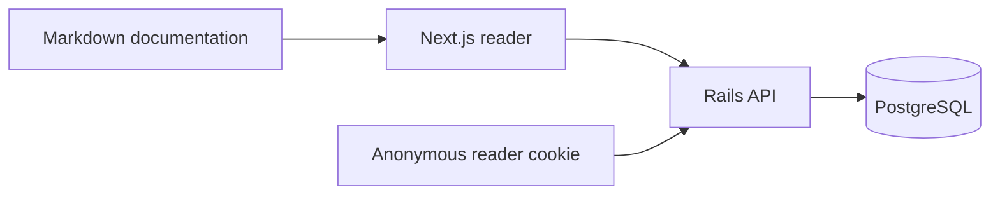
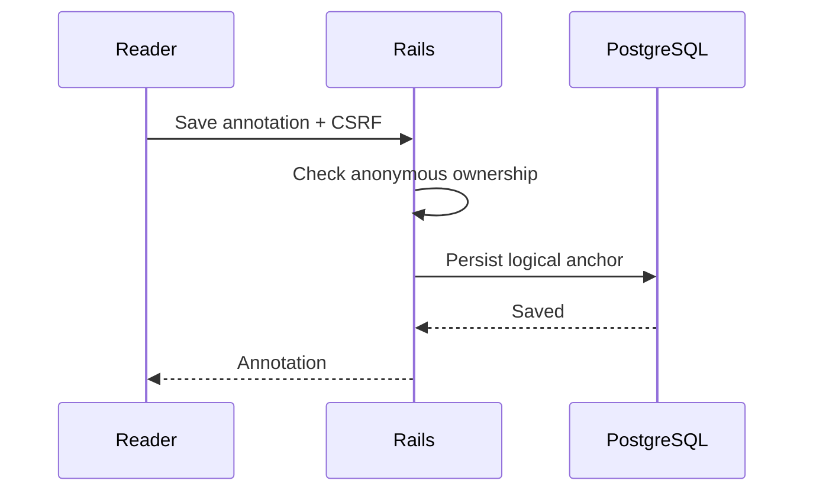

# IMG — Componentes visuais

Este guia funciona sem seeds. Notas, cores e fitas requerem seleção manual ou demonstrações explícitas.

<!-- reading-section: img-01 -->

## Recursos compartilhados

`docs/img/` é a biblioteca global de recursos de todos os projetos e idiomas.

```markdown


```

Use nomes em kebab-case. O leitor resolve /img/ via /api/shared-assets/; /assets/ serve recursos públicos existentes. Não use caminhos relativos dependentes do documento. Texto alternativo descreve o conteúdo; legendas são parágrafos em itálico após a imagem, não metadados especiais.


*Escritor da interface do livro, reutilizado sem duplicação.*


*Persistência anônima, SVG compartilhado com rótulo acessível.*


<!-- reading-section: img-02 -->

## Mermaid



Markdown permanece fonte de verdade; PostgreSQL armazena anotações e metadados. Ollama/RAG são planejamento, não serviços ativos neste diagrama.



<!-- reading-section: img-03 -->

## Tabelas e código

| Component | Storage |
|---|---|
| Documentation | Markdown |
| Annotations | PostgreSQL |

A tabela seguinte combina largura, células longas e muitas linhas para inspecionar scrolling e continuação.

| Case | Source | Ownership | Language | Position | Content | Expected behavior | Recovery |
|---|---|---|---|---|---|---|---|
| 1 | Markdown logical block | Anonymous cookie | pt-BR | Stable anchor | A deliberately long description preserves context across responsive layout changes and reader pagination | Scroll horizontally and expand the complete table | Keep the original source intact |
| 2 | Markdown logical block | Anonymous cookie | pt-BR | Stable anchor | A deliberately long description preserves context across responsive layout changes and reader pagination | Scroll horizontally and expand the complete table | Keep the original source intact |
| 3 | Markdown logical block | Anonymous cookie | pt-BR | Stable anchor | A deliberately long description preserves context across responsive layout changes and reader pagination | Scroll horizontally and expand the complete table | Keep the original source intact |
| 4 | Markdown logical block | Anonymous cookie | pt-BR | Stable anchor | A deliberately long description preserves context across responsive layout changes and reader pagination | Scroll horizontally and expand the complete table | Keep the original source intact |
| 5 | Markdown logical block | Anonymous cookie | pt-BR | Stable anchor | A deliberately long description preserves context across responsive layout changes and reader pagination | Scroll horizontally and expand the complete table | Keep the original source intact |
| 6 | Markdown logical block | Anonymous cookie | pt-BR | Stable anchor | A deliberately long description preserves context across responsive layout changes and reader pagination | Scroll horizontally and expand the complete table | Keep the original source intact |
| 7 | Markdown logical block | Anonymous cookie | pt-BR | Stable anchor | A deliberately long description preserves context across responsive layout changes and reader pagination | Scroll horizontally and expand the complete table | Keep the original source intact |
| 8 | Markdown logical block | Anonymous cookie | pt-BR | Stable anchor | A deliberately long description preserves context across responsive layout changes and reader pagination | Scroll horizontally and expand the complete table | Keep the original source intact |
| 9 | Markdown logical block | Anonymous cookie | pt-BR | Stable anchor | A deliberately long description preserves context across responsive layout changes and reader pagination | Scroll horizontally and expand the complete table | Keep the original source intact |
| 10 | Markdown logical block | Anonymous cookie | pt-BR | Stable anchor | A deliberately long description preserves context across responsive layout changes and reader pagination | Scroll horizontally and expand the complete table | Keep the original source intact |
| 11 | Markdown logical block | Anonymous cookie | pt-BR | Stable anchor | A deliberately long description preserves context across responsive layout changes and reader pagination | Scroll horizontally and expand the complete table | Keep the original source intact |
| 12 | Markdown logical block | Anonymous cookie | pt-BR | Stable anchor | A deliberately long description preserves context across responsive layout changes and reader pagination | Scroll horizontally and expand the complete table | Keep the original source intact |
| 13 | Markdown logical block | Anonymous cookie | pt-BR | Stable anchor | A deliberately long description preserves context across responsive layout changes and reader pagination | Scroll horizontally and expand the complete table | Keep the original source intact |
| 14 | Markdown logical block | Anonymous cookie | pt-BR | Stable anchor | A deliberately long description preserves context across responsive layout changes and reader pagination | Scroll horizontally and expand the complete table | Keep the original source intact |
| 15 | Markdown logical block | Anonymous cookie | pt-BR | Stable anchor | A deliberately long description preserves context across responsive layout changes and reader pagination | Scroll horizontally and expand the complete table | Keep the original source intact |
| 16 | Markdown logical block | Anonymous cookie | pt-BR | Stable anchor | A deliberately long description preserves context across responsive layout changes and reader pagination | Scroll horizontally and expand the complete table | Keep the original source intact |
| 17 | Markdown logical block | Anonymous cookie | pt-BR | Stable anchor | A deliberately long description preserves context across responsive layout changes and reader pagination | Scroll horizontally and expand the complete table | Keep the original source intact |
| 18 | Markdown logical block | Anonymous cookie | pt-BR | Stable anchor | A deliberately long description preserves context across responsive layout changes and reader pagination | Scroll horizontally and expand the complete table | Keep the original source intact |
| 19 | Markdown logical block | Anonymous cookie | pt-BR | Stable anchor | A deliberately long description preserves context across responsive layout changes and reader pagination | Scroll horizontally and expand the complete table | Keep the original source intact |
| 20 | Markdown logical block | Anonymous cookie | pt-BR | Stable anchor | A deliberately long description preserves context across responsive layout changes and reader pagination | Scroll horizontally and expand the complete table | Keep the original source intact |
| 21 | Markdown logical block | Anonymous cookie | pt-BR | Stable anchor | A deliberately long description preserves context across responsive layout changes and reader pagination | Scroll horizontally and expand the complete table | Keep the original source intact |
| 22 | Markdown logical block | Anonymous cookie | pt-BR | Stable anchor | A deliberately long description preserves context across responsive layout changes and reader pagination | Scroll horizontally and expand the complete table | Keep the original source intact |
| 23 | Markdown logical block | Anonymous cookie | pt-BR | Stable anchor | A deliberately long description preserves context across responsive layout changes and reader pagination | Scroll horizontally and expand the complete table | Keep the original source intact |
| 24 | Markdown logical block | Anonymous cookie | pt-BR | Stable anchor | A deliberately long description preserves context across responsive layout changes and reader pagination | Scroll horizontally and expand the complete table | Keep the original source intact |
| 25 | Markdown logical block | Anonymous cookie | pt-BR | Stable anchor | A deliberately long description preserves context across responsive layout changes and reader pagination | Scroll horizontally and expand the complete table | Keep the original source intact |
| 26 | Markdown logical block | Anonymous cookie | pt-BR | Stable anchor | A deliberately long description preserves context across responsive layout changes and reader pagination | Scroll horizontally and expand the complete table | Keep the original source intact |
| 27 | Markdown logical block | Anonymous cookie | pt-BR | Stable anchor | A deliberately long description preserves context across responsive layout changes and reader pagination | Scroll horizontally and expand the complete table | Keep the original source intact |
| 28 | Markdown logical block | Anonymous cookie | pt-BR | Stable anchor | A deliberately long description preserves context across responsive layout changes and reader pagination | Scroll horizontally and expand the complete table | Keep the original source intact |
| 29 | Markdown logical block | Anonymous cookie | pt-BR | Stable anchor | A deliberately long description preserves context across responsive layout changes and reader pagination | Scroll horizontally and expand the complete table | Keep the original source intact |
| 30 | Markdown logical block | Anonymous cookie | pt-BR | Stable anchor | A deliberately long description preserves context across responsive layout changes and reader pagination | Scroll horizontally and expand the complete table | Keep the original source intact |
| 31 | Markdown logical block | Anonymous cookie | pt-BR | Stable anchor | A deliberately long description preserves context across responsive layout changes and reader pagination | Scroll horizontally and expand the complete table | Keep the original source intact |
| 32 | Markdown logical block | Anonymous cookie | pt-BR | Stable anchor | A deliberately long description preserves context across responsive layout changes and reader pagination | Scroll horizontally and expand the complete table | Keep the original source intact |
| 33 | Markdown logical block | Anonymous cookie | pt-BR | Stable anchor | A deliberately long description preserves context across responsive layout changes and reader pagination | Scroll horizontally and expand the complete table | Keep the original source intact |
| 34 | Markdown logical block | Anonymous cookie | pt-BR | Stable anchor | A deliberately long description preserves context across responsive layout changes and reader pagination | Scroll horizontally and expand the complete table | Keep the original source intact |
| 35 | Markdown logical block | Anonymous cookie | pt-BR | Stable anchor | A deliberately long description preserves context across responsive layout changes and reader pagination | Scroll horizontally and expand the complete table | Keep the original source intact |

```typescript
const anchor = { block: 'logical-content-id', start: 0, end: 12 };
// Illustrative syntax only; actual seeds derive anchors from the rendered document.
```

<!-- reading-section: img-04 -->

## Interações e erros comuns

Tabelas mantêm controles existentes: arraste horizontalmente e amplie no botão inferior. Linhas continuam nas folhas seguintes com cabeçalho repetido. Imagens ajustam-se à folha; o botão inferior abre o visualizador com zoom, arraste e Escape. Uma imagem indisponível mostra o fallback existente. Confira formato, extensão, URL e rede antes de diagnosticar um erro do leitor. O badge acima é um GIF remoto; animação depende do arquivo original.

Selecione prosa para marcar em amarelo, azul, rosa, laranja, roxo, vermelho ou verde. Adicione uma nota pelo destaque; remover a cor preserva a nota e seu indicador. Filtros de cor não incluem notas sem cor. Marcadores salvam posições lógicas; a fita permite removê-los. O Índice de capítulos usa o mesmo sumário canônico; pesquisa é limitada ao projeto e idioma. A troca de idioma preserva navegação, mantendo anotações isoladas. Setas viram folhas; a posição física é recalculada conforme a tela. Referências de código autorizadas abrem disclosures com linhas e sintaxe; caminhos arbitrários não são permitidos.

Consulte [demonstrações](development-demos.md). Não confunda prosa deste guia com destaques persistidos.

[Shared IMG assets](../../../../../img/README.md)

Referência de código autorizada: [Puma](../../../../../../backend/config/puma.rb).

Notas também aceitam o prefixo canônico `/img/`; o preview o resolve pela mesma rota segura. Use HTTPS para recursos externos. Mermaid requer fences com a linguagem `mermaid`; não envolva o diagrama em HTML arbitrário.
