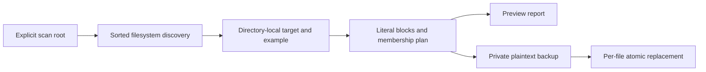

# Implementation study and operational boundaries

Static review: 2026-10-18, revision `000949ff926fcc71428855193a2a029520f7e887`. Intended for developers maintaining literal environment examples across local checkouts. This independent CLI has no HTTP, broker, database or mobile integration. Install Python 3.10+ and keep the script at its intended location; relocation changes its implicit root. Prefer an explicit positional `root` in normal use: `python3 scripts/audit-envs.py <root> --dry-run` previews that scope. See the [README](../../../README.md) for exact commands and exit codes and [recovery guide](../operations/recovery-and-evidence.md) before writes.

## Trace one key

Read `scripts/audit-envs.py`: `resolve_root` → `discover` → directory-local reference matching → `parse` → `plan` → `run`. `Document.raw` preserves input bytes; ordered `(key, block)` entries preserve comments, quotations and permitted duplicate target assignments. The example defines key membership, not value correctness. Variant examples override base examples for corresponding targets. Missing keys copy literal example assignments; obsolete target blocks are removed. Nothing is evaluated as shell code.

Discovery does not use Git ignore rules and is not a repository transaction. Its exact directory exclusions prevent common dependency/build traversal, but arbitrary application storage is not automatically safe. Do not point it at unrelated/private workspaces. This documentation review inspected source and synthetic test definitions only; it did not invoke the CLI against environment files.

## Failure, security and cost

`os.replace` follows a same-directory flushed/fsynced temporary file. Backup failure prevents replacement; later pair failures do not roll back earlier successes. Directory fsync, file locking, concurrent-writer detection, ownership/ACL preservation and encrypted backup retention are absent. Link checks reduce accidental traversal but have filesystem race windows. Backups are plaintext (0700 directories, 0600 files); key/path-only terminal output does not make backup content non-sensitive.

Sorted discovery costs depend on entries; parsing depends on bytes. Ordered appending uses membership in the `added` list, potentially quadratic for many missing keys. This is code analysis, not measurement. A set alongside the list could improve membership without losing order; no implementation change was made. A dictionary-only parser would lose representation details. A dotenv interpreter would support different semantics and must not be treated as a drop-in equivalent.

## Interview rehearsal

**Introductory — Does preview prove the application will start?** No. It calculates the same structural plan without backups/writes, but does not validate application-required values, dependencies or future write permissions. Follow-up: a difference alone exits successfully; distinguish handled errors from proposed changes using the documented exit contract.

**Intermediate — Why not roll back every file on failure?** Current atomicity is one replacement. A workspace rollback would need durable coordination and conflict detection to avoid overwriting later edits. Follow-up: restore an exact backup only after comparing concurrent changes; automatic bulk rollback is not implemented.

**Challenging — What evidence would establish crash safety?** Existing temporary-fixture tests cover parse/plan, preview, backup permissions and injected failures. They do not establish power-loss durability, adversarial filesystem safety or multi-writer correctness. Follow-up: separately designed crash/concurrency experiments and a directory-sync/locking protocol would be needed; neither was executed here.

Read [implementation decisions](../architecture/implementation-review.md), [filesystem boundaries](../security/filesystem-boundaries.md) and [historical verification](../testing/verification.md). These project explanations stand alone; the Library offers additional interview comparisons.
