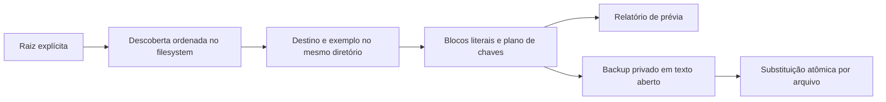

# Estudo da implementação e limites operacionais

Revisão estática: 2026-10-18, revisão `000949ff926fcc71428855193a2a029520f7e887`. Destina-se a desenvolvedores que mantêm exemplos literais de configuração em checkouts locais. Esta CLI independente não possui integração HTTP, broker, banco ou aplicativo móvel. Instale Python 3.10+ e mantenha o script no local previsto; movê-lo altera a raiz implícita. Prefira o argumento posicional `root` explícito: `python3 scripts/audit-envs.py <root> --dry-run` mostra a prévia desse escopo. Consulte o [README](../../../README.pt-BR.md) para comandos e códigos de saída e o [guia de recuperação](../operations/recovery-and-evidence.md) antes de escrever.

## Acompanhe uma chave

Leia `scripts/audit-envs.py`: `resolve_root` → `discover` → associação local de referências → `parse` → `plan` → `run`. `Document.raw` preserva bytes; entradas ordenadas `(key, block)` preservam comentários, aspas e atribuições duplicadas permitidas no destino. O exemplo define o conjunto de chaves, não a correção dos valores. Exemplos de variantes têm precedência sobre o exemplo base para os respectivos destinos. Chaves ausentes copiam atribuições literais; blocos obsoletos são removidos. Nada é avaliado como shell.

A descoberta não usa regras de ignore do Git nem constitui transação entre repositórios. Exclusões exatas evitam dependências/builds comuns, mas não tornam seguro qualquer armazenamento da aplicação. Não aponte para outros workspaces privados. Esta revisão leu código e definições de testes sintéticos; não executou a CLI sobre arquivos de ambiente.

## Falhas, segurança e custo

`os.replace` sucede um temporário no mesmo diretório com flush/fsync. Falha no backup impede a substituição; erros posteriores não desfazem pares anteriores. Não há fsync do diretório, locks, detecção de escritores concorrentes, preservação de proprietário/ACL ou retenção criptografada. Verificações de links reduzem travessias acidentais, mas têm janelas de corrida. Backups são texto aberto (diretórios 0700, arquivos 0600); omitir valores do terminal não torna seu conteúdo não sensível.

O custo da descoberta ordenada depende das entradas; o parsing depende dos bytes. A inclusão ordenada consulta a lista `added`, podendo ser quadrática para muitas chaves ausentes. É análise de código, não medição. Um conjunto junto da lista poderia melhorar consultas sem perder ordem; não houve alteração de implementação. Um parser baseado apenas em dicionário perderia representação. Um interpretador dotenv teria outras semânticas e não seria substituto equivalente automático.

## Preparação para entrevista

**Introdutória — A prévia prova que a aplicação inicia?** Não. Calcula o mesmo plano estrutural sem backups/escritas, mas não valida valores exigidos pela aplicação, dependências ou permissões futuras. Aprofundamento: uma diferença isolada termina com sucesso; separe erros tratados de alterações propostas pelos códigos documentados.

**Intermediária — Por que não desfazer todos os arquivos após falha?** A atomicidade atual cobre uma substituição. Rollback do workspace exigiria coordenação durável e detecção de conflitos para não sobrescrever edições posteriores. Aprofundamento: restaure um backup exato somente após comparar mudanças concorrentes; rollback automático em lote não existe.

**Desafiadora — Qual evidência demonstraria segurança contra crashes?** Testes com fixtures temporárias cobrem parsing/plano, prévia, permissões e falhas injetadas. Não demonstram durabilidade em queda de energia, filesystem adversarial ou correção entre escritores. Aprofundamento: seriam necessários experimentos separados e protocolo de sincronização de diretório/locks; nada disso foi executado aqui.

Leia [decisões da implementação](../architecture/implementation-review.md), [limites de filesystem](../security/filesystem-boundaries.md) e [verificação histórica](../testing/verification.md). As explicações do projeto são autossuficientes; a Library oferece comparações adicionais para entrevistas.
