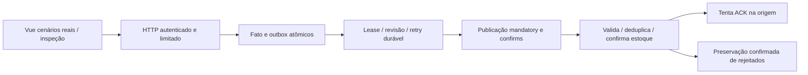

# Fluxos verificados e projetos independentes

Revisão estática: 2026-10-18. Não foi encontrada integração de runtime entre as cinco aplicações. Linguagens, Compose ou PostgreSQL comuns não estabelecem chamadas. Engineering Library lê documentação; não é dependência implantada. ENV Auditor pode inspecionar diretórios irmãos como entrada de filesystem, não serviço HTTP. Nenhum workspace privado foi acessado.

| Projeto | Chamador → receptor | Transporte e dados | Segurança / falhas |
| --- | --- | --- | --- |
| Go Image Optimizer | React → Next.js → Go | HTTP multipart na mesma origem, FormData reconstruído, metadados ou bytes | Sem token de identidade; BACKEND_URL no servidor; status propagado, falha proxy 502; retry repete trabalho |
| URL Shortener | Cliente → FastAPI → Redis/Cassandra | POST URL → INCR → INSERT; GET código → lookup Cassandra → 301 | Basic na criação, redirect público; ofuscação não é criptografia; sem transação conjunta, falhas esperadas 503 |
| Payment Lab | Angular → Spring → PostgreSQL | GET via proxy dev; DTO de consulta JPA em transação somente leitura | Allowlist GET, CORS configurado sem credenciais, demais rotas negadas; sem Stripe/webhook/pagamentos |
| Rust Event Relay | Vue → HTTP produtor → PostgreSQL → relay → RabbitMQ → consumidor → PostgreSQL | Intenção JSON fixa, fato/outbox atômicos, envelope AMQP, efeito/recibo atômicos e tentativa de ACK; GET de evidência | Bearer demo separado de replay/broker; resultados desconhecidos preservados; sem transporte exatamente uma vez |
| ENV Auditor | CLI → pares locais | Blocos literais, plano, backup privado e replace por arquivo | Sem shell/rede; falha por par pode deixar progresso parcial |

## Entrega Rust e fronteiras

Commit do consumidor independe da conclusão observada da outbox; envio local de ACK difere de recebimento pelo broker. Ações duplicadas reutilizam envelope e correlacionam evidência mantendo estoque 15. Rejeição antes do envio é comportamento real de política controlada, não indisponibilidade de infraestrutura. Playback crash/corrida/perda de ACK é ilustrativo; falhas reais pertencem a testes isolados. Inspeção HTTP não publica nem implica WebSocket.

O [dossiê Rust](../architecture/rust-event-relay.md) explica contratos, posse, retry, schemas e limites. Outros [dossiês](../architecture/workspace-catalog.md) detalham chamadas internas. [Revisões anteriores](../operations/historical-flow-reviews.md) preservam afirmações históricas de worker/consumidor/API ausentes; não descrevem o presente. Credenciais/broker não implicam criptografia da aplicação ou TLS de produção.
