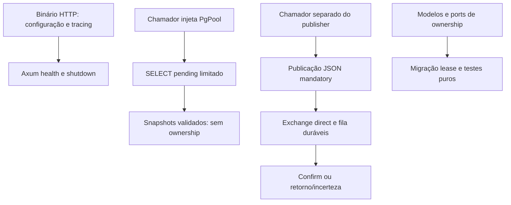

# Fluxos verificados e ausência de integrações

## Atualização de engenharia — Marco 2.5, 2026-10-12

O [worker Rust separado](../../../../rust-event-relay/docs/pt-BR/architecture/milestone-2-5.md) compõe configuração validada, tracing JSON, pool/repositório PostgreSQL dedicado e lifecycle RabbitMQ. [Scheduling da aplicação](../../../../rust-event-relay/backend/src/application/worker.rs) usa dispatch estático/dependências controladas; [composição](../../../../rust-event-relay/backend/src/bin/relay.rs) constrói infraestrutura concreta. Admite uma entrega por vez, sem tarefas criadas pelo worker, com token novo por invocação. NoEvent espaça uma chamada, sem provar backlog vazio. Apenas aceitação confirmada e conclusão Applied permitem próxima admissão imediata.

Lição geral: pacing entre invocações controla pressão operacional; não grava agenda durável de retry. Rust usa defaults de 1000 ms para idle/failure e 5000 ms para reconnect, preservando available_at/last_error/attempts. Eventos elegíveis inválidos/permanentemente falhos ainda podem obstruir progresso. Fairness, backoff/jitter, quarentena e DLQ exigem políticas/evidências próprias.

Lição geral: conexão inutilizável é fato de lifecycle, sem autorizar repetição de efeito anterior. Rust fecha/substitui após Unavailable/Uncertain ou canal sabidamente aposentado/desconectado, sem adquirir quando falta publisher usável. Serialization/Unroutable/Rejected preservam conexão usável. Reconectar não reconcilia aceitação passada. Aquisição incerta não fornece claim confirmado; conclusão incerta pode esconder processed. Sem compensação ou republicação do claim anterior.

Exemplo Rust concreto, abreviado do worker, com tipos dos ports existentes:

```rust
let request = AcquireRequest::new(config.lease); // token novo
let outcome = deliver_once(repository, publisher, request).await;
let action = decision(&outcome); // distingue publicação e conclusão
// Continue, Idle, Pace ou Replace; esperas devem disputar com shutdown.
```

Lição geral: shutdown compartilha budget finito. Primeiro interrompe admissão, permite drain, cancela ao expirar esse prazo e fecha publisher/pool com o mesmo deadline absoluto. Descartar future pode ocultar efeitos persistidos/aceitos; release cego de claim abandonado é inseguro. Defaults Rust: drain 15 s dentro de 25 s total; Supervisor 30 s por filho; Compose 65 s para grupos sequenciais. Timeout de aquisição do pool não limita consultas: statement/lock de sessão dedicada são 5 s/3 s, distintos das esperas de rede RabbitMQ e do lease durável de 60 s. Esses tempos não garantem lease ativo.

[Testes controlados](../../../../rust-event-relay/backend/tests/worker.rs) demonstram política; [composição real isolada](../../../../rust-event-relay/backend/tests/worker_smoke.rs) verifica entrega/conclusão e Supervisor individual/coletivo. Happy path não demonstra crash/recuperação. Migração compartilhada de posse continua pendente, autostart relay é false e /health prova liveness HTTP. Falha de configuração/setup encerra sanitizadamente; outage RabbitMQ em runtime reconecta explicitamente. Somente imagem/container app foram atualizados, preservando infraestrutura/dados compartilhados.

Referência transferível para futuras melhorias do Viva Bem: limitar admissão, separar construção de infraestrutura e scheduling, distinguir aceitação externa e conclusão durável, preservar incerteza/erros primários e de cleanup e planejar encerramento finito. Trata-se de referência futura; não se afirma que Viva Bem utiliza essa arquitetura, nem se descreve/modifica implementação privada. Interface gráfica opcional só após conclusão do núcleo, se houver necessidade operacional concreta. Próximo Rust: 2.6, experimentos integrados de crash/falha/recuperação e fechamento do marco; sem alegações de throughput/fairness/efeitos do consumidor ou at-least-once ponta a ponta.

Seções datadas preservam escopo histórico; status do worker é atualizado por esta seção.


## Caso de uso relay chamável — Marco 2.4

Aquisição → publicação do envelope original → completion agora existe como caso de uso Rust chamável. Completion exige aceitação confirmada. Falhas definitivas tentam release uma vez; Uncertain mantém lease. Resultados principal/cleanup são distintos; expiração e cancelamento podem gerar duplicatas na recuperação. Consulte [dossiê atual](../architecture/rust-event-relay.md). Não há worker, produtor/consumidor ou integração runtime entre projetos; revisões anteriores preservam escopo datado.


Os fluxos permanecem em projetos independentes. Não há relação API/evento entre repositórios estabelecida. Ausência de produtor/consumidor/pagamentos é fronteira explícita, não etapa omitida de um ecossistema funcional.

## Requisição de imagem no navegador

Usuário seleciona original no React. Configuração escolhe operação; Next.js recebe multipart na mesma origem, reconstrói FormData e envia ao Go. Go valida HTTP/form e conteúdo real, chama caso de uso e adapter da operação e retorna metadados ou bytes. Next.js encaminha status/conteúdo e cabeçalhos selecionados; UI guarda resultado, usa object URLs para exibição/download e separa preview fallback da saída. Nenhum token de autenticação ou registro persistente é criado. Exceção do proxy vira 502; validação/codec backend conserva status relevante. Retry inicia novo processamento; resultados temporários não são jobs duráveis.

## Criação e resolução de código curto

POST verifica Basic, valida HttpUrl, aloca ID Redis, codifica/ofusca e grava Cassandra. 201 só é emitido depois do retorno da gravação. Não há transação entre bancos: criação falha pode consumir ID ou deixar mapeamento incerto. GET público reverte sete caracteres, consulta Cassandra e retorna 301. GET não consulta Redis. Sintaxe/autenticação/ofuscação e TLS são fronteiras distintas; aplicação atual não configura TLS público. Código inspecionado não mostra outro projeto consumindo a API.

## Leitura de catálogo

Angular carrega `/products` e chama `/api/v1/products` pelo proxy dev. GET permitido pelo Spring alcança controller/serviço; transação read-only consulta estados visíveis no JPA e mapeia DTOs antes da serialização. PostgreSQL impõe constraints persistidas; Angular distingue loading/error/vazio/resultados e retry manual repete GET. Não participam provedor, assinatura, webhook, pedido ou job de conciliação. Falha genérica retorna 500 Problem Details; readiness testa conectividade do banco, não pagamento.

## Caminhos separados do relay



Não há setas de HTTP para leitor/publisher ou snapshot para publicação porque a composição atual não os liga. Publisher autentica no vhost, confirma aceitação e trata envio incerto sem retry automático. Não há efeito de consumidor implementado. Transação local futura de produtor/outbox, aquisição, publicação, completion e consumidor deduplicador formariam novo caminho com código/testes. UUID estável, mandatory e confirms não fornecem esse caminho nem provam efeitos exactly-once.

## Sincronização de filesystem

ENV Auditor descobre pares no mesmo diretório, interpreta blocos, calcula plano e apresenta prévia ou faz backup/substituição. Não troca payload HTTP/evento com aplicação. Mudanças de chaves podem afetar startup posterior, mas CLI não fornece verificação runtime ou orquestração. Continuação por arquivo e backups não criam transação de workspace.


## Marco 2.6 — Recuperação demonstrada, 2026-10-12

Experimentos Rust com PostgreSQL/RabbitMQ reais e processos próprios observaram pending após SIGKILL antes do envio e após confirmação; expiração real seguida de token novo/count 2 e processed. A segunda janela produziu duas mensagens com o ID original. Perder confirm AMQP deixou pending e Uncertain enquanto um observador independente já tinha a mensagem; o worker substituiu a conexão sem repetir o claim vivo. Perder resposta COMMIT de completion produziu CommitUncertain apesar de processed durável/count 1; reinício não adquiriu o evento.

Dois binários foram bloqueados em completion após publicar: tokens distintos duráveis e leases vivos sustentaram a afirmação de posse concorrente neste schedule. Owner antigo não concluiu/liberou após B adquirir; publisher anterior ainda conseguiu enviar. Banco protege autoridade de transição, não fencing externo. Rejeição/deadline SQL e cancelamento TERM preservaram pending recuperável; restauração/expiração/reinício concluíram. ACK do observador é só fixture, não efeito de negócio.

Esta evidência sustenta fechamento do escopo do Marco 2 como fundação pelo menos uma vez sob origem commitada, storage/contratos suportados, disponibilidade eventual, worker ativo e eventos válidos com falhas resolvíveis. Não prova entrega universal/exactly-once, fairness, ordenação, power loss, poison/rejeição permanente, contador esgotado ou HA/TLS produtivos. Rollout compartilhado permanece pendente/relay STOPPED. Próximo: decisões de retries duráveis/classificação/quarantine-dead-letter/replay auditável. Princípios são transferíveis sem alegar arquitetura privada de outro produto.

[Evidência e fronteiras](../../../../rust-event-relay/docs/pt-BR/architecture/milestone-2-6.md) | [Aceitação e premissas](../../../../rust-event-relay/docs/pt-BR/operations/milestone-2-review.md).

## Integração durável — Marco 3.3

[Decisões contextuais, jitter sem viés, pausas separadas, manutenção finita e cancelamento](../architecture/durable-failure-policy.md). Integração implementada e testada em infraestrutura isolada; rollout compartilhado permanece pendente. Descrições anteriores mantêm escopo histórico. Scanning geral fica em 3.4, replay em 3.5 e fechamento em 3.6.

## Rollout local autorizado do relay — 2026-10-13

Supervisão de processos e persistência do broker têm donos diferentes: parar publisher não para broker gerenciado separadamente. Health de dependência condiciona startup, sem substituir autenticação, pré-requisitos de schema ou recuperação runtime. autostart vale no início do manager; autorestart=unexpected recupera falhas não zero após RUNNING, enquanto stop intencional mantém parado até start explícito ou novo início do manager. Tentativas de startup são finitas; schema/artefatos ausentes podem exigir reparo. Migrations continuam ações explícitas, sem efeitos repetidos no startup.

Reliable Event Relay agora inicia http/relay automaticamente pelo Supervisor. Dependências service_healthy de PostgreSQL/RabbitMQ preservadas; management permanece localhost:15672. Publisher existente declara exchange/fila/binding duráveis após autenticação, sem mensagens de demonstração. Duas migrations locais pendentes de ownership/retry autorizadas explicitamente, revisadas contra SQL/estado e aplicadas ao outbox vazio; as quatro agora instaladas. Somente app reconstruído/recriado; banco/broker/frontend e dados/credenciais preservados.

Verificações compartilhadas executadas: management host/topologia autenticados, controle direto/interativo pelos dois aliases, stop intencional do relay preservando HTTP/management/metadados e contagens observadas zero, recuperação após saída inesperada de ambos. Filas vazias não demonstram persistência de payload não vazio; nenhuma mensagem inventada. Worker smoke isolado verifica autostart com configuração real e recursos de entrega próprios do teste. Simulações frontend e semântica 3.3 preservadas. Registros anteriores pendentes/parados são históricos; rollout local não prova prontidão produtiva ou fechamento de 3.4–3.6.

[Procedimento e evidência atuais do projeto](../../../../rust-event-relay/docs/pt-BR/operations/local-relay-rollout.md). Library somente documentação; sem mudanças no Viva Bem, credenciais, aplicação/dependências runtime ou deployment público. Sem staging/commit/push.
