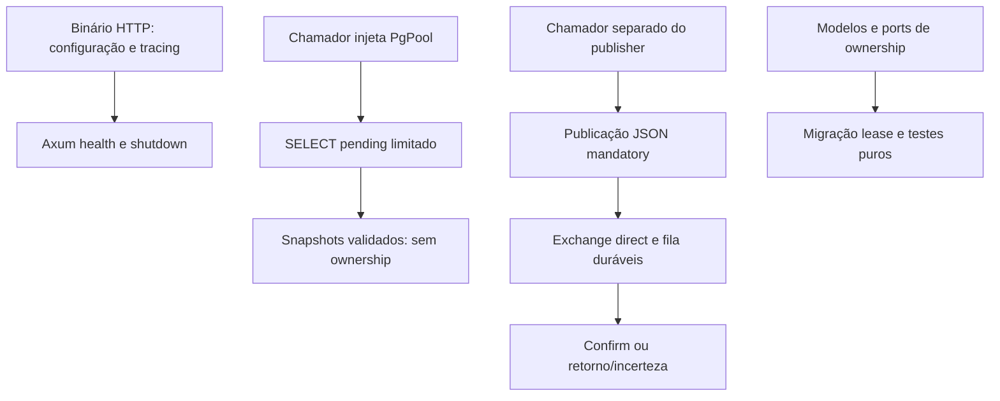

# Fluxos verificados e ausência de integrações

Os fluxos permanecem em projetos independentes. Não há relação API/evento entre repositórios estabelecida. Ausência de produtor/consumidor/pagamentos é fronteira explícita, não etapa omitida de um ecossistema funcional.

## Requisição de imagem no navegador

Usuário seleciona original no React. Configuração escolhe operação; Next.js recebe multipart na mesma origem, reconstrói FormData e envia ao Go. Go valida HTTP/form e conteúdo real, chama caso de uso e adapter da operação e retorna metadados ou bytes. Next.js encaminha status/conteúdo e cabeçalhos selecionados; UI guarda resultado, usa object URLs para exibição/download e separa preview fallback da saída. Nenhum token de autenticação ou registro persistente é criado. Exceção do proxy vira 502; validação/codec backend conserva status relevante. Retry inicia novo processamento; resultados temporários não são jobs duráveis.

## Criação e resolução de código curto

POST verifica Basic, valida HttpUrl, aloca ID Redis, codifica/ofusca e grava Cassandra. 201 só é emitido depois do retorno da gravação. Não há transação entre bancos: criação falha pode consumir ID ou deixar mapeamento incerto. GET público reverte sete caracteres, consulta Cassandra e retorna 301. GET não consulta Redis. Sintaxe/autenticação/ofuscação e TLS são fronteiras distintas; aplicação atual não configura TLS público. Código inspecionado não mostra outro projeto consumindo a API.

## Leitura de catálogo

Angular carrega `/products` e chama `/api/v1/products` pelo proxy dev. GET permitido pelo Spring alcança controller/serviço; transação read-only consulta estados visíveis no JPA e mapeia DTOs antes da serialização. PostgreSQL impõe constraints persistidas; Angular distingue loading/error/vazio/resultados e retry manual repete GET. Não participam provedor, assinatura, webhook, pedido ou job de conciliação. Falha genérica retorna 500 Problem Details; readiness testa conectividade do banco, não pagamento.

## Caminhos separados do relay

Não há setas de HTTP para leitor/publisher ou snapshot para publicação porque a composição atual não os liga. Publisher autentica no vhost, confirma aceitação e trata envio incerto sem retry automático. Não há efeito de consumidor implementado. Transação local futura de produtor/outbox, aquisição, publicação, completion e consumidor deduplicador formariam novo caminho com código/testes. UUID estável, mandatory e confirms não fornecem esse caminho nem provam efeitos exactly-once.

## Sincronização de filesystem

ENV Auditor descobre pares no mesmo diretório, interpreta blocos, calcula plano e apresenta prévia ou faz backup/substituição. Não troca payload HTTP/evento com aplicação. Mudanças de chaves podem afetar startup posterior, mas CLI não fornece verificação runtime ou orquestração. Continuação por arquivo e backups não criam transação de workspace.
