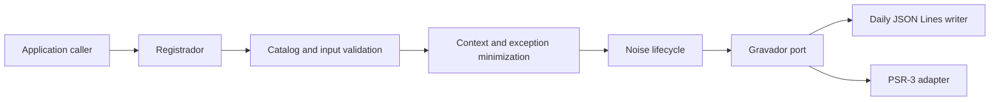

# Architecture and ownership

[Contents](../index.md) | [Português brasileiro](../../pt-br/architecture/overview.md)

Reviewed 2026-11-10. Audience: library maintainers and application integrators. Scope: the inspected PHP library, not installed consumer versions. A means source-inspected behavior; executed results are recorded in [verification](../testing/verification.md). This is a public-safe contract summary awaiting owner review.

<!-- reading-section: purpose -->
## Purpose and implemented boundary

TracePaw is a private Composer library for catalogued, structured operational events. It validates event definitions, contextual scalars and controlled tags, creates occurrence identities, and writes through an injected port. It does not contact Datadog: the inspected `src/` contains a daily-file writer and a PSR-3 adapter, with no HTTP exporter, Datadog agent client, Laravel provider, queue or database. Its name does not establish application adoption.

The package manifest is `composer.json`: `parceiro-vivabem/tracepaw-lib`, proprietary license, PHP `^8.2`, `ext-json`, `psr/log ^3.0`; development uses PHPUnit `^11.5`. PSR-4 maps `TracePaw\` to `src/`. There is no framework dependency. The checkout revision is recorded in the [README](../README.md); a consumer must separately verify its lockfile and deployed artifact.

<!-- reading-section: layers -->
## Layers and dependency direction

| Responsibility | Component | Contract |
| --- | --- | --- |
| Caller-facing orchestration | `src/Registrador.php`, `Registrador` | Resolve definition, validate inputs, sanitize, aggregate, dispatch |
| Application policy | `src/Aplicacao/Catalogo.php`, `Configuracao.php` | Approved event vocabulary and producer identity |
| Privacy and diagnostics | `SanitizadorContexto.php`, `DiagnosticoExcecao.php` | Minimize data before writer dispatch |
| Noise lifecycle | `AgregadorTransitorios.php`, `PoliticaRuido.php` | Bounded in-memory groups; default preserves events |
| Domain contract | `src/Dominio/Evento.php`, `DefinicaoEvento.php`, enums | Structured representation and event semantics |
| Output port | `src/Dominio/Gravador.php` | `gravar(Evento $evento): void` |
| Infrastructure | `src/Infraestrutura/` | JSON serialization, daily files, PSR-3 dispatch |

The separation follows Clean Architecture dependency inversion: the registrar depends on the domain `Gravador` interface rather than a concrete filesystem or PSR logger. Application code chooses the adapter. Domain value types do not import Laravel or a Datadog SDK. This reduces framework coupling but leaves deployment, collection, retention and delivery confirmation to the integrating application/operator. These are observed structural consequences, not a reconstructed ADR or an attributed approval history.

<!-- reading-section: flow -->
## Event flow and state ownership

`Registrador::registrar` resolves the event code before processing caller metadata. Invalid or unknown usage is rejected, not converted into a successful generic event. Producer identity comes from `Configuracao`; code, message, severity and classification come from `DefinicaoEvento`; arbitrary caller context cannot overwrite them. Tags may supplement defaults but cannot contradict them. The registrar creates UUID v4 and a UTC timestamp after identifier/tag validation, sanitizes approved context, then processes pending summaries before writing the current event.

Normal return is the current event ID after the writer returns. Eligible repetitions may return `null` after being counted rather than individually written. A writer's return proves only that adapter's contract: PSR-3 dispatch is not evidence of a remote delivery receipt. A pending-summary error can occur after the current event was written; see [reliability](../operations/reliability.md). There is no transaction across multiple records or business operations.

Each registrar owns its aggregator. Injected aggregators are cloned and their groups reset by `__clone`; separate instances/processes do not share suppression evidence. Configuration is immutable, but the registrar's aggregator maintains mutable process-local state. No database migration, distributed lock for aggregation, automatic scheduler or shutdown flush exists in the inspected implementation.

<!-- reading-section: adoption -->
## Integration status and maintenance

No database category or HTTP endpoint reference applies to this package. No Docker topology is declared by this library. No standalone ADR is invented for the observed layering. Review the API, privacy and reliability chapters whenever event contracts, adapter behavior, schemas or dependencies change. Maintainers own evidence refresh and bilingual updates; owner approval is an editorial step separate from test success.

Evidence: `composer.json`; `src/Registrador.php::{__construct,registrar,registrarDefinicao}`; `src/Dominio/Gravador.php`; all `src/Aplicacao/` and `src/Infraestrutura/` components named above. Static inspection does not certify production readiness, performance or live integrations.

## Current adoption — 2026-11-11

All three Laravel consumers use dependency `0.2.0` in manifests, lockfiles and local installed metadata, with channel `tracepaw` and the PSR/Monolog adapter. Node.js Hub does not install this PHP library. The internal writer requires empty/exclusive storage and marker `.tracepaw-lib-jsonl-v1`; Monolog does not use that marker. Deployment and remote publication remain unverified; earlier future-adoption references describe the historical scope of the isolated library review.
