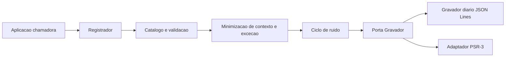

# Arquitetura e responsabilidades

[Sumário](../index.md) | [English](../../en/architecture/overview.md)

Revisado em 2026-11-10. Público: mantenedores da biblioteca e integradores. Escopo: biblioteca PHP inspecionada, sem presumir versões instaladas nos consumidores. A significa comportamento inspecionado no código; resultados executados constam na [verificação](../testing/verification.md). Síntese pública de contratos aguardando revisão do proprietário.

<!-- reading-section: purpose -->
## Objetivo e fronteira implementada

TracePaw é uma biblioteca Composer privada para eventos operacionais estruturados e catalogados. Valida definições, contexto escalar e tags controladas, cria identidades de ocorrência e grava por uma porta injetada. Não se conecta ao Datadog: `src/` contém gravador diário e adaptador PSR-3, sem exportador HTTP, cliente de agente Datadog, provider Laravel, fila ou banco. O nome não comprova adoção nas aplicações.

O manifesto `composer.json` declara `parceiro-vivabem/tracepaw-lib`, licença proprietária, PHP `^8.2`, `ext-json`, `psr/log ^3.0`; desenvolvimento utiliza PHPUnit `^11.5`. PSR-4 associa `TracePaw\` a `src/`. Não há dependência de framework. A revisão do checkout consta no [README](../README.md); consumidores precisam verificar separadamente lockfile e artefato implantado.

<!-- reading-section: layers -->
## Camadas e direção das dependências

| Responsabilidade | Componente | Contrato |
| --- | --- | --- |
| Orquestração pública | `src/Registrador.php`, `Registrador` | Resolver definição, validar, sanitizar, agregar e despachar |
| Política de aplicação | `src/Aplicacao/Catalogo.php`, `Configuracao.php` | Vocabulário aprovado e identidade do produtor |
| Privacidade e diagnóstico | `SanitizadorContexto.php`, `DiagnosticoExcecao.php` | Minimizar dados antes do despacho ao gravador |
| Ciclo de ruído | `AgregadorTransitorios.php`, `PoliticaRuido.php` | Grupos limitados em memória; padrão preserva eventos |
| Contrato de domínio | `src/Dominio/Evento.php`, `DefinicaoEvento.php`, enums | Representação estruturada e semântica |
| Porta de saída | `src/Dominio/Gravador.php` | `gravar(Evento $evento): void` |
| Infraestrutura | `src/Infraestrutura/` | JSON, arquivos diários e despacho PSR-3 |

A separação segue inversão de dependência da Clean Architecture: o registrador depende da interface de domínio `Gravador`, em vez de filesystem ou logger PSR concretos. A aplicação escolhe o adaptador. Os tipos de domínio não importam Laravel nem SDK Datadog. Isso reduz acoplamento ao framework e deixa implantação, coleta, retenção e confirmação de entrega para aplicação/operador. São consequências observadas da estrutura, sem reconstruir ADR ou atribuir histórico de aprovação.

<!-- reading-section: flow -->
## Fluxo e propriedade do estado

`Registrador::registrar` resolve o código antes de processar metadados do chamador. Uso inválido ou desconhecido é rejeitado, sem conversão em evento genérico bem-sucedido. A identidade vem de `Configuracao`; código, mensagem, severidade e classificação vêm de `DefinicaoEvento`; contexto arbitrário não os sobrescreve. Tags complementam padrões, sem contradizê-los. O registrador cria UUID v4 e timestamp UTC após validar identificadores/tags, sanitiza contexto aprovado e processa resumos pendentes antes do evento atual.

O retorno normal é o ID do evento atual após o gravador retornar. Repetições elegíveis podem retornar `null` após contabilização sem gravação individual. Retorno do gravador comprova apenas seu contrato: despacho PSR-3 não comprova recebimento remoto. Erro de resumo pendente pode ocorrer depois da gravação do evento atual; consultar [confiabilidade](../operations/reliability.md). Não há transação entre registros ou operações de negócio.

Cada registrador possui seu agregador. Agregadores injetados são clonados e têm grupos zerados por `__clone`; instâncias/processos separados não compartilham evidência de supressão. A configuração é imutável, mas o agregador mantém estado mutável local ao processo. Não há migração de banco, lock distribuído de agregação, agendador automático ou flush no encerramento na implementação inspecionada.

<!-- reading-section: adoption -->
## Estado da integração e manutenção

A adoção Laravel existe nos três consumidores via adaptadores PSR/Monolog, conforme a revisão atual abaixo. Isso não confirma implantação ou operação de produção. Resultado de logging não substitui resultado de negócio; `retry_scheduled` não comprova recuperação.

Banco de dados e endpoints HTTP não se aplicam ao pacote. A biblioteca não declara topologia Docker. Não se inventa ADR para o arranjo observado. Rever API, privacidade e confiabilidade quando contratos, adaptadores, schemas ou dependências mudarem. Mantenedores respondem pela atualização das evidências e dos idiomas; aprovação editorial do proprietário é separada do sucesso dos testes.

Evidências: `composer.json`; `src/Registrador.php::{__construct,registrar,registrarDefinicao}`; `src/Dominio/Gravador.php`; componentes de `src/Aplicacao/` e `src/Infraestrutura/` citados acima. Inspeção estática não certifica produção, desempenho ou integrações reais.

## Adoção atual — 11/11/2026

Os três consumidores Laravel usam a dependência `0.2.0` em declaração, lockfile e metadados instalados locais, com canal `tracepaw` e adaptador PSR/Monolog. O Hub Node.js não instala essa biblioteca PHP. O gravador interno exige diretório vazio/exclusivo e marcador `.tracepaw-lib-jsonl-v1`; Monolog não usa esse marcador. Implantação e publicação remota permanecem não verificadas; referências anteriores a adoção futura descrevem o escopo histórico da revisão isolada da biblioteca.
