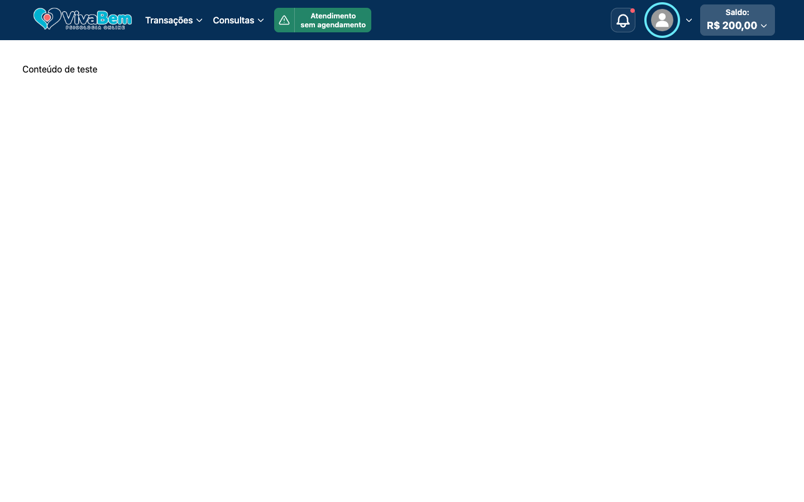
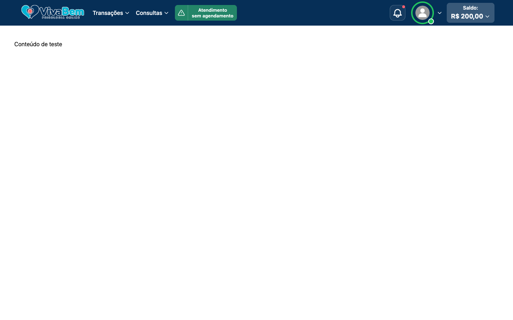

# Authenticated navbar

[Português (Brasil)](../../pt-br/architecture/authenticated-navbar.md)

The shared controls live in `resources/views/layouts/navigation.blade.php`; layout styles live in `public/css/pages/navigation/navigation.css`.

Below 1100 CSS px, the first row contains the logo, unscheduled consultation action and notification bell. The second contains Transactions, Appointments, profile and balance. At 1100 px and above, CSS orders the same controls into the existing desktop row. The breakpoint reserves space for the logo, readable labels and account controls instead of relying on Tailwind's 640 px breakpoint.

The DOM follows compact visual/keyboard order. Navigation menus are directly available at all widths; duplicated mobile menus and consultation controls were removed. Routes, permission branches, balance handlers and consultation/payment methods remain unchanged. The separate explanation button supports hover, focus, click, Escape and click outside; clicking it does not invoke consultation. Compact menus anchor to the bar; the explanation uses viewport insets, while overlays remain above page content.

At 320 px the logo is 96 px wide, the action label is 12 px on two lines and the explanation target is 24 by 44 px. The bell remains 44 by 44 px. Larger compact widths increase logo and label sizes. Long balances wrap inside their control without ellipsis; unusually long amounts can increase row height. Amounts are never shortened or clipped.

## Verification — 2026-10-18

Vite production build passed (existing browser-data freshness warnings). Blade directives compiled without component-tag expansion and the resulting PHP passed syntax lint, without application bootstrap. Chromium uses the real navbar and notification drawer markup rendered with fictional users for patient/professional variants. Component buttons/loading placeholders and data sources are substituted in the isolated fixture; every browser request is intercepted for local files. This does not verify authenticated sessions, real subscriptions, provider calls or backend integration.

The historical capture used `tests/browser/authenticated-navbar-fixture.php` and `tests/browser/authenticated-navbar.cjs`; these files are absent from the current checkout. This task did not recreate or run them. Any restored documentation-image generator must write to `docs/img/navbar-review/`. The dated results below are historical.

The matrix covers 320, 360, 375, 390, 414, 639, 640, 768, 820, 1024, 1099, 1100, 1440 and 1920 CSS px for both roles. Checks include control bounds/overlap, row placement, open menus/popover/drawer bounds, stable layout while opening, compact Tab order, explanation hover, a notification badge and a long fictional balance. The preserved screenshots now live in `docs/img/navbar-review/`. Native touch devices, browser zoom and other browser engines remain unverified. No database commands, financial operations, consultations, commits or deployments were executed.

Selected existing JavaScript suites passed: 27 tests covering call sound alerts and shared psychologist payment entry points. `git diff --check` passed.

Engineering Library PT/EN architecture summaries synchronized through the two expressly authorized Docker copies; byte comparison passed for both destination files.

## Documentation screenshots

The same Portuguese-language UI captures illustrate both language versions. They use fictional users and balances; filenames identify role, viewport and open-control state, not document language. Image bytes are preserved from the existing review.

All preserved captures:

- [patient-1024-long.webp](../../img/navbar-review/patient-1024-long.webp)
- [patient-1024.webp](../../img/navbar-review/patient-1024.webp)
- [patient-1440-asidedrawerwidth.webp](../../img/navbar-review/patient-1440-asidedrawerwidth.webp)
- [patient-1440-emergencytabletpopover.webp](../../img/navbar-review/patient-1440-emergencytabletpopover.webp)
- [patient-1440-long.webp](../../img/navbar-review/patient-1440-long.webp)
- [patient-1440-menuconsultas.webp](../../img/navbar-review/patient-1440-menuconsultas.webp)
- [patient-1440-menutransacoes.webp](../../img/navbar-review/patient-1440-menutransacoes.webp)
- [patient-1440-menuusuario.webp](../../img/navbar-review/patient-1440-menuusuario.webp)
- [patient-1440-saldohistoricodropdown.webp](../../img/navbar-review/patient-1440-saldohistoricodropdown.webp)
- [patient-1440.webp](../../img/navbar-review/patient-1440.webp)
- [patient-320-asidedrawerwidth.webp](../../img/navbar-review/patient-320-asidedrawerwidth.webp)
- [patient-320-emergencytabletpopover.webp](../../img/navbar-review/patient-320-emergencytabletpopover.webp)
- [patient-320-long.webp](../../img/navbar-review/patient-320-long.webp)
- [patient-320-menuconsultas.webp](../../img/navbar-review/patient-320-menuconsultas.webp)
- [patient-320-menutransacoes.webp](../../img/navbar-review/patient-320-menutransacoes.webp)
- [patient-320-menuusuario.webp](../../img/navbar-review/patient-320-menuusuario.webp)
- [patient-320-saldohistoricodropdown.webp](../../img/navbar-review/patient-320-saldohistoricodropdown.webp)
- [patient-320.webp](../../img/navbar-review/patient-320.webp)
- [patient-390-long.webp](../../img/navbar-review/patient-390-long.webp)
- [patient-390.webp](../../img/navbar-review/patient-390.webp)
- [patient-768-long.webp](../../img/navbar-review/patient-768-long.webp)
- [patient-768.webp](../../img/navbar-review/patient-768.webp)
- [professional-1024-long.webp](../../img/navbar-review/professional-1024-long.webp)
- [professional-1024.webp](../../img/navbar-review/professional-1024.webp)
- [professional-1440-long.webp](../../img/navbar-review/professional-1440-long.webp)
- [professional-1440.webp](../../img/navbar-review/professional-1440.webp)
- [professional-320-long.webp](../../img/navbar-review/professional-320-long.webp)
- [professional-320.webp](../../img/navbar-review/professional-320.webp)
- [professional-390-long.webp](../../img/navbar-review/professional-390-long.webp)
- [professional-390.webp](../../img/navbar-review/professional-390.webp)
- [professional-768-long.webp](../../img/navbar-review/professional-768-long.webp)
- [professional-768.webp](../../img/navbar-review/professional-768.webp)
