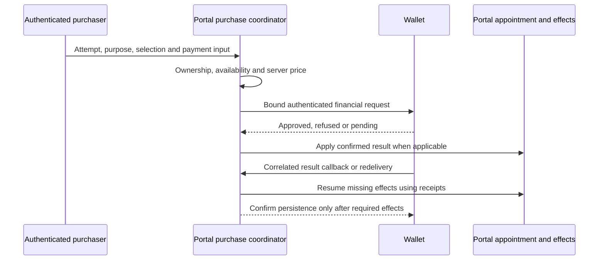

# Purchase orchestration, confirmation and recovery

Reviewed 2026-11-10. IMPLEMENTED means source-backed behavior, not deployed provider acceptance. This chapter describes the current purchase path; dated Stripe/refund reports remain HISTORICAL. No financial operation was executed during review.

<!-- reading-section: entry -->
## Entry, eligibility and amount

The authenticated `POST /transacoes/adicionar-saldo/submit` enters `ControladorTransacao::adicionarSaldoSubmit`, then `CasoDeUsoTransacao::comprarSaldoCredito`. Dispatch is purpose-specific: selected appointments use `CasoDeUsoCompraAtendimentoSelecionado`; emergency purchases use `CasoDeUsoCompraEmergencial`; ordinary top-ups use `CartoesSalvos::purchase`. These are separate coordinators, not one interchangeable purchase method. Legacy controller scheduling methods return HTTP 503 `financial_operations_unavailable`; their presence is not an active payment contract.

Validation binds an attempt UUID, supported purpose/method and bounded amount. Selected duration is 30–240 minutes. Pix rejects card token, method and saved-card fields; non-Pix rejects Pix-only intent fields. Card purchases require their applicable payment fields. The authenticated account supplies the owner and customer identity; the caller cannot select an arbitrary financial owner. Saved references must be usable in the configured environment.

Selected purchases reject self-purchase and require an email-verified professional. Participant locks and agenda queries check both participants. Reusing an intent requires matching owner, professional, duration and scheduled start. Scheduled starts must be future, within one year and aligned to ten-minute increments; immediate appointments require current availability. Price is derived from the stored hourly price in integer cents, with `intdiv(hourlyCents * duration + 30, 60)` rounding. A mismatching submitted price is rejected. The provisional appointment is `DESMARCADO`, not funded or ready for consultation.

<!-- reading-section: boundary -->
## Wallet boundary and provider responsibility

`ClienteHttpCarteiraDigital` permits configured Wallet paths, disallows request overrides, disables redirects and uses a bounded timeout. Its short-lived scoped JWT binds subject, body and path. Successful HTTP alone is insufficient: the expected JSON string wrapper must decrypt to a successful response with content. A malformed or unavailable response leaves confirmation uncertain.

Wallet owns provider submission, financial transaction/balance persistence, idempotency and reconciliation. Portal owns appointment eligibility, local lifecycle and user effects. Portal does not turn a transport exception into a confirmed decline and must not submit a fresh payment merely because the first response was lost. The controller preserves expected 404/409/422 domain failures; unexpected failures return 503 with pending-confirmation guidance.

<!-- reading-section: confirmation -->
## Confirmation, correlation and local effects

`ResultadoCompraSaldoControlador` independently validates HS256 credentials, issuer/audience/scope, integer timestamps with a maximum 60-second window, subject/environment and body/path binding. Event, attempt, transaction and appointment identifiers serve different purposes; they must not be replaced by a guessed match on user/date/value. The callback applies an existing financial result; it does not create a provider charge.

Selected approval is applied under an attempt lock and SQL transaction, validating owner, appointment, amount, duration and transaction identity. Only first approval schedules the appointment. Cancelled/completed appointments are not reopened; immediate availability is checked again and expired scheduled starts are rejected. Confirmed insufficient balance can remove an unpaid provisional appointment; uncertainty is not that case.

SQL commit precedes Cofre link persistence, notifications and invalidation. Redis step receipts allow missing effects to resume. `CasoDeUsoAplicarResultadoCompraSaldo` uses an event lock, payload digest and independent pending/approved receipts, rejects conflicting amounts and prevents pending/refused events from regressing approval. Notification IDs remain stable. It invalidates cached balance and publishes `balance.updated` only after its preceding steps. These guards are not a distributed transaction or exactly-once delivery guarantee.

A financially approved result may remain pending to the caller when mandatory appointment effects fail; `payment_status` retains the financial result. Wallet `effects_pending` and Portal receipts represent delivery obligations, not a new authorization to charge. Callback persistence is not confirmed until required application succeeds. Recovery must reuse the original identities.

<!-- reading-section: pix -->
## Pix, emergency and compensation boundaries

Pix QR creation is not payment confirmation. `CasoDeUsoAplicarCompraAtendimentoPix` serializes application by appointment and checks owner/transaction. Missing emergency appointments can be created after approval; arbitrary missing selected appointments cannot. Cancelled, expired or conflicting unfulfilled appointments and recognized domain 409/422 failures may request conversion to balance. Technical exceptions remain pending; they are not blanket permission to convert every failed application. An already delivered consultation link must not be converted merely because a notification is late.

Emergency amount/duration come from configuration. Non-Pix emergency appointment identity must match the attempt; approved results trigger the emergency lifecycle. `CasoDeUsoCompraEmergencial::estornar` is limited to an approved, unconverted, cancelled, unassigned/not-accepted emergency. It calls Wallet before acquiring the local SQL lock so the callback can use its own connection, then verifies the persisted reversal marker under lock. Recovery scans eligible cancelled/unassigned records and continues after individual failures. This is not a promise that every external refund or bank transfer is implemented.

PARTIALLY IMPLEMENTED: Wallet has internal balance reversal/payment paths, while default external bank-transfer payout/refund dispatch rejects with `bank_transfer_unavailable`. Provider debit acceptance, real callback delivery, MySQL/Redis lock behavior, live scheduling and operational recovery remain UNVERIFIED by this offline review. No approved future executor design is inferred from an unavailable path.

<!-- reading-section: evidence -->
## Source evidence and maintenance

Portal sources: `routes/web.php`; `app/Http/Controllers/ControladorTransacao.php`; `app/Http/Controllers/ResultadoCompraSaldoControlador.php`; `app/Services/CartoesSalvos.php`; `app/Services/ClienteHttpCarteiraDigital.php`; `app/UseCases/CasoDeUsoTransacao.php`, `CasoDeUsoCompraAtendimentoSelecionado.php`, `CasoDeUsoCompraEmergencial.php`, `CasoDeUsoAplicarCompraAtendimentoPix.php`, `CasoDeUsoAplicarResultadoCompraSaldo.php`.

Wallet sources: `app/Http/Controllers/OperacaoFinanceiraControlador.php`; `app/UseCases/CasoDeUsoComprarAtendimentoSaldo.php`, `CasoDeUsoOperarOperacaoFinanceira.php`, `CasoDeUsoConcluirCompra.php`, `CasoDeUsoResultadoCompra.php`. Refresh both languages when dispatch, validation, receipts, status or provider contracts change. Existing offline tests do not exercise this complete cross-service sequence; see [testing](../operations/backend-testing.md).

<!-- reading-section: refund -->
## Appointment refund completion

`CasoDeUsoEstornoAtendimento` requires the requesting appointment owner, delegates the requested destination to Wallet and correlates status reads back to the appointment. Authorization derives the refundable amount from current appointment eligibility; it does not trust browser amount. Completion accepts only authenticated approved/refunded results, rechecks owner and amount under SQL lock, and persists `estorno_realizado` once. Cached balance, stable bell/push notifications and Hub invalidation follow commit. Delivery failure propagates so Wallet retains the same refund’s `effects_pending`; a notification failure must not repeat the credited amount. Explicit refused results have a separate notification path. Selected purchase pricing uses integer arithmetic, but this refund coordinator still contains float/round conversions: do not claim that every Portal money path is integer-only.
