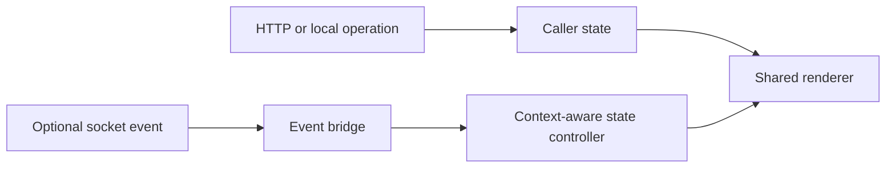

# Shared loading presentation and reliable asynchronous interfaces

[Architecture](index.md) · [Testing strategy](../operations/backend-testing.md#reactive-interface-testing-strategy) · [Português brasileiro](../../pt-br/architecture/shared-loading.md)

Reviewed on 2026-11-12. This chapter teaches general engineering patterns using synthetic examples. Snippets are illustrative contracts, not a copy of private application components or operational protocols. The public project entry already exists; no source snapshots, private endpoints or operational channel identifiers are added.

## Separate the renderer from the operation

A reusable Laravel Blade component should render the waiting state while the caller owns visibility and message state. Alpine.js connects those values to the DOM. Sharing the image, card and status text reduces drift across forms, lists and payment interfaces; sharing financial decisions would couple unrelated operations.

A renderer does not need to send HTTP, connect a socket, decide payment success or schedule recovery. A plain form can show loading with a CSS class; a reactive caller can use x-show. Real-time progress is optional input to an external controller. Changing x-text updates the text node without replacing the image, avoiding animation restart and unnecessary component recreation.



## Message and visibility contracts

Design a documented fallback for omitted, null, empty and whitespace-only messages. Static text must be escaped by Blade; reactive text should use x-text rather than HTML insertion. An illustrative caller could expose:

```html
<div x-data="{ waiting: false, message: 'Reading records…' }">
  <section x-show="waiting" x-cloak aria-label="Current operation">
    <p role="status" aria-live="polite" aria-atomic="true"
       x-text="String(message ?? '').trim() || 'Loading'"></p>
  </section>
</div>
```

This fragment demonstrates the binding, not a complete overlay API. Its message variable is declared. Nullish coalescing does not protect an undeclared identifier: an optional simple identifier needs a deliberate typeof guard, or the caller must declare it. Compound expressions require valid roots and explicit optional access where appropriate. Catching every expression error hides programming faults and weakens diagnosis.

Choose one visibility owner per instance. A class-based path can work before Alpine starts; an Alpine path should avoid an independently controlled hidden class. Distinct instances need distinct identifiers. Reopening should preserve image identity and display the most recent message, including updates made while hidden.

## Concurrent HTTP operations and DataTables

A single boolean cannot represent overlapping operations. If requests A and B both show the overlay, A finishing must not hide B's pending work. Model loading as ownership scoped to the actual DOM element. Each acquisition returns an idempotent release function; the last owner restores the initial visibility. Never let an old release close a newer operation.

Conceptual caller code, assuming an application-provided ownership helper:

```js
const release = acquireIndicator(element);
try {
  await readRecords();
} finally {
  release();
}
```

The helper and operation names are synthetic. An implementation can use a WeakMap of elements to token sets. Preserve an indicator that was already visible before the first acquisition. Direct class mutations outside the helper cannot automatically participate in its ownership guarantees.

For DataTables, acquire per request, not per generic draw event. Release on success, HTTP failure, abort, synchronous failure and destruction. Preserve existing beforeSend callbacks and transport configuration. A custom ajax function must expose a terminal callback or promise; an operation that never signals completion cannot be safely inferred complete. Abort owned requests on destroy, suppress late drawing after disposal and avoid duplicate bindings on reinitialization. Multiple tables may share an overlay while maintaining separate operation tokens.

A history screen may instead use its existing read coordinator with silent refreshes and a manual-operation count. Document that boundary: forcing every controller into a new global counter can break established freshness behavior. Discarding stale responses and coordinating visual ownership solve different problems.

## Optional real-time progress and lifecycle

An event bridge can normalize object and JSON-string envelopes and dispatch a browser event. A separate state controller validates identity, sequence and lifecycle before exposing text to Alpine. The overlay consumes that state and remains unaware of the transport.

Use synthetic correlation fields such as operationId, attemptId and kind. Reject unrelated attempts, incompatible transactions, invalid counters, regressing progress, unexpected maximum changes and events after completion. Decide explicitly how duplicate events behave. These checks prevent one operation from repainting another; they do not authenticate a server or guarantee delivery.

A shared Socket.IO client can outlive a mounted navigation component. The component owns its callbacks, not necessarily the connection. On destroy remove the exact callbacks it registered; on remount attach them again even if the client already exists. Avoid anonymous handlers that cannot be removed, broad removeAllListeners that affect other consumers, and registering business listeners again inside every connect callback. Reconnect should trigger resynchronization without accumulating subscriptions. Close visibility/focus listeners and timers owned by the mount. A global application-store listener has a different lifetime from a component listener; starting the application twice is not a safe remount strategy.

Malformed input should leave the last valid state intact and produce an appropriate diagnostic. Disconnection means loss of updates, not financial completion. User-scoped client channel selection is not proof of server-side authorization; test those boundaries separately.

## Financial progress is presentation, not settlement

Preparation, sending, processing, retries, definitive completion, rejection and an ambiguous outcome are separate states. A progress message such as “Retry 2 of 7…” uses a maximum supplied by the operation. It should not hardcode a deployment-specific limit; persisted operation metadata may preserve an earlier maximum.

Reaching the last retry does not itself prove failure or success. A deadline may close a blocking overlay and leave an unconfirmed status with instructions to consult history or await reconciliation. Preserve the attempt identity during recovery and avoid advising another payment while the first outcome is unknown. A generated QR code is not a completed purchase. A hidden overlay is never proof of successful settlement.

Controllers should correlate definitive results before applying them. Presentation completion and transaction completion deserve different names and separate assertions. A banner, receipt status or recovery view may continue showing information after the blocking overlay closes. See the [purchase workflow discussion](purchase-workflows.md) for business-boundary context; this chapter does not extend authorization to publish private contracts.

## Focus, keyboard and long messages

Generic loaders should not automatically inherit financial-modal keyboard restrictions. Make focus-on-show an explicit option for the blocking instance. A next-tick callback alone may run before x-show reveals the element; focus only after it is connected and visibly laid out. If a local observer is used, disconnect it on destruction. Return focus through the caller's lifecycle and test the target still exists.

Status live regions announce message changes without requiring HTML replacement. role=dialog, aria-modal, labels and tabindex are declarative ingredients, not proof of a complete focus trap or screen-reader experience. Check Tab/Escape behavior in both generic and blocking instances, background keyboard behavior after close and actual assistive technology separately.

A card taller than the viewport can lose its top when vertically centered. Safe alignment, scrollable overlay space, nonshrinking card content and wrapping long words keep the image and beginning reachable while preserving centered short messages. Verify medium and long messages at desktop, tablet and narrow mobile sizes in both themes. Spinners inside buttons, autocomplete, postcode lookup, Select2, notifications, dashboards, technical diagnostics, CSV export, audit views and alerts can remain specialized. Reusing an image primitive does not make every inline indicator a full-screen consumer.

## Regression lessons and trade-offs

| Symptom | Engineering correction | Regression expectation |
| --- | --- | --- |
| Missing message identifier throws | Guard the supported simple optional case; preserve other errors | Fallback appears; invalid compound expression still reports an error |
| Focus runs before visibility | Observe actual visibility with opt-in lifecycle cleanup | Every reopen focuses only after display; generic loader does not steal focus |
| One response hides another request | Per-element ownership and idempotent release | First completion leaves indicator visible; final completion restores state |
| Aborted form leaves loading behind | Release owned presentation during destroy | Other owners survive; destroyed form cannot start again |
| Socket remount receives nothing | Reattach owned callbacks on reused client | One listener per channel after repeated remounts |
| Long text loses the card top | Safe alignment and scrolling | Start and end are reachable; short content stays centered |

These patterns reflect a corrected implementation; they are not newly open defects. Permanent declarative component tests and temporary browser/transport evidence have different strengths. The [test documentation](../operations/backend-testing.md#reactive-interface-testing-strategy) explains how to record that distinction without claiming provider certification.
