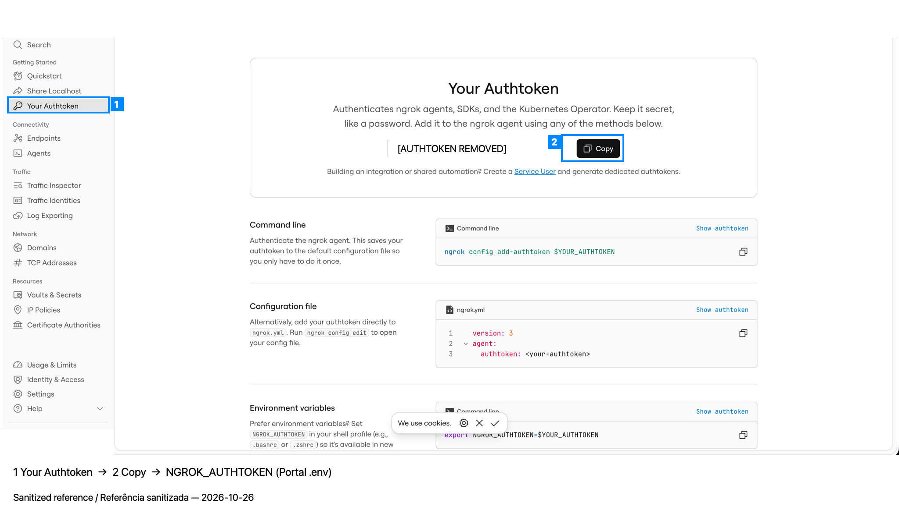

# Local HTTPS Portal and Mercado Pago webhook tunnel — 2026-10-26

Service `ngrok`, container `vivabem-ngrok`, is included automatically by the standard local command from the Portal repository:

```sh
docker compose up -d --build
```

Compose pins official agent **3.39.13** by immutable multi-platform image index `ngrok/ngrok@sha256:ff3b5c3674432d14a786349908b7bdf28ee56c25662637afcbe7180d471993ef`. The version is the source comment's declared agent release; this review did not run the binary/version check. Keep `docker/ngrok/agent-v3.yml` (agent schema v3) and `docker/ngrok/webhook-policy-v1.yml` (policy revision 1) distinct from the agent release. Do not infer a previous image/name/version or a migration beyond the inspected files.

Set `NGROK_AUTHTOKEN` through the existing Portal `.env` mechanism. Compose injects it into the agent environment; it is not a Mercado Pago Access Token or webhook signing secret. The agent reads two read-only config mounts and forwards to `http://nginx:8081`. This is not absolute secret isolation: Docker administrators can inspect container environments, and existing application repository/environment mounts still grant their configured readers access. Do not print tokens or a fully interpolated Compose configuration.

`docker-compose.server.yml` removes `ngrok` with `!reset null`. The updater selects base plus server configuration; the server needs no ngrok token. Local base configuration includes the tunnel without a profile or manual extra Compose file. Agent restart policy is `no`.

## Inspect connection and retrieve the URL

These Docker-only commands require no host ngrok, Python or jq:

```sh
docker compose ps ngrok
docker compose logs --no-color --tail=100 ngrok
```

Privately inspect the agent's connection status/errors and `url` in the tunnel-start log. This guide supplies no fabricated live URL. The agent disables its web inspector (`web_addr: false`) and request inspection (`--inspect=false`); a localhost inspector API is not the URL retrieval mechanism here. Successful agent connection proves a tunnel, not Wallet readiness or provider acceptance.

The current policy serves Portal navigation over HTTPS, denies HTTP, denies non-POST methods on the exact webhook path and blocks operational paths (`audit`, `health`, `healthz`, `readyz`, `up`). Open the current public HTTPS root in the browser for SDK tokenization. Browser GET to the webhook is not a valid POST/signature test. Nginx proxies the webhook internally to Wallet; valid supported signatures currently return 503 with `accepted=false` and `processed=false`. See [Portal setup and test cards](../integrations/mercado-pago.md) and [Wallet webhook setup](../../../carteira-digital/en/integrations/mercado-pago.md). No runtime request was made here.

## Obtain the authtoken

1. Sign up/sign in at the [ngrok dashboard](https://dashboard.ngrok.com/).
2. Open **Your Authtoken** ([direct dashboard page](https://dashboard.ngrok.com/get-started/your-authtoken)) and use **Copy** privately.
3. Set `NGROK_AUTHTOKEN` in the existing local Portal `.env`. Docker does not generate this token. Compose injects it into the existing ngrok service environment. Do not install ngrok on the host or run `add-authtoken` inside PHP for this setup; the command/config examples visible in the screenshot are alternative ngrok setups, not this project's procedure.
4. During a separately authorized local startup, use the standard startup command above. Retrieve the current HTTPS URL with the existing service logs above; never assume the screenshot's historical hostname. Keep tokens and unrelated log details private. The agent's inspector API is disabled.



Sanitized supplied English dashboard, reused in both languages. Callout 1: Your Authtoken; 2: Copy. Only surrounding instructions are localized. The token and account identity were irreversibly removed.

Official references checked 2026-10-26: [ngrok environment injection](https://ngrok.com/docs/gateway/agent/config), [ngrok dashboard walkthrough](https://ngrok.com/blog/go-crud-app-1). Server exclusion is confirmed statically in `docker-compose.server.yml` and `../acesso-servidor/atualizar_projetos.sh` (base plus server selection). The server uses existing HTTPS without ngrok; deployment was not executed or verified here. After a hostname change, update the Mercado Pago dashboard test URL and review APP_URL/assets/cookies/Hub origins as described in the Portal guide. No effective configuration was changed.

## Stop only the tunnel

```sh
docker compose stop ngrok
```

This leaves the other services running. Explicitly starting it again uses `docker compose start ngrok` for the existing container; normal full startup also includes it. A stop/start may change an assigned URL; retrieve current logs and verify the provider dashboard separately rather than assuming continuity. No service was stopped/started by this documentation task.

[Compose source](../../../../../vivabem/docker-compose.yml) · [Server exclusion](../../../../../vivabem/docker-compose.server.yml) · [Agent configuration](../../../../../vivabem/docker/ngrok/agent-v3.yml) · [Traffic policy](../../../../../vivabem/docker/ngrok/webhook-policy-v1.yml) · [Proxy](../../../../../vivabem/docker/nginx.conf)
