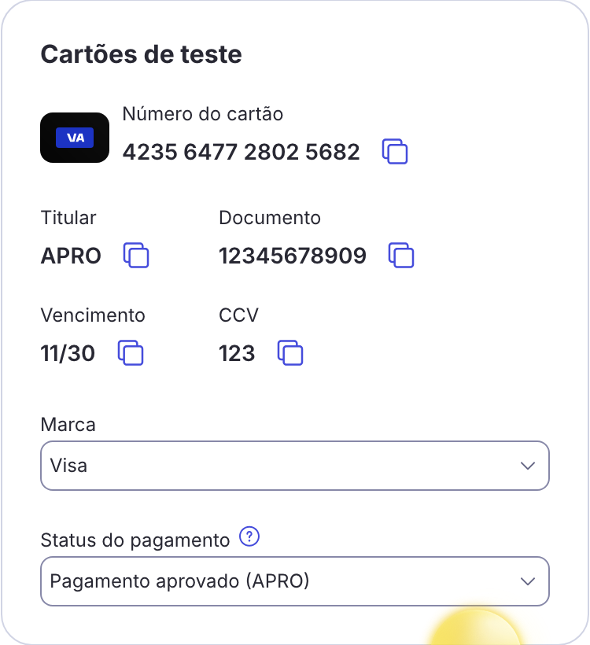

# Mercado Pago: application, browser SDK and official test cards

Navigation reference updated on 2026-10-26 using the screenshot attached to this task. Documentation only; no application, Docker, provider, payment or queue operation was executed. Implementation observations below belong to the existing guide and were not revalidated at runtime in this update.

## Application and credentials

1. Sign in to Mercado Pago Developers and open **Integrações / Suas integrações**. Select the intended application, or use **Criar aplicação** and the manual creation flow. Select online payments and **Checkout Transparente (via Orders API)** for the planned purchases; confirm the product on the application's home screen. Follow the current creation form when its labels differ from the dated reference.
2. At the top of the application select **Teste / Produção**. In **Início → Credenciais**, or the sidebar **Credenciais**, obtain the Public Key and Access Token for the same intended application/environment. Never infer the environment solely from a credential prefix.
3. Portal consumes `MERCADO_PAGO_PUBLIC_KEY`; `MERCADO_PAGO_AMBIENTE` must be exactly `teste` or `producao`. The lazy official SDK loader (`@mercadopago/sdk-js`) loads Mercado Pago v2 remotely. The layout exposes the public key and environment as meta tags; `cardPaymentFields.tokenize()` calls `createCardToken` and clears the fields. Network access to the official SDK is required.
4. Only Carteira receives `MERCADO_PAGO_ACCESS_TOKEN`. Never put it in `MERCADO_PAGO_PUBLIC_KEY`, HTML or browser assets. Backend credentials and webhook setup belong to [Carteira's guide](../../../carteira-digital/en/integrations/mercado-pago.md). This documentation does not modify any environment file, default or example.

## Where to find and copy test cards

1. Open [Mercado Pago Developers](https://www.mercadopago.com.br/developers/pt), sign in and open **Integrações / Suas integrações** (Integrations / Your integrations). Select the intended application.
2. Choose **Teste** (Test) in the application's environment selector and open **Início** (Home).
3. Find **Cartões de teste** (Test cards; the official guide also uses singular **Cartão de teste**) on the right, below **Credenciais de teste** (Test credentials). This is separate from **Contas de teste** (Test accounts).
4. Use the copy icons beside **Número do cartão** (Card number), **Vencimento** (Expiration) and **CCV** (Security code). Also copy **Titular** (Cardholder) and **Documento** (Identity document) when required by the scenario.
5. Select the intended brand under **Marca** (Brand) and copy the displayed details again: the number and security code can vary by brand. Under **Status do pagamento** (Payment status), select the result to simulate and consult the corresponding cardholder/document inputs. Changing the scenario does not require inventing a different number, expiration or security code; follow the displayed official values and the provider's table.

Screenshot supplied on **2026-10-26**, cropped directly to preserve the authentic Portuguese interface. From top to bottom: copyable card and cardholder details; **Marca** (Brand); **Status do pagamento** (Payment status). The crop irreversibly excludes credentials, account details and application identifiers. It shows **Visa / APRO**; the Mastercard values below are another official example available through **Marca**. The interface may change; confirm navigation in the [official test-card guide](https://www.mercadopago.com.br/developers/pt/docs/checkout-api-orders/integration-test/cards), consulted on 2026-10-26.

## Official test card and payment scenarios

Use only official public fixtures in the sandbox, never real cards or generic generated numbers. Selecting **Pagamento aprovado (APRO)** (Approved payment) documents a test input; it does not prove that a payment occurred in VivaBem. This task executed no payments or provider calls.

| Shared field | Value |
| --- | --- |
| Type | Credit card |
| Brand | Mastercard |
| Number | `5480 8328 0103 3311` |
| Expiration | `11/30` |
| Security code | `123` |

| Cardholder | Expected payment scenario | Document |
| --- | --- | --- |
| `APRO` | Approved payment | CPF `12345678909` |
| `OTHE` | Declined due to a general error | CPF `12345678909` |
| `CONT` | Pending payment | Not shown; official table: `-` |
| `CALL` | Declined; authorization validation required | Not shown; official table: `-` |
| `FUND` | Declined due to insufficient funds | Not shown; official table: `-` |
| `SECU` | Declined due to an invalid security code | Not shown; official table: `-` |
| `EXPI` | Declined due to an expiration-date issue | Not shown; official table: `-` |
| `FORM` | Declined due to a form error | Not shown; official table: `-` |

Reuse the same card details; the cardholder selects the documented payment scenario. Keep expiration and security code unchanged, including SECU/EXPI. Do not invent document values for rows marked `-`. The screenshot above illustrates APRO only; it is not evidence of eight executed scenarios.

Checked against the applicable [official Orders test-card guide](https://www.mercadopago.com.br/developers/pt/docs/checkout-api-orders/integration-test/cards) on **2026-10-26**: the supplied eight entries and shared values agree; the official page also lists additional scenarios outside this table.

The current Portal passes the authenticated holder (`config.holder`) to tokenization, rather than exposing an editable scenario selector. This table describes provider inputs, not a claim that the current form can run all scenarios. Tokenization and saving a card do not approve a purchase. APRO does not prove payment execution. Purchase processing is still a placeholder; none of these scenarios was executed in this task.

## Local HTTPS and server deployment

Use the [existing ngrok procedure](../../../../../vivabem/docs/en/docker/ngrok.md) and open the Portal at the current HTTPS root URL, not HTTP localhost, for the observed SDK tokenization path. Public HTTPS → Portal Nginx; the exact webhook path proxies internally to Carteira. Guide ownership does not relocate that public route.

`MERCADO_PAGO_AMBIENTE` is independent of local/server topology: local does not force `teste`, and server does not force `producao`. The server uses its existing HTTPS host and internal routing, without ngrok. No production deployment or runtime validation was performed.

`APP_URL` supplies canonical/non-request URLs; `AppServiceProvider` forces HTTPS when it starts with `https://`. `ConfiarTunelLocal` resolves the local ngrok peer and trusts only its forwarded protocol; secure requests set secure session cookies. The edge replaces incoming forwarded-protocol headers and blocks operational paths. `SESSION_SECURE_COOKIE` remains an existing setting. Layout assets use the existing Vite pipeline; HTTPS page access alone does not verify asset URLs or mixed content. Inspect browser requests in a later runtime check. Hub has separate origin/session configuration (`HUB_VIVABEM_NODE_CORS_ORIGIN`, `HUB_RECIPIENT_BROWSER_ORIGIN`); a new tunnel host is not automatically proof of working sockets. No origin, APP_URL, cookie or asset configuration was changed here.

## Current boundaries and FAQ

- **Does saving charge the card?** No. Source implements temporary browser tokenization, Carteira customer/card association and encrypted reusable references in Cofre. Financial processing and durable webhook acceptance remain pending.
- **Must every test payer use a synthetic email?** No such general rule is asserted. The synthetic mapping applies specifically to the current saved-card Customers flow; see Carteira's guide.
- **What is verified?** Current source and official documentation were inspected statically. Historical operational/test reports retain their dates and do not become tests executed by this task. Manual deletion and expired-card cleanup are separate work; their completion is not established here.

## Sources

Official navigation checked on 2026-10-26: [create application](https://www.mercadopago.com.br/developers/pt/docs/checkout-api-orders/create-application), [application details](https://www.mercadopago.com.br/developers/pt/docs/your-integrations/application-details), [credentials](https://www.mercadopago.com.br/developers/pt/docs/your-integrations/credentials).

Source: [SDK loader](../../../../../vivabem/resources/js/mercado-pago.js), [card form](../../../../../vivabem/resources/js/components/card-payment-form.js), [configuration](../../../../../vivabem/config/services.php), [HTTPS middleware](../../../../../vivabem/app/Http/Middleware/ConfiarTunelLocal.php), [URL provider](../../../../../vivabem/app/Providers/AppServiceProvider.php), [Nginx](../../../../../vivabem/docker/nginx.conf).

Additional topology source: [updater](../../../../../acesso-servidor/atualizar_projetos.sh), [Hub origins](../../../../../hub-vivabem/node-server/src/configuracao.js), [Hub session origin](../../../../../hub-vivabem/node-server/src/server.js).
