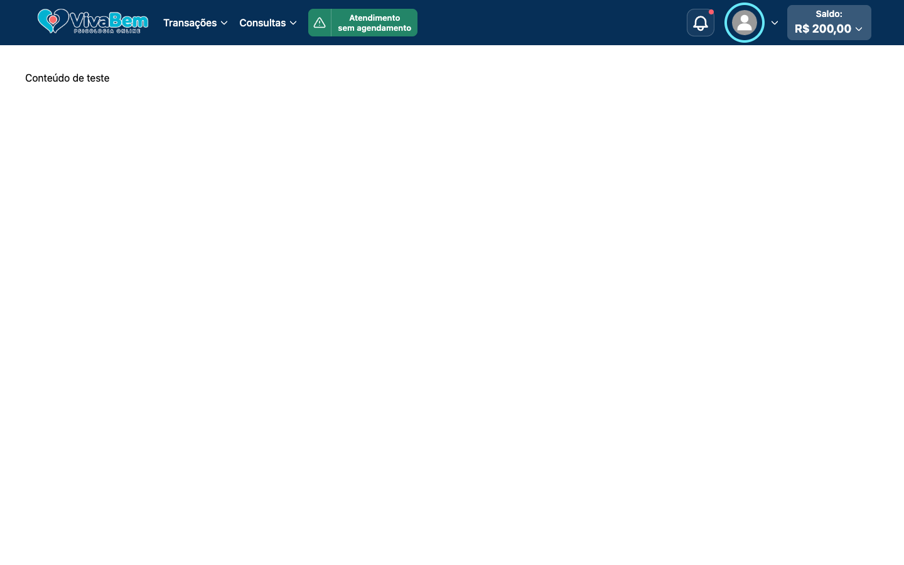
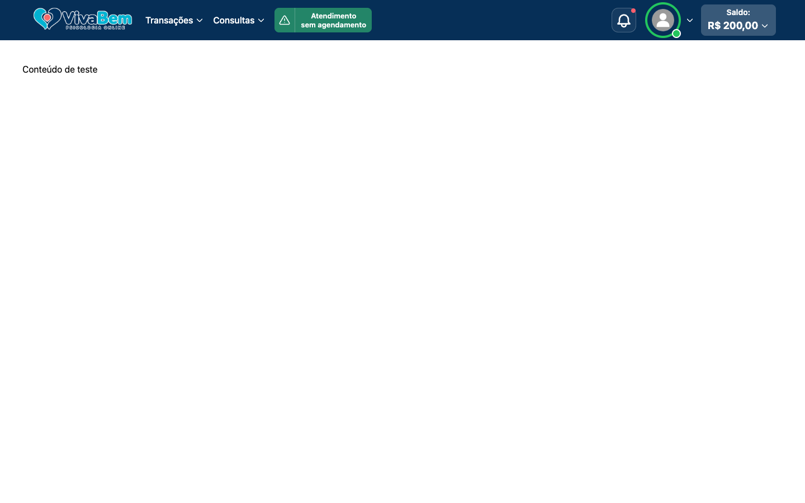

# Navbar autenticada

[English](../../en/architecture/authenticated-navbar.md)

Os controles compartilhados ficam em `resources/views/layouts/navigation.blade.php`; os estilos ficam em `public/css/pages/navigation/navigation.css`.

Abaixo de 1100 CSS px, a primeira linha contém logo, atendimento sem agendamento e sino. A segunda contém Transações, Consultas, perfil e saldo. A partir de 1100 px, o CSS organiza os mesmos controles na linha desktop existente. O breakpoint reserva espaço para logo, textos legíveis e controles da conta, em vez de depender do breakpoint de 640 px do Tailwind.

O DOM segue a ordem visual e de teclado compacta. Os menus ficam diretamente disponíveis em todas as larguras; foram removidos menus e controles de atendimento duplicados para mobile. Rotas, condições de permissão, handlers de saldo e métodos de atendimento/pagamento foram preservados. O botão separado de explicação aceita hover, foco, clique, Escape e clique fora; acioná-lo não inicia atendimento. Os menus compactos usam a barra como referência; a explicação respeita as margens da viewport e as sobreposições ficam acima do conteúdo.

Em 320 px, o logo tem 96 px, o texto do atendimento usa 12 px em duas linhas e o alvo de explicação mede 24 por 44 px. O sino mantém 44 por 44 px. Larguras maiores aumentam logo e textos. Saldos longos quebram dentro do controle, sem reticências; valores excepcionalmente longos podem aumentar a altura da linha. O valor não é abreviado nem cortado.

## Verificação — 18/10/2026

Build Vite de produção aprovado, com avisos existentes de atualização da base de navegadores. Diretivas Blade compiladas sem expansão de tags de componentes; o PHP resultante passou no lint sem bootstrap da aplicação. O Chromium usa o markup real da navbar e do drawer, renderizado com usuários fictícios de paciente e psicólogo. Botões/loading de componentes e fontes de dados são substituídos na fixture isolada; todas as requisições são interceptadas para arquivos locais. Isso não valida sessão autenticada, assinaturas reais, chamadas a provedores ou integração com backend.

A captura histórica utilizou `tests/browser/authenticated-navbar-fixture.php` e `tests/browser/authenticated-navbar.cjs`; esses arquivos estão ausentes no checkout atual. Esta tarefa não os recriou nem executou. Um gerador documental restaurado deve gravar em `docs/img/navbar-review/`. Os resultados datados abaixo são históricos.

A matriz cobre 320, 360, 375, 390, 414, 639, 640, 768, 820, 1024, 1099, 1100, 1440 e 1920 CSS px nos dois perfis. Confere limites/sobreposição dos controles, linhas, limites dos menus/popover/drawer abertos, estabilidade ao abrir, ordem de Tab compacta, explicação por hover, badge de notificações e saldo fictício longo. As capturas preservadas agora ficam em `docs/img/navbar-review/`. Dispositivos de toque reais, zoom e outros motores de navegador não foram verificados. Não foram executados comandos de banco, operações financeiras, atendimentos, commits ou deploy.

Suítes JavaScript existentes selecionadas: 27 testes aprovados, cobrindo avisos sonoros e entradas compartilhadas de pagamento do psicólogo. `git diff --check` aprovado.

Resumos de arquitetura PT/EN da Engineering Library sincronizados pelas duas cópias Docker expressamente autorizadas; comparação byte a byte aprovada nos dois destinos.

## Capturas de documentação

As mesmas capturas da interface em português ilustram as duas versões do texto. Utilizam usuários e saldos fictícios; os nomes indicam perfil, viewport e estado dos controles, não o idioma do documento. Os bytes foram preservados da revisão existente.

Todas as capturas preservadas:

- [patient-1024-long.webp](../../img/navbar-review/patient-1024-long.webp)
- [patient-1024.webp](../../img/navbar-review/patient-1024.webp)
- [patient-1440-asidedrawerwidth.webp](../../img/navbar-review/patient-1440-asidedrawerwidth.webp)
- [patient-1440-emergencytabletpopover.webp](../../img/navbar-review/patient-1440-emergencytabletpopover.webp)
- [patient-1440-long.webp](../../img/navbar-review/patient-1440-long.webp)
- [patient-1440-menuconsultas.webp](../../img/navbar-review/patient-1440-menuconsultas.webp)
- [patient-1440-menutransacoes.webp](../../img/navbar-review/patient-1440-menutransacoes.webp)
- [patient-1440-menuusuario.webp](../../img/navbar-review/patient-1440-menuusuario.webp)
- [patient-1440-saldohistoricodropdown.webp](../../img/navbar-review/patient-1440-saldohistoricodropdown.webp)
- [patient-1440.webp](../../img/navbar-review/patient-1440.webp)
- [patient-320-asidedrawerwidth.webp](../../img/navbar-review/patient-320-asidedrawerwidth.webp)
- [patient-320-emergencytabletpopover.webp](../../img/navbar-review/patient-320-emergencytabletpopover.webp)
- [patient-320-long.webp](../../img/navbar-review/patient-320-long.webp)
- [patient-320-menuconsultas.webp](../../img/navbar-review/patient-320-menuconsultas.webp)
- [patient-320-menutransacoes.webp](../../img/navbar-review/patient-320-menutransacoes.webp)
- [patient-320-menuusuario.webp](../../img/navbar-review/patient-320-menuusuario.webp)
- [patient-320-saldohistoricodropdown.webp](../../img/navbar-review/patient-320-saldohistoricodropdown.webp)
- [patient-320.webp](../../img/navbar-review/patient-320.webp)
- [patient-390-long.webp](../../img/navbar-review/patient-390-long.webp)
- [patient-390.webp](../../img/navbar-review/patient-390.webp)
- [patient-768-long.webp](../../img/navbar-review/patient-768-long.webp)
- [patient-768.webp](../../img/navbar-review/patient-768.webp)
- [professional-1024-long.webp](../../img/navbar-review/professional-1024-long.webp)
- [professional-1024.webp](../../img/navbar-review/professional-1024.webp)
- [professional-1440-long.webp](../../img/navbar-review/professional-1440-long.webp)
- [professional-1440.webp](../../img/navbar-review/professional-1440.webp)
- [professional-320-long.webp](../../img/navbar-review/professional-320-long.webp)
- [professional-320.webp](../../img/navbar-review/professional-320.webp)
- [professional-390-long.webp](../../img/navbar-review/professional-390-long.webp)
- [professional-390.webp](../../img/navbar-review/professional-390.webp)
- [professional-768-long.webp](../../img/navbar-review/professional-768-long.webp)
- [professional-768.webp](../../img/navbar-review/professional-768.webp)
