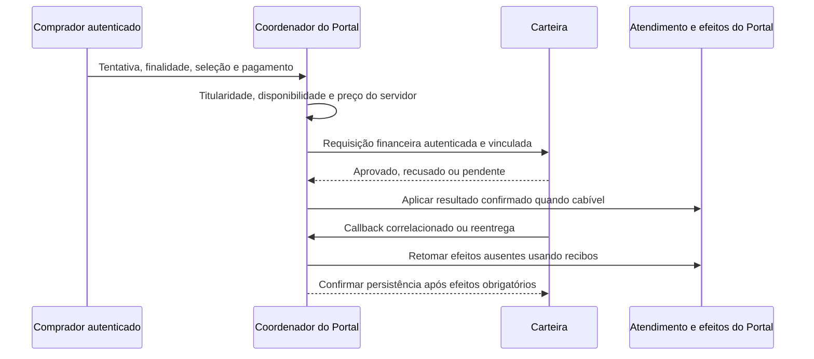

# Orquestração de compras, confirmação e recuperação

Revisado em 2026-11-10. IMPLEMENTED indica comportamento sustentado pelo código, não aceitação do provedor em produção. Este capítulo descreve o caminho atual; relatórios datados de Stripe/estorno permanecem HISTORICAL. Nenhuma operação financeira foi executada na revisão.

<!-- reading-section: entry -->
## Entrada, elegibilidade e valor

O `POST /transacoes/adicionar-saldo/submit` autenticado entra em `ControladorTransacao::adicionarSaldoSubmit` e segue para `CasoDeUsoTransacao::comprarSaldoCredito`. O despacho depende da finalidade: consultas selecionadas usam `CasoDeUsoCompraAtendimentoSelecionado`; compras emergenciais usam `CasoDeUsoCompraEmergencial`; recargas comuns usam `CartoesSalvos::purchase`. São coordenadores separados, não um método de compra intercambiável. Métodos legados de agendamento do controlador retornam HTTP 503 `financial_operations_unavailable`; sua existência não estabelece um contrato de pagamento ativo.

A validação vincula UUID da tentativa, finalidade/método suportados e valor limitado. A duração selecionada é de 30–240 minutos. Pix rejeita token, método e campos de cartão salvo; outros métodos rejeitam campos exclusivos da intenção Pix. Compras com cartão exigem seus campos de pagamento aplicáveis. A conta autenticada fornece titular e identidade do cliente; o chamador não escolhe um titular financeiro arbitrário. Referências salvas precisam ser utilizáveis no ambiente configurado.

Compras selecionadas rejeitam autocompra e exigem profissional com e-mail verificado. Bloqueios dos participantes e consultas à agenda verificam ambos. Reutilizar uma intenção exige titular, profissional, duração e horário agendado compatíveis. O início agendado deve ser futuro, dentro de um ano e alinhado a intervalos de dez minutos; consultas imediatas exigem disponibilidade atual. O preço deriva da tarifa horária armazenada em centavos inteiros, com arredondamento `intdiv(hourlyCents * duration + 30, 60)`. Valor enviado divergente é rejeitado. O atendimento provisório fica `DESMARCADO`, sem financiamento ou liberação da consulta.

<!-- reading-section: boundary -->
## Fronteira da Carteira e responsabilidade do provedor

`ClienteHttpCarteiraDigital` permite caminhos configurados da Carteira, impede sobrescritas da requisição, desativa redirecionamentos e limita o timeout. Seu JWT curto e com escopo vincula sujeito, corpo e caminho. Sucesso HTTP não basta: o invólucro esperado de string JSON deve descriptografar para resposta de sucesso com conteúdo. Resposta malformada ou indisponível deixa a confirmação incerta.

A Carteira controla submissão ao provedor, persistência de transações/saldo, idempotência e reconciliação. O Portal controla elegibilidade, ciclo local e efeitos ao usuário. O Portal não transforma exceção de transporte em recusa confirmada e não deve enviar novo pagamento apenas porque perdeu a primeira resposta. O controlador preserva falhas de domínio 404/409/422 esperadas; falhas inesperadas retornam 503 com orientação de confirmação pendente.

<!-- reading-section: confirmation -->
## Confirmação, correlação e efeitos locais

`ResultadoCompraSaldoControlador` valida independentemente credenciais HS256, emissor/audiência/escopo, timestamps inteiros com janela máxima de 60 segundos, sujeito/ambiente e vínculo de corpo/caminho. Identificadores de evento, tentativa, transação e atendimento têm funções diferentes; não devem ser substituídos por associação presumida por usuário/data/valor. O callback aplica um resultado financeiro existente; não cria cobrança no provedor.

A aprovação selecionada é aplicada sob bloqueio da tentativa e transação SQL, validando titular, atendimento, valor, duração e identidade da transação. Somente a primeira aprovação agenda. Atendimentos cancelados/concluídos não reabrem; disponibilidade imediata é conferida novamente e inícios agendados vencidos são rejeitados. Saldo insuficiente confirmado permite remover atendimento provisório não pago; incerteza não é esse caso.

O commit SQL antecede persistência do link no Cofre, notificações e invalidação. Recibos de etapas no Redis permitem retomar efeitos ausentes. `CasoDeUsoAplicarResultadoCompraSaldo` usa bloqueio por evento, digest do conteúdo e recibos independentes de pendência/aprovação, rejeita valores conflitantes e impede regressão de aprovação por eventos pendentes/recusados. IDs das notificações permanecem estáveis. Invalida saldo em cache e publica `balance.updated` após suas etapas anteriores. Essas proteções não constituem transação distribuída nem garantia de entrega exatamente uma vez.

Um resultado financeiramente aprovado pode continuar pendente para o chamador quando efeitos obrigatórios do atendimento falham; `payment_status` preserva o resultado financeiro. `effects_pending` da Carteira e recibos do Portal representam obrigações de entrega, não autorização para cobrar novamente. A persistência do callback não é confirmada até a aplicação obrigatória ter sucesso. A recuperação deve reutilizar as identidades originais.

<!-- reading-section: pix -->
## Pix, emergência e limites de compensação

Criar QR Pix não confirma pagamento. `CasoDeUsoAplicarCompraAtendimentoPix` serializa a aplicação por atendimento e verifica titular/transação. Atendimentos emergenciais ausentes podem ser criados após aprovação; atendimentos selecionados arbitrariamente ausentes não. Atendimentos não entregues cancelados, vencidos ou conflitantes e falhas de domínio 409/422 reconhecidas podem solicitar conversão em saldo. Exceções técnicas permanecem pendentes; não autorizam converter qualquer falha de aplicação. Um link de consulta já entregue não deve ser convertido apenas por atraso de notificação.

Valor/duração emergenciais vêm da configuração. A identidade do atendimento emergencial não Pix deve corresponder à tentativa; resultados aprovados iniciam seu ciclo. `CasoDeUsoCompraEmergencial::estornar` limita-se a emergência aprovada, não convertida, cancelada, sem profissional/não aceita. Chama a Carteira antes do bloqueio SQL local para permitir conexão própria do callback e depois verifica o marcador persistido de estorno sob bloqueio. A recuperação percorre registros cancelados/sem profissional elegíveis e continua após falhas individuais. Isso não promete implementação de todo estorno externo ou transferência bancária.

PARTIALLY IMPLEMENTED: a Carteira possui caminhos internos de estorno/pagamento em saldo, enquanto o despacho padrão de pagamento/estorno por transferência externa rejeita com `bank_transfer_unavailable`. Aceitação real de débito, entrega de callbacks, bloqueios MySQL/Redis, agendamento real e recuperação operacional permanecem UNVERIFIED nesta revisão offline. Não se presume projeto futuro aprovado de executor a partir de um caminho indisponível.

<!-- reading-section: evidence -->
## Evidências de código e manutenção

Fontes do Portal: `routes/web.php`; `app/Http/Controllers/ControladorTransacao.php`; `app/Http/Controllers/ResultadoCompraSaldoControlador.php`; `app/Services/CartoesSalvos.php`; `app/Services/ClienteHttpCarteiraDigital.php`; `app/UseCases/CasoDeUsoTransacao.php`, `CasoDeUsoCompraAtendimentoSelecionado.php`, `CasoDeUsoCompraEmergencial.php`, `CasoDeUsoAplicarCompraAtendimentoPix.php`, `CasoDeUsoAplicarResultadoCompraSaldo.php`.

Fontes da Carteira: `app/Http/Controllers/OperacaoFinanceiraControlador.php`; `app/UseCases/CasoDeUsoComprarAtendimentoSaldo.php`, `CasoDeUsoOperarOperacaoFinanceira.php`, `CasoDeUsoConcluirCompra.php`, `CasoDeUsoResultadoCompra.php`. Atualizar ambos os idiomas quando mudarem despacho, validação, recibos, estados ou contratos do provedor. Os testes offline existentes não exercitam esta sequência completa entre serviços; consultar [testes](../operations/backend-testing.md).

<!-- reading-section: refund -->
## Conclusão do estorno de atendimento

`CasoDeUsoEstornoAtendimento` exige titularidade do solicitante, delega o destino pedido à Carteira e correlaciona a consulta de status ao atendimento. A autorização deriva o valor reembolsável da elegibilidade atual; não confia no valor do navegador. A conclusão aceita somente resultados autenticados aprovados/com estorno realizado, verifica novamente titular e valor sob bloqueio SQL e persiste `estorno_realizado` uma vez. Saldo em cache, notificações estáveis de sininho/push e invalidação Hub vêm após commit. Falha de entrega propaga para a Carteira manter `effects_pending` do mesmo estorno; falha de notificação não deve repetir o crédito. Resultados explicitamente recusados têm caminho próprio de notificação. O preço da compra selecionada usa aritmética inteira, mas este coordenador de estorno ainda contém conversões float/round: não afirmar que todo caminho monetário do Portal usa somente inteiros.
