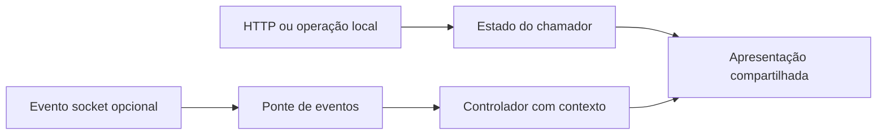

# Loading compartilhado e interfaces assíncronas confiáveis

[Arquitetura](index.md) · [Estratégia de testes](../operations/backend-testing.md#estratégia-de-testes-de-interfaces-reativas) · [English](../../en/architecture/shared-loading.md)

Revisado em 12/11/2026. Este capítulo ensina padrões de engenharia com exemplos sintéticos. Os trechos são contratos ilustrativos, não cópias de componentes privados ou protocolos operacionais. A entrada pública do projeto já existe; não foram adicionados snapshots de código, endpoints privados ou identificadores operacionais de canais.

## Separar apresentação e operação

Um componente Laravel Blade reutilizável deve renderizar a espera enquanto o chamador controla visibilidade e mensagem. Alpine.js liga esses valores ao DOM. Compartilhar imagem, cartão e texto de status reduz divergências entre formulários, listagens e interfaces de pagamento; compartilhar decisões financeiras acoplaria operações distintas.

A apresentação não precisa enviar HTTP, conectar socket, decidir sucesso financeiro ou agendar recuperação. Um formulário simples pode controlar uma classe CSS; um chamador reativo pode usar x-show. Progresso em tempo real é entrada opcional para um controlador externo. Atualizar x-text altera o texto sem substituir a imagem, evitando reiniciar a animação e recriar o componente.



## Contratos de mensagem e visibilidade

Defina fallback para mensagem omitida, null, vazia e com espaços. Texto estático deve receber escaping Blade; texto reativo deve usar x-text, sem inserção de HTML. Um chamador ilustrativo pode declarar:

```html
<div x-data="{ aguardando: false, mensagem: 'Buscando registros…' }">
  <section x-show="aguardando" x-cloak aria-label="Operação atual">
    <p role="status" aria-live="polite" aria-atomic="true"
       x-text="String(mensagem ?? '').trim() || 'Carregando'"></p>
  </section>
</div>
```

O fragmento demonstra o binding, não uma API completa de overlay. A variável mensagem está declarada. Nullish coalescing não protege identificador não declarado: uma referência simples opcional precisa de guard typeof deliberado ou declaração pelo chamador. Expressões compostas exigem raízes válidas e acesso opcional explícito quando necessário. Capturar qualquer erro de expressão esconde falhas de programação e prejudica o diagnóstico.

Escolha um dono de visibilidade por instância. Classes podem funcionar antes de Alpine iniciar; x-show deve evitar uma classe hidden controlada independentemente. Instâncias distintas precisam de identificadores distintos. Reabrir deve preservar a identidade da imagem e mostrar a mensagem mais recente, inclusive atualizações feitas enquanto oculto.

## HTTP concorrente e DataTables

Um booleano não representa operações sobrepostas. Se A e B mostram o overlay, concluir A não pode ocultar a espera de B. Modele loading como posse vinculada ao elemento DOM. Cada aquisição retorna uma liberação idempotente; a última restaura a visibilidade inicial. Uma liberação antiga não pode encerrar uma operação nova.

Código conceitual, supondo um helper de posse fornecido pela aplicação:

```js
const liberar = adquirirIndicador(elemento);
try {
  await consultarRegistros();
} finally {
  liberar();
}
```

Nomes do helper e da operação são sintéticos. Uma implementação pode usar WeakMap de elementos para conjuntos de tokens. Preserve o indicador que já estava visível antes da primeira aquisição. Mutações diretas de classes fora do helper não participam automaticamente dessas garantias.

Em DataTables, adquira por requisição, não por evento genérico de desenho. Libere em sucesso, falha HTTP, abort, erro síncrono e destruição. Preserve beforeSend e a configuração do transporte. Ajax customizado precisa expor callback terminal ou promessa; não é seguro inferir conclusão de uma operação que nunca a informa. Aborte requests próprios no destroy, impeça desenho tardio após dispose e evite bindings duplicados ao reinicializar. Tabelas distintas podem compartilhar overlay com tokens separados.

Um histórico pode usar seu coordenador existente, com refresh silent e contagem de operações manuais. Documente essa fronteira: impor novo contador global pode romper a política de atualização existente. Descartar respostas obsoletas e coordenar posse visual resolvem problemas diferentes.

## Progresso opcional em tempo real e ciclo de vida

Uma ponte normaliza envelopes objeto/JSON string e despacha evento do navegador. Um controlador separado valida identidade, sequência e ciclo de vida antes de expor texto ao Alpine. O overlay consome o estado sem conhecer o transporte.

Use campos sintéticos de correlação como operationId, attemptId e kind. Rejeite tentativas alheias, transações incompatíveis, contadores inválidos, regressões, mudanças inesperadas de máximo e eventos após conclusão. Defina explicitamente o tratamento de duplicatas. Esses controles evitam repintar outra operação; não autenticam o servidor nem garantem entrega.

Um cliente Socket.IO compartilhado pode sobreviver ao componente de navegação. O componente possui seus callbacks, não necessariamente a conexão. No destroy, remova os callbacks exatos; no remount, registre-os mesmo que o cliente exista. Evite handlers anônimos impossíveis de remover, removeAllListeners que afete outros consumidores e registro de listeners de negócio dentro de cada connect. Reconexão deve motivar sincronização sem acumular assinaturas. Remova listeners de visibilidade/foco e timers da montagem. Um listener global do store tem vida diferente de um listener de componente; iniciar a aplicação duas vezes não é estratégia segura de remount.

Entrada malformada deve preservar o último estado válido e produzir diagnóstico apropriado. Desconexão significa perda de atualizações, não conclusão financeira. Seleção de canal por usuário no cliente não comprova autorização no servidor; teste essas fronteiras separadamente.

## Progresso financeiro é apresentação, não liquidação

Preparação, envio, processamento, retentativas, conclusão definitiva, recusa e resultado ambíguo são estados distintos. Uma mensagem como “Retentativa 2 de 7…” usa máximo fornecido pela operação. Não fixe limite específico de deployment; metadados persistidos podem preservar um máximo anterior.

A última retentativa não prova falha ou sucesso. Um prazo pode encerrar o bloqueio e manter status não confirmado, orientando consultar histórico ou aguardar conciliação. Preserve a identidade da tentativa durante recuperação e evite sugerir novo pagamento enquanto o primeiro estiver incerto. Gerar QR não conclui compra. Overlay oculto nunca comprova liquidação bem-sucedida.

Controllers devem correlacionar resultados definitivos antes de aplicá-los. Conclusão visual e conclusão da transação merecem nomes e asserts separados. Banner, recibo ou recuperação podem continuar mostrando informações após fechar o bloqueio. Consulte [fluxos de compra](purchase-workflows.md) para as fronteiras de negócio; este capítulo não amplia autorização para publicar contratos privados.

## Foco, teclado e mensagens longas

Loaders genéricos não devem herdar automaticamente restrições de teclado de um modal financeiro. Torne foco ao exibir uma opção explícita da instância bloqueante. Next-tick pode ocorrer antes de x-show revelar o elemento; foque somente depois que estiver conectado e com geometria visível. Se usar observador local, desconecte no destroy. O chamador deve restaurar foco pelo próprio ciclo e verificar se o alvo ainda existe.

Regiões live de status anunciam mudanças sem substituir HTML. role=dialog, aria-modal, labels e tabindex são ingredientes declarativos, não prova de focus trap completo ou experiência com leitor de tela. Verifique Tab/Escape nas instâncias genérica e bloqueante, teclado do fundo após fechar e tecnologia assistiva real separadamente.

Cartão maior que viewport pode perder o topo quando centralizado verticalmente. Alinhamento seguro, overlay rolável, conteúdo sem encolhimento e quebra de palavras mantêm imagem e início alcançáveis, preservando conteúdo curto centralizado. Verifique mensagens médias/longas em desktop, tablet e mobile estreito, nos dois temas. Spinners de botões, autocomplete, CEP, Select2, notificações, dashboards, diagnósticos técnicos, CSV, auditoria e alertas podem permanecer especializados. Reutilizar a primitiva de imagem não torna todo indicador inline consumidor full-screen.

## Lições de regressão e trade-offs

| Sintoma | Correção de engenharia | Expectativa de regressão |
| --- | --- | --- |
| Identificador de mensagem ausente lança erro | Proteger o caso simples opcional; preservar outros erros | Fallback aparece; expressão composta inválida continua reportando erro |
| Foco anterior à visibilidade | Observar visibilidade efetiva com opt-in e cleanup | Reabrir foca somente após exibir; genérico não rouba foco |
| Uma resposta oculta outra pendente | Posse por elemento e liberação idempotente | Primeira conclusão mantém espera; última restaura estado |
| Formulário abortado retém loading | Liberar apresentação própria no destroy | Outros donos preservados; formulário destruído não reinicia |
| Remount socket não recebe eventos | Reanexar callbacks próprios no cliente reutilizado | Um listener por canal após remontagens repetidas |
| Texto longo perde o topo | Alinhamento seguro e scroll | Início/fim alcançáveis; conteúdo curto centralizado |

Os padrões refletem implementação corrigida, não novos defeitos abertos. Testes declarativos permanentes e evidências temporárias de navegador/transporte têm forças diferentes. A [documentação de testes](../operations/backend-testing.md#estratégia-de-testes-de-interfaces-reativas) explica como registrar essa distinção sem afirmar certificação do provedor.
