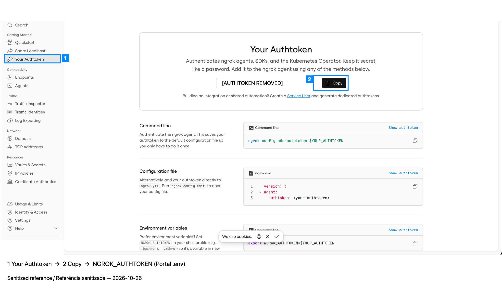

# HTTPS local do Portal e túnel do webhook Mercado Pago — 2026-10-26

O serviço `ngrok`, container `vivabem-ngrok`, entra automaticamente no comando local padrão, executado no repositório do Portal:

```sh
docker compose up -d --build
```

O Compose fixa o agente oficial **3.39.13** pelo índice imutável de imagem multiplataforma `ngrok/ngrok@sha256:ff3b5c3674432d14a786349908b7bdf28ee56c25662637afcbe7180d471993ef`. A versão é a release declarada no comentário do código; esta revisão não executou o binário para conferir a versão. Diferencie `docker/ngrok/agent-v3.yml` (schema v3 do agente), `docker/ngrok/webhook-policy-v1.yml` (revisão 1 da política) e a release do agente. Não infira imagem/nome/versão anterior ou migração além dos arquivos inspecionados.

Defina `NGROK_AUTHTOKEN` pelo mecanismo existente de `.env` do Portal. Compose o injeta no ambiente do agente; não é Access Token Mercado Pago ou segredo de assinatura do webhook. O agente lê dois mounts de configuração somente leitura e encaminha para `http://nginx:8081`. Isso não é isolamento absoluto de segredos: administradores Docker podem inspecionar ambientes dos containers, e os mounts existentes de repositório/ambiente das aplicações continuam concedendo acesso aos leitores configurados. Não imprima tokens ou o Compose completamente interpolado.

`docker-compose.server.yml` remove `ngrok` com `!reset null`. O atualizador seleciona base mais configuração server; o servidor não precisa de token ngrok. A configuração local base inclui o túnel sem profile ou Compose extra manual. A política de reinício do agente é `no`.

A política atual permite navegação do Portal por HTTPS, nega HTTP, nega métodos diferentes de POST no caminho exato do webhook e bloqueia caminhos operacionais (`audit`, `health`, `healthz`, `readyz`, `up`). Abra a raiz HTTPS pública atual no navegador para tokenização do SDK. GET no webhook não testa seu contrato POST/assinatura. O Nginx encaminha o webhook internamente à Carteira; assinatura válida suportada ainda retorna 503 com `accepted=false` e `processed=false`. Consulte [Portal e cartões de teste](../integrations/mercado-pago.md) e [webhook na Carteira](../../../carteira-digital/pt-br/integrations/mercado-pago.md). Nenhuma requisição de runtime foi feita aqui.

## Inspecionar conexão e obter URL

Estes comandos usam somente Docker, sem ngrok, Python ou jq no host:

```sh
docker compose ps ngrok
docker compose logs --no-color --tail=100 ngrok
```

Confira de forma privada o estado/erros de conexão do agente e `url` no log de abertura do túnel. Este guia não fornece URL ativa inventada. O agente desativa o inspetor web (`web_addr: false`) e a inspeção de requisições (`--inspect=false`); API de inspetor localhost não é o mecanismo de obtenção de URL aqui. Conexão do agente comprova um túnel, não prontidão da Carteira ou aceite do provedor.


## Parar somente o túnel

```sh
docker compose stop ngrok
```

Isso mantém os demais serviços executando. Para iniciar explicitamente o container existente, use `docker compose start ngrok`; a subida completa normal também o inclui. Stop/start pode alterar uma URL atribuída; consulte logs atuais e verifique o painel separadamente, sem presumir continuidade. Esta tarefa documental não parou/iniciou serviços.

[Compose](../../../../../vivabem/docker-compose.yml) · [Exclusão server](../../../../../vivabem/docker-compose.server.yml) · [Configuração do agente](../../../../../vivabem/docker/ngrok/agent-v3.yml) · [Política de tráfego](../../../../../vivabem/docker/ngrok/webhook-policy-v1.yml) · [Proxy](../../../../../vivabem/docker/nginx.conf)

## Obter o authtoken — 2026-10-26

1. Crie conta/entre no [dashboard ngrok](https://dashboard.ngrok.com/).
2. Abra **Your Authtoken** ([acesso direto](https://dashboard.ngrok.com/get-started/your-authtoken)) e use **Copy** privadamente.
3. Defina `NGROK_AUTHTOKEN` no `.env` local existente do Portal. Docker não gera esse token. Compose o injeta no ambiente do serviço ngrok existente. Não instale ngrok no host nem execute `add-authtoken` dentro do PHP nesta configuração; os exemplos de comando/configuração visíveis na captura são alternativas do ngrok, não o procedimento deste projeto.
4. Em startup local autorizado separadamente, use o comando padrão acima. Descubra a URL HTTPS atual pelos logs do serviço existente descritos acima; nunca suponha válido o host histórico da captura. Preserve tokens e detalhes não relacionados dos logs. A API do inspector está desativada.



Dashboard fornecido em inglês e sanitizado, reutilizado nos dois idiomas. Chamada 1: Your Authtoken; 2: Copy. Somente instruções ao redor são traduzidas. Token e identidade da conta foram removidos irreversivelmente.

Fontes oficiais conferidas em 2026-10-26: [injeção por ambiente ngrok](https://ngrok.com/docs/gateway/agent/config), [navegação no dashboard ngrok](https://ngrok.com/blog/go-crud-app-1). A exclusão no servidor foi confirmada estaticamente em `docker-compose.server.yml` e `../acesso-servidor/atualizar_projetos.sh` (seleção base mais server). O servidor usa HTTPS existente sem ngrok; implantação não foi executada ou validada aqui. Após mudança de host, atualize a URL de teste no painel Mercado Pago e revise APP_URL/assets/cookies/origens do Hub conforme o guia do Portal. Nenhuma configuração efetiva foi alterada.
