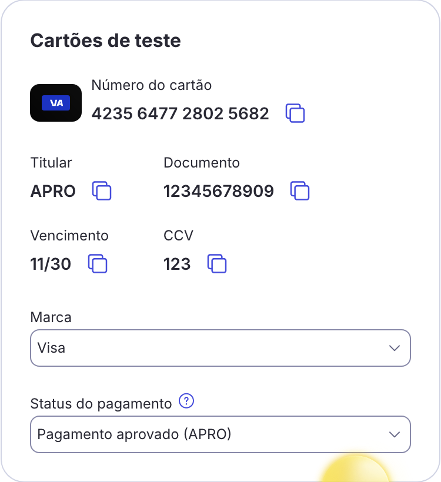

# Mercado Pago: aplicação, SDK no navegador e cartões oficiais de teste

Referência de navegação atualizada em 2026-10-26 com a captura anexada a esta tarefa. Somente documentação; nenhuma operação de aplicação, Docker, provedor, pagamento ou fila foi executada. As observações de implementação abaixo pertencem ao guia existente e não foram revalidadas em runtime nesta atualização.

## Aplicação e credenciais

1. Entre no Mercado Pago Developers e abra **Integrações / Suas integrações**. Selecione a aplicação pretendida ou use **Criar aplicação** e a criação manual. Selecione pagamentos online e **Checkout Transparente (via Orders API)** para as compras planejadas; confirme o produto no início da aplicação. Siga o formulário atual quando os rótulos divergirem da referência datada.
2. No topo da aplicação selecione **Teste / Produção**. Em **Início → Credenciais**, ou **Credenciais** no menu lateral, obtenha Public Key e Access Token da mesma aplicação/ambiente pretendidos. Nunca deduza o ambiente apenas pelo prefixo da credencial.
3. O Portal consome `MERCADO_PAGO_PUBLIC_KEY`; `MERCADO_PAGO_AMBIENTE` deve ser exatamente `teste` ou `producao`. O loader oficial lazy (`@mercadopago/sdk-js`) carrega remotamente o Mercado Pago v2. O layout expõe chave pública e ambiente em meta tags; `cardPaymentFields.tokenize()` chama `createCardToken` e limpa os campos. É necessário acesso de rede ao SDK oficial.
4. Somente a Carteira recebe `MERCADO_PAGO_ACCESS_TOKEN`. Nunca coloque esse token em `MERCADO_PAGO_PUBLIC_KEY`, HTML ou assets do navegador. Credenciais de backend e webhook pertencem ao [guia da Carteira](../../../carteira-digital/pt-br/integrations/mercado-pago.md). Esta documentação não altera arquivos de ambiente, defaults ou exemplos.

## Onde encontrar e copiar os cartões de teste

1. Acesse [Mercado Pago Developers](https://www.mercadopago.com.br/developers/pt), entre na sua conta e abra **Integrações / Suas integrações**. Selecione a aplicação pretendida.
2. No seletor de ambientes da aplicação, escolha **Teste** e abra **Início**.
3. Localize **Cartões de teste** (a documentação oficial também usa **Cartão de teste**) no lado direito da tela, abaixo de **Credenciais de teste**. Não confunda esse painel com **Contas de teste**.
4. Use os ícones de copiar ao lado de **Número do cartão**, **Vencimento** e **CCV** (código de segurança). Copie também **Titular** e **Documento** quando exigidos pelo cenário.
5. Em **Marca**, selecione a bandeira pretendida e copie novamente os dados exibidos: número e código de segurança podem variar entre bandeiras. Em **Status do pagamento**, escolha o resultado a simular e consulte os dados de titular/documento correspondentes. A mudança de cenário não exige inventar outro número, vencimento ou código de segurança; siga os valores oficiais exibidos e a tabela do provedor.

Captura fornecida em **2026-10-26**, recortada diretamente para preservar a interface autêntica em português. De cima para baixo: dados copiáveis do cartão e do titular; **Marca**; **Status do pagamento**. O recorte exclui irreversivelmente credenciais, conta e identificadores da aplicação. A referência mostra **Visa / APRO**; os valores Mastercard abaixo são outro exemplo oficial, selecionável em **Marca**. A interface pode mudar; confirme o caminho no [guia oficial de cartões](https://www.mercadopago.com.br/developers/pt/docs/checkout-api-orders/integration-test/cards), consultado em 2026-10-26.

## Cartão oficial de teste e cenários de pagamento

Use somente fixtures públicas oficiais no sandbox, nunca cartões reais ou números genéricos gerados. Selecionar **Pagamento aprovado (APRO)** documenta uma entrada de teste; não comprova que houve pagamento no VivaBem. Esta tarefa não executou pagamentos nem chamadas ao provedor.

| Campo compartilhado | Valor |
| --- | --- |
| Tipo | Cartão de crédito |
| Bandeira | Mastercard |
| Número | `5480 8328 0103 3311` |
| Vencimento | `11/30` |
| Código de segurança | `123` |

| Titular | Cenário esperado de pagamento | Documento |
| --- | --- | --- |
| `APRO` | Pagamento aprovado | CPF `12345678909` |
| `OTHE` | Recusado por erro geral | CPF `12345678909` |
| `CONT` | Pagamento pendente | Não exibido; tabela oficial: `-` |
| `CALL` | Recusado com validação para autorizar | Não exibido; tabela oficial: `-` |
| `FUND` | Recusado por quantia insuficiente | Não exibido; tabela oficial: `-` |
| `SECU` | Recusado por código de segurança inválido | Não exibido; tabela oficial: `-` |
| `EXPI` | Recusado por problema com a data de vencimento | Não exibido; tabela oficial: `-` |
| `FORM` | Recusado por erro no formulário | Não exibido; tabela oficial: `-` |

Reutilize os mesmos dados do cartão; o titular seleciona o cenário documentado de pagamento. Mantenha vencimento e código de segurança, inclusive em SECU/EXPI. Não invente documento para linhas com `-`. A captura acima ilustra somente APRO; não comprova execução dos oito cenários.

Conferido no [guia oficial aplicável de cartões Orders](https://www.mercadopago.com.br/developers/pt/docs/checkout-api-orders/integration-test/cards) em **2026-10-26**: os oito itens e dados compartilhados fornecidos conferem; a página oficial também lista cenários adicionais fora desta tabela.

O Portal atual passa o titular autenticado (`config.holder`) à tokenização, sem oferecer seletor editável de cenários. A tabela descreve entradas do provedor, sem afirmar que o formulário atual execute todos os cenários. Tokenizar e salvar cartão não aprovam compra. APRO não comprova pagamento executado. O processamento de compras continua placeholder; nenhum desses cenários foi executado nesta tarefa.

## HTTPS local e implantação no servidor

Use o [procedimento ngrok existente](../../../../../vivabem/docs/pt-br/docker/ngrok.md) e abra o Portal na raiz HTTPS atual, em vez de localhost HTTP, para o caminho observado de tokenização do SDK. HTTPS público → Nginx do Portal; o caminho exato do webhook encaminha internamente à Carteira. A responsabilidade pelo guia não muda essa rota pública.

`MERCADO_PAGO_AMBIENTE` independe da topologia local/servidor: local não força `teste`, servidor não força `producao`. O servidor usa seu host HTTPS existente e roteamento interno, sem ngrok. Nenhuma implantação produtiva ou validação de runtime foi realizada.

`APP_URL` fornece URLs canônicas/fora de requisição; `AppServiceProvider` força HTTPS quando começa com `https://`. `ConfiarTunelLocal` resolve o peer ngrok local e confia somente no protocolo encaminhado; requisições seguras ativam cookies seguros da sessão. A borda substitui cabeçalhos de protocolo encaminhado recebidos e bloqueia caminhos operacionais. `SESSION_SECURE_COOKIE` permanece uma configuração existente. Assets do layout usam o pipeline Vite existente; abrir HTTPS não verifica URLs de assets ou conteúdo misto. Inspecione requisições do navegador em validação futura de runtime. O Hub tem configuração separada de origem/sessão (`HUB_VIVABEM_NODE_CORS_ORIGIN`, `HUB_RECIPIENT_BROWSER_ORIGIN`); um novo host do túnel não comprova funcionamento de sockets. Nenhuma configuração de origem, APP_URL, cookie ou asset foi alterada aqui.

## Limites atuais e FAQ

- **Salvar cobra o cartão?** Não. A fonte implementa tokenização temporária no navegador, associação de cliente/cartão na Carteira e referências reutilizáveis criptografadas no Cofre. Processamento financeiro e aceite durável de webhook permanecem pendentes.
- **Todo pagador de teste precisa de e-mail sintético?** Não se afirma essa regra geral. O mapeamento sintético aplica-se especificamente ao fluxo Customers atual de cartões salvos; consulte o guia da Carteira.
- **O que foi verificado?** Código atual e documentação oficial foram inspecionados estaticamente. Relatos históricos de operação/testes mantêm suas datas e não se tornam testes desta tarefa. Exclusão manual e limpeza de vencidos são trabalhos separados; sua conclusão não foi estabelecida aqui.

## Fontes

Navegação oficial conferida em 2026-10-26: [criar aplicação](https://www.mercadopago.com.br/developers/pt/docs/checkout-api-orders/create-application), [dados da integração](https://www.mercadopago.com.br/developers/pt/docs/your-integrations/application-details), [credenciais](https://www.mercadopago.com.br/developers/pt/docs/your-integrations/credentials).

Fonte: [loader SDK](../../../../../vivabem/resources/js/mercado-pago.js), [formulário](../../../../../vivabem/resources/js/components/card-payment-form.js), [configuração](../../../../../vivabem/config/services.php), [middleware HTTPS](../../../../../vivabem/app/Http/Middleware/ConfiarTunelLocal.php), [provider de URLs](../../../../../vivabem/app/Providers/AppServiceProvider.php), [Nginx](../../../../../vivabem/docker/nginx.conf).

Fonte adicional de topologia: [updater](../../../../../acesso-servidor/atualizar_projetos.sh), [Hub origins](../../../../../hub-vivabem/node-server/src/configuracao.js), [Hub session origin](../../../../../hub-vivabem/node-server/src/server.js).
